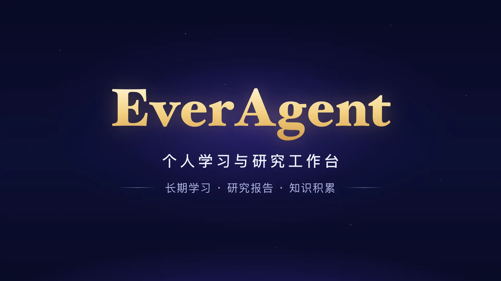

# EverAgent — 个人学习与研究工作台

EverAgent 收录借助 AI Agent 完成的论文精读、技术博客分析、开源项目研究和播客笔记。自 2026 年 3 月起持续积累，涉及 AI、计算机科学、哲学、心理学和生物学，已有 500+ 篇报告和 300+ 个 Wiki 条目。报告保留来源、分析与未解决的问题，便于查阅和继续研究。

这里也整理 Personal Context 的实践：怎样让后续任务中的 Agent 用上这些记录、决定与偏好。

**[阅读研究成果](./docs/REPORT_INDEX.md)** · **[了解 Personal Context](./PERSONAL_CONTEXT.md)** · **[让 Agent 参与研究](./AGENTS.md)**

<picture>
  <source media="(prefers-reduced-motion: reduce)" srcset="./docs/assets/everagent-horizontal.jpg">
  
</picture>

## 最近更新

<!-- AUTO-RECENT:START -->
| 日期 | 报告 | 领域 |
|------|------|------|
| 2026-10-31 | [余一聊 Manus：怎样把任务真正交给 Agent](./podcast-learning/reports/2026-10-28_xiaoyuzhou-ai-lianjinshu_yuyi-manus-delegation.md) | 🎙️ Podcast Learning |
| 2026-10-30 | [模型不变，Agent 如何做得更好：一项 Harness 实验](./ai-learning/reports/paper_analyses/46_evolve_the_harness_2026.md) | 🤖 AI Learning |
| 2026-10-30 | [Personal Context 正交论：哪些积累值得保留，怎样持续维护](./ai-learning/reports/knowledge_reports/PersonalContext正交论_PC构建指南_20261010.md) | 🤖 AI Learning |
| 2026-10-29 | [多设备、多 Agent 怎样共用上下文与续接会话：从 Manus 到可实现的架构](./ai-learning/reports/knowledge_reports/多设备多Agent共享Context与会话续接_Manus实践与架构边界_深度解析_20261029.md) | 🤖 AI Learning |
| 2026-10-27 | [纳德拉谈企业智能：知识、反馈、模型选择与 Agent 治理](./podcast-learning/reports/2026-10-27_bilibili-nadella_enterprise-intelligence.md) | 🎙️ Podcast Learning |
<!-- AUTO-RECENT:END -->

按报告修改日期排列，修订过的旧报告也会出现在这里。[浏览全部报告 →](./docs/REPORT_INDEX.md)

## 研究领域与内容导航

从 Transformer、Raft 共识算法，到柏拉图的洞穴比喻、Milgram 服从实验和昼夜节律，报告按学科和资料来源归档。Wiki 列依次是概念、实体（人物、机构等）和综合分析的条目数，0/0/0 表示该集合没有单独的 Wiki。

<!-- AUTO-OVERVIEW:START -->
| 项目 | 报告 | Wiki(概念/实体/综合) |
|------|------|----------------------|
| 🤖 [AI Learning](./ai-learning/) | 152 篇 | 54/30/1 |
| 💻 [CS Learning](./cs-learning/) | 33 篇 | 24/17/1 |
| 📚 [Philosophy Learning](./philosophy-learning/) | 22 篇 | 20/14/1 |
| 🧠 [Psychology Learning](./psychology-learning/) | 17 篇 | 13/13/0 |
| 🧬 [Biology Learning](./biology-learning/) | 18 篇 | 14/9/0 |
| ⚗️ [AI Practice](./ai-practice/) | 10 篇 | 9/1/0 |
| 🎙️ [Podcast Learning](./podcast-learning/) | 109 篇 | 58/54/0 |
| 🔭 [GitHub Research](./github-trending-analyzer/) | 124 篇 | 0/0/0 |
| 🏄 [Web Surfing](./web-surfing/) | 48 篇 | 0/0/0 |
<!-- AUTO-OVERVIEW:END -->

## 知识怎样积累

研究资料按用途保存在几类文件中（链接以 AI Learning 为例，其他学科目录结构相同）：

- **报告**保留研究问题、来源、分析、结论与局限，推断标注 `[推测]` 或 `[待验证]`。
- **Wiki**整理报告涉及的概念、人物、机构及其联系，可从 [Wiki 索引](./ai-learning/wiki/index.md)按主题回到相关报告。
- **研究地图（MAP）与未解问题**记录已经研究过什么、还有哪些疑问，见[研究地图](./ai-learning/MAP.md)和[未解问题](./ai-learning/wiki/open-questions.md)。
- **证据与复核记录**：2026-10-15 起新增的报告，在同目录 `.quality/` 中附证据账本（关键结论对应来源）和复核记录（由新会话中的 AI 模型对照来源写成，不是人工审核或外部认证）；更早的报告按需迁移。这套检查是质量下限，不保证每个判断都正确。

写作与核验方法见[研究方法论](./METHODOLOGY.md)、[报告流程](./docs/REPORT_WORKFLOW.md)和[质量检查说明](./docs/REPORT_QUALITY_GATE.md)。

## Personal Context

研究做到一半换个 Agent，已经查过什么、做过哪些决定、哪些结论仍有疑问，都需要有地方可以回查。Personal Context 关注这些会影响后续任务的记录，也包括用户确认的偏好和项目约束。这里提供的是设计建议与试点结论，不代表已实现完整的记忆系统。

- [构建指南](./PERSONAL_CONTEXT.md)：从少量记录起步，怎样读取、更新和处理冲突。
- [多设备 Context 案例](./PERSONAL_CONTEXT.md#真实脱敏案例多设备-agent-会话-context)：可公开的实践结果与仍未证明的部分。
- [共享 Context 与会话续接研究](./ai-learning/reports/knowledge_reports/多设备多Agent共享Context与会话续接_Manus实践与架构边界_深度解析_20261029.md)：共用资料与接续运行中任务的区别。

本仓怎样组织指令、让 Agent 按任务读取资料，见 [Context Engineering](./docs/CONTEXT_ENGINEERING.md)。

## 如何阅读与参与

**阅读资料**：直接从报告索引或领域目录进入，无需安装工具。可沿报告中的来源继续查阅，也可从各学科的 Wiki 索引进入概念、人物和机构页，再回到相关报告。

**使用 Agent 参与研究**：在仓库根目录启动 Agent，并保留项目指令加载（[AGENTS.md](./AGENTS.md) 是规则入口，Claude Code 经 `CLAUDE.md` 导入），再给出具体问题或材料。例如：

- “精读这篇论文，解释方法、证据与局限。”
- “结合已有报告，比较这两个开源项目的实现取舍。”
- “整理这期播客的关键观点，核验其中的重要事实。”

**在本地阅读或维护**：

```bash
git clone https://github.com/Everloster/EverAgent.git
cd EverAgent
```

运行研究任务时，模型访问、联网检索和转写服务需另行配置。AGENTS.md 提到的 `eacli` 是维护者的私有命令行工具，公开仓不提供；没有它时，Agent 按 AGENTS.md 做最小降级并记录原因。

维护约定见[安全与协作协议](./docs/PROTOCOL_COMMON.md)。报告索引和 README 自动区块由 `scripts/reindex.py` 生成；介绍动画的源文件与生成脚本在 [`docs/assets/intro/`](./docs/assets/intro/)。

## 资料与使用边界

- **来源与时效**：报告区分来源方主张与分析推断。历史材料的复核程度不一，收录数量不等于通过复核的数量；阅读时结合具体报告的来源、日期与复核记录判断。已有产出的证据类型、验证范围与缺口见 [AI 学习与实践记录](./AI_PROGRESS.md)。
- **公开与私有**：私人对话、设备、账号、网络和访问入口不进入公开仓；通用经验的公开处理方式见 [Personal Context 指南](./PERSONAL_CONTEXT.md#10-私有经验怎样安全进入公开仓)。
- **版权与许可**：学术论文 PDF 仅供个人学习，版权归原作者及出版机构所有；除另有说明外，报告与分析等原创内容采用 CC BY 4.0 许可，详见[免责声明](./DISCLAIMER.md)。
