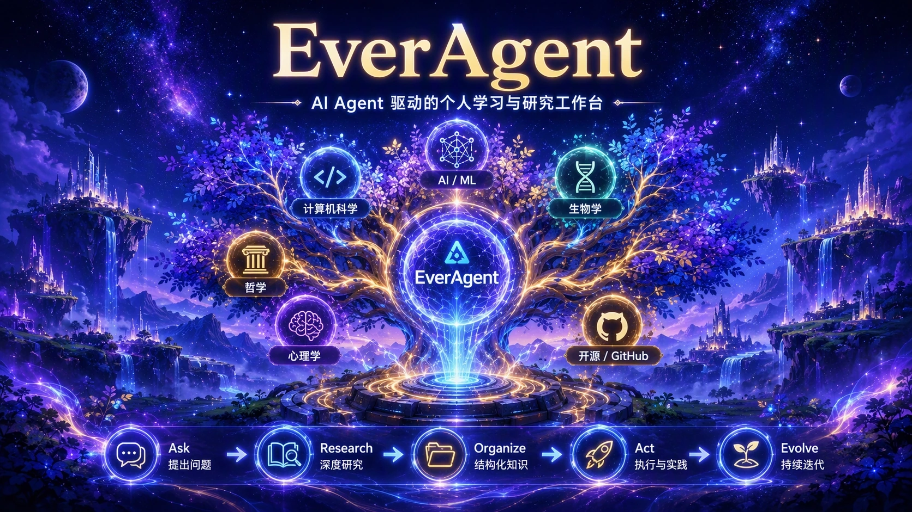
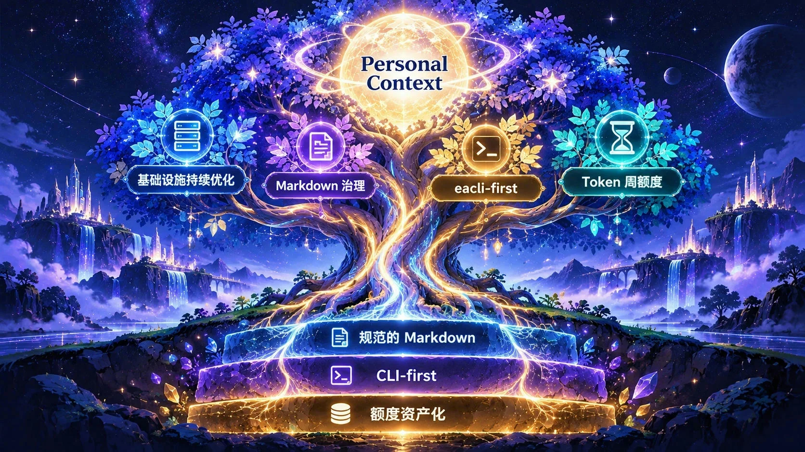

# EverAgent

**开放知识 × 个人上下文**

这里有论文精读、技术博客分析、开源项目研究、播客笔记和小型实验。自 2026 年 3 月起，借助 AI Agent 持续整理，已积累 500+ 篇报告和 300+ 个 Wiki 条目。

另一条实践是 Personal Context：把查过的资料、做过的决定和确认过的偏好记录下来，供下一次任务使用。方法与案例可以分享，个人数据由使用者自己保存。

**[读报告](./docs/REPORT_INDEX.md)** · **[部署学习工作台](./apps/everagent-learning/DEPLOY.md)** · **[构建 Personal Context](./PERSONAL_CONTEXT.md)** · **[学习与实践记录](./AI_PROGRESS.md)** · **[项目网站](https://everloster.com/)**

<picture>
  <source media="(prefers-reduced-motion: reduce)" srcset="./docs/assets/everagent-horizontal.jpg">
  
</picture>

<sub>约 54 秒 · 无声循环 · <a href="./docs/assets/everagent-poster.webp">查看静态全景</a></sub>

## 最近更新

<!-- AUTO-RECENT:START -->
- 2026-11-15 · [常驻 Agent 怎样安全运行：把能力留给模型，把权限留在模型之外](./ai-learning/reports/knowledge_reports/%E5%B8%B8%E9%A9%BBAgent%E5%AE%89%E5%85%A8_%E6%8E%A7%E5%88%B6%E9%9D%A2%E9%9A%94%E7%A6%BB%E4%B8%8E%E6%9D%83%E9%99%90%E4%BA%A4%E9%9B%86_%E6%B7%B1%E5%BA%A6%E8%A7%A3%E6%9E%90_20261115.md)
- 2026-11-15 · [AI 安全评测测到了什么：从拒绝率到构念效度、裁判校准与统计不确定性](./ai-learning/reports/knowledge_reports/AI%E5%AE%89%E5%85%A8%E8%AF%84%E6%B5%8B_%E6%9E%84%E5%BF%B5%E6%95%88%E5%BA%A6%E4%B8%8E%E8%A3%81%E5%88%A4%E6%A0%A1%E5%87%86_%E6%B7%B1%E5%BA%A6%E8%A7%A3%E6%9E%90_20261115.md)
- 2026-11-14 · [AI 行业日报 · 2026-11-14](./web-surfing/reports/ai-news-daily-2026-11-14.md)
- 2026-11-13 · [硅谷101 E258：硅谷创业"修道院"HF0 与 OpenRouter 早期故事](./podcast-learning/reports/2026-11-10_rss-guigu101_e258-hf0-openrouter.md)
- 2026-11-13 · [晚点聊 187：对话 LiberAI 刘松铭——Astra 来袭，00 后物理 AI 创始人看到的胜率](./podcast-learning/reports/2026-11-13_rss-wandian-latetalk_187-liberai-astra.md)
<!-- AUTO-RECENT:END -->

按报告修改日期排列，修订过的旧报告也会出现在这里。[浏览全部报告 →](./docs/REPORT_INDEX.md)

想选下一篇文章或一期节目，可以先翻历史速看表：

| 清单 | 可以看到什么 |
| --- | --- |
| [顶尖技术博客](./web-surfing/TECH_BLOG_UPDATES.md) | 按月份和厂商整理，附原文、中文导读和学习报告。 |
| [小宇宙精选播客](./podcast-learning/PODCAST_UPDATES.md) | 按节目整理，附发布日期、时长、本期主题和学习报告。 |

每次查询更新同一页，保留历史；做过的学习任务也会列出。

## 开放知识

研究涉及 AI、计算机科学、哲学、心理学和生物学，也跟进技术博客、开源项目和播客。每份报告围绕具体问题展开，保留来源、分析和仍未解决的疑问。

<a href="./docs/assets/everagent-poster.webp">
  
</a>

<sub>学习与研究全景 · 点击图片查看大图</sub>

- **读完整分析**：[报告索引](./docs/REPORT_INDEX.md)按日期和领域整理，适合查找新内容或回看旧问题。
- **看代码与实验**：[AI Practice](./ai-practice/)用小型 demo 解释机制，保留真实输出和实验笔记。
- **沿主题继续查**：[Wiki](./ai-learning/wiki/index.md)串起概念、人物和相关报告；[研究地图](./ai-learning/MAP.md)与[未解问题](./ai-learning/wiki/open-questions.md)记录研究进展和下一步问题。这里以 AI 领域为例。

<details>
<summary><strong>按领域浏览：报告与 Wiki</strong></summary>

Wiki 三列数字依次是概念、实体（人物、机构等）和综合分析的条目数；0/0/0 表示该集合没有单独的 Wiki。

<!-- AUTO-OVERVIEW:START -->
| 项目 | 报告 | Wiki(概念/实体/综合) |
|------|------|----------------------|
| 🤖 [AI Learning](./ai-learning/) | 203 篇 | 54/30/1 |
| 💻 [CS Learning](./cs-learning/) | 33 篇 | 24/17/1 |
| 📚 [Philosophy Learning](./philosophy-learning/) | 22 篇 | 20/14/1 |
| 🧠 [Psychology Learning](./psychology-learning/) | 17 篇 | 13/13/0 |
| 🧬 [Biology Learning](./biology-learning/) | 18 篇 | 14/9/0 |
| ⚗️ [AI Practice](./ai-practice/) | 10 篇 | 9/1/0 |
| 🎙️ [Podcast Learning](./podcast-learning/) | 121 篇 | 60/61/0 |
| 🔭 [GitHub Research](./github-trending-analyzer/) | 126 篇 | 0/0/0 |
| 🏄 [Web Surfing](./web-surfing/) | 56 篇 | 0/0/0 |
<!-- AUTO-OVERVIEW:END -->

</details>

## Personal Context

研究做到一半换个 Agent，已经查过什么、做过哪些决定、哪些结论仍有疑问，都需要有地方回查。Personal Context 关注这些会影响后续任务的记录，也包括用户确认的偏好和项目约束。

在这套实践中，EverAgent 保存公开知识，配套私有项目 EverAgent-infra 保存个人资料与环境维护记录。本仓整理其中可以公开的方法和脱敏案例。

<a href="./docs/assets/personal-context-tree.webp">
  
</a>

<sub>个人上下文的实践方向 · 点击图片查看大图</sub>

可以从一个反复遇到的任务、三个普通文件开始：

- `profile.md`：本人确认、会影响任务的偏好。
- `decisions.md`：重要决定、当时的依据与后续结果。
- `boundaries.md`：允许读取哪些资料，哪些动作需要确认。

下一次任务先找相关记录，用完再更新。检查它是否找对了依据、是否仍在引用过期决定，再考虑增加检索或同步服务。

[构建指南](./PERSONAL_CONTEXT.md)提供可照做的示例；[多设备试点](./PERSONAL_CONTEXT.md#真实脱敏案例多设备-agent-会话-context)记录实际结果与尚未证明的部分；[共享 Context 与会话续接研究](./ai-learning/reports/knowledge_reports/多设备多Agent共享Context与会话续接_Manus实践与架构边界_深度解析_20261029.md)解释共用资料和接续任务的区别。目前公开的是方法与试点经验，完整记忆系统仍有待验证。

## 怎样做研究

- **先读材料，再写判断。** 关键结论对应来源，区分原作者的主张、已核实的事实与分析推断。读不到的内容明确说明。
- **需要实验的，就实际运行。** 保存输入、输出与适用条件，让读者知道结论在什么范围内成立。
- **把新认识写回记录。** 报告保留完整分析，Wiki 整理关联，研究地图和未解问题帮助后续任务接着做。

已有报告保留当时的证据与复核记录；新笔记、草稿与报告按用途选择复核，不再统一要求评分和独立Reviewer。收录不等于通过复核，阅读时仍应结合状态、来源、日期与具体论证判断。

方法见[研究方法论](./METHODOLOGY.md)，写作、元数据及按需复核统一见[写作与报告指南](./docs/REPORT_WORKFLOW.md)。已有成果与缺口见 [AI 学习与实践记录](./AI_PROGRESS.md)。

## 实践中留下的经验

- **入口保持短，材料按需读。** 把完整历史塞进每次对话，会增加阅读成本，也容易让旧信息干扰当前任务。
- **先用成熟工具，再补缺口。** 反复遇到、现有工具确实解决不了的问题，才值得增加脚本或流程。
- **格式通过后，还要看实际效果。** 报告要对照原文检查分析是否充分；工具要沿真实使用路径验证。
- **超时后先查结果。** 执行结果可能只是暂时不可见，直接重试可能造成重复操作或重复产出。

这些经验也用于调整本仓的指令与资料组织，见 [Context Engineering](./docs/CONTEXT_ENGINEERING.md)。

## 如何使用

**阅读**：从[报告索引](./docs/REPORT_INDEX.md)或上面的领域目录进入，无需安装工具。报告中的原始来源和相关 Wiki 可以继续引向更具体的问题。

**本地工作台**：想按日期、领域和关键词翻阅报告，可以把[部署 prompt](./apps/everagent-learning/DEPLOY.md#交给-agent-的-prompt)发给 Agent，也可以克隆仓库后在根目录首次构建并启动：

```bash
npm --prefix apps/everagent-learning run build
node apps/everagent-learning/start.mjs
```

打开终端显示的地址，默认是 **http://127.0.0.1:4173/dashboard**。需要 Node.js 20+；首次构建需要 Go 1.27+，之后只运行第二条命令即可阅读。无需 `npm install`、Python、eacli、私有仓或模型账号。[启动说明](./apps/everagent-learning/README.md)也介绍了如何作为 MiniMax Code Mini App 使用。

**用 Agent 参与研究**：在仓库根目录启动 Agent，保留项目指令加载，再给出材料和想弄清的问题。例如：

> 精读这篇论文，解释方法、证据与局限。
>
> 整理这期播客的关键观点，核验重要事实，并联系已有报告继续分析。

<details>
<summary><strong>本地使用与维护</strong></summary>

```bash
git clone https://github.com/Everloster/EverAgent.git
cd EverAgent
```

[AGENTS.md](./AGENTS.md) 是简短入口，Claude Code经`CLAUDE.md`导入。模型、联网与转写按任务需要配置；eacli提供维护者的跨设备与Token Plan能力，部分桥接脚本会调用它，但公开仓的阅读和Go提交器不依赖eacli、私仓checkout或其他设备在线。缺少某项能力时明确说明，不把维护者的私有环境当成公开仓启动条件。

维护约定见[安全与协作协议](./docs/PROTOCOL_COMMON.md)。报告索引和 README 自动区块由 Go `ea-quality index --write` 生成，命令见该协议；配图来源与介绍动画的维护入口见[媒体说明](./docs/assets/README.md)。

</details>

---

私人对话、设备、账号与网络细节保留在私有环境，公开经验的处理方式见 [Personal Context 指南](./PERSONAL_CONTEXT.md#10-私有经验怎样安全进入公开仓)。

原创知识内容采用 CC BY 4.0，原创软件代码采用 [MIT License](./LICENSE)。第三方论文、转写等材料保留各自权利，详见[版权与使用说明](./DISCLAIMER.md)及[播客来源规则](./podcast-learning/COPYRIGHT.md)。
