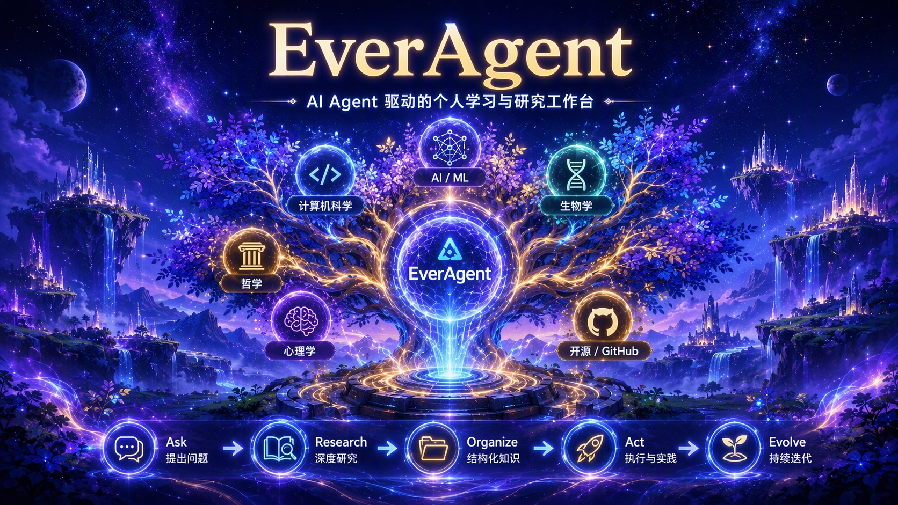

# EverAgent — 个人学习与研究工作台

EverAgent 收录借助 AI Agent 完成的论文精读、技术博客分析、开源项目研究和播客笔记。报告保留来源、分析与未解决的问题，便于查阅和继续研究。

这里也整理 Personal Context 的实践经验：怎样保存知识、项目决定和使用约束，让后续任务用得上这些记录。

**[阅读研究成果](./docs/REPORT_INDEX.md)** · **[了解 Personal Context](./PERSONAL_CONTEXT.md)** · **[让 Agent 参与研究](./AGENTS.md)**



## 最近研究

<!-- AUTO-RECENT:START -->
| 日期 | 报告 | 领域 |
|------|------|------|
| 2026-10-29 | [多设备、多 Agent 怎样共用上下文与续接会话：从 Manus 到可实现的架构](./ai-learning/reports/knowledge_reports/多设备多Agent共享Context与会话续接_Manus实践与架构边界_深度解析_20261029.md) | 🤖 AI Learning |
| 2026-10-27 | [纳德拉谈企业智能：知识、反馈、模型选择与 Agent 治理](./podcast-learning/reports/2026-10-27_bilibili-nadella_enterprise-intelligence.md) | 🎙️ Podcast Learning |
| 2026-10-27 | [大模型推理全链路：服务质量、量化、编译搜索与 Agent 缓存](./podcast-learning/reports/2026-10-27_bilibili-krillinai_llm-inference-stack.md) | 🎙️ Podcast Learning |
| 2026-10-27 | [上下文工程的失效与修复：从长对话到可维护的记忆](./ai-learning/reports/knowledge_reports/Context_Engineering_失败修复与战略性遗忘_深度解析_20261027.md) | 🤖 AI Learning |
| 2026-10-27 | [OpenAI Computer Use：从跨应用操作到可验收的企业任务](./podcast-learning/reports/2026-10-27_bilibili-openai_computer-use.md) | 🎙️ Podcast Learning |
<!-- AUTO-RECENT:END -->

[浏览全部报告 →](./docs/REPORT_INDEX.md)

## 研究领域与内容导航

按学科和资料来源整理，点击项目名可进入对应目录。数量表示已收录的报告与 Wiki 条目。

<!-- AUTO-OVERVIEW:START -->
| 项目 | 报告 | Wiki(概念/实体/综合) |
|------|------|----------------------|
| 🤖 [AI Learning](./ai-learning/) | 152 篇 | 54/30/1 |
| 💻 [CS Learning](./cs-learning/) | 33 篇 | 24/17/1 |
| 📚 [Philosophy Learning](./philosophy-learning/) | 22 篇 | 20/14/1 |
| 🧠 [Psychology Learning](./psychology-learning/) | 17 篇 | 13/13/0 |
| 🧬 [Biology Learning](./biology-learning/) | 18 篇 | 14/9/0 |
| ⚗️ [AI Practice](./ai-practice/) | 10 篇 | 9/1/0 |
| 🎙️ [Podcast Learning](./podcast-learning/) | 108 篇 | 58/54/0 |
| 🔭 [GitHub Research](./github-trending-analyzer/) | 124 篇 | 0/0/0 |
| 🏄 [Web Surfing](./web-surfing/) | 47 篇 | 0/0/0 |
<!-- AUTO-OVERVIEW:END -->

## 知识怎样积累

研究资料按用途保存在几类文件中：

- **报告**保留研究问题、来源、分析、结论与局限，脱离原始对话也能独立阅读。
- **Wiki**整理报告涉及的概念、人物、机构及其联系，方便跨主题查阅。
- **研究地图（MAP）与未解问题**记录已经研究过什么、还有哪些疑问。
- **证据与复核记录**附在较新的重要报告旁，列出关键结论的来源和复核结果。

写作与核验方法见 [研究方法论](./METHODOLOGY.md)、[报告流程](./docs/REPORT_WORKFLOW.md)和[质量检查说明](./docs/REPORT_QUALITY_GATE.md)。已有产出的证据类型、验证范围与缺口汇总在 [AI 学习与实践记录](./AI_PROGRESS.md)。

## Personal Context

研究做到一半换个 Agent，已经查过什么、做过哪些决定、哪些结论仍有疑问，都需要有地方可以回查。Personal Context 关注这些会影响后续任务的记录，也包括用户确认的偏好和项目约束。

[构建指南](./PERSONAL_CONTEXT.md)介绍从少量记录起步，怎样读取、更新和处理冲突；[多设备 Context 案例](./PERSONAL_CONTEXT.md#真实脱敏案例多设备-agent-会话-context)记录可公开的实践结果；[共享 Context 与会话续接研究](./ai-learning/reports/knowledge_reports/多设备多Agent共享Context与会话续接_Manus实践与架构边界_深度解析_20261029.md)讨论共用资料与接续运行中任务的区别。

本仓怎样组织指令、让 Agent 按任务读取资料，见 [Context Engineering](./docs/CONTEXT_ENGINEERING.md)。

## 如何阅读与参与

**阅读资料**：直接从报告索引或领域目录进入，无需安装工具。可沿报告中的来源与 Wiki 链接继续查阅。

**使用 Agent 参与研究**：先让它读取 [AGENTS.md](./AGENTS.md)，再给出具体问题或材料。例如：

- “精读这篇论文，解释方法、证据与局限。”
- “结合已有报告，比较这两个开源项目的实现取舍。”
- “整理这期播客的关键观点，核验其中的重要事实。”

**在本地阅读或维护**：

```bash
git clone https://github.com/Everloster/EverAgent.git
cd EverAgent
```

运行研究任务时，eacli、模型访问、联网检索和转写服务需另行配置。维护约定见 [安全与协作协议](./docs/PROTOCOL_COMMON.md)；报告索引和 README 自动区块由 `scripts/reindex.py` 生成。

## 资料与使用边界

- **来源与时效**：报告区分来源方主张与分析推断。历史材料的复核程度不一，收录数量不代表质量通过数量；阅读时结合具体报告的来源、日期与复核记录判断。
- **公开与私有**：私人对话、设备、账号、网络和访问入口不进入公开仓；通用经验的公开处理方式见 [Personal Context 指南](./PERSONAL_CONTEXT.md#10-私有经验怎样安全进入公开仓)。
- **版权**：学术论文 PDF 仅供个人学习，版权归原作者及出版机构所有，详见 [免责声明](./DISCLAIMER.md)。

早期多 Agent 编排框架保存在 `legacy-v1-multiagent` 分支，当前仓库聚焦学习研究与知识积累。
