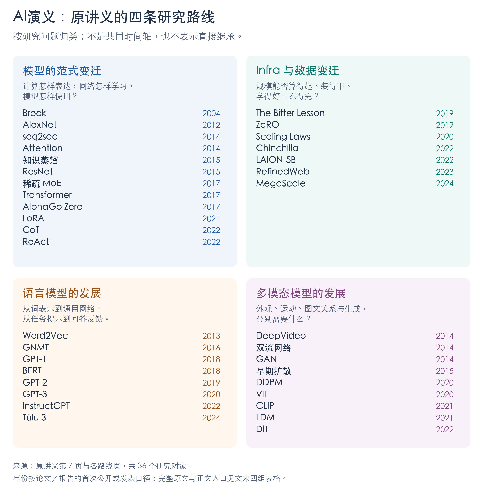

# AI演义·总览｜从计算与表示，到生成和行动

《AI演义》讲义用51页介绍36个研究对象。[^lecture] 这些工作处理的并不是同一道题：有的让程序用上GPU，有的改变语言表示，有的整理训练数据，有的让模型产生图像或依据反馈行动。读它们的联系，需要先分清每项工作改了什么，再看这种改变怎样被后续研究采用。

本系列由总览与31篇展开稿组成。总览串联机制、实验和历史关系，各节链接进入更详细的说明；文末保留 [36个对象的原文与定位](#lecture-mapping)、[跨路线连接索引](#verified-connections)及 [阅读新论文的方法](#new-papers)。例子用于解释，实验与作者观察各有出处。

## 四条路线怎样相交

讲义按模型范式、Infra与数据、语言模型、多模态模型分类。这是研究问题的分组，不是四个先后时代。同一Transformer骨架会进入语言、视觉与生成，GAN与扩散也长期并行探索。[^lecture]

图按讲义第7页及各路线页整理，各框按首次公开或发表年份排列，未画技术继承箭头。[查看原图](paper_assets/ai-yanyi-four-routes.png) · [可缩放版](paper_assets/ai-yanyi-four-routes.svg)。下文按问题衔接，年份有时回跳，例如先讲Chinchilla的预算，再回看更早的ZeRO怎样分担显存。

| 讲义路线 | 本文入口 |
|---|---|
| 模型的范式变迁 | [计算与训练](#conditions)、[语言架构](#language)、[稀疏计算](#paper-sparse-moe)、[反馈与行动](#goals) |
| Infra与数据变迁 | [预算、数据与系统](#resources)、[Bitter Lesson与硬件条件](#lenses) |
| 语言模型的发展 | [词表示、网络与上下文](#language)、[从用户反馈训练](#paper-instructgpt) |
| 多模态模型的发展 | [视频、图块与图文匹配](#vision)、[图像生成](#generation) |

可以顺读，也可以按问题进入：先理解模型如何工作，再查它依赖的数据和计算；关心整体关系时，读 [跨章节的两条完整过程](#connections)。

### 几个反复出现的概念

| 概念 | 含义 |
|---|---|
| 参数、训练、推理 | 参数是可学习数值；训练根据数据和目标更新它们，推理用已有参数处理输入。提示可改变输出而不更新参数。 |
| 表示 | 将输入变成适合处理的数值形式。词向量、图块向量、图像潜网格保留的区别和承担的任务各不相同。 |
| token | 序列中的输入或输出单位。文本可按词或片段分，视觉token可从图块计算；训练token数也不是独立文章或知识条数。 |
| 架构、目标 | 架构安排信息流与运算，目标决定训练鼓励什么。Transformer可用于下一token预测，也可用于图像去噪。 |
| 预训练、后训练 | 先在较广材料上学习可迁移能力，再按任务或行为继续适配；各阶段使用的数据和信号需分别看。 |
| 损失、评价 | 损失用于优化，评价检查所选用途。更善于预测原文，不必然更受用户偏好或更可靠。 |

## 一、计算怎样变成学习能力

### 1. Brook：让通用计算使用GPU

[第01章：Brook：让普通计算用上 GPU](knowledge_reports/AI演义_01_Brook_GPU通用计算_科普讲解_20261104.md)

两列数逐行算“第一列乘2加第二列”，例如`[1, 2, 3]`与`[10, 20, 30]`得到`[12, 24, 36]`。各行独立，可以分给许多计算单元，适合GPU。但2004年前后的接口主要为图形设计，程序员常需将数据装成纹理、把运算写成着色器，再用绘图触发。类C着色器语言改善了算式表达，数据搬运和调用仍费力。[^brook]

Brook把批量记录称为stream，对每条记录执行的规则称为kernel，跨记录求和等汇总称为reduction。程序员描述这些数据和运算，编译器与运行时将其映射到图形接口。这里的数据流与聊天输出的流式传输含义不同。

抽象降低了编程负担，没有消除计算依赖。若下一步必须等前一步，不能凭语言自动并行；传入、启动和取回数据也有成本，需要测完整任务。Ian Buck与Stanford团队的工作后来被NVIDIA历史回顾列为CUDA前驱，属于编程抽象与工业化的联系，不能据此说AlexNet直接使用Brook。[^gpu-history]

### 2. AlexNet：数据、训练方法与GPU共同作用

[第02章：AlexNet：从像素学到图像特征](knowledge_reports/AI演义_02_AlexNet_图像识别突破_科普讲解_20261104.md)

猫的姿态、光线与背景改变时，像素数值会大幅变化。2012年AlexNet沿已有CNN路线，用共享滤波器处理局部图像，再逐层组合特征；类别误差同时训练分类头和前面的表示。局部性是结构设计，具体权重从数据学习。[^alexnet]

竞赛提供约120万训练图、1000类，模型约6000万参数，ReLU与GPU实现帮助训练。两张各3GB显存的GTX 580运行约5–6天，显存和通信还影响分布与连接方式。数据增强增加裁剪、翻转等变化，Dropout减少对固定单元组合的依赖，分别处理计算与泛化问题。

冠军15.3%是七模型集成的Top-5测试错误率，第二名26.2%，其中两模型还用额外数据预训练。它既非单模型结果，也不是Top-1错误率。Krizhevsky、Sutskever与Hinton的团队将数据、网络与实现结合成有效训练，留下了两个后续问题：更深网络能否学会，部署是否必须运行同样大的组合。

### 3. ResNet：让深层网络学习修正

[第03章：ResNet：深网络为什么难训练](knowledge_reports/AI演义_03_ResNet_深层网络如何训练_科普讲解_20261104.md)

普通网络加深后，连训练集都可能更差，这首先是优化问题，不同于训练很好、测试退步的过拟合。2015年ResNet在一组层旁增加保留输入的通路，让带参数分支学习修正。教学算例中，特征0.6加修正−0.1得到0.5；真实网络处理整组特征，原版相加后还有ReLU。[^resnet]

各层修正由最终任务误差共同训练，没有逐层人工答案，也不是冻结浅网络后追加补丁。结构使保留已有表示更容易，仍不保证任意深度都好：CIFAR-10的1202层网络训练错误低于0.1%，测试却不如110层。优化可行以后，泛化仍需检查。

微软团队的残差连接后来被Transformer明确采用并引用，进入注意力和前馈子层外。[^transformer] 这是可以指出具体位置的组件迁移，视觉与语言的内部计算不同，连接方式仍能复用。

### 4. 蒸馏：用教师行为训练便于部署的学生

[第04章：知识蒸馏：把教师的预测教给学生](knowledge_reports/AI演义_04_知识蒸馏_从教师到学生_科普讲解_20261104.md)

十个模型集成可能比一个准确，每次运行十份也更贵。Hinton、Vinyals、Dean的2015年蒸馏工作让学生学习教师或集成的预测分布，学生可有不同结构。真实标签只指出猫，教师还能提供其他候选间的相对判断，例如狗比汽车更像。较高温度使低概率选项参与学习，有标签时再与正确答案共同约束。[^distill]

语音实验中，十模型帧分类准确率61.1%，蒸馏单模型60.8%，同规模直接训练基线58.9%。这支持转移部分集成收益，没有实测十倍提速，也不是无损复制所有能力；容量、教师和迁移输入都有影响。

2006年已有模型压缩前驱，2015年论文推进了软目标、温度与实际任务。ResNet改善怎样训练，蒸馏安排训练所得能力怎样部署，二者解决不同环节。

## 二、从词表示到上下文任务接口

### 5. Word2Vec：学习可复用的词向量

[第05章：Word2Vec：词向量是怎样学出来的](knowledge_reports/AI演义_05_Word2Vec_词向量怎样学出来_科普讲解_20261104.md)

给苹果和梨编号，只能找到词条。若文本中它们常出现在类似上下文，模型可以用预测练习将用法关系写入向量。2013年Mikolov、Chen、Corrado与Dean的Word2Vec，以CBOW平均周围词向量预测中间词，以Skip-gram从当前词预测邻词，文本位置提供训练答案。[^word2vec]

词向量和神经语言模型早已存在，本篇的简化计算使更多文本、更高维度可处理，并借助DistBelief分布式CPU训练扩大规模。在相同3.2亿训练词、8.2万词表、640维条件下，Skip-gram语义类比较好，CBOW句法类比较好；填空实验Skip-gram单独48.0%，与循环语言模型组合58.9%，显示部件和完整任务能力的差别。

此时复用的是静态表。“苹果手机”与“吃苹果”若共用词条，查出的初始向量仍相同，模型不会因当前句子自动换词义。后续需要能处理整段上下文的网络。

### 6. seq2seq与Attention：生成时怎样访问源句

[第06章：seq2seq 与 Attention：读一句话，再生成另一句话](knowledge_reports/AI演义_06_seq2seq与Attention_模型怎样翻译一句话_科普讲解_20261105.md)

`The black cat is sleeping`译为`Le chat noir dort`，词序与长度都变了。2014年Sutskever、Vinyals与Le用LSTM编码器读入源句，交接最终状态，解码器逐步生成直到EOS。固定尺寸状态连接不同长度输入输出，整个系统用对应译句联合训练。[^seq2seq]

将源句倒序、目标句保持原序，可缩短部分对应词的计算距离。五个倒序LSTM集成34.81 BLEU，超过统计基线33.30；单模型30.59。结果体现端到端学习与数据、搜索、实现的共同作用，也说明固定状态并非所有长句必败。

Bahdanau、Cho与Bengio让双向循环编码器保留各源位置表示，解码每步按已有状态打分、加权汇总，重新读取所需信息。打分不预知未生成的正确词，读取机制与翻译共同学习。[^bahdanau] 它改善了长句中人物身份等错误，但完整测试最佳28.45 BLEU仍低于统计系统33.30，无未知词子集的成绩不能外推为全面胜出。

两者不是按叙述顺序发表：Bahdanau首发2014-09-01，Sutskever为09-10，所用门控单元也不同。Attention放宽访问方式，未知词、数据分布与读取成本仍在；两套系统仍有循环状态依赖。

### 7. GNMT与Transformer：翻译系统与并行计算

[第07章：GNMT 与 Transformer：翻译系统与并行架构](knowledge_reports/AI演义_07_GNMT与Transformer_从翻译系统到并行架构_科普讲解_20261105.md)

把黑猫译成`Le chat dort`会漏掉颜色，罕见名字可能超出词表，等待太久又影响服务。吴永辉等的2016年GNMT将8层编码器、8层解码器LSTM、残差、WordPiece、长度归一化、覆盖惩罚及整数推理组成系统，分别处理训练、词表示、搜索与执行。词片仍可能遇到未知字符，覆盖惩罚也不保证完整传达意思。[^gnmt]

500个英法例子的8模型集成人评中，强化学习使BLEU从40.35升到41.16，0–6的人评分却从4.46到4.44，未显示明确改善，后续生产数据实验未采用该精调。自动目标与用户判断需要分开。

GNMT已有批次、矩阵和流水并行，同句状态仍沿词序传递。2017年Transformer让同层各位置根据上一层输入相互读取，计算cat的本层输出无需等待black的本层输出。Q与K匹配形成权重、汇总V，多头提供不同读取关系，位置编码、前馈、残差和LayerNorm一起构成网络。[^transformer]

训练时正确译文已知，输入右移并遮住未来，可批量预测各位置；预测noir时只能读此前目标词，却能读完整源句。生成时未来未知，仍须产生词片再续写，不能把训练并行理解为原始Transformer一次生成整句。

普通注意力两两匹配，相关计算随长度平方增长，计算优势有句长与表示维数条件。GNMT的词片与搜索经验也继续被引用：Transformer采用WordPiece和长度惩罚，BERT也引用GNMT的WordPiece。[^transformer][^bert] 架构变化与具体部件复用同时发生。

### 8. GPT-1与BERT：复用整套上下文网络

[第08章：GPT-1 与 BERT：把预训练网络用于不同任务](knowledge_reports/AI演义_08_GPT1与BERT_预训练怎样迁移到不同任务_科普讲解_20261105.md)

黑猫在沙发上睡觉这句话，可以翻译、判断是否蕴含“有动物在睡觉”，也可回答地点。2018年GPT-1先在书籍做下一词片预测，用单向Transformer学习上下文；随后将任务文本排成序列，接分类层，再按各任务标签微调，每项从共同起点得到自己的权重。[^gpt1]

表5中多任务混合指标平均由无预训练59.9到完整方法74.7，不是统一准确率；RTE却为56.0%，低于对照61.7%。可迁移能力有效但不均匀，这条路线也承接更早语言模型预训练。

BERT同样预训练再微调，但用双向编码器从左右文恢复被选词片，另以NSP判断两段是否原本相邻。它不是编码器加解码器，也不通过NSP生成下一句。[^bert] 问“猫在哪里”时，可以为段落各位置预测起终点，从原文抽出`the sofa`，SQuAD主要评价这种片段抽取。

在均去掉NSP、Base规模和数据等一致的配方比较中，双向MLM的SQuAD验证F1为87.9，左到右语言预测77.8。它支持该任务上双向预训练的价值，总榜仍受数据和训练差异影响，不能只归于方向开关。

OpenAI与Google AI Language的两条方案使复用对象从词表扩展为网络。下一步的变化发生在任务接口：是否每换任务都要再训练参数。

### 9. GPT-2与GPT-3：用上下文表达任务

[第09章：GPT-2 与 GPT-3：用上下文说明任务](knowledge_reports/AI演义_09_GPT2与GPT3_任务怎样进入上下文_科普讲解_20261105.md)

将黑猫句子后接`Q: Where is the black cat sleeping? A:`，可以把续写位置安排成回答。GPT-2研究这类任务条件能否从文本学习中获得。WebText约40GB，主要来自Reddit用户推荐的外链网页，非直接把评论当语料。[^gpt2]

`TL;DR:`使摘要的三项ROUGE F1平均由15.03到21.40，但取文章前三句有31.55；CoQA约55 F1，也可能靠“问谁就找个人名”等浅层线索。提示改变行为，不等于任务已可靠完成。

GPT-3分别测试无演示、一个演示和多个演示，均不更新参数。GPT-2的zero-shot主要指无任务参数更新，部分实验其实提供示例，两篇定义不可按字面混同。[^gpt3] 黑猫前先演示“狗在桌下→under the table”，可说明既找地点也只输出短语，改变的是输入和本次表示，非跨会话永久记忆。

GPT-3有1.25亿至1,750亿参数的8档，最大模型CoQA验证由零示例81.5到少示例85.0 F1；WiC用32示例仅49.4%，LAMBADA还出现单示例差于零示例。效果受任务、格式与模型影响。

各档仍训练3,000亿token，包含网页、书籍和维基百科，570GB只指清洗Common Crawl。论文未给GPT-3本体跑监督微调对照，也因评测过滤程序错误需事后分析污染，不能据此说提示全面胜过微调。

贡献记录显示数据、训练系统、规模研究与评测共同参与：Mann、Radford等处理数据，Brown、Ryder等推进模型设施，Kaplan、McCandlish等指导规模。下一节从这里进入预算与系统；而预测文本尚未直接表达用户目标的缺口，会在InstructGPT中继续研究。

## 三、预算、数据与训练系统

### 10. Scaling Laws与Chinchilla：预算怎样分给模型和数据

[第10章：Scaling Laws 与 Chinchilla：怎样分配训练预算](knowledge_reports/AI演义_10_ScalingLaws与Chinchilla_算力预算怎样分配_科普讲解_20261105.md)

以密集模型的简化成本估算，10亿参数处理200亿token，与20亿参数处理100亿token，参数乘训练量相同，质量却需实验决定。2020年Kaplan、McCandlish等发现，在其他因素未成瓶颈的所测范围，下一token损失随参数、数据和计算呈较规律的变化，可用小实验估计更大训练。[^kaplan] 该损失不等于所有下游能力。

较大模型有时以更少样本达到同一损失，因此把小模型训练到收敛未必最省总计算；固定预算仍有合适规模，不是参数越多越好。2022年Hoffmann、Borgeaud、Mensch、Sifre等的Chinchilla重测400多个模型，同时调整规模、训练长度和学习率衰减，发现参数与token宜更均衡地增长。[^chinchilla] 长训练的中途结果不等于妥善安排的短训练，这会影响配比判断。

参数与训练量各翻倍，主要计算约四倍。在论文所述同训练FLOPs下，Gopher的2800亿参数／3000亿token改为Chinchilla的700亿／1.4万亿token，57学科MMLU五示例平均从60.0%到67.6%，仍有任务未改善。优化器、数据配比和tokenizer也变化，不能把全部增益只归数据量。

两篇研究将资源规划变成经验问题。训练FLOPs相同不代表时间、费用相同，较小模型后续服务可能更便宜，训练最优与长期使用最优需各自核算。

### 11. ZeRO：分担重复的训练状态

[第11章：ZeRO：把训练状态分给多张 GPU](knowledge_reports/AI演义_11_ZeRO_多卡怎样分担训练显存_科普讲解_20261105.md)

15亿参数半精度权重约3GB，混合精度Adam还需梯度、主权重与优化器统计，仅模型状态就约24GB，未含激活和临时空间，一张32GB卡仍可能不够。[^zero] 普通四卡数据并行各存全套，设备增加不自动减少每卡占用。

Rajbhandari、Rasley、Ruwase、He的ZeRO按阶段分片：先优化器，再梯度，最后参数。按同一四卡账本推算，每卡持续保存状态由24降为10.5、8.25、6GB，均为公式算例而非实测峰值。

第三阶段各卡仍可算自己的完整样本，逐层临时收齐参数，汇总梯度后由分片负责人更新。减少长期副本需要通信和调度，激活及聚合缓冲仍占空间。600亿参数配置中，将激活检查点搬到CPU虽省显存却降低吞吐，对更大且原本不能运行的模型又可能必要。

2019年首发、所读2020年5月版的ZeRO-100B实现前两阶段和其他优化，配合模型并行在400张V100上执行到1,700亿参数；完整第三阶段、万亿容量分析不能当作同版已完成实验。前两位作者同等贡献，微软团队将其接入DeepSpeed。它早于Chinchilla，这里按预算与可执行性的关系衔接。

### 12. RefinedWeb：通过训练结果检验数据处理

[第12章：RefinedWeb：筛选与去重怎样影响训练数据](knowledge_reports/AI演义_12_RefinedWeb_网页怎样变成训练数据_科普讲解_20261105.md)

2023年RefinedWeb引用Chinchilla的数据需求，检验网页能否经筛选成为有竞争力的预训练来源。[^refinedweb] 一篇猫的文章可能同时有导航、广告、转载与重复抓取，文件增加未必增加独立信息。

流程从Common Crawl提正文、检查语言格式，先每组近重复文档留一篇，再切掉跨文档重复长片段。后者可能断句或误删有用说明，需要看训练效果，而不只看文本整洁。

同架构、训练与评测、1B模型处理27B token时，六项零样本平均准确率为RefinedWeb 56.2%、The Pile 53.4%、C4 55.7%，分别高2.8与0.5个百分点。对OSCAR-22.01增加过滤却由52.7%降到52.3%，所以规则需适配来源、误删、剩余规模与训练遍数，不能推出精选材料无用或删得越多越好。

TII等作者将采集、抽取、识别和去重组合后，通过训练选择配方。自动化扩大处理范围，样本检查、规则修正与计算资源仍是工作的一部分。

### 13. LAION：让图文训练材料可取得、可检查

[第13章：LAION：用已有模型筛选图文数据](knowledge_reports/AI演义_13_LAION_图文怎样变成训练数据_科普讲解_20261105.md)

LAION-5B在2022年公开，早于RefinedWeb。CLIP已展示图文预训练，完整原训练集却不可得，外部研究还需可获取的数据。[^laion]

网页狗在雪地跑的照片，配“一只狗在雪地奔跑”可能有用，配“限时促销”则不一定。LAION从Common Crawl元数据取图片地址与替代文字，下载后用已有CLIP筛相关性，经检查留下58.5亿配对，公开元数据和工具。它主要选择已有配文，不是逐图另写说明，相关也不保证数量和动作全对。

固定ViT-L/14并累计处理340亿次样本时，LAION-2B-en的ImageNet零样本准确率75.40%，LAION-400M为73.90%。累计次数包含重复，较小模型和较少训练量下也有更大数据未赢的情况，规模需要匹配预算。

公开内容主要是链接、文字、尺寸和检测分数，不等于取得每图版权或安全保证；检索已有图与另训扩散生成也不同。Schuhmann、社区研究者及支持机构分担方案、采集、分布式处理、训练、评测和资源，开放改善研究可得性，未免去大训练成本与维护。

这是一条模型与数据回路：CLIP参与筛选，数据支持OpenCLIP再训练，筛选器的盲点也可能随之传递。

### 14. MegaScale：让万卡共同训练持续运行

[第14章：MegaScale：让万卡训练持续运行](knowledge_reports/AI演义_14_MegaScale_万卡怎样协同训练_科普讲解_20261105.md)

独立运行万份任务，与万卡更新同一个模型不同。后者计算相互依赖，迟到与故障会使大量进程等待。ByteDance与北京大学的2024年MegaScale结合数据、流水线、张量并行，以及ZeRO状态分担，再安排通信与计算重叠。[^megascale]

它也改模型与优化器，如并行Attention/MLP、更大batch减少流水线气泡，另做收敛检查。在1750亿参数、12,288 GPU和相同batch的性能对照中，MFU由41.2%到55.2%，高14个百分点、约1.34倍。MFU反映模型吞吐相对计算潜力，不能解释成其他卡都闲着。

一项越跑越慢的排障中，带宽未明显下降，垃圾回收和代码抖动却使进程到达同步点的时间分散。通信内的等待可能来自更早执行，需沿时间线找起点。

另一数周生产作业经历100多次重启，通过暂停、诊断、隔离、补节点和恢复checkpoint继续训练，有效训练时间率超过90%。它是长期运行指标，既非无停顿热换卡，也不同于前面的MFU实验。资源规划、状态分片、数据与可靠执行在此汇合。

### 15. 稀疏MoE：按输入选择少量专家

[第15章：稀疏 MoE：每个输入只计算少数专家](knowledge_reports/AI演义_15_稀疏MoE_大模型怎样只计算一部分_科普讲解_20261105.md)

回到2017年1月、Transformer公开之前，Shazeer等在LSTM语言系统中扩大稀疏专家混合。[^moe] 前层为每个文本位置形成上下文向量，门控选少数前馈专家、加权合并输出，再交后层；专家是参数子网，不是各自写答案的聊天模型。

门控与专家联合训练，热门专家可能获得更多训练后继续热门，因此分别约束混合权重和输入负载。专家增加还会使每个批量碎片化，作者聚集多设备、多时间位置发往同一专家的输入，让参数留原处、主要交换输入输出，才能将少算术转成效率。

1 Billion Word训练10轮，专家由4增至4,096、每位置仍用4个时，前向计数840万到890万，困惑度45.0到34.1。计数不含softmax，不能把专家容量约千倍换成费用千分之一。另一1,000亿词新闻语料上，65,536到131,072专家却使困惑度28.9到29.2，单GPU效率也下降。

MoE的容量、激活计算、batch、通信与数据需共同选择。这与Brook的计算粒度问题相通，也与ZeRO状态保存、MegaScale协作属于不同层次，而非按本文顺序相继替代。

### 16. LoRA：学习与保存任务增量

[第16章：LoRA：训练一份小的参数更新](knowledge_reports/AI演义_16_LoRA_少量参数怎样适配新任务_科普讲解_20261105.md)

对话摘要需记最终会议时间，既可输入说明，也可用对话与参考摘要训练。LoRA冻结基座，在选定线性层旁增加两个小矩阵组成的更新，输入经过原路径和增量后相加。小支路利用完整网络，无须独立学会整个任务。[^lora]

4,096×4,096权重的完整更新约1,678万参数，经8维中间空间的两矩阵约6.6万，只限制更新秩，原路径仍计算。GPT-3 175B的SAMSum中，470万可训练参数LoRA三项ROUGE超过全量基线，其他任务和更大秩未必继续改善，分数也不保证每个事实正确。

某配置每任务约350GB完整权重可改存35MB增量，但仍需共享基座；训练显存约1.2TB到350GB，缩减比例不同。固定任务可将线性更新合入权重，动态多任务仍有切换和批量安排。带非线性的Adapter通常不能同样合并。

ResNet的保留加修正可帮助理解，结构却不等价；Diffusion适配是后续应用，非本篇语言实验。个人记忆也是节目设想：稳定摘要习惯与可查询、更新、追溯、删除的会议记录要求不同，原论文没有验证完整长期记忆系统。

| 方法 | 重新安排的对象 |
|---|---|
| 蒸馏 | 学生的监督与部署模型形态 |
| ZeRO | 设备间训练状态保存和通信 |
| 稀疏MoE | 每个输入调用的专家计算 |
| LoRA | 适配时学习和保存的更新 |

这些方法节省的账目不同，组合时需保留各自条件，不能将缩减倍率直接相乘。

## 四、反馈、推理与任务行动

### 17. AlphaGo Zero：搜索与对局怎样提供训练反馈

[第17章：AlphaGo Zero：从搜索与自弈中学习下棋](knowledge_reports/AI演义_17_AlphaGoZero_不靠棋谱怎样学会下棋_科普讲解_20261105.md)

此前AlphaGo已有棋谱监督、自弈强化学习和搜索。2017年Zero进一步撤掉棋谱起点，从随机权重自弈。[^alphago] 残差主干读取棋盘与历史，策略头建议落子，价值头估计当前方胜负。

搜索沿候选应手展开，在新节点调用网络，将评价与访问次数回传树中；每步1,600模拟不是1,600整盘或向后1,600手。搜索后访问分布给策略训练目标，终局输赢给价值目标。树统计回传与参数梯度更新是两回事，搜索期间权重固定；候选也需对弈晋级才能接替当前网络。

三天版36小时学习曲线超过Lee，72小时后100局比赛100–0；另从随机权重训练四十天的大网络对Master为89–11，两者对手不同，均采用每方2小时等条件。4 TPU是对弈搜索配置，非全部训练资源。

监督对照更会猜职业落子，准确率54.3%，自弈版49.0%，后者胜负判断和棋力却更好。训练损失权重仍不同，不能推出人类数据普遍无用。规则、可模拟后果和明确输赢仍是Zero的基础，开放语言任务常缺这样的裁判。

### 18. InstructGPT：从示范与偏好学习回答

[第18章：InstructGPT：用示范和偏好训练语言助手](knowledge_reports/AI演义_18_InstructGPT_模型怎样学会按要求回答_科普讲解_20261105.md)

把通知改成三句，既要保留事实又要遵守格式，不应编闭馆原因，难用单一规则完整评价。Ouyang等的2022年InstructGPT在GPT-3继续训练，应用并扩展既有RLHF路线。[^instruct]

SFT学习人工示范，奖励模型学习同请求的回答排序，PPO让回答模型根据该评分继续优化。每轮策略优化中RM和偏离参照固定，回答策略及辅助价值模型更新；不是所有模型边互评边同时改变。KL限制分布偏离，混合预训练数据则帮助保留旧能力，作用不同。

指定提示与人评中，13亿InstructGPT比1,750亿GPT-3更受偏好，显示任务行为对可用性的影响，没有证明小模型知识或全部能力更强。传统任务仍有回退，也会顺“冥想后为什么吃袜子”的错误前提编理由。

请求分布、研究者指南和标注者判断共同定义训练中的好回答，更会遵循指令还可能提高有害请求的执行。偏好需与事实、任务和其他能力分别验证。

### 19. CoT：让中间结果进入后续生成

[第19章：CoT：先生成中间步骤，再回答问题](knowledge_reports/AI演义_19_CoT_中间步骤怎样帮助模型作答_科普讲解_20261105.md)

23个苹果用20个、再买6个，先剩3个再得9。CoT的Figure 1用此例展示普通提示答27、带步骤示范答9，单例说明方法而非发生率。2022年Wei、Wang等将少量示例改为“问题、步骤、答案”，参数不变，新题步骤由模型自己生成。[^cot]

已写的“剩3个”成为后续上下文，既可帮助分解，也可传播错误。无信息点号或先答后解释未得同样收益；点号按算式字符数构造，非严格等token、等计算实验，后写解释也不能影响已产生答案。

GSM8K 1,319题，PaLM 540B、8示例、贪心解码且无计算器，准确率17.9%到56.9%，高39.0个百分点；简单SingleOp仍94.1%，没有改善。模型、任务与示例限定收益。

苹果派反例将“剩14块”解释为“吃14块”，最终数碰巧对。步骤可查错，却不必忠实揭示内部原因。提示、参数训练、运行时计算是不同环节；后来的零示例逐步提示和多次投票各有独立研究。

### 20. ReAct：让工具返回改变下一步

[第20章：ReAct：让下一步行动用上外部反馈](knowledge_reports/AI演义_20_ReAct_模型怎样边查边想_科普讲解_20261105.md)

查询Apple Remote最初控制的程序及另一控制设备时，模型先得Front Row，再因查找失败返回候选，改查Front Row (software)，最终答键盘功能键。Act-only在同图查询后却答yes。2022年姚顺雨、Narasimhan与Princeton、Google Research作者将推理、动作与观察交错组织，研究任务如何推进。[^react]

推理是模型写的计划，动作是执行请求，观察来自工具返回。主要实验使用冻结模型和少量轨迹示范，交互改变上下文，不自动更新参数；另做微调才把轨迹用于训练。

PaLM 540B中，ReAct比CoT的FEVER由56.3%到60.9%，HotpotQA却由29.4%降到27.4%。搜索失败、错实体和重复操作都会损害结果，结合多次CoT采样有时改善，也增加计算。

文字家务与模拟购物中，推理可维护子目标与完成状态，未要求每步长篇解释。可见轨迹不保证正确，结束动作也非完成证明，模拟购物更不涉及付款。真实系统仍需安排隐私与权限，基准不能替代这些条件。

### 21. Tülu 3：公开训练过程与得失

[第21章：Tülu 3：公开后训练的数据、过程与得失](knowledge_reports/AI演义_21_Tulu3_后训练配方怎样起作用_科普讲解_20261105.md)

Ai2与华盛顿大学Lambert等在2024年发布基于Llama 3.1的Tülu 3，公开数据、代码、中间模型及评价。所读2025年4月v5先整理数据，再SFT、DPO、RLVR；只数参数训练有三阶段，405B扩展不全属首版。[^tulu]

用一道教学题区分反馈：原有12支彩笔，新买两盒、每盒6支。SFT给模型一份合格回答，让它学习示范；DPO给出候选之间的偏好，让它学习取舍；RLVR则让模型先作答，再检查结果是否为24支，或是否满足指定条件，据此更新参数。实际RLVR为数学与可验证指令，没有在这套配方执行代码训练。

偏好可能奖励好听但错误的表达，最终答案也不验证过程。Figure 28问笔长并要求两个词，模型只写两个词，满足检查却未答题。

Table 23中8B GSM8K八示例答案匹配从DPO 84.3到RLVR 87.6，高3.3个百分点；70B仍93.5，8B六安全任务平均87.2到85.5。开发评测外还需新题，论文没有unseen安全评价，长上下文、多轮和工具Agent也未充分覆盖。

这些章节改变不同对象：后训练更新参数，CoT组织生成过程，ReAct取得环境信息。公开材料使各阶段更容易检查，不等于本报告已复现训练。

## 五、时间、图块与图文对应

### 22. DeepVideo：检验连续帧的增量

[第22章：DeepVideo：连续帧怎样参与视频分类](knowledge_reports/AI演义_22_DeepVideo_模型怎样利用视频时间信息_科普讲解_20261105.md)

跳绳定格可见器材与姿态，连续帧才显示转绳和起跳。2014年Karpathy、Toderici等建设Sports-1M并比较时间输入：100万YouTube视频、487类，自动文字标签可能整段错，也可能在正确视频中抽到采访或比分牌。[^deepvideo]

Early Fusion第一层合看10帧，Late Fusion先处理相隔15帧的两图再合并，Slow Fusion逐层汇合，均为RGB视频分类，非音画文字多模态对齐。

20万测试视频的Video Hit@1为单帧59.3%、Slow 60.9%，多1.6个百分点；Early 57.7%，四CNN集成63.9%。单帧每次只看一图，评测仍取20个clip、各4次裁剪翻转并平均，能积累多个时刻外观。平均不保留clip顺序，连续片段表示与长程时序是不同问题。

抛接棒杂耍AP增加0.12，短道赛车下降0.07，是0–1分数的绝对差，非首选命中率。作者认为外观已能区分类别、相机运动又干扰判断，尚未隔离各原因。

低清全景与清晰中心两路在其实现中提速2–4倍；Sports-1M迁移UCF-101、调顶部三层为65.4%三折准确率，从头训练41.3%，数据重叠未完全排除。原文也未明确主实验用ImageNet权重，已报告的迁移是Sports-1M→UCF-101。时间信息、数据与成本需一起看。

### 23. 双流网络：先提供显式运动

[第23章：双流网络：分别学习外观与光流](knowledge_reports/AI演义_23_TwoStream_外观与运动怎样共同识别动作_科普讲解_20261105.md)

Simonyan与Zisserman的2014年双流分别以RGB和预计算光流训练空间、时间CNN，再融合类别分数。[^two-stream] 光流估计对应内容移到哪里，水平、垂直形成两张数值图；图像相减只显示同位置颜色变化，不能代替位移定义。

时间流主要堆叠10组光流、20通道，空间流借用ImageNet预训练；时间网络还共享前层、分别保留UCF-101与HMDB-51分类头，用辅助数据减少小数据训练困难。

UCF-101首划分，从头11帧RGB Slow Fusion 56.4%，减均值的十组光流81.0%。表示有帮助，光流也已花额外算法与计算，非等总成本对照。正式三划分平均中，双流SVM在UCF-101为88.0%，强手工方法87.9%；HMDB-51为59.4%，低于61.1%、66.8%的更强手工组合。

敲锤与头部按摩、刷牙混淆，作者分别联系到人脸外观和手的上下运动，属于观察解释。光流不会随分类误差更新，前置计算与存储也有成本；减均值只简单补偿相机运动，局部窗口和最终平均仍未建模完整活动顺序。

### 24. ViT：将图块交给Transformer

[第24章：ViT：用图块序列识别图像](knowledge_reports/AI演义_24_ViT_图像怎样变成Transformer输入_科普讲解_20261105.md)

2020年ViT尽量保留标准Transformer，用图像块形成输入。224×224 RGB按16×16切出196块，共享线性投影后加分类标记和位置表示，形成197位置的序列。[^vit] 图块未预先标为猫耳或尾巴，它们由像素计算而来。

自注意力交换位置内容，分类标记汇集信息，再按图像标签训练整个网络，无逐块部位监督。这是编码已有图块，不像自回归语言模型逐位置生成。

CNN写入局部与共享等视觉偏好，ViT减少部分约束，更多关系需从数据学。统一384分辨率微调时，ImageNet预训练的B/16 77.91%，大L/16 76.53%；约3.03亿图JFT预训练后分别84.15%、87.12%。[^vit-scale] 训练计划也不同，不能推断一个固定数据门槛。

大预训练支持分类迁移与计算优势，但资源不等单图延迟，也未各项领先；图像更大、块更多，会增加全局注意力成本。它没有由分类实验统一全部视频与图文任务。

讲义“让数据适应模型”指出输入改造。Uszkoreit同时署名Transformer与ViT，ViT共同指导标记却在Dosovitskiy、Houlsby名下，不能由讲义称呼推定私人指导关系。[^vit-lecture]

### 25. CLIP：配对监督与语言分类接口

[第25章：CLIP：用图文配对学习匹配，再用文字指定类别](knowledge_reports/AI演义_25_CLIP_图文怎样学会相互匹配_科普讲解_20261105.md)

夕阳飞鸟照片与提及它的配文共同出现，即使无对象框也有训练线索。[^clip-lecture] CLIP分别编码图与文、投影到可比较空间，用同批原始配对与其他配对作对照。生成类别描述的文本向量后，可将其作为分类器权重与图片比较，换类别无需重训视觉主干。[^clip]

4亿对预训练仍是基础，零样本只指无目标任务专门训练样本，不表示未见相关概念。候选不合适时最高分也会错，整体语义匹配不保证计数、距离和细微关系。

零样本ImageNet Top-1 76.2%达到原ResNet-50水平，非当时最强模型；与ResNet-50特征上监督线性分类器比，在27任务赢16个。若CLIP也用目标标签训练线性分类器，那是另一种线性探测，不能合并为一个“无需标注”的成绩。

视觉侧可选ResNet或ViT，文本侧是Transformer，但原文从零联合训练，不只是拼接现成GPT与ViT权重。CLIP又参与LAION筛选，开放数据支持OpenCLIP，回路也会继承筛选盲点。[^laion]

SD v1.4复用冻结CLIP文本编码器作为条件，真正生成图像还需扩散与解码，匹配分数不会自行变成像素。[^sd14]

## 六、生成学习的信号、空间与骨架

分类给类别，匹配比较已有图文，生成则产生新样本。这条研究线与识别长期并行，下面回到2014年，再沿不同生成方法展开。

### 26. GAN：通过判别器训练生成器

[第26章：GAN：通过判别器的反馈训练生成器](knowledge_reports/AI演义_26_GAN_两个模型怎样在对抗中学会生成_科普讲解_20261106.md)

G将随机数变图，D区分真实数据与当前G的输出，来源标签由程序掌握，不是“花／非花”或人工画质分。真实数据通过D训练间接影响G，每个随机输入无需唯一目标图。[^gan]

先固定G更新D，再固定D权重更新G；梯度仍需穿过D的可微计算，才能传到生成器。原始目标在D极易识破假图时可能梯度弱，非饱和替代目标保留理想固定点，却有不同梯度与动力学。更新失调还可能使许多随机数映射到少数相似图，即模式崩塌。[^gan-training]

理想分布匹配时最优D给1/2，但弱D也会总给1/2，50%判别表现不是成功证明。理论依赖足够表达能力与每步最优D等条件，有限网络不自动享有保证。

原文数字、人脸、小图像样本展示竞争力，未宣称全面最好。MNIST 225±2、TFD 2057±26是高斯Parzen窗平均对数似然估计，非准确率或显式GAN密度，高维方差与记忆检查也有局限。[^gan-evaluation]

训练后抽z一次运行G即可采样，无需D审核循环；精确密度、反演和文字控制仍非基本实验直接提供的能力。

### 27. 早期扩散：用小步逆过程表达复杂分布

[第27章：早期扩散模型：用许多小步学习生成分布](knowledge_reports/AI演义_27_Diffusion2015_逐步加噪怎样学会生成_科普讲解_20261106.md)

2015年Sohl-Dickstein等按已知规则逐步扰动真实图，再训练反向转移。高斯前向缩小信号、加入规定噪声，反向均值与协方差依赖当前状态和时间，小步简单分布由此可组合成复杂整体。[^diffusion15] 形式依赖小步条件，不能任意放大扰动仍假定准确。

真实样本与前向过程构造变分下界训练依据。高斯实验还学习第二至末步的日程、固定第一步，作者同时指出固定日程也有效；它不是框架必要条件，也不能把后来DDPM噪声预测整套写回2015年。

自由生成从新噪声抽样，不找回唯一原图；树皮100×100缺失区域修补另用观测条件，合理相接也不证明恢复原件。一步密度、整条路径概率与汇总所有路径的边缘概率不同，后者需估计与下界；按模型采样也不表示模型等于真实分布。图像通常1000步，树皮500步，多步成本仍在。[^diffusion15-probability]

v8的dead leaves合成遮挡数据，扩散下界1.489 bits/pixel，对照MCGSM似然1.244；MNIST Parzen估计扩散317±2.7、GAN 325±2.9 bits。这里对数似然越大越好，连续密度可大于1且受缩放影响，不是文件大小或后来的离散NLL。v8也更正CIFAR-10的8位量化影响。[^diffusion15-experiments] 评价代码复用GAN说明工具交流，不证明机制直接继承。

### 28. DDPM：噪声参数化与简化目标共同起作用

[第28章：DDPM：用噪声预测计算反向生成步骤](knowledge_reports/AI演义_28_DDPM_预测噪声怎样学会生成图像_科普讲解_20261106.md)

2020年DDPM在既有框架内选择日程、预测对象、目标与网络，本文沿用当年12月v2。[^ddpm] 训练程序先取一张真实图片，选定噪声程度，再抽取高斯噪声与图片混合。程序知道自己加入了什么，可以用它检查网络的预测。网络接收的只有受扰图和时间步，没有额外看到干净原图。

前向可直接构造任意时间状态，无需逐步扰动600次再训练第600步，同一网络随机学不同级别。预测是原图到当前的累计等效噪声，不只是链的最后新增噪声。[^ddpm-training]

生成则从新噪声迭代预测，按时间系数、信号缩放和方差更新，最后一步以外还有新随机项。噪声预测、原图估计和抽下一状态相连但不同。

Table 2固定方差、原目标下，预测均值FID 13.22、预测噪声13.51；噪声预测结合简化损失才3.17，后者改变时间步权重。3.17是无条件CIFAR-10、训练集参考，测试集参考为5.24；样本指标改善而似然弱于原目标。[^ddpm-results]

带时间条件U-Net、残差与注意力负责计算，扩散负责过程；分数匹配与渐进编码又提供解释联系。实验仍1000步，未解决实时成本。Ho、Jain、Abbeel均署名UC Berkeley，Google TPU支持不改变作者机构。

### 29. LDM：分开重建与生成

[第29章：LDM：将反复去噪移到压缩表示中](knowledge_reports/AI演义_29_LDM_潜空间怎样降低图像生成成本_科普讲解_20261106.md)

像素损失少重视某些细节，去噪网络仍处理完整高分辨率网格。2021年LDM先训练编解码器，再冻结表示、在潜空间扩散，最后一次解码，所读为2022年4月v2。[^ldm]

潜表示仍是空间数值网格，非文字标签或缩略图；高宽各缩4倍、位置1/16，也不代表系统快16倍。压缩器学重建，扩散学编码表示分布，新图从潜噪声开始。

感知损失、局部对抗与轻KL/VQ等约束决定表示，GAN思想作为部件继续使用。f＝4、8在所测质量与效率间较好，过强压缩先损害信息。相同步数之外，另有折算35个V100 GPU日的比较，A100快2.2倍是换算假设，非全部跨硬件实测。[^ldm-compression]

条件注意力由图像查询读取文本键值，原LDM用BERT tokenizer与联合Transformer，不是完整预训练BERT或冻结CLIP；后者属于SD v1.4。类别、布局和空间对齐条件各有接口。[^ldm-conditioning]

CelebA-HQ FID 5.11，FFHQ 4.98却弱于ProjectedGAN 3.08；修补中吞吐与FID同增也有特定硬件批量。[^ldm-results] 潜空间改善分工，仍有采样与压缩损失，合理补全不能保证还原原件。

### 30. Stable Diffusion v1.4：一个具体实现组合

[第30章：Stable Diffusion v1.4：从提示词到像素图像](knowledge_reports/AI演义_30_StableDiffusion_v14_文生图系统怎样协同工作_科普讲解_20261106.md)

LDM是方法，v1.4是组件和训练参数，采样程序决定运行方式。[^sd14] 冻结CLIP文本编码器仍计算未汇聚序列；U-Net读取时间、潜状态和条件，交叉注意力不保证每词与图像位置严格对应。

512×512×3经8倍空间压缩成64×64×4，新潜噪声多步去噪后解码。位置减少64倍不等于全流程提速64倍。训练以10%概率丢文本条件，使同一网络可做条件与无条件预测；CFG再组合两者，共参数不免两组计算。代码强度1是普通条件，大并不保证好。[^sd14-sampling]

CompVis参考PLMS 50步、CFG 7.5、512×512，模型卡Diffusers例用PNDM。采样器不等权重，50迭代不一定恰好50次前向，最后一次解码更非一步生成。

v1.3、v1.4都从v1.2继续，后者在美学子集再训225,000步并丢条件。LAION端CLIP筛数据，生成端CLIP编码提示，角色与型号不同。[^sd14-training]

模型卡以COCO2017随机10,000提示、50步PLMS及多档CFG比较，32×8张A100是训练配置，非个人推理需求。组合关系、文字、人脸、非英语与记忆仍有限制，安全检查、水印及带用途约束的权重是额外环节，不等于现成无须防护的产品。[^sd14-limits]

### 31. DiT：在潜空间训练Transformer去噪器

[第31章：DiT：用Transformer承担扩散去噪](knowledge_reports/AI演义_31_DiT_Transformer怎样接替去噪骨架_科普讲解_20261106.md)

2022年DiT保留扩散与固定卷积VAE，在潜空间训练新Transformer，主要做ImageNet类别生成，采用2023年3月v2。[^dit] 256×256图像成为32×32×4潜网格，按2×2切出256 token，共同完成一步预测，而非逐词生成图块。

时间和类别可作为额外token、交叉注意力条件或归一化调节。adaLN-Zero另控制残差输出，从恒等块起步，在所测类别配置更好，参数与计算也不同，不能把收益全归零初始化或推广到所有长文本。[^dit-design]

DiT把输出token重新排成网格，分别给出噪声预测和反向一步的对角协方差参数。采样器据此更新潜状态，再交给网络预测下一步；整个采样过程结束后，解码器才把潜表示变成像素。XL块边长8→2时参数约6.75亿不变，前向7.39→118.64 GFLOPs，400,000步无额外CFG的FID 106.41→19.47。[^dit-scaling]

Figure 9再按前向量、batch、步数估训练总计算，在足够预算下更大模型少训一些或细切块可能更划算。它是特定模型与预算下的经验，不是全任务定理。

采样比较中，两模型都训练400,000步：L/2走1000步约80.7 TFLOPs、FID-10K 25.9；XL/2走128步约15.2 TFLOPs、23.7。相同训练步数不等训练成本，更多次调用较弱网络也未必补模型差距。

最终256×256 XL/2训练700万步，250步DDPM、CFG 1.5、ft-EMA解码器得FID-50K 2.27；512×512为3.04，优于此前扩散3.85，却弱于StyleGAN-XL 2.41。[^dit-results] 引导、解码器、训练长度和样本数都是成绩条件。

ViT、残差、DDPM、潜空间和CFG在不同层次组合。原文把接入Stable Diffusion等开放文生图系统列为未来方向，类别实验不自动证明文本、视频或后续产品谱系。[^dit-boundaries]

## 七、计算机会与研究选择

### The Bitter Lesson：怎样让方法继续受益于计算

Sutton的2019年文章从若干历史案例归纳：当可用计算长期增长时，通用学习与搜索往往比不断编码既有人类知识更能利用这种增长。[^bitter] 这是方法论主张，不是对前述论文在统一设置下做出的证明。

“苦涩”也涉及研究者的投入。亲手设计的规则容易理解，短期可以奏效，却可能使人不愿转向另一种更能随资源扩展的方法。Sutton因此主张建设发现规律的过程，而不只把当前已知答案写进系统。

它不否定一切先验、结构和工程，也无法替代MoE路由、LoRA秩或数据配比的具体实验。用在本书，更合适的是检查一项办法在数据、算力和任务变化后，还能怎样改进。

### The Hardware Lottery：哪些方法有机会被充分尝试

Hooker的2020年文章补充另一面：硬件、编译器、软件、资金与研究激励，并不对所有想法同样友好。某种方法容易获得高效实现与试验机会，另一种可能因支持不足而显得不划算。[^hardware] 它是解释讲义视角的补充材料，未另计入36个对象。

The Bitter Lesson关注方法怎样利用持续增长的计算，The Hardware Lottery关注计算机会怎样形成。Brook的抽象、AlexNet的数据与实现、MoE的批量、ViT的标准组件，都显示算法与工程条件共同决定一个想法能否得到充分检验。

## 八、把章节接成完整过程

以下是基于前述材料的综合解释。问题相通、提供条件和直接采用部件属于不同关系，需要分别说明。

### 从文字表示到查证任务

Word2Vec学习词表示，seq2seq、Attention、Transformer安排上下文的保存与读取，GPT-1和BERT再把整套预训练网络用于新任务。GPT-2/3改变使用入口，让描述与示例进入上下文；昂贵预训练随之连接到规模研究、数据建设与训练系统。

接受任务以后，仍可能不按需要回答，或缺少事实。InstructGPT通过示范与偏好改变行为，CoT把中间结果写入后续上下文，ReAct通过工具获取观察。若任务是比较两篇论文的实验条件，清晰表达、分步比较和实际读原文各有作用：前两者无法自动补上未取得的证据。Tülu 3又让部分训练数据、阶段与评价可供外部检查。

这些工作没有让表示、训练或系统问题消失，而是在它们之上增加了任务与反馈要求。

### 从视觉识别到条件生成

图像分类输出类别，CLIP匹配图文，生成模型产生新图。ViT提供序列骨架，CLIP提供语言监督和分类接口，均不自行完成生成。

DDPM组织像素扩散，LDM将重复运算移到压缩空间。SD v1.4再把扩散、CLIP文本条件和LAION子集连接；CLIP在训练前还曾用于筛选图文，两个使用位置不同。DiT将ViT式图块和Transformer放进潜空间去噪器，保留其他生成环节。

遇到“Transformer生成模型”这样的名称，可以继续查其目标、表示空间、条件与采样方法，才能知道实际复用了哪些部分。

### 三种视角和几类连接

| 视角 | 关注的证据 | 例子 |
|---|---|---|
| 历史条件 | 当时可用数据、硬件、软件与评价 | 可编程GPU配合数据与可训练网络，才形成实际学习机会 |
| 方法变化 | 学习、复用与优化的对象 | 词向量到上下文网络，任务微调到提示接口，文本预测到偏好反馈 |
| 人与组织 | 谁使问题变成可执行实验 | Brook工业化、翻译研究与服务合作、LAION与Tülu 3开放材料 |

直接采用残差连接是组件关系，ZeRO提供显存条件是系统支撑，Chinchilla重测预算是问题继承与修正，蒸馏与ResNet则可作为训练和部署的主题对照。AlphaGo Zero提供清晰反馈的例子，也不能仅凭相似问题称为语言推理的直接祖先。CLIP与LAION之间还有模型—数据反馈回路。

### 跨路线连接索引

| 连接 | 关系 | 可查的具体内容 |
|---|---|---|
| Brook→CUDA | 编程与工业化 | 历史资料联系原型、Buck与CUDA发展，不证明AlexNet使用Brook |
| ResNet→Transformer | 组件采用 | Transformer明确采用并引用残差连接 |
| seq2seq／Attention→GNMT | 方法与部署 | 编码解码、注意力及工程改造进入翻译系统 |
| GNMT→BERT | 部件复用 | BERT的WordPiece引用GNMT |
| Transformer→GPT-1／BERT | 骨架与目标分化 | 可见信息和预训练目标不同 |
| Scaling Laws→GPT-3 | 资源依据 | GPT-3用缩放研究指导训练规模 |
| Chinchilla→RefinedWeb | 研究动机 | 更多token需求推动可扩展数据与质量检验 |
| ZeRO→MegaScale | 系统组件 | 状态分片与相关通信重叠 |
| Transformer→ViT；ViT／ResNet→CLIP | 骨架与监督结合 | 序列视觉处理接入图文对比目标 |
| CLIP→LAION→OpenCLIP | 模型—数据回路 | 已有表示筛数据，开放数据再训练模型 |
| DDPM→LDM | 框架与成本问题 | 从像素重复计算移向潜空间 |
| 对抗训练→LDM压缩器 | 部件复用 | 局部对抗目标用于重建，不是整个系统改成GAN |
| LDM＋CLIP＋LAION子集→SD v1.4 | 指定实现组合 | 生成方法、文字条件与训练材料各有位置 |
| ViT／LDM→DiT | 骨架与框架组合 | 潜网格切块后以Transformer去噪，实验限类别条件 |
| GPT-3→InstructGPT | 基座后训练 | 示范和偏好改变回答行为 |
| CoT→ReAct | 执行过程组合 | 推理与动作、观察交错，不等同每次交互都训练 |

逐项出处可由正文脚注及 [跨路线研究记录](../notes/ai_yanyi_research/README.md)回查。连接索引用于定位，不能代替每篇的条件和反例。

### 从共同署名追线索，再回到方法证据

Sutskever参与AlexNet、seq2seq与GPT相关研究，Vinyals参与seq2seq、蒸馏和GNMT，Radford、Sutskever参与CLIP，Narasimhan参与GPT-1与ReAct。这些署名显示研究网络跨越视觉、语言和交互。[^people]

共同参与不能单独证明某方法的来源或私人分工。数据管道、训练设施、计算支持、示范与偏好标注同样决定实验能否完成。人物视角应说明他们改变了什么条件，而不只追踪后来去了哪里。

## 九、把新论文放回具体问题

先从论文提出的问题与对照看它处理什么限制：表示不够、目标不合适、数据不足、计算昂贵，还是执行和评价有缺口。再查它实际改变的是骨架、学习信号、材料、资源组织或调用方式，避免将几个熟悉术语当成理解。

随后核对实验默认拥有的条件，例如预训练模型、特定数据和工具环境；比较任务、预算与指标是否一致，区分改善结果与解释原因。最后再建立与旧工作的联系：直接采用、提供条件、修正同一问题，或只是主题相似。没有依据时，不急于画继承箭头。

读者可以只记录有助于当前问题的内容，无需每篇填同一张表或回答固定数量的问题。比如一项新图像方法声称“更快”，先查少了采样步数、压缩了表示，还是改变了单次网络运算，再看是否测了实际设备时间。不同答案对应本书不同章节。

讲义倡导先建框架、借工具阅读并留意人物脉络，不必将作者个人数学准备路线变成读者门槛。AI可协助提取和解释，关键判断仍应回到原文、代码或实验。若新工作放不进已有分类，可能是理解尚缺一层，也可能这张路线图需要扩展。

## 讲义与本系列的对应

原讲义36个对象包括33篇论文、2篇研究报告和1篇观点文章。第12、28页各合讲两篇，21–25页连续介绍The Bitter Lesson。正文保留所有对象，但没有声称逐式重推或复现每篇实验。

五组合章是seq2seq／Attention、GNMT／Transformer、GPT-1／BERT、GPT-2／GPT-3、Scaling Laws／Chinchilla；Bitter Lesson在总览讨论，LDM方法与SD v1.4实现另分两章，形成31篇展开稿。Hardware Lottery是补充视角，不计入原36对象。

| 讲义页码 | 本文承接 |
|---|---|
| 1–9：目的、方法、视角与硬件背景 | 导言、路线图与末尾阅读方法 |
| 10–20：结构与使用 | 计算、语言、效率及反馈章节 |
| 21–31：Bitter Lesson、Infra与数据 | 资源章节与技术史视角 |
| 32–40：语言模型 | 预训练、上下文接口和后训练 |
| 41–50：多模态与生成 | 视觉、匹配与生成章节 |
| 51：致谢 | 保留讲义出处，无额外技术节点 |

### 36个对象的原文与正文位置

四组沿用讲义分类。年份是首次公开或发表年份，实际阅读版本见脚注。

#### 模型范式：12个

| 原文 | 年份 | 正文 |
|---|---:|---|
| [Brook](https://dl.acm.org/doi/10.1145/1015706.1015800) | 2004 | [GPU编程](#paper-brook) |
| [AlexNet](https://papers.nips.cc/paper/2012/hash/c399862d3b9d6b76c8436e924a68c45b-Abstract.html) | 2012 | [图像学习的条件](#paper-alexnet) |
| [seq2seq](https://arxiv.org/abs/1409.3215) | 2014 | [编码与解码](#paper-seq2seq) |
| [Bahdanau Attention](https://arxiv.org/abs/1409.0473) | 2014 | [重新读取源句](#paper-bahdanau-attention) |
| [蒸馏](https://arxiv.org/abs/1503.02531) | 2015 | [教师与学生](#paper-distillation) |
| [ResNet](https://arxiv.org/abs/1512.03385) | 2015 | [残差训练](#paper-resnet) |
| [Transformer](https://arxiv.org/abs/1706.03762) | 2017 | [序列并行与注意力](#paper-transformer) |
| [AlphaGo Zero](https://www.nature.com/articles/nature24270) | 2017 | [搜索与自弈](#paper-alphago-zero) |
| [稀疏MoE](https://arxiv.org/abs/1701.06538) | 2017 | [专家路由](#paper-sparse-moe) |
| [LoRA](https://arxiv.org/abs/2106.09685) | 2021 | [低秩更新](#paper-lora) |
| [CoT](https://arxiv.org/abs/2201.11903) | 2022 | [中间步骤](#paper-cot) |
| [ReAct](https://arxiv.org/abs/2210.03629) | 2022 | [动作与观察](#paper-react) |

#### Infra与数据：7个

| 原文 | 年份 | 正文 |
|---|---:|---|
| [The Bitter Lesson](http://www.incompleteideas.net/IncIdeas/BitterLesson.html) | 2019 | [计算与方法选择](#paper-bitter-lesson) |
| [ZeRO](https://arxiv.org/abs/1910.02054) | 2019 | [状态分片](#paper-zero) |
| [Scaling Laws](https://arxiv.org/abs/2001.08361) | 2020 | [资源经验关系](#paper-scaling-laws) |
| [Chinchilla](https://arxiv.org/abs/2203.15556) | 2022 | [重新估计配比](#paper-chinchilla) |
| [LAION-5B](https://arxiv.org/abs/2210.08402) | 2022 | [图文数据](#paper-laion5b) |
| [RefinedWeb](https://arxiv.org/abs/2306.01116) | 2023 | [网页处理](#paper-refinedweb) |
| [MegaScale](https://arxiv.org/abs/2402.15627) | 2024 | [可靠集群训练](#paper-megascale) |

#### 语言模型：8个

| 原文 | 年份 | 正文 |
|---|---:|---|
| [Word2Vec](https://arxiv.org/abs/1301.3781) | 2013 | [词向量](#paper-word2vec) |
| [GNMT](https://arxiv.org/abs/1609.08144) | 2016 | [翻译系统](#paper-gnmt) |
| [GPT-1](https://cdn.openai.com/research-covers/language-unsupervised/language_understanding_paper.pdf) | 2018 | [预训练迁移](#paper-gpt1) |
| [BERT](https://arxiv.org/abs/1810.04805) | 2018 | [双向预训练](#paper-bert) |
| [GPT-2](https://cdn.openai.com/better-language-models/language_models_are_unsupervised_multitask_learners.pdf) | 2019 | [文本中的任务格式](#paper-gpt2) |
| [GPT-3](https://arxiv.org/abs/2005.14165) | 2020 | [上下文示例](#paper-gpt3) |
| [InstructGPT](https://arxiv.org/abs/2203.02155) | 2022 | [偏好反馈](#paper-instructgpt) |
| [Tülu 3](https://arxiv.org/abs/2411.15124) | 2024 | [公开后训练](#paper-tulu3) |

#### 多模态模型：9个

| 原文 | 年份 | 正文 |
|---|---:|---|
| [DeepVideo](https://openaccess.thecvf.com/content_cvpr_2014/html/Karpathy_Large-scale_Video_Classification_2014_CVPR_paper.html) | 2014 | [连续帧](#paper-deepvideo) |
| [双流网络](https://arxiv.org/abs/1406.2199) | 2014 | [外观与光流](#paper-two-stream) |
| [GAN](https://arxiv.org/abs/1406.2661) | 2014 | [对抗生成](#paper-gan) |
| [Diffusion 2015](https://arxiv.org/abs/1503.03585) | 2015 | [小步逆过程](#paper-diffusion-2015) |
| [DDPM](https://arxiv.org/abs/2006.11239) | 2020 | [噪声预测](#paper-ddpm) |
| [ViT](https://arxiv.org/abs/2010.11929) | 2020 | [图块序列](#paper-vit) |
| [CLIP](https://arxiv.org/abs/2103.00020) | 2021 | [图文匹配](#paper-clip) |
| [LDM](https://arxiv.org/abs/2112.10752) | 2021 | [潜空间扩散](#paper-ldm) |
| [DiT](https://arxiv.org/abs/2212.09748) | 2022 | [Transformer去噪](#paper-dit) |

## 来源与修订范围

本次完整改写总览和31篇展开稿的文字、组织与过渡，保留原有来源、实验条件及历史核验记录，未重新复现训练、评测或生产系统。旧评分与复核记录不自动证明修订后的正文，当前检查范围包括作者回读、数值与引用一致性以及学习工作台显示。

原研究从2026-11-03开始，2026-11-06曾完成上一轮全文校订。本次没有将未重读网页说成新核验，各来源版本与先前阅读范围见原脚注及分章。错链、论文与产品混用、本地PDF错配记在 [来源地图](../notes/ai_yanyi_research/source-map.md)，未解决的版本冲突与外围问题见 [研究记录](../notes/ai_yanyi_research/README.md)。未核人物现职、优先权及后续产品谱系保持未定。

## 来源与延伸阅读

[^brook]: Buck et al.，[Brook for GPUs](https://dl.acm.org/doi/10.1145/1015706.1015800)，2004；读取[Stanford作者稿](https://graphics.stanford.edu/papers/brookgpu/brookgpu.pdf)相关正文。
[^gpu-history]: NVIDIA，[Inside the Programming Evolution of GPU Computing](https://developer.nvidia.com/blog/inside-the-programming-evolution-of-gpu-computing/)，2015发布的历史介绍；只用于Brook、Buck与CUDA的关系，不用作AlexNet直接软件依赖证明。
[^alexnet]: Krizhevsky, Sutskever & Hinton，[ImageNet Classification with Deep Convolutional Neural Networks](https://papers.nips.cc/paper/2012/file/c399862d3b9d6b76c8436e924a68c45b-Paper.pdf)，2012。
[^resnet]: He et al.，[Deep Residual Learning for Image Recognition](https://arxiv.org/pdf/1512.03385v1)，2015。
[^distill]: Hinton, Vinyals & Dean，[Distilling the Knowledge in a Neural Network](https://arxiv.org/pdf/1503.02531v1)，2015。
[^word2vec]: Mikolov et al.，[Efficient Estimation of Word Representations in Vector Space](https://arxiv.org/pdf/1301.3781v3)，2013。
[^seq2seq]: Sutskever, Vinyals & Le，[Sequence to Sequence Learning with Neural Networks](https://arxiv.org/pdf/1409.3215v3)，2014。
[^bahdanau]: Bahdanau, Cho & Bengio，[Neural Machine Translation by Jointly Learning to Align and Translate](https://arxiv.org/pdf/1409.0473v7)，首发2014年，所读修订版2016年。
[^gnmt]: Wu et al.，[Google's Neural Machine Translation System](https://arxiv.org/pdf/1609.08144v2)，2016；§3–7 核架构、词片、搜索与整数推理，§8.6/Table 9 核 500 例、8 模型集成的 BLEU 与人评，§8.7 核生产实验没有采用 RL 的决定。
[^transformer]: Vaswani et al.，[Attention Is All You Need](https://arxiv.org/pdf/1706.03762v7)，首发2017年，所读修订版2023年；§3 核 Q/K/V、三处 Attention、右移与遮罩、位置和残差等部件，§4/Table 1 核并行与长度代价，§5.1/§6.1 核 GNMT 部件引用。
[^gpt1]: Radford et al.，[Improving Language Understanding by Generative Pre-Training](https://cdn.openai.com/research-covers/language-unsupervised/language_understanding_paper.pdf)，2018；§2–3 的前驱、两阶段训练与任务输入，表 2 的 RTE 对照，表 5 的 74.7／59.9 混合指标平均分。本文黑猫句子与关系标签为教学示意，未运行模型。
[^bert]: Devlin et al.，[BERT v2](https://arxiv.org/pdf/1810.04805v2)，首版 2018 年 10 月 11 日，所读修订版为 2019 年 5 月 24 日；§3 的 encoder、MLM／NSP 与微调，§4.2 的片段抽取，表 5 中 No NSP 与 LTR & No NSP 的 Base 验证集对照，附录 A.4 的比较条件。v2 全部实验不倒填为首版结果。
[^gpt2]: Radford et al.，[Language Models are Unsupervised Multitask Learners](https://cdn.openai.com/better-language-models/language_models_are_unsupervised_multitask_learners.pdf)，2019。§2：任务条件、WebText；§3.5–3.7、表 4：CoQA 与摘要、翻译的能力边界。黑猫问答为教学示意，未运行原版模型。
[^gpt3]: Brown et al.，[Language Models are Few-Shot Learners，v4](https://arxiv.org/pdf/2005.14165v4)，2020-07-22；首版为 2020-05-28。引言脚注 1、§2 与图 2.1：示例定义及未做本体微调；表 2.1–2.2、3.2、3.7–3.8：规模、数据、任务表现；§4–5、附录 C：污染与目标边界；第 42 页：贡献分工。
[^kaplan]: Kaplan et al.，[Scaling Laws for Neural Language Models](https://arxiv.org/pdf/2001.08361v1)，2020。Figure 1的幂律有非瓶颈前提；§6／Figures 12–14讨论固定预算下的最优规模和提前停止；[Appendix B.4，p.22](https://arxiv.org/pdf/2001.08361v1#page=22)已讨论较小模型的推理成本优势。其参数与FLOPs口径排除embedding，不能把loss等同所有任务能力。
[^chinchilla]: Hoffmann et al.，[Training Compute-Optimal Large Language Models](https://arxiv.org/pdf/2203.15556v1)，2022。§3／Table 2核三种配比估计；[§4，p.9](https://arxiv.org/pdf/2203.15556v1#page=9)采用70B／1.4T及同训练FLOPs口径；[Table 6，p.11](https://arxiv.org/pdf/2203.15556v1#page=11)为MMLU 5-shot 57任务均值60.0%→67.6%（7.6个百分点），摘要另写67.5%，不混用。§4.1及附录A／F／G说明数据、计算量和训练配置差异；§5保留外推与数据边界。
[^zero]: Rajbhandari et al.，[ZeRO，2020-05-13修订版](https://arxiv.org/pdf/1910.02054v3)。[§3，pp.7–8](https://arxiv.org/pdf/1910.02054v3#page=7)列混合精度Adam显存账本；[§5–§7，pp.10–14](https://arxiv.org/pdf/1910.02054v3#page=10)给三阶段、其他显存与通信分析；[§10，pp.16–19](https://arxiv.org/pdf/1910.02054v3#page=16)明确实现范围、实验和CPU搬运反例。四卡数字为按公式推算；附录基线卡数、batch与模型并行度并非全部相同，系统吞吐不代表同质量训练提速。[arXiv历史](https://arxiv.org/abs/1910.02054v3)可核2019年首次提交。
[^refinedweb]: Penedo 等，[The RefinedWeb Dataset for Falcon LLM](https://arxiv.org/pdf/2306.01116v1)，2023-06-01。按 v1 的 §1、§3–5、表 4–5 及附录 G/H 核对动机、处理机制、实验与反例；[仓内 PDF](../papers/30_refinedweb_2023.pdf#page=7)。27B token 为 270 亿训练 token，1B 为论文所用模型规模简称；跨数据集分数差以百分点计算。讲义 p.30、播客相关段和官方数据卡的细节见[第 12 节展开篇](knowledge_reports/AI演义_12_RefinedWeb_网页怎样变成训练数据_科普讲解_20261105.md#source-scope)。
[^laion]: Schuhmann et al.，[LAION-5B](https://arxiv.org/pdf/2210.08402v1)，2022；[仓内论文](../papers/29_laion5b_2022.pdf)，§3–5、表 2、[表 6（第 42 页）](../papers/29_laion5b_2022.pdf#page=42)、datasheet 的分发与版权说明、附录 F/G 及作者贡献。展开篇另核讲义、对应转录与后续治理说明。
[^megascale]: Jiang et al.，[MegaScale](https://arxiv.org/pdf/2402.15627v1)，2024-02-23，§§2–5 的并行、联合设计、通信重叠、诊断与容错；§6.1 Table 2 的 175B、12,288 GPU、batch 6,144 性能对照；§6.2 的 13B 收敛微实验与独立生产记录；§6.3 的慢节点、代码抖动和恢复案例。MFU 与有效训练时间率不混用；万卡性能表不等于数周任务的持续实测曲线。
[^moe]: Shazeer et al.，[The Sparsely-Gated Mixture-of-Experts Layer](https://arxiv.org/pdf/1701.06538v1)，2017-01-23，arXiv v1。§1–4、Figure 1 说明 LSTM 中的逐位置门控、批量聚集、输入输出通信与均衡；Table 6 区分 importance 和 load。Table 7 的 MoE-4／MoE-4096-h 均训练 10 epochs、每位置激活 4 个专家，后者采用两级路由；ops/timestep 计单样本单时间步的前向乘加，排除 softmax。Table 8 为另一套 100B-word 内部新闻语料；65,536／131,072 专家分别使用 64／128 张 K40、总 batch 约 2.5M words，困惑度 28.9／29.2，实测 TFLOPS/GPU 为 0.72／0.30。主文与附录 A–G 的展开核验见本节链接。
[^lora]: Hu et al.，[LoRA](https://arxiv.org/pdf/2106.09685v2)，arXiv v2，2021-10-16；首发于 2021-06-17。低秩更新、初始化、合并和多任务限制见 pp. 4–5；存储与显存口径见 p. 5（35 MB 对应 q/v、r = 4）；SAMSum 及任务比较见 p. 8 Table 4，配置与选择条件见附录 C、D.4；适配位置、秩与反例见 Tables 5–6、18。记忆设想来自[第 117 期节目](https://www.xiaoyuzhoufm.com/episode/68ff9d1b083a71a4eb86c52c)约 01:33:25 后的讨论，可用 [Apple Podcasts 备用入口](https://podcasts.apple.com/cn/podcast/id1634356920?i=1000733801180)；类比与后续应用见[讲义第 19 页](../notes/终版：AI演义，36篇论文开启你的探索之旅.pdf#page=19)。完整解释与转写范围见本节展开篇。
[^alphago]: Silver et al.，[Mastering the game of Go without human knowledge](https://www.nature.com/articles/nature24270)，Nature 550, 354–359，2017-10-19。实读[身份已核对的公开 PDF 镜像](https://augmentingcognition.com/assets/Silver2017a.pdf)：pp. 2–3 Figures 1–3、p. 5 Figure 6、pp. 7–9 Methods；54.3%／49.0% 为 p. 16 Extended Data Table 1 的 GoKifu validation 结果，监督版与自弈版的损失权重见 p. 8。论文简称 20／40 块网络；40 天实例重新初始化网络权重，搜索参数曾借助小实例重新优化。此处研究围棋专用 AlphaGo Zero，不混用后来的 AlphaZero 论文；节目、讲义及推理模型的一手延伸见展开篇。
[^instruct]: Ouyang et al.，[Training language models to follow instructions with human feedback](https://arxiv.org/pdf/2203.02155v1)，2022-03-04，arXiv v1。§2–3 说明既有 RLHF 路线与 SFT／RM／PPO；§4、Figures 1–9、Appendix C／E 说明评价、能力回退与失败例；§5.2–5.4 讨论对齐对象和边界。
[^cot]: Wei et al.，[Chain-of-Thought Prompting Elicits Reasoning in Large Language Models](https://arxiv.org/pdf/2201.11903v6)，首发2022年，本文采用2023-01-10的v6。Figure 1是提示与输出示例；§3.1及Tables 1、3、6、12给出模型、准确率、消融与样本数；Table 9保留“答案对、语义错”的苹果派案例。细节与播客定位见本节展开篇。
[^react]: Yao et al.，[ReAct](https://arxiv.org/pdf/2210.03629v3)，首发2022-10-06，所读v3为2023-03-10；Figure 1、§2–4及Tables 1–4。主要提示实验不更新参数，问答、文字家务和模拟购物的结果需按各自口径理解。
[^tulu]: Lambert et al.，[Tülu 3 v5](https://arxiv.org/pdf/2411.15124v5)，2025-04-14；首版为 2024-11-22。流程见 §2–6，阶段成绩见 [Table 23](https://arxiv.org/pdf/2411.15124v5#page=36)，关键词过度优化见 [Figure 28](https://arxiv.org/pdf/2411.15124v5#page=67)，评测边界与后续工作见 §7–8。示意彩笔题为本篇构造；不混用跨表平均分，不将修订扩展全部归入首版。
[^deepvideo]: Karpathy et al.，[Large-scale Video Classification with Convolutional Neural Networks](https://openaccess.thecvf.com/content_cvpr_2014/papers/Karpathy_Large-scale_Video_Classification_2014_CVPR_paper.pdf)，CVPR 2014，§§3–5、Figures 1–5、Tables 1–4。59.3/60.9/63.9 为 Sports-1M Video Hit@1；65.4% 按 UCF-101 Table 3，摘要另写 63.3%，本文保留该差异。讲义 p42 与节目约 03:08:08–03:15:12 的对照、输入聚合与迁移边界，见[本节展开](knowledge_reports/AI演义_22_DeepVideo_模型怎样利用视频时间信息_科普讲解_20261105.md#sources-and-scope)。
[^two-stream]: Simonyan & Zisserman，[Two-Stream Convolutional Networks for Action Recognition in Videos](https://arxiv.org/pdf/1406.2199v2)，首发 2014-06-09，本篇采用 2014-11-12 的 v2。§§2–5 定义 RGB／光流两路、输入堆叠、训练与预计算；p. 7 的 Table 1b 及正文为 split 1 的 81.0%／56.4%；p. 8 的 Table 4 为三划分比较；pp. 9–10 解释敲锤混淆与后续限制。结合讲义 p. 43 和约 03:15:12–03:17:55 的播客转写核对，未听校或复现实验。
[^vit]: Dosovitskiy et al.，[An Image is Worth 16x16 Words](https://arxiv.org/pdf/2010.11929v2)，首发 2020-10-22；所读 v2 为 2021-06-03，ICLR 2021。架构见 §3、Figure 1，监督训练、迁移和评价见 §4；本轮补读附录，不把图块输入等同于语言生成。
[^vit-scale]: [ViT v2](https://arxiv.org/pdf/2010.11929v2)，Table 5、Figure 3 及 §4.3，384 分辨率下比较不同预训练条件；模型规模见 Table 1。Table 2 的高分另用了不同分辨率与参数平均，不能混为同一实验；§4.4 的计算比较也有固定任务和训练范围。
[^vit-lecture]: [《AI演义》讲义](../notes/终版：AI演义，36篇论文开启你的探索之旅.pdf)第 47 页；[节目](https://www.xiaoyuzhoufm.com/episode/68ff9d1b083a71a4eb86c52c)约 03:32:18–03:41:16，相关转写已核对，未逐句听音校订或测量字词错误率。作者与共同指导标记以 ViT 首页为准；节目关于后续视频和图文融合的延伸不作为 ViT 已验证能力。
[^clip]: Radford et al.，[Learning Transferable Visual Models From Natural Language Supervision, v1](https://arxiv.org/pdf/2103.00020v1)，2021；§§2–3、Tables1/14–17与Figures1/3/5/10–14。零样本、线性探测、计算效率与下游任务设置分开，详细阅读范围见第25节展开篇。
[^bitter]: Sutton，[The Bitter Lesson](http://www.incompleteideas.net/IncIdeas/BitterLesson.html)，2019-03-13；作为作者的历史归纳与方法论主张，不是本文逐案重做的全史因果审计。
[^hardware]: Hooker，[The Hardware Lottery](https://arxiv.org/pdf/2009.06489v2)，2020；为解释讲义的硬件彩票视角补充的必要来源，重点为软硬件、研究激励与方法选择的关系。
[^gan]: Goodfellow et al.，[Generative Adversarial Nets，arXiv 1406.2661v1](https://arxiv.org/pdf/1406.2661v1)，2014-06-10；已读全 9 页。讲义第 44 页、节目 GAN 主段约 03:17:55–03:22:03 及扩散转场中约 03:24:03–03:24:42 的训练比较，见[本节展开与阅读范围](knowledge_reports/AI演义_26_GAN_两个模型怎样在对抗中学会生成_科普讲解_20261106.md#sources-and-scope)。两段转写分别审计，未听校；花卉例子不当作原论文实验。
[^diffusion15]: Sohl-Dickstein et al.，[Deep Unsupervised Learning using Nonequilibrium Thermodynamics，v8](https://arxiv.org/pdf/1503.03585v8)，首版 2015-03-12，本篇读取的 v8 为 2015-11-18；结合讲义 p45、约 03:22:03–03:27:55 的转写及 shownotes，见[本节展开](knowledge_reports/AI演义_27_Diffusion2015_逐步加噪怎样学会生成_科普讲解_20261106.md#sources-and-scope)。转写的时间重叠与专名校正记录见展开篇；未逐句听音校订。
[^ddpm]: Ho, Jain & Abbeel，[Denoising Diffusion Probabilistic Models](https://arxiv.org/pdf/2006.11239v2)，首版 2020-06-19、本文使用 v2（2020-12-16）。首页作者机构均为 UC Berkeley，p9 致谢 TFRC 的 TPU 支持；讲义 p46、节目约 03:27:55–03:32:16 提供讲解线索，原文与转写范围见[第 28 节展开](knowledge_reports/AI演义_28_DDPM_预测噪声怎样学会生成图像_科普讲解_20261106.md#sources-and-scope)。
[^ldm]: Rombach et al.，[High-Resolution Image Synthesis with Latent Diffusion Models](https://arxiv.org/pdf/2112.10752v2)，首版 2021-12-20、本文采用 v2（2022-04-13）。§§1–3 说明像素计算成本、两阶段训练、潜空间与一次解码；讲义 p49 和节目约 03:45:52–03:52:54 的版本混用、转写重复／时间重叠已在[第 29 节展开](knowledge_reports/AI演义_29_LDM_潜空间怎样降低图像生成成本_科普讲解_20261106.md#sources-and-scope)说明。
[^sd14]: [v1.4 官方模型卡，固定仓库版本](https://huggingface.co/CompVis/stable-diffusion-v1-4/blob/133a221b8aa7292a167afc5127cb63fb5005638b/README.md)，Model Details 与 Training；[本节展开](knowledge_reports/AI演义_30_StableDiffusion_v14_文生图系统怎样协同工作_科普讲解_20261106.md)。该文件版本晚于模型初发，不作为2022首发原稿。
[^dit]: [DiT 原论文 v2](https://arxiv.org/pdf/2212.09748v2)，§§1–4；[本节展开](knowledge_reports/AI演义_31_DiT_Transformer怎样接替去噪骨架_科普讲解_20261106.md)。首版 2022-12-19，所读 v2 为 2023-03-02；在固定卷积 VAE 上训练类别条件 DiT，不是给预训练 SD 文本模型直接换权重。

[^lecture]: 谢青池，[《AI演义：36篇论文开启你的探索之旅》](../notes/终版：AI演义，36篇论文开启你的探索之旅.pdf)，本地51页版本。作者身份按封面署名理解，不将其自动视为当前职位。
[^people]: 该段依据AlexNet、seq2seq、蒸馏、GNMT、GPT-1、CLIP和ReAct的原文署名，分别见前述论文链接。共同参与只支持研究网络的连续性；具体方法继承另据正文所列设计与引用。
[^clip-lecture]: [《AI演义》讲义第48页](../notes/终版：AI演义，36篇论文开启你的探索之旅.pdf#page=48)；[节目CLIP片段](https://www.xiaoyuzhoufm.com/episode/68ff9d1b083a71a4eb86c52c)约03:41:16–03:45:50。夕阳与飞鸟例子来自转写，关键结论按论文核验；本轮未重新听音。
[^gan-training]: 原论文 [§3、Figure 1 与 Algorithm 1](https://arxiv.org/pdf/1406.2661v1#page=3)说明交替更新、原始与替代目标；[§4](https://arxiv.org/pdf/1406.2661v1#page=4)讨论理想条件，有限参数优化不享有同样保证；[§6](https://arxiv.org/pdf/1406.2661v1#page=7)提醒双方同步与 Helvetica scenario。
[^gan-evaluation]: 原论文 [Table 1、Figure 2](https://arxiv.org/pdf/1406.2661v1#page=6)及 §5；MNIST 为实值版本，± 为均值标准误，MNIST 与 TFD 分别按测试样本和数据折计算。高维 Parzen 估计、样本质量、记忆审计和显式密度是不同问题，不能相互替代。
[^diffusion15-probability]: 原论文 [§§2.2–2.4，pp5–6](https://arxiv.org/pdf/1503.03585v8#page=5)区分反向分布、路径积分、估计与训练下界；p6 脚注 2 说明固定前向日程也可获得相近结果；[附录 D，pp17–18](https://arxiv.org/pdf/1503.03585v8#page=17)给出时间步与网络；[Figure 5，p8](https://arxiv.org/pdf/1503.03585v8#page=8)为树皮条件修补，不是花照实验或文字控制。
[^diffusion15-experiments]: 原论文 [Table 2，p8](https://arxiv.org/pdf/1503.03585v8#page=8)及 p9 的 MNIST 说明。dead leaves 是合成遮挡数据，其正数对数密度依赖连续表示与缩放，不能与 DDPM 离散像素 NLL 上界直接横比；MNIST 的 Parzen 估计保留原表 bits 单位和 ±，不可与 GAN 原论文的 225 等数值不换口径直接比较。CIFAR-10 去量化更正见 [p7 脚注 3](https://arxiv.org/pdf/1503.03585v8#page=7)。
[^ddpm-training]: [DDPM v2，§§2–3、Algorithms 1–2、式 4 与式 11–14](https://arxiv.org/pdf/2006.11239v2#page=2)：直接构造任意噪声阶段、累计噪声目标、反向均值与方差、最后一步不另加随机项；§4.3、附录 B/C 分别解释渐进编码、具体网络与分数匹配联系。
[^ddpm-results]: [DDPM v2，Tables 1–2、§§4.1–4.3](https://arxiv.org/pdf/2006.11239v2#page=5)，三种固定方差配置的 FID 为 13.22／13.51／3.17，训练集参考 3.17 与测试集参考 5.24 分开；简化损失的测试 NLL 上界 ≤3.75 bits/dim，原变分目标 ≤3.70。全部实验 T＝1000，附录 B 说明最终各训一次、取训练过程最低 FID，不能当作跨训练重复均值。
[^ldm-compression]: [LDM v2，§3.1、§4.1](https://arxiv.org/pdf/2112.10752v2#page=3)与[附录 G](https://arxiv.org/pdf/2112.10752v2#page=29)：感知／局部对抗目标、KL 与 VQ 正则；VQ 量化前表示用于扩散。相同步数的压缩率比较控制 GPU 型号与近似参数规模，但批量／学习率等不完全相同；[§D.5、Figure 17，p22](https://arxiv.org/pdf/2112.10752v2#page=22)另以 35 V100 GPU 日比较；A100 相对 V100 快 2.2 倍的折算假设见[§F，p28](https://arxiv.org/pdf/2112.10752v2#page=28)。空间尺寸比不能直接当作速度比。
[^ldm-conditioning]: [LDM v2，§3.3、§4.3.1](https://arxiv.org/pdf/2112.10752v2#page=4)和 pp25–26：BERT tokenizer、联合训练的 Transformer 条件编码器、交叉注意力与拼接；[SD v1.4 固定版本模型卡](https://huggingface.co/CompVis/stable-diffusion-v1-4/blob/133a221b8aa7292a167afc5127cb63fb5005638b/README.md)的固定 CLIP 是另一个明确版本的实现选择。
[^ldm-results]: [LDM v2，Tables 1–3 与 Table 6](https://arxiv.org/pdf/2112.10752v2#page=6)。CelebA-HQ 5.11 为 500 步 DDIM，FFHQ 4.98 为 200 步；前者／后者都不是所有 GAN 的统一比较结论。修补的训练吞吐 0.11→0.33 样本/秒、FID@2k epoch6 24.74→14.99 对应 VQ、含注意力的 LDM-4，修补训练为 8×V100，不能与单 A100 的压缩率实验混淆；精度与采样限制见 §5。 无条件生成数字采用256×256输出，以50,000个生成样本和对应完整训练集估计统计量。
[^sd14-sampling]: [CFG 原论文](https://arxiv.org/abs/2207.12598v1) §3.2；[官方 PLMS 代码](https://github.com/CompVis/stable-diffusion/blob/master/ldm/models/diffusion/plms.py)与[README参考采样](https://github.com/CompVis/stable-diffusion/blob/master/README.md#reference-sampling-script)，核共用网络、权重约定、首步额外估计与eta=0；不把训练1000时间步或推理50步解释成相同调用次数。
[^sd14-training]: 固定版本模型卡 Training，v1.3续195,000步、v1.4续225,000步，均从v1.2开始；[LAION-5B论文](https://arxiv.org/pdf/2210.08402v1) §3.1–3.2，数据筛选的英语CLIP ViT-B/32与生成的CLIP ViT-L/14文本条件分开。
[^sd14-limits]: 固定版本模型卡 Evaluation Results、Limitations and Bias、Uses；[官方 README](https://github.com/CompVis/stable-diffusion/blob/master/README.md)的研究权重、安全检查、水印及用途限制。本轮不声称生成实测、曲线逐点复核或完整法律审查；节目片段与第29节共享03:45:52–03:52:54。
[^dit-design]: [DiT v2，Figure 3](https://arxiv.org/pdf/2212.09748v2#page=3)、§3.2与 Table 4：潜网格切块、四种条件块、噪声与对角协方差输出及 adaLN-Zero。不同条件设计的参数量与计算量不同，不能把消融差异全归一个初始化数字。
[^dit-scaling]: [DiT v2，§5、Figure 9](https://arxiv.org/pdf/2212.09748v2#page=8)、[§5.2、Figure 10](https://arxiv.org/pdf/2212.09748v2#page=9)与 Table 4。400,000 训练步、无额外 CFG 的扩展表采用 ft-MSE 解码器，计算与参数不含 VAE；Figure 9 以单次前向量×批量×训练步数×3 估算训练 FLOPs，不是精确硬件计量。Figure 10 比较的模型都训练 400,000 步，生成质量用 FID-10K，不能与最终 FID-50K 混比，也不是墙钟测速。
[^dit-results]: [DiT v2，§5.1、Tables 2–3](https://arxiv.org/pdf/2212.09748v2#page=9)、附录 A/D 及 Table 5：256×256 模型训练 700 万步，512×512 模型训练 300 万步；250 步 DDPM、50,000 个生成样本与 CFG 逐项保留；最终解码器为 ft-EMA，原 CFG 施加于前三个潜通道。256×256 的 2.27 与 512×512 的 3.04 不证明所有方法、指标全面获胜。
[^dit-boundaries]: [DiT v2，§6](https://arxiv.org/pdf/2212.09748v2#page=9)的后续方向与首页署名：William Peebles — UC Berkeley、Saining Xie — NYU，Peebles 的星号说明 Meta AI FAIR 实习；不据此确认后续任职或 Sora 谱系。节目 03:52:54–03:56:32 的转写已核对；时间结构和转录缺陷见展开篇，未逐句听音或测量字错误率。
