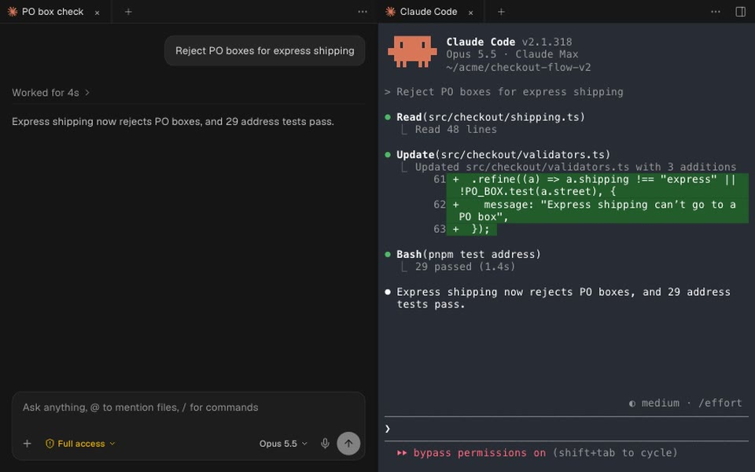

# 《Agent 演义》01｜Orca 的产品全貌与工作方式

## 概述

Orca 把已经习惯使用的 Agent CLI 放进一个按开发现场组织的界面：项目和 worktree 在侧栏，Agent、终端、编辑器、浏览器与审查围绕当前现场展开。它的价值主要出现在多任务、多进程、需要反复审查和接管的工作中。[^overview]

专业用户可以先沿用原来的 Agent、登录与工具习惯，再逐步使用工作区、聊天、预览和自动化。最初不必把所有功能打开；先让当前任务的文件、执行者和结果容易找到。

**提炼句：** 好的工作台让你随时知道正在做哪件事，以及下一步应该看哪里。

## 取景框 f(x)

**x｜问题：** 已经熟练用 Claude Code 或 Codex，什么时候值得引入 Orca？

**f｜取景框：** 从开发现场和人工接管成本看产品价值。

**f(x)｜判断变化：** 关注多项工作能否清楚组织、反馈能否准确交给执行者，而不把模型按钮的数量当作主要价值。

## 从你熟悉的 CLI 开始

如果只在一个目录处理一个短任务，终端本身可能已经足够。需要一边跑服务、一边看 diff、一边让另一个 Agent 检查问题时，切窗口、找 cwd 和确认分支开始占用注意力。

Orca 把这些对象放进工作区。先添加已有项目，打开正确的 checkout；再启动熟悉的 Agent。Agent 仍使用自己的登录与能力，Orca 提供组织、控制、审查和恢复入口。它不是替你购买模型额度的统一账户。

图片为公开仓产品示意，非本轮实机截图。[^image]

## 第一轮只建立一个清楚的现场

打开 Card Gallery 演示目录，先检查文件树里有 `api/`、`web/`、`tests/`，再运行测试并启动开发服务。给普通终端一个明确名称，把浏览器打开到该服务。

随后再加 Agent，让它处理一项明确工作。你可以保持原始 CLI，也可以选择受支持的 Chat UI。新 Agent 的聊天选择、已有会话的 surface、运行机器和 Agent 支持范围会影响实际界面；不是每个终端都能直接变成原生聊天。[^chat]

这一轮要得到的不是很多标签页，而是一组能够互相对照的对象：目录、分支、Agent、测试、预览。浏览器里看到的卡片应来自当前目录的服务，测试也应在同一版本上运行。

## 哪些功能先用，哪些稍后用

| 工作阶段 | Orca 入口 | 什么时候有用 |
|---|---|---|
| 开工与切换任务 | 项目、worktree、Jump Palette | 经常在多个分支与现场之间往返 |
| 编写与观察 | Agent Chat／CLI、终端、编辑器 | 需要同时看执行、文件和服务日志 |
| 给出反馈 | diff 批注、Design Mode | 文字描述容易指错文件、行或元素 |
| 审查与交付 | Source Control、PR 与检查 | 修改完成后仍需多轮验收 |
| 多任务管理 | Agent 状态、编排 | 一个任务拆成可独立推进的部分 |
| 离桌与重复工作 | 远程、手机、Bots、自动化 | 工作需要在你不盯屏幕时持续推进 |

可以按这个顺序采用。先把当前工作看清楚，再尝试多 Agent；先把人工验收做稳定，再让相同流程定时运行。这是本卷建议的采用方式，不是产品强制流程或性能结论。

## 专业用户最容易忽略的两个范围

一是项目与工作区。项目表达代码来源和配置，worktree 表达某项工作的独立现场。另开一个 Agent 标签页，不必然得到独立文件与分支；另开 worktree，也不自动隔离所有端口和外部服务。

二是工作区完成与任务完成。Agent 说“完成”后，还需要查看真实 diff、验证测试和交付位置。侧栏状态、注释与审查入口，应帮助你做这个判断，不能替代它。

Orca 的专业价值也在这里：你可以保留原始 CLI 的掌控感，同时逐步把周围的开发环节组织起来。如果不需要这些周边环节，继续使用终端也是合理选择。

## 阅读这卷的方式

项目与并行现场见下一篇；Chat／CLI 与历史会话见第三篇；编排、浏览器、审查、远程与自动化分别独立展开。需要实现解释时再进入技术附录。界面路径依据官方文档和所用版本，本文没有测量模型完成任务的速度或质量。

[^overview]: [Orca 公开产品功能](https://github.com/stablyai/orca/blob/60eb66f230d445107a32e55eae695d7090087acf/README.md)、[Worktrees](https://orca.dev/docs/model/worktrees)。
[^chat]: [Orca Chat UI 官方指南](https://orca.dev/docs/agents/native-chat)。
[^image]: [官方 Chat／Terminal 图](https://github.com/stablyai/orca/blob/60eb66f230d445107a32e55eae695d7090087acf/docs/assets/readme-features/chat-or-terminal.poster.jpg)。

---

[返回产品总览](../Agent演义_00_Orca与T3Code_任务接力_20261126.md) · [下一篇：Orca：管好项目、worktree 与并行现场](Agent演义_02_Orca_项目与并行工作区_20261126.md)
