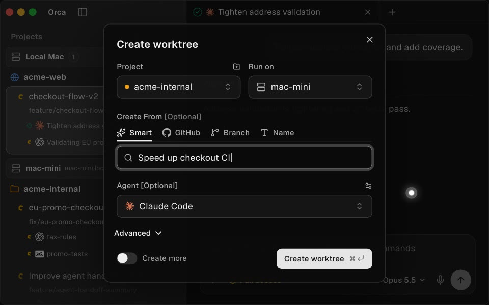

# 《Agent 演义》02｜Orca：管好项目、worktree 与并行现场

## 概述

高频使用 Agent 后，最先变乱的常常是开发现场：功能分支还在跑，另一个 bug 要马上修，第三个终端里的服务又占着端口。Orca 用项目和 worktree 把这些现场组织起来，每个现场保留自己的文件、Agent、终端、编辑器和浏览器。[^worktrees]

这里最值得学的不是 Git 命令，而是怎样决定“这项工作要不要另开一个现场”，以及怎样把新现场准备到能直接开工。依赖缓存、本地配置、起始分支与运行机器，都需要在创建时安排好。

**提炼句：** 并行工作的第一步，是让每项任务有一个你能辨认、能回来、能交付的现场。

## 取景框 f(x)

**x｜问题：** 一边加功能、一边修 bug、一边审查，怎样让多个 Agent 的工作保持清楚？

**f｜取景框：** 从任务的独立性和交付位置决定工作区，再安排人、终端和预览。

**f(x)｜判断变化：** 不按 Agent 数量开目录；按是否需要独立改动、独立运行和独立验收来创建 worktree。

## 先把三项工作摆在桌上

本卷的 Card Gallery 包含前端、搜索 API 和测试。现在要扩展搜索字段、调查一个筛选 bug，同时审查昨天的 UI 改动。三项工作如果都修改当前 checkout，测试结果和未提交改动很难归属。

适合的安排是：功能开发一个 worktree，bug 调查另一个，旧 PR 的审查打开对应分支。每个现场用任务命名，如“扩展搜索字段”“调查分页重置”，终端再按用途命名为 API、Tests、Agent。工作区名称说明你为什么来这里，终端名称说明这个窗格在做什么。

如果只是让另一位 Agent 看现有文件并提出意见，且不会改代码或运行冲突服务，就可以继续使用当前现场。是否独立 checkout，应由工作边界决定。

## 创建时最值得确认的四件事

图片来自 Orca 公开仓的产品示意，不是本轮实机截图；不同版本可能使用 New Workspace 或 Create Worktree 标题。[^image]

1. **Project：** 选择这项工作所属的项目。多仓父目录和单一 Git 仓库的工作方式不同，先确认目标 checkout。
2. **Run on：** 决定代码和 Agent 实际在哪台机器运行。选了远程机器，依赖和服务也要在那个现场准备。
3. **Branch from／start-from：** 独立功能通常从项目基线开始；只有确实依赖前一项修改时，才从它的分支继续。
4. **Agent：** 想先检查配置时选普通终端；准备直接开工时再选择 Agent 和初始要求。[^worktrees]

创建在后台进行，侧栏和工作区会显示 checkout 与 setup 进度。观察完成状态再进入对应现场，不必一直盯着创建对话框。失败时先读错误和当前目录状态，再使用产品提供的重试入口。

## 新目录为什么跑不起来

新 worktree 有仓库跟踪的文件，通常没有原目录的依赖、缓存与本地配置。Orca 提供几条不同的准备路径：Repository 设置里的 Worktree Shared Paths、`orca.yaml` 的共享目录、`.worktreeinclude` 的独立复制。[^worktrees]

| 材料 | 常用安排 | 需要看清楚的条件 |
|---|---|---|
| 可重建依赖与缓存 | 共享目录，或 setup 安装 | 共享不等于完全隔离；写入行为仍需考虑 |
| 每个现场独立的本地配置 | `.worktreeinclude` 复制 | 是具体路径，且应符合产品的 gitignored 条件 |
| 编译与测试准备 | setup／项目动作 | 必须在新现场的机器和目录执行 |
| 临时服务与端口 | 给现场单独启动并命名 | 两个 checkout 也可能争用同一个端口 |

对于本卷演示项目，没有第三方依赖，先运行 `python3 -m unittest discover -s tests -v`，再在该 worktree 启动 API。若两个现场同时预览，给它们不同端口，在浏览器标题或工作区注释中写清楚。共享工作区配置只放可公开的脚本与路径规则，本地账户材料另按自己的环境管理。

## 真正并行后，怎样找到工作

用侧栏的项目和工作区层次区分任务，再用 Quick Open／Jump Palette 回到具体现场。工作区注释适合记录“已复现，等待测试”“实现完成，待审查”这类当前状态，避免只靠 Agent 最后一条回复判断进度。

一个现场里可以同时有 Agent、测试终端和预览页。切换现场前，确认浏览器展示的端口、终端 cwd 和分支属于同一项任务；“页面有变化”不一定来自你刚修改的那个 checkout。

Orca CLI 也能创建、查看和标记工作区。可复用的入口是 `orca worktree create`、`orca worktree show`、`orca worktree set`；具体参数以所用版本的 `orca skills get orca-cli` 或帮助为准。使用 CLI 是为了减少重复点击，日常判断仍是任务归属与基线选择。[^cli]

## 做完后怎样收现场

先审查分支与实际改动，再确认修改已进入预期交付位置。需要以后继续时，可以保留或让现场休眠；需要删除时，查看产品对目录、分支与未合并提交的处理提示。

手动 Sleep 与删除工作区作用不同：前者服务于以后恢复，后者处理现场及分支生命周期。自动 hibernation 又是有资格条件的实验功能，涉及 resumable Agent、当前活动和未结算协作，不应只按“终端看起来安静”判断。[^sleep]

这一章的使用标准很简单：你能指出某项修改在哪个现场、测试在什么版本跑过、接下来怎样交付。只有做到这些，并行 Agent 才会增加吞吐，而不是增加找现场的时间。

[^worktrees]: [Orca Worktrees 官方指南](https://orca.dev/docs/model/worktrees)，2026-11-26 读取；共享路径、setup 与创建入口以所用发行版为准。
[^image]: [官方工作区产品图](https://github.com/stablyai/orca/blob/60eb66f230d445107a32e55eae695d7090087acf/docs/assets/readme-features/parallel-worktrees.poster.jpg)。
[^cli]: 本机 Orca 1.4.277 的 `orca-cli` 版本匹配指南；[公开 CLI 实现入口](https://github.com/stablyai/orca/blob/60eb66f230d445107a32e55eae695d7090087acf/src/main/runtime/orchestration/coordinator/dispatch/coordinator-task-dispatch.ts)仅作为任务与现场关系的补充。
[^sleep]: [Orca Agent hibernation](https://orca.dev/docs/agents/hibernation)。

---

[返回产品总览](../Agent演义_00_Orca与T3Code_任务接力_20261126.md) · [上一篇：Orca 的产品全貌与工作方式](Agent演义_01_Orca_产品全貌与工作方式_20261126.md) · [下一篇：Orca：在聊天与终端之间工作](Agent演义_03_Orca_聊天终端与会话_20261126.md)
