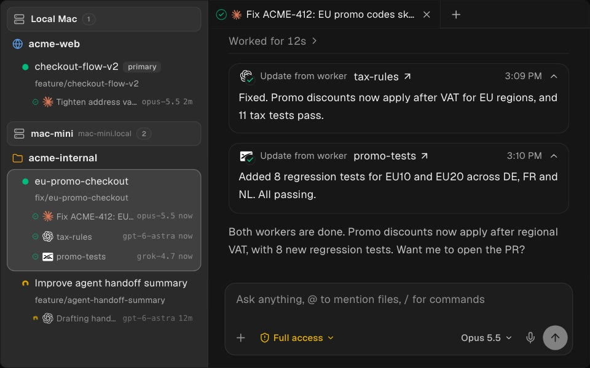

# 《Agent 演义》04｜Orca：一个人怎样管理多个 Agent

## 概述

Orca 的多 Agent 使用方式从工作分工开始：一个协调者维护目标，独立任务交给 worker，结果回到同一条管理线。产品帮助你看见工作、等待、阻塞与需要介入的状态。[^overview][^visibility]

专业用户需要控制的不只是 Agent 数量，还包括每个人的责任、文件现场、依赖、回报内容与最终验收。并行适合独立工作；对同一文件的连续修订，需要更明确的交接。

**提炼句：** 多 Agent 的收益来自清楚分工，管理成本也来自分工。

## 取景框 f(x)

**x｜问题：** 一个人监督多个 Agent，怎样保持产出和掌控感？

**f｜取景框：** 把并行任务、依赖任务和人工决策分开安排。

**f(x)｜判断变化：** 先让每位执行者的输入与交付可辨认，再增加并发；完成后验收结果和整合位置。

## Card Gallery 怎样分工

接口改动和界面原型可以先独立推进，前后端集成则要等接口合同明确。测试者可以提前列用例，但验收最终实现应对准合并后的版本。

| 角色 | 负责什么 | 最小交付 |
|---|---|---|
| 协调者 | 维护目标、合同、依赖与整合 | 当前计划、待决问题、整合结果 |
| API 执行者 | 搜索、标签与分页接口 | 改动位置、测试、接口边界 |
| UI 执行者 | 筛选控件、列表状态与反馈 | 页面与状态行为、未覆盖情况 |
| 审查／验证者 | 核对合同与失败路径 | 可复现问题、证据与建议 |

这个分工是自拟工作法。若任务很短、目录高度耦合，顺序执行可能省去协调成本。

## 把大任务交给协调者时，说清楚什么

先给目标、验收条件和代码范围，再说明哪些工作可并行，哪些必须等待。要求协调者在需要你决策时提出具体问题，回报结果时说明文件、测试与尚未整合的部分。

```text
组织 API、界面和验证三部分工作。
先固定搜索、tag 和分页合同，再并行实现 API 与界面。
各执行者使用明确的工作区，避免同时修改同一文件。
最终对整合版本运行测试并检查页面状态。
有接口分歧时先提交选项与影响，等决定后继续。
```

它不是指定某个模型必然更擅长某种角色，而是让输入与责任明确。



公开产品图，非本轮模型运行结果。[^image]

## 管理时优先看需要你处理的状态

工作中的 Agent 可以继续观察；等待问题或审批的 Agent 需要回答；失败、额度受限或现场无法准备的任务，需要明确下一步。只看到“仍有输出”不表示无需介入，看到“done”也不表示所有结果已经整合。

用 Agent 状态、工作区注释和任务回报定位问题。反馈应交给承担该项工作的执行者；协调请求应回到协调者，避免让两个 worker 各自决定同一个接口问题。

## 并行任务与接力任务怎样不同

不同文件或独立调查适合并行，依赖上一轮产出的任务适合接力。需要独立视角的审查者，可以提供合同与 diff，而不是要求它沿用实现者的全部解释。

增加 worker 前，确认新任务是否真的独立。如果只是把“再检查一下”同时交给多个人，最终还需要你比较重复意见；未必减少总时间。

## 怎样判断这轮协作完成

逐项核对任务交付，再看代码是否进入预期版本。测试应对准整合后的实现；worker 的完成回报是一个管理节点，不是分支合并与工程验收的替代。

源码里的任务、派发和进程身份有助于解释重试与晚到回报。日常使用先记住结果归属和现场位置，必要时再读[技术附录 C](Agent演义_附录C_协作投递与恢复_20261126.md)。

[^overview]: [Orca 编排产品入口](https://github.com/stablyai/orca/blob/60eb66f230d445107a32e55eae695d7090087acf/README.md)、[官方 orchestration 文档入口](https://orca.dev/docs/cli/orchestration)。
[^visibility]: [Orca 功能说明中的 Agent Visibility 与 Orchestration](https://github.com/stablyai/orca/blob/60eb66f230d445107a32e55eae695d7090087acf/src/shared/feature-education/explore/agents-orchestration-steps.ts)。
[^image]: [官方编排图](https://github.com/stablyai/orca/blob/60eb66f230d445107a32e55eae695d7090087acf/docs/assets/readme-features/orchestration.poster.jpg)。

---

[返回产品总览](../Agent演义_00_Orca与T3Code_任务接力_20261126.md) · [上一篇：Orca：在聊天与终端之间工作](Agent演义_03_Orca_聊天终端与会话_20261126.md) · [下一篇：Orca：浏览器、Design Mode 与界面反馈](Agent演义_05_Orca_浏览器与界面反馈_20261126.md)
