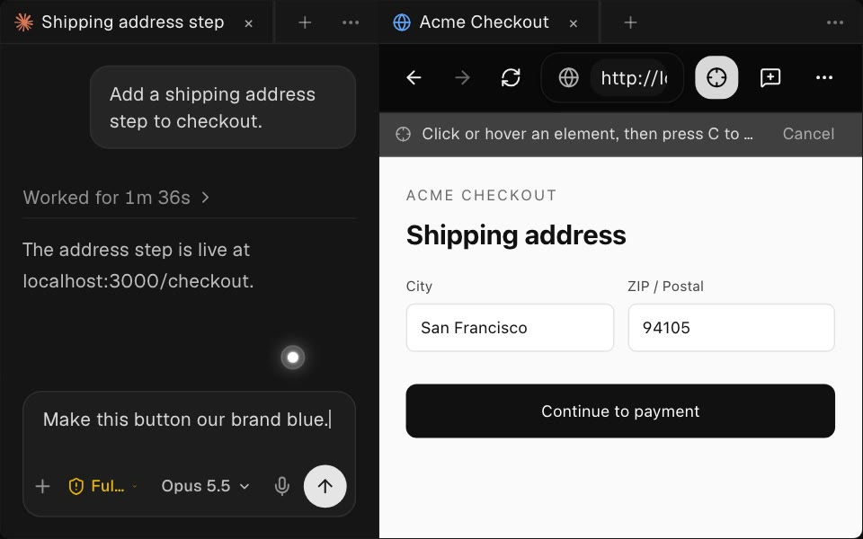

# 《Agent 演义》05｜Orca：浏览器、Design Mode 与界面反馈

## 概述

界面任务最常见的返工，是反馈只有“这个地方不对”。Orca 的浏览器与 Design Mode 可以把元素、样式、截图和注释带到反馈中，让执行者知道改哪一块、期待什么状态。[^design]

专业用户需要把预览、定位、批量反馈和复查连接起来。截图指出外观，操作路径指出行为；两者一起才构成可验收的 UI 要求。

**提炼句：** 界面反馈越能指出对象与状态，修订越容易对准问题。

## 取景框 f(x)

**x｜问题：** 怎样让 Agent 准确修改界面，而不是凭一句模糊评价反复猜？

**f｜取景框：** 将反馈拆成具体元素、复现状态和期望变化。

**f(x)｜判断变化：** 从评价“好不好看”转向可定位、可复查的说明，修改后沿同一路径验收。

## 先确认预览属于当前现场

在对应 worktree 启动开发服务，再用 Orca 浏览器打开它。确认地址、端口和当前分支，避免浏览到另一个现场的旧服务。页面加载成功只说明服务可访问，尚未说明交互符合合同。

本卷在 Orca 内置浏览器打开 Card Gallery，验证了 `search` 得到三条结果、叠加 Docs 标签得到一条、中文查询与标签组合符合预期。这些是演示页面的实际操作结果，未调用模型。

## 从元素进入反馈



公开产品图，非本轮修改结果。[^image]

使用浏览器工具栏的 Annotate；菜单里有 Grab page element 与 Draw on screenshot 等入口。选择元素后，产品可以带入 HTML、计算样式、局部截图，以及可用时的源码位置。源码映射并非任何页面都有。[^design]

给 Card Gallery 的反馈可以这样写：

```text
对象：标签下拉框和它旁边的搜索框。
状态：窄屏、已有中文搜索词，切换标签后。
期望：搜索词保留，结果刷新，分页回到第一页。
布局：两项控件在窄屏垂直排列，标签文本和控件左边缘一致。
验收：沿上述状态重新操作，并检查没有显示旧请求结果。
```

这是自拟反馈。定位材料说明对象，文字说明目标，不需要让 Agent 从截图里猜业务规则。

## 批量注释怎样使用

在 annotation tray 收集同一轮问题，编辑注释的 comment 或 intent，确认后再发送。多处相关布局问题适合一批反馈，减少执行者在不同方向来回修订。

Send／Copy 的摘要与 Include page details 影响带入的材料。根据问题选择足够的页面详情，不必每次附上整页内容。注释仍要有明确的预期，元素截图本身不会表达“切换标签应重置分页”。[^design]

未发送注释与已发送反馈属于不同阶段。发送后确认目标 Agent 和对应工作区，再看实际修订；不要只因注释从页面移除就认定问题已经解决。

## 验收外观，也验收操作

| 问题类型 | 适合的证据 | 复查方式 |
|---|---|---|
| 间距、对齐、颜色 | 元素定位与局部截图 | 同视口比较修改后布局 |
| 筛选、分页、路由 | 操作顺序与状态 | 重复步骤检查结果与 URL／参数 |
| 错误与空状态 | 触发条件和期望文案 | 输入无结果或失败请求 |
| 响应式布局 | 视口、设备与内容长度 | 桌面和窄屏分别操作 |
| 数据更新不一致 | 请求条件和结果顺序 | 快速改变筛选，检查旧结果不会回写 |

浏览器能让反馈更具体，却不替你定义验收条件。本轮只验证了演示页面的选定操作；自动源码映射、Agent 修订与热更新闭环未实测。

## CLI 怎样减少重复操作

Orca 浏览器 CLI 提供 snapshot、fill、select、screenshot 等命令。固定 page ID 可以在后台操作指定页面，避免动作落到你刚切换的其他标签。日常使用可以让这些工具复查确定的操作路径，仍应以页面状态和结果判断完成。[^cli]

真正顺手的 UI 工作流是：打开正确现场，选择具体对象，提交一轮连贯反馈，修改后沿同一路径复查。浏览器、代码 diff 和测试共同完成验收。

[^design]: [Design Mode 官方指南](https://orca.dev/docs/browser/design-mode)，2026-11-26 读取。
[^image]: [官方 Design Mode 图](https://github.com/stablyai/orca/blob/60eb66f230d445107a32e55eae695d7090087acf/docs/assets/readme-features/design-mode.poster.jpg)。
[^cli]: 本机 Orca 1.4.277 `orca-cli` 的 browser 参考；[自拟演示项目](../../experiments/agent-harness-series/web-project/README.md)。

---

[返回产品总览](../Agent演义_00_Orca与T3Code_任务接力_20261126.md) · [上一篇：Orca：一个人怎样管理多个 Agent](Agent演义_04_Orca_多Agent分工与监督_20261126.md) · [下一篇：Orca：从改动审查到提交与 PR](Agent演义_06_Orca_审查提交与PR_20261126.md)
