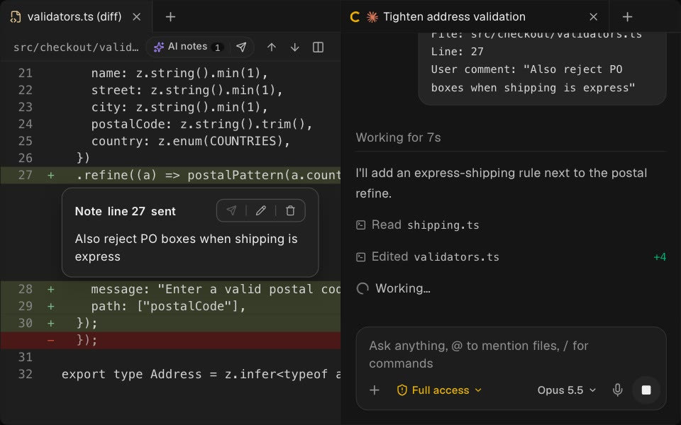
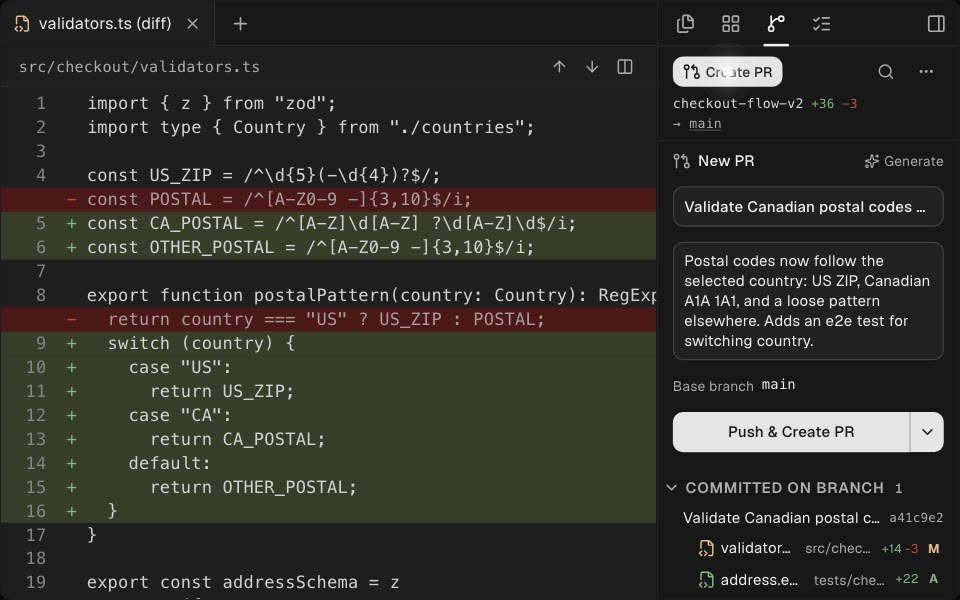

# 《Agent 演义》06｜Orca：从改动审查到提交与 PR

## 概述

Agent 完成修改后，专业用户的工作进入审查与交付。Orca 把 diff、行注释、反馈发送、Source Control 和 PR 检查放在开发现场附近，方便完成一轮修改、反馈、复查的循环。[^review][^git]

最重要的选择是看哪份差异、把反馈交给谁、怎样确认当前版本已验证，以及最终提交包含哪些文件。AI 生成提交信息可以节省整理，但实际变更范围仍要由你确认。

**提炼句：** 交付从看清当前改动开始，在确认目标版本与验收结果后结束。

## 取景框 f(x)

**x｜问题：** 怎样把 Agent 的修改变成可以审查、可以交付的代码？

**f｜取景框：** 将变更范围、反馈轮次和交付版本连起来。

**f(x)｜判断变化：** 不把最后一条回复当验收，按 diff、测试、未解决意见与提交范围决定下一步。

## 先确认你正在看哪份改动

Card Gallery 的前端和 API 可能来自两个执行者。审查时先确认当前 branch、compare base、未提交文件和已提交差异。仅看一轮 Agent 的输出，可能遗漏其他现场带来的变更。

Orca 的 Source Control 提供暂存、取消暂存、丢弃和提交等入口，分支行说明当前分支与比较基线。先核对范围，再生成文字或执行交付动作。[^git]

## 把反馈锚到代码



公开产品图，非本轮 PR 审查结果。[^image]

在 diff 行旁的加号处写批注，或选择一段相邻行形成范围意见。反馈可以跨文件收集，完成后用 Send to agent 选择修订者。批量发送帮助执行者把同一轮意见一起处理。[^review]

意见要解释影响。例如：

```text
这里把结果按 id 排序，但当前合同要求保留原始顺序。
请删除这项排序，并补一个输入顺序与 id 顺序不同的测试。
```

这比“排序有问题”更容易验收。实现者修改后，再检查批注锚点、实际 diff 和新增测试；确认解决后 Resolve。

## 用测试与页面复查同一版代码

API 测试验证搜索、标签和分页；浏览器操作验证用户实际看到的状态。两者要对准当前 checkout，而不是各自在不同 worktree 上通过。

本卷演示项目有九项 API／页面服务测试，并在 Orca 浏览器核对选定交互。它们是自拟项目的结果，没有经过真实 Agent 修改，也不是完整产品 PR 工作流评测。

## 提交与 PR 的动作分开理解



图为公开仓的产品示意，具体入口以所用版本为准。[^git-image]

确认暂存文件，检查自动生成的提交说明是否准确，再执行提交。推送和创建 PR 还需要对应远端和登录。查看分支、目标仓与 base branch，避免把审查完成误当作代码已经发布。

Orca 的提交、PR 和命名文字可通过 Git & Source Control 的 Action recipes 配置 Agent、模型、effort 和提示。仓库级覆盖可能优先于全局配置；改了全局默认后若某项目不生效，先检查 Repository overrides。[^git]

模板中的 issue 引用也应核对实际关联项。没有关联 issue 时，固定的关闭语句可能生成不完整信息。让生成文字反映真实变更，而不是为每次提交加同一套总结。

## 提交后还有一轮反馈

在 PR 中查看检查、审查评论和新提交。失败日志或行意见可以交给明确的修订者；修改后以最新 head 复查。只看旧的绿色结果，会错过之后的改动。

对一个人管理多项工作，最好能从工作区找到 linked issue／PR，再从 PR 回到负责该项工作的人。若责任不明确，先明确谁负责修订，避免多个执行者同时回应同一条意见。

[^review]: [Annotate AI Diff 官方指南](https://orca.dev/docs/review/annotate-ai-diff)。
[^git]: [Commit & push 官方指南](https://orca.dev/docs/review/commit-push)。
[^image]: [官方 diff 批注图](https://github.com/stablyai/orca/blob/60eb66f230d445107a32e55eae695d7090087acf/docs/assets/readme-features/annotate-ai-diffs.poster.jpg)、[产品 Git 功能说明](https://github.com/stablyai/orca/blob/60eb66f230d445107a32e55eae695d7090087acf/README.md)。
[^git-image]: [官方 Git 集成图](https://github.com/stablyai/orca/blob/60eb66f230d445107a32e55eae695d7090087acf/docs/assets/readme-features/git-integration.poster.jpg)。

---

[返回产品总览](../Agent演义_00_Orca与T3Code_任务接力_20261126.md) · [上一篇：Orca：浏览器、Design Mode 与界面反馈](Agent演义_05_Orca_浏览器与界面反馈_20261126.md) · [下一篇：Orca：远程机器与手机上的工作](Agent演义_07_Orca_远程与移动工作_20261126.md)
