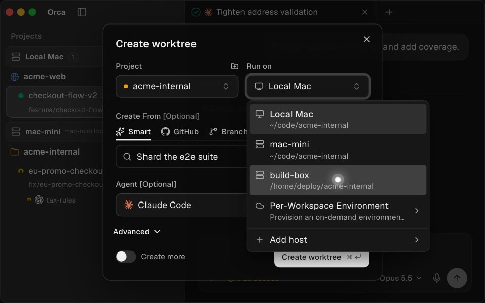
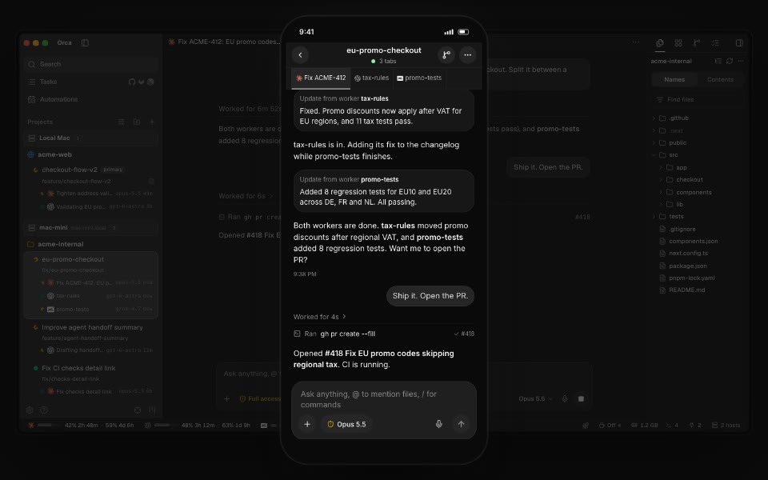

# 《Agent 演义》07｜Orca：远程机器与手机上的工作

## 概述

Orca 可以把开发现场放在本机、SSH 主机或远程 Orca Server，并用手机作为观察和接管入口。专业用户要先区分代码在哪、Agent 在哪运行、哪个客户端只是遥控。[^remote]

离开电脑后能否继续工作，取决于实际执行主机是否在线。选择远程机器适合长任务或资源密集任务；移动端适合查看状态、回答问题与小范围介入，完整审查仍需要足够的上下文。

**提炼句：** 远程工作先选择执行现场，再选择从哪里观察它。

## 取景框 f(x)

**x｜问题：** 怎样在多台机器和手机之间继续开发，而不失去任务与现场的对应？

**f｜取景框：** 把执行主机、工作区和控制设备分开安排。

**f(x)｜判断变化：** 判断持续运行时看主机的生命周期；判断接管时看当前任务、文件和权限，不只看客户端能否连上。

## 三种常见安排

| 安排 | 适合什么工作 | 开工前确认 |
|---|---|---|
| 本机执行 | 交互密集、需要本地设备或工具 | 目录、依赖、端口与账户可用 |
| SSH 工作区 | 使用已有服务器与开发环境 | 代码位置、CLI PATH、登录与连接方式 |
| 远程 Orca Server | 主机持续承担 Agent 与工作区 | 服务器在线、配对、项目位置与权限 |

在创建工作区的 Run on 中选择目标。代码和 Agent 的准备要在目标机器完成，不应因为本机 CLI 已登录就假定服务器也可用。[^worktree]

## 一个适合远程的案例

Card Gallery 如果只是短改动，本机足够。若扩展为长时间构建、需要远程资源或希望离桌后继续测试，可以把任务现场放到持续在线的主机。先运行一个短测试，确认结果和文件路径，再开始长任务。

浏览器预览还要知道 localhost 属于哪台机器。远程服务的端口需要对应转发或产品提供的访问方式，不能把手机的 localhost 当成执行主机。

公开产品图，非本轮远程部署结果。[^image]

## 跨设备观察时，优先看这些信息

公开产品图，用于说明移动入口，非本轮手机实测。[^mobile-image]

先看任务身份、当前阶段和最近结果，再看需要你回答的问题。Agent 正在运行、等待输入、额度受限或遇到错误，需要不同动作。

移动端收到通知后，先打开对应会话检查问题与相关改动，再回应。问题如果涉及跨文件变更、大段 diff 或无法确认的测试范围，可以留下明确的待办，回到桌面继续审查。

手机是控制入口，不是自动接管所有执行资源。客户端离线、执行主机休眠和 Agent 进程退出会产生不同后果；恢复连接后仍要确认实际状态。

## SSH 与配对服务器的差异不能忽略

同一个 Chat 按钮在不同运行位置可能采用不同 surface。Orca 文档区分可原生聊天的配对服务器与部分 SSH／WSL 的 terminal-backed 路径。历史恢复也有执行位置限制。[^chat]

因此，部署时不只检查“能连上”：还要检查所需 Agent、聊天控制、浏览器、历史和文件访问是否在那个运行位置可用。产品支持表与执行主机版本应一起查看。

## 什么时候适合远程，什么时候保留本机

长任务、统一环境与多设备监督适合远程；依赖本地设备、频繁手动交互或网络不稳定时，本机更直接。两种可以并用，但任务应该有明确的执行现场，不因切换客户端就复制一份不明归属的工作。

[^remote]: [Orca Run Anywhere 与 Mobile 产品入口](https://github.com/stablyai/orca/blob/60eb66f230d445107a32e55eae695d7090087acf/README.md)、[Ways to run 官方入口](https://orca.dev/docs/ways-to-run)。
[^worktree]: [Worktrees 的 Run on 与目标项目设置](https://orca.dev/docs/model/worktrees)。
[^chat]: [不同运行位置的 Chat 支持](https://orca.dev/docs/agents/native-chat)。
[^image]: [官方远程图](https://github.com/stablyai/orca/blob/60eb66f230d445107a32e55eae695d7090087acf/docs/assets/readme-features/remote.poster.jpg)。
[^mobile-image]: [官方 Mobile Companion 图](https://github.com/stablyai/orca/blob/60eb66f230d445107a32e55eae695d7090087acf/docs/assets/readme-features/mobile-companion.poster.jpg)。

---

[返回产品总览](../Agent演义_00_Orca与T3Code_任务接力_20261126.md) · [上一篇：Orca：从改动审查到提交与 PR](Agent演义_06_Orca_审查提交与PR_20261126.md) · [下一篇：Orca：Bots、自动化与个人配置](Agent演义_08_Orca_Bots自动化与配置_20261126.md)
