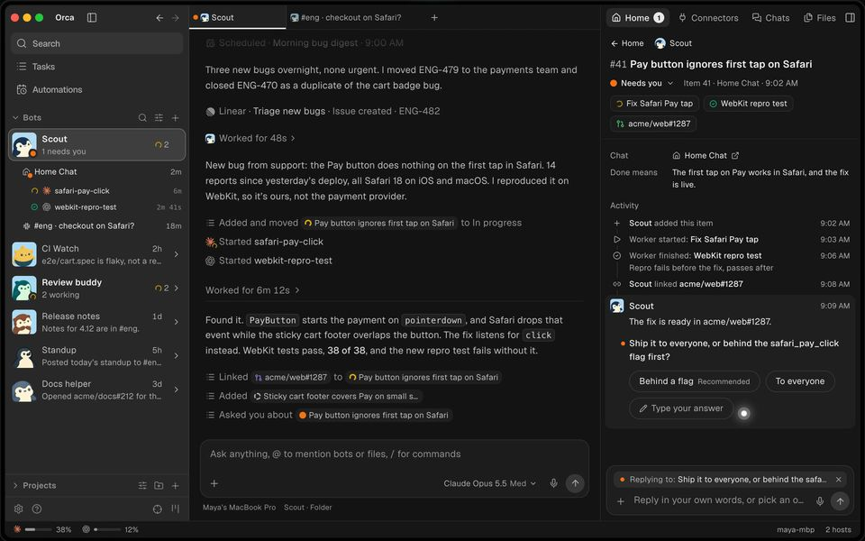

# 《Agent 演义》08｜Orca：Bots、自动化与个人配置

## 概述

Orca 的 Bots 与自动化把开发任务接到你平时接收工作的地方。Bot 可以从 Slack、Linear 或 GitHub 等入口获得请求，工作仍在配置的 Agent 与现场中进行；定时自动化则把一段明确的工作要求重复运行。[^overview]

专业用户最需要明确的是触发范围、执行位置、采用哪个会话、结果送到哪里，以及何时需要人来判断。配置完成后，应先观察一次受控运行，再扩大使用范围。

**提炼句：** 自动化的质量，首先取决于任务和结果边界是否清楚。

## 取景框 f(x)

**x｜问题：** 怎样把高频开发工作交给 Bot 或定时任务，又保持可检查、可接管？

**f｜取景框：** 从入口、执行与结果三段设计自动化。

**f(x)｜判断变化：** 不从“每天运行一次”开始，而是先规定什么算有效输入、在哪做、输出给谁，以及哪些情况停下来。

## 先选择一种重复工作

适合的起点是结构清楚、结果容易复查的任务：汇总一个仓库的失败检查、检查文档链接、整理待处理问题。需要多步发布或复杂业务决策时，应先把人工流程做稳定，再考虑自动化。

以 Card Gallery 为例，定时任务可以在目标工作区运行测试，整理失败项和最近改动，给出下一步建议。最初让输出回到可审查的位置，不应把“发现失败”直接等同于允许自动发布修复。

## Bot 与项目自动化怎样选择

| 需求 | 合适的入口 | 配置重点 |
|---|---|---|
| 在任务系统里提出请求并接收回复 | Bot 与对应 connector | 谁能请求、哪个项目、怎样介入 |
| 固定时间做同一类工作 | 项目 automation | schedule、工作区、Agent 与输出 |
| 针对某个 PR 等待后续变化 | 受支持的事件或 watch 操作 | 精确对象、事件、截止时间和结果路径 |
| 多阶段、需要人工决策的流程 | 分段任务与明确 gate | 哪一步等待人、怎样恢复 |

产品图展示了 Bot 在 Orca 中执行与等待介入的方式，实际 connector、事件和权限仍受配置与版本影响。[^image]

## 配置自动化时的五个决定

第一，确定目标是每次新 worktree，还是已有工作区。独立检查适合新现场；长期追踪同一任务可能需要原有现场。

第二，决定每次新会话还是复用会话。复用有连续历史，新会话便于隔离每次输入；复用能力还取决于原来的运行资源。

第三，选择 schedule 或受支持事件。事件是否可用要看 Bot 自己的 connector 与版本匹配的 trigger options，不能从一个全局功能列表推断某个 Bot 已具备它。

第四，明确结果路径：Bot Chat、来源 thread 或另一个指定位置。结果路径不清楚时，任务即使运行也可能无人接收。

第五，设置停止与人工判断条件。结果不确定、对象已改变或依赖不可用时，应报告实际情况，而不是自行寻找另一个目标继续。[^automation]

## Run now 与定时运行可能不同

版本匹配的 CLI 参考说明，scheduled precheck 决定定时任务是否继续，而 Run now 可以绕过它。用手动运行测试任务正文时，还要单独检查定时触发条件是否按预期工作。

项目 setup、新现场与会话复用也有相容条件。先用一个范围小、可复查的任务测试配置，再观察 run history 中的成功、失败和跳过，避免把任何“没有输出”都理解为运行过。

## 个人配置怎样逐步积累

保留几类真正重复使用的配置：项目准备、Agent 启动偏好、审查与提交文字风格、工作区命名、通知与常用快捷键。仓库级覆盖和全局默认分开管理，便于解释某个项目为什么表现不同。

工具、skills、plugins 与 MCP 应服务于实际工作。加入之后检查它们在哪个运行位置和会话生效；配置更多工具不自动等于任务做得更好。

[^overview]: [Orca Bots、CLI 与自动化产品说明](https://github.com/stablyai/orca/blob/60eb66f230d445107a32e55eae695d7090087acf/README.md)。
[^image]: [官方 Bot 图](https://github.com/stablyai/orca/blob/60eb66f230d445107a32e55eae695d7090087acf/docs/assets/readme-features/bots.poster.jpg)。
[^automation]: 本机 `orca skills get orca-cli --reference references/automations.md` 与 Bot 参考；[公开自动化文档入口](https://orca.dev/docs/cli/automations)。使用示例和触发条件以执行主机版本为准。

---

[返回产品总览](../Agent演义_00_Orca与T3Code_任务接力_20261126.md) · [上一篇：Orca：远程机器与手机上的工作](Agent演义_07_Orca_远程与移动工作_20261126.md) · [下一篇：T3：产品全貌与接入方式](Agent演义_09_T3_产品全貌与接入_20261126.md)
