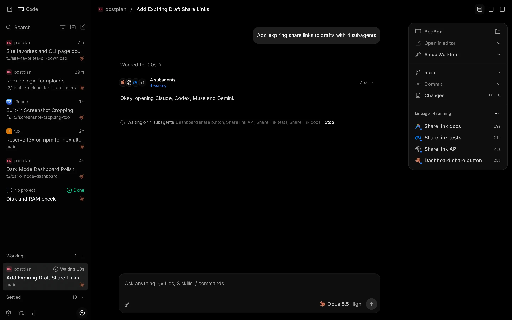

# 《Agent 演义》09｜T3：产品全貌与接入方式

## 概述

T3 把不同 Agent 放到以 thread 为中心的工作界面，并让桌面、网页和手机连接承担代码与执行的 environment。专业用户可以继续使用已有 Agent 和账户，在 T3 中组织任务、预览、审查与接力。[^guide]

先理解 host 与 client，随后按项目和 thread 开始工作。远程入口、模型选择和使用额度都依赖实际执行主机；客户端并不是一份随身携带的 Agent 环境。

**提炼句：** T3 把一项工作整理成可继续、可回看、可跨设备进入的线程。

## 取景框 f(x)

**x｜问题：** 已经使用多个 Agent，怎样把它们放进 T3 而不重新建立一整套习惯？

**f｜取景框：** 把主机、项目、thread 与执行者分开配置，再用 thread 组织一项工作。

**f(x)｜判断变化：** 先确认代码与 Agent 属于哪个 environment，再决定在哪个客户端操作、怎样继续任务。

## 第一件事：让执行主机准备好

T3 使用主机上已有的 Agent 登录与能力。至少准备一个可用 provider，再在 Welcome page 或 Settings → Providers 核对。客户端连上服务器，不代表客户端本机的登录会自动变成服务器的登录。

项目可以是单仓、多仓目录或普通文件夹；Git 为 worktree、branch diff 和 PR 等功能提供基础。已有 CLI 用户不必先学习全部设置，先让一个已有项目能被正确打开。[^guide]

## 第一次连接与第一次开工分开

本卷以 T3 CLI 0.1.8 的独立数据目录启动演示服务器，并在 Orca 浏览器连接。网页先要求 Pair with this environment，配对后才能进入工作界面。这一过程未启动模型任务。

它说明浏览器入口与执行环境授权是两个步骤。日常部署应按自己的主机与设备建立连接，配对材料不放进项目、截图或共享报告。生产用例还需要配置真正可用的 Agent。

图来自 T3 公开仓的 marketing 资源，非本轮模型运行截图；具体界面以所用版本为准。[^image]

## 一项工作怎样进入界面

选定 environment 和项目，建立 thread；需要独立修改时选 New worktree。随后选择 provider、模型与权限，把目标和验收条件写进第一条消息。

Card Gallery 可以从“扩展搜索字段”开始：明确前端、API、测试的范围，说明结果顺序、标签和分页规则。执行后在 thread 中查看过程，在右侧看文件、diff 或预览。

任务还没结束而只是暂时离开时，保留 thread；需要晚点处理可 Snooze；当前完成可 Settle；不再接收新工作时再 Archive。这些操作的含义在后续篇章展开。

## 功能地图怎样读

| 你要做什么 | T3 的主要入口 | 进一步阅读 |
|---|---|---|
| 开项目并准备现场 | Project、worktree、项目动作 | 10 |
| 整理输入与连续任务 | thread、composer、引用、Queue／Steer | 11 |
| 调整执行者 | 模型选择与 provider switch | 12 |
| 并行推进 | 委派、子 Agent、独立 thread | 13 |
| 检查与交付 | 文件、diff、browser、Git／PR | 14 |
| 从其他设备继续 | environments、Connect、手机 | 15 |
| 管理长期使用 | Usage、权限、自动化、诊断 | 16 |

不用第一天打开全部功能。先把一个项目的一项任务完成，再逐步加入并行、远程和自动化，比较新增功能是否减少实际协调工作。

## 账户、模型与费用各是谁的

T3 是控制界面，模型能力和登录来自 provider。T3 产品服务、Agent 订阅与 API 费用是不同层，不能用一个数字概括。

Usage 可以估计 API-equivalent cost、汇总 token 与额度，但估算不是实际订阅账单。模型菜单显示的选项也受 provider 与账户能力影响。选执行者之前，先确认可用范围，避免任务已经建立才发现目标接入不可用。[^usage]

## 与裸 CLI 怎样配合

CLI 仍适合短、直接、无需周边管理的工作。T3 更适合要回看过程、整理任务、看预览和 diff，或在同一主线换执行者的场景。它也能连接外部 Agent 与脚本，但外部入口的权限、上下文和操作能力需要按对应功能确认。

本卷产品说明主要依据固定提交随附用户指南。实机部分只核对独立启动、配对和选定界面操作，未执行模型任务或真实计费测量。

[^guide]: [T3 用户指南与 Quickstart](https://github.com/pingdotgg/t3code/blob/2b0f633db3ba23e692750be2f578ecb089d6a852/docs/user/README.md)、[安装与接入](https://github.com/pingdotgg/t3code/blob/2b0f633db3ba23e692750be2f578ecb089d6a852/docs/user/install.md)。
[^usage]: [Usage 与 Limits](https://github.com/pingdotgg/t3code/blob/2b0f633db3ba23e692750be2f578ecb089d6a852/docs/user/usage.md)。
[^image]: [官方桌面资源](https://github.com/pingdotgg/t3code/blob/2b0f633db3ba23e692750be2f578ecb089d6a852/apps/marketing/src/assets/app-desktop.webp)。

---

[返回产品总览](../Agent演义_00_Orca与T3Code_任务接力_20261126.md) · [上一篇：Orca：Bots、自动化与个人配置](Agent演义_08_Orca_Bots自动化与配置_20261126.md) · [下一篇：T3：项目、worktree 与项目动作](Agent演义_10_T3_项目工作区与动作_20261126.md)
