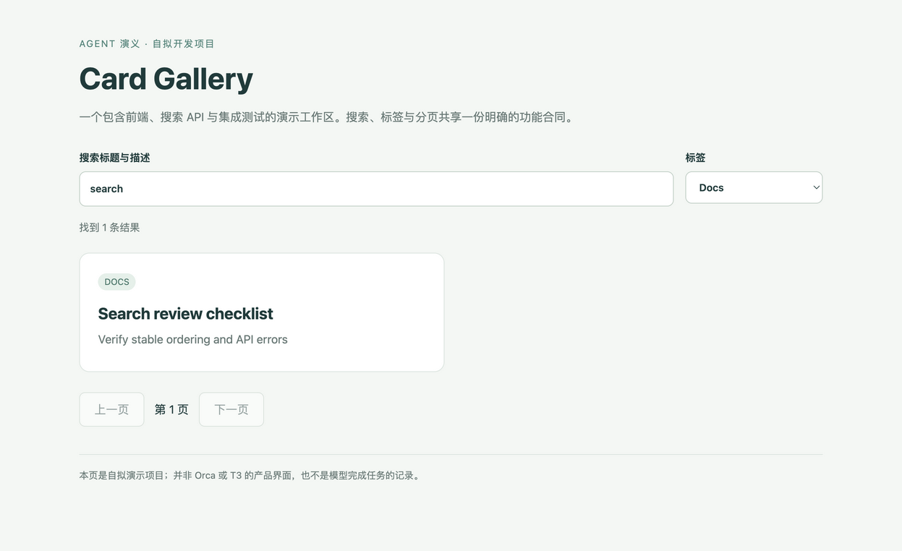

# 《Agent 演义》17｜完成一项功能：两套产品怎样配合开发

## 概述

把“给页面加搜索”做完，通常要经过需求澄清、准备现场、实现、页面反馈、测试和交付。Orca 围绕工作区组织聊天、终端、浏览器与审查；T3 围绕 thread 组织输入、执行者、工作文件与变更。两者都能覆盖这条路径，差别更容易在实际操作中看出来。[^orca][^t3]

本篇以 Card Gallery 为例，给出两条可复走的使用路线。路线是作者设计的操作方案；页面与 API 已本地验证，尚未让两套产品的 Agent 实际完成开发。因此不按速度或生成质量选赢家。

**提炼句：** 一项功能的完成，要能从要求一直追到当前文件、页面行为和交付版本。

## 取景框 f(x)

**x｜问题：** 已经会用 Claude Code 和 Codex，怎样借 Orca 或 T3 把一项功能从开工推进到交付？

**f｜取景框：** 沿功能的验收条件组织操作，观察要求、反馈与代码是否一直对应。

**f(x)｜判断变化：** 产品是否顺手，要看你能否在每个转折处找到正确现场、送出具体反馈并确认修订，而不只是看聊天是否流畅。

## 从一份能验收的要求开始

Card Gallery 已有前端、搜索 API 与测试。现在假设要从“只搜标题”扩展到“搜标题和描述”，同时支持中文、忽略大小写、保留数据顺序。标签与搜索取交集，改变筛选回到第一页，连续输入不能让旧响应覆盖新结果。

这些要求可以直接组成首条输入，附上项目位置与测试命令。它们不是产品特定 prompt，换执行者时也不应丢失。现有代码是这份合同的参考实现，读者要练习开发，可在独立副本里选择其中一项再修改。

先在 `web-project` 目录运行：

```sh
python3 -m unittest discover -s tests -v
python3 api/server.py --port 4188
```

打开 `http://127.0.0.1:4188`。完整代码与准备方法见[演示项目](../../experiments/agent-harness-series/web-project/README.md)。两套产品都使用同一份合同，避免界面体验的比较暗中换了任务。

## 在 Orca 中走一遍

先把演示副本作为项目打开。需要独立改动时创建 worktree，选起始分支，再安排 Agent、测试终端与开发服务。依赖或配置缺失时在 setup 阶段解决；每个服务的端口应能指向这个现场。

在 Chat 中给出功能要求；习惯原生 CLI 的用户可以继续在 terminal 中工作。你要观察的第一件事，是 Agent 对合同的理解：有没有把“保留源顺序”改成按相关度排序，有没有把中文处理扩成无关的语言识别系统。

实现后，打开这个工作区的预览。在 Design Mode 中选中结果区，说明实际状态，例如“切标签后仍停在第 2 页，应回到第 1 页，同时保留搜索词”。选择元素帮助定位，正文说明行为，二者合起来才是一条可操作的反馈。[^design]

随后查看 diff。对 API、前端或测试中相互矛盾的行加批注，把相关问题合成一轮修改要求。修改后再跑测试与页面操作，最后审查完整分支差异、暂存文件、提交说明与目标分支。Orca 的 Commit & Push／PR 入口承接交付，具体权限与托管服务登录按环境检查。[^review]

如果你想换另一位 Agent 审查，先说明审查范围与当前版本；需要独立判断时可以使用单独会话，涉及修改再决定是否开独立现场。没有必要为了这么小的功能，先把全部工作拆成一套多 Agent 编排。

## 在 T3 中走一遍

先选执行 environment，加入演示 project，再建 thread。需要隔离时选 New worktree；已有原生 CLI 登录应在执行主机确认。把 Test 与 Dev 命令整理成项目动作，后续 thread 就不用反复猜启动方法。[^projects]

首条输入给出相同合同。计划形成后，可以留在当前执行者继续实现；也可以在模型选择器换 provider，把计划交给下一位。切换前保留关键约束与验证入口，切换后确认实际文件、目标执行者和未完事项。这是一种阶段接力，并没有证明某模型天然更适合规划或编码。

实现后，从 diff source picker 选择 Turn changes 看本轮，再用 Changes／Uncommitted 检查完整范围。行批注与 workspace file 选择进入 composer context chips，适合一次收集 API、前端、测试间的相关意见。[^diffs]

从 Browser／Servers 打开开发服务，给元素或区域反馈；远程与手机的预览路由按环境确认。修订完成后，检查当前分支、暂存内容和测试，再进行 Git／PR 操作。PR 有新提交时重新载入，审查对象要跟着最新 head 更新。[^browser][^source]

## 页面里应该看到什么



图为本轮在 Orca 内置浏览器打开自拟页面的截图。它展示验收对象，不展示模型产出，也不是 Orca 或 T3 的产品主界面。

| 操作 | 预期行为 | 检查的功能关系 |
|---|---|---|
| 搜索 `search` | 共 3 个结果 | 标题与描述都参与匹配 |
| 再选 Docs | 共 1 个结果，第 1 页 | 搜索与标签取交集，分页归一 |
| 保留 Docs，搜索“中文” | 0 个结果 | 空状态与筛选组合 |
| 去掉标签 | 共 1 个中文结果 | 查询保留，标签解除 |
| 快速更改输入 | 最终显示最新筛选结果 | 异步响应不会倒灌旧页面状态 |

前四行已做页面操作检查；最后一行由前端请求序号与失效处理实现，本轮没有用网络延迟注入复现竞态。API 的九项测试另覆盖字面匹配、顺序、分页和错误状态。

## 从这项小功能判断自己的使用偏好

如果你频繁在原生终端、测试服务和视觉反馈间移动，Orca 的工作区容易成为固定落脚点。如果你希望计划、实现、换执行者与后续审查沿一条 thread 回看，T3 的组织方式值得试。

这只是从功能组织推出的选择线索。真正试用时记录两件具体事情：一次反馈是否送到了正确版本；隔天回来是否能迅速找到未完工作。它们比单次生成的观感更接近日常开发成本。

[^orca]: [Orca 产品功能](https://github.com/stablyai/orca/blob/60eb66f230d445107a32e55eae695d7090087acf/README.md)、[Worktrees](https://orca.dev/docs/model/worktrees)。
[^t3]: [T3 用户指南](https://github.com/pingdotgg/t3code/blob/2b0f633db3ba23e692750be2f578ecb089d6a852/docs/user/README.md)。
[^design]: [Orca Design Mode](https://orca.dev/docs/browser/design-mode)。
[^review]: [Orca Annotate AI Diffs](https://orca.dev/docs/review/annotate-ai-diff)、[Commit & Push](https://orca.dev/docs/review/commit-push)。
[^projects]: [T3 project settings](https://github.com/pingdotgg/t3code/blob/2b0f633db3ba23e692750be2f578ecb089d6a852/docs/user/project-settings.md)、[t3.json](https://github.com/pingdotgg/t3code/blob/2b0f633db3ba23e692750be2f578ecb089d6a852/docs/user/t3-json.md)。
[^diffs]: [T3 diffs 与文件反馈](https://github.com/pingdotgg/t3code/blob/2b0f633db3ba23e692750be2f578ecb089d6a852/docs/user/diffs.md)。
[^browser]: [T3 browser](https://github.com/pingdotgg/t3code/blob/2b0f633db3ba23e692750be2f578ecb089d6a852/docs/user/browser.md)。
[^source]: [T3 source control](https://github.com/pingdotgg/t3code/blob/2b0f633db3ba23e692750be2f578ecb089d6a852/docs/user/source-control.md)。

---

[返回产品总览](../Agent演义_00_Orca与T3Code_任务接力_20261126.md) · [上一篇：T3：用量、权限、自动化与日常维护](Agent演义_16_T3_用量权限与自动化_20261126.md) · [下一篇：同时推进多项工作：分工、监督与整合](Agent演义_18_工作流_同时推进多项工作_20261126.md)
