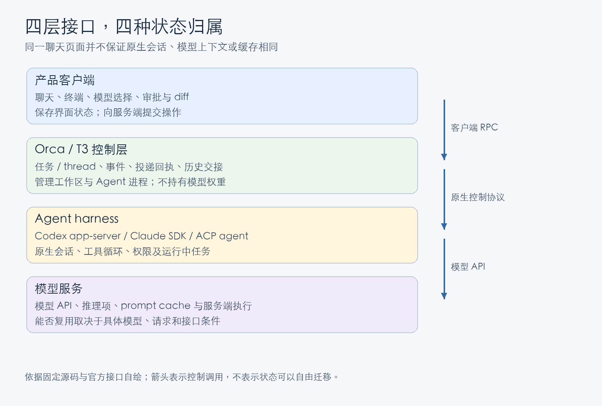

# 《Agent 演义》技术附录 A：对象、协议与能力边界

## 概述

产品里的 project、thread、session、worker，分别指向不同层面的对象。Orca 用任务、派发和执行者解释协作，T3 用应用 thread、provider thread 和原生会话解释接力。它们与模型 API 请求又是不同层。[^identity][^orca]

本附录回答产品篇背后的两个问题：一条工作主线为什么能换 Agent；统一接入之后，为什么有些按钮或操作仍取决于 provider 能力。

**提炼句：** 用户可以沿一项工作继续，底层会话、进程和协议却各有自己的身份与能力。

## 取景框 f(x)

**x｜问题：** Orca 的多 session 和 T3 的同 thread 切 harness，究竟控制哪些对象？

**f｜取景框：** 按对象的责任、身份和生命周期拆开控制层，再比较它们如何连接。

**f(x)｜判断变化：** 不从“还是同一个窗口”推断原生 session、进程或模型状态连续；先指出哪一层保留了，哪一层被替换了。

## 一项工作有几种身份



| 对象 | 保存或控制什么 | 为什么需要区分 |
|---|---|---|
| 项目／worktree | 代码目录、分支与工作位置 | 会话恢复也可能进入不同文件现场 |
| T3 application thread | 持久化工作历史、当前选择与任务主线 | 跨 provider 后仍能沿原工作继续 |
| T3 provider thread／session | 某个 provider 的原生续接身份／运行资源 | 一个应用 thread 可以关联不同执行者的原生历史 |
| Orca Task | 目标、依赖与任务状态 | 任务可以重试，意图不必随尝试改写 |
| Orca Dispatch／Worker | 一次派发、执行权与实际承担者 | 旧进程的回报不能结算新的尝试 |
| harness 原生 thread／turn／item | 原生会话、一次执行和具体输出 | 路由、取消和追加必须找对对象 |
| 模型请求 | 输入、模型、工具与推理设置 | 一个 Agent turn 可能涉及多次请求与工具往返 |

T3 的 provider instance 还表示具体接入配置和账户。两个配置使用相同 harness，不表示它们共享可恢复身份。Orca 的 canonical session ID 与原生 session 之间也有映射，不能只凭字符串相同或类型相同判断续接。[^identity][^orca]

一个 app-server 进程可以服务多个原生 thread；一个父 turn 又可能有子 Agent 或后台工作。因此进程退出、子任务结束和父任务完成不是同一事件。相同进程 ID 也不是同一工作上下文的证明。

## “不同 API 怎么切”要先分层

```text
客户端 → 工作台 RPC → harness 控制协议 → 模型 HTTP API
         建任务、选执行者   开会话、启动／追加／取消   输入、工具、推理、usage
```

Orca 与 T3 的代表接入是 Codex app-server、Claude Agent SDK 和 ACP Agent。切 provider 首先切换的是受控 Agent，后面的模型请求由相应 harness 组织。它不是将 Claude Messages 的 JSON 改字段后直接发给 OpenAI。[^adapters]

| 工作台需要的动作 | Codex 接入的代表路径 | Claude 接入的代表路径 |
|---|---|---|
| 开始或继续原生会话 | thread start／resume | SDK query 的 session／resume 选项 |
| 新一轮工作 | `turn/start` | 向 query 提供用户消息 |
| 运行中追加 | `turn/steer`，对准在途 turn | 持续输入流及相应原生消费与控制 |
| 换模型 | 下一轮选择与参数 | live query 模型控制或下一轮设置 |
| 投递历史 | 支持时注入历史 message | 带归属的历史文本等路径 |

表是固定源码中的代表路径，不是裸模型 API 的共同方法表。历史工具输出被转换成可读证据后，也没有恢复原始 tool-call 链。具体输入何时生效见附录 C。

## T3 怎样分类一次切换

统一策略先比较当前与目标的 `driverKind`、`continuationKey`、配置与工作区，再使用 adapter 的选择变化计划。它会得到五种结果。[^policy]

| 结果 | 代表含义 |
|---|---|
| `reuse` | 续接身份与配置适合直接继续 |
| `switch_model_in_session` | 同实例且 adapter 允许下一 turn 应用选择 |
| `restart_and_resume` | 运行资源需要重启，但身份允许尝试原生恢复 |
| `create_with_handoff` | 不相容或无现有上下文，安排目标路径与历史接力 |
| `reject` | 目标不可用，或变化未获能力支持／明确分类 |

这是策略分类，实际目标原生会话还由 Orchestrator 决定。返回以前使用过的 provider，可以恢复其旧原生 thread 并补入增量；不能因为分类名里有 `create` 就断定每次产生全新 UUID。[^switch]

同一个 driver 的不同实例，也要看 continuation identity。默认 fallback 会把 instance 放进 key；明确共享续接身份需要 driver 的依据。账户与 cwd 的改变可能要求重启，不宜只看模型名字。

所查 Codex 与 Claude adapter 声明模型选择可在下一 turn 应用。泛型 ACP 则按实际 capability 判断，缺少 session 内换模型能力会拒绝该路径。模型菜单、adapter 声明和目标实际支持的模型，三者仍要对照。

## ACP：版本号不能代替能力协商

T3 的 ACP client 根据初始化响应的形状判断协议代际。一些已发布 Agent 返回数值版本 2，却仍使用 v1 形状，因此不能只看 `protocolVersion`。client 再正规化能力，将内部 load 操作映射为 v1 `session/load` 或 v2 `session/resume`，并安排对应 replay。[^acp]

支持 ACP 意味着可以按协商接口连接，不意味着每个 Agent 都支持 fork、rollback、steering 或任意模型切换。缺少能力由上层降级或拒绝，不能靠厂商名字猜测。

从专业用户角度，判断切换成功要回到三件事：实际执行者变成谁；当前文件和合同是否正确；下一轮以什么原生历史继续。[12｜换模型与换 Agent](Agent演义_12_T3_换模型与换Agent_20261126.md)给出使用选择，附录 B 继续解释带过去的内容。

[^identity]: [T3 glossary](https://github.com/pingdotgg/t3code/blob/2b0f633db3ba23e692750be2f578ecb089d6a852/docs/internals/00_glossary.md)、[provider 身份与实例](https://github.com/pingdotgg/t3code/blob/2b0f633db3ba23e692750be2f578ecb089d6a852/docs/internals/03_providers.md)。
[^orca]: [Orca canonical session identity](https://github.com/stablyai/orca/blob/60eb66f230d445107a32e55eae695d7090087acf/src/main/runtime/orchestration/addressing/session-lineage/canonical-orca-session-id.ts)、[派发与执行身份](https://github.com/stablyai/orca/blob/60eb66f230d445107a32e55eae695d7090087acf/src/main/runtime/orchestration/coordinator/dispatch/coordinator-task-dispatch.ts)。
[^adapters]: [T3 Codex adapter](https://github.com/pingdotgg/t3code/blob/2b0f633db3ba23e692750be2f578ecb089d6a852/apps/server/src/orchestration-v2/Adapters/CodexAdapterV2.ts)、[Claude adapter](https://github.com/pingdotgg/t3code/blob/2b0f633db3ba23e692750be2f578ecb089d6a852/apps/server/src/orchestration-v2/Adapters/ClaudeAdapterV2.ts)。
[^policy]: [T3 session transition policy](https://github.com/pingdotgg/t3code/blob/2b0f633db3ba23e692750be2f578ecb089d6a852/apps/server/src/orchestration-v2/ProviderSessionTransitionPolicy.ts)、[selection capability](https://github.com/pingdotgg/t3code/blob/2b0f633db3ba23e692750be2f578ecb089d6a852/packages/provider-core/src/server/selectionTransition.ts)。
[^switch]: [ProviderSwitchService](https://github.com/pingdotgg/t3code/blob/2b0f633db3ba23e692750be2f578ecb089d6a852/apps/server/src/orchestration-v2/ProviderSwitchService.ts)、[Orchestrator](https://github.com/pingdotgg/t3code/blob/2b0f633db3ba23e692750be2f578ecb089d6a852/apps/server/src/orchestration-v2/Orchestrator.ts)。
[^acp]: [T3 ACP 初始化与版本兼容](https://github.com/pingdotgg/t3code/blob/2b0f633db3ba23e692750be2f578ecb089d6a852/packages/effect-acp/src/client.ts)。协议解释限定固定实现与其随附指南。

---

[返回产品总览](../Agent演义_00_Orca与T3Code_任务接力_20261126.md) · [离线实验](../../experiments/agent-harness-series/README.md)
