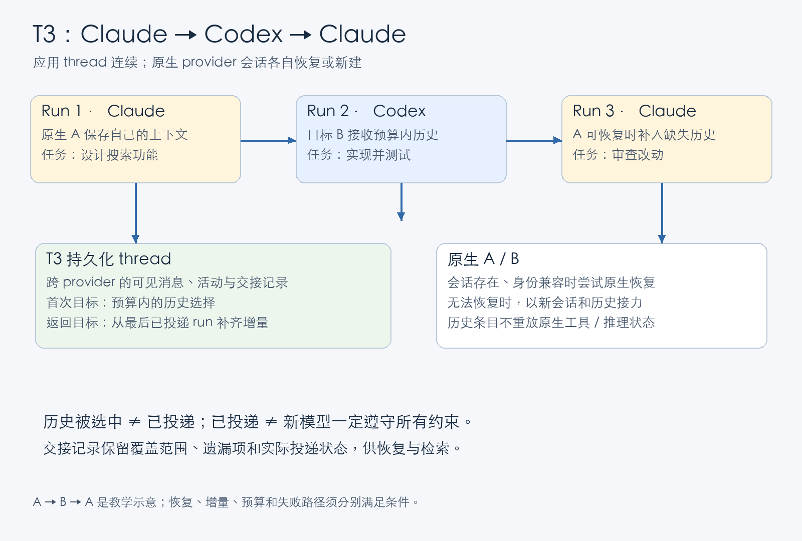
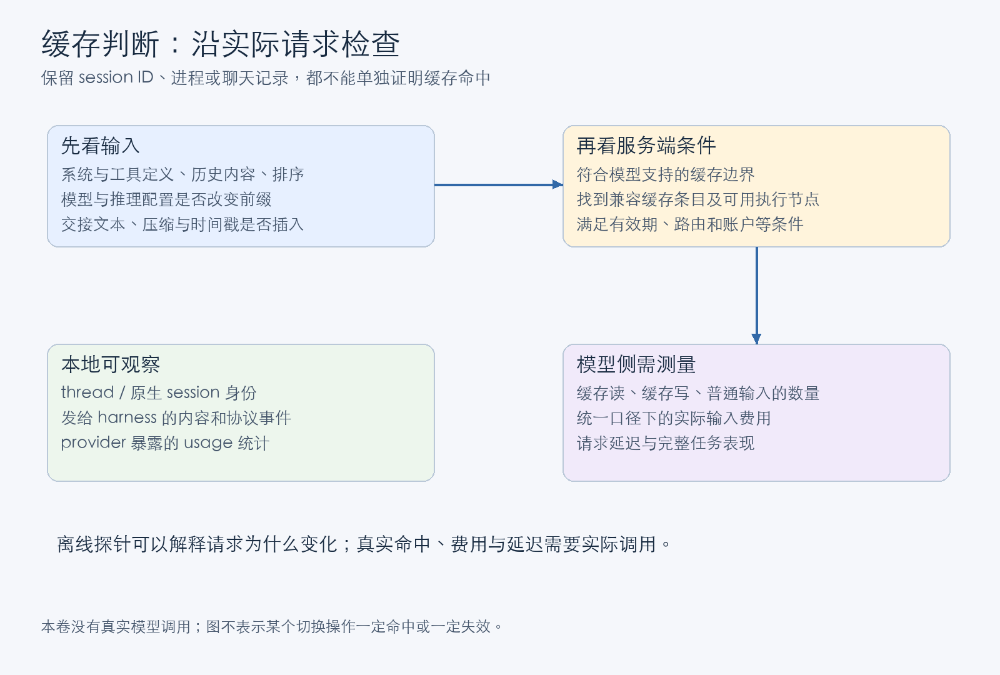

# 《Agent 演义》技术附录 B：上下文、推理与缓存

## 概述

一条 thread 从 Claude 切到 Codex，再切回来，可以保留工作主线，但可见历史、原生推理、运行资源与模型缓存不会因此一起搬迁。T3 选择并包装可移植历史，原生会话能恢复时再补增量；超出预算的材料会遗漏。[^budget][^handoff]

缓存和推理要沿实际模型输入与兼容条件判断。模型 API 支持某种原生状态，并不能证明工作台的这条接力路径已经传入它。本附录据此解释“接着工作”成立到哪一层。

**提炼句：** 接续一项工作，要分清可读证据、原生状态和可复用的计算输入。

## 取景框 f(x)

**x｜问题：** 换执行者后，要求会不会漏，推理能否延续，缓存会怎样变化？

**f｜取景框：** 沿实际带入目标的内容判断连续性，再分别检查原生兼容与服务端复用条件。

**f(x)｜判断变化：** 不以 thread 或原生 UUID 连续证明全部状态保留；查看交接范围、遗漏与真实 usage，知道哪些仍需复查。

## Claude → Codex → Claude：回来时补什么

Claude 在 A 中澄清搜索合同，Codex 在 B 中实现并测试，再由 Claude 审查。若 A 能原生恢复，它已经知道最初要求，却可能不知道 B 的文件变化与新加的中文约束。T3 因此按目标已有原生引用与最后已投递位置，选择较完整历史或 `delta_since_target_last_seen`。[^handoff]

最后已投递位置不只看 completed。一个失败或中断的 run，若输入已经被消费，也可能成为锚点；`promptDropped=true` 则表示相应输入没有送进去。A1、B2 完成而 A3 失败时，这个区别决定下次从 A1 还是 A3 补材料。离线探针直接测试了该 helper。[^probe]

准备好的历史还要实际投递。支持原生历史注入时，T3 记录 pending，再注入带角色与归属说明的 message；其他路径将历史文本与用户正文组合。记录绑定目标原生 thread，结果不明时不能向同一 native thread 盲目再次注入，详见附录 C。[^delivery]

## 历史选择为什么可能漏掉关键要求

`historicalMessage()` 可转换用户与助手消息、命令及输出、文件变化、计划、错误和中断结果。命令变成“此前执行过什么”的证据，reasoning 不在可移植列表里；原生工具调用链和附件也没有原样重放。[^budget]

名为 `full_thread_summary` 的路径不必调用模型写摘要。`selectHistory()` 按尺寸与位置挑选完整条目：先尝试最近用户、最近助手、最早用户，再从后向前填入可容纳的其他条目，最后恢复时间顺序。它没有语义重要性判断。

初始历史 cap 默认 16,000，可配置到 1,024–64,000。虽然参数叫 token cap，这条保守预算用 UTF-8／JSON 字节成本估算，并非 tokenizer 的精确 token 数。当前输入、附件、已有原生占用、模型窗口和工作预留还会进一步限制可用空间。[^budget]

探针把中间条目设为 6,000 个汉字，在 3,500 的预算下整个省略；原始要求过大时也会省略。“优先尝试最早要求”不能解释为“必定保留”。T3 保存 omitted item ID 和数量，Agent 可再用 thread read 找回，是否主动检索仍取决于后续执行。

对搜索项目而言，最有效的接力检查是重新确认匹配字段、字面输入、源顺序、标签与分页合同，而不是询问“你是否读完全部历史”。新测试应针对当前文件，旧的 OK 只能证明旧版本。

## 推理设置、可见解释与原生推理项

| 内容 | 能支持的用途 | 保留条件 |
|---|---|---|
| effort／thinking 设置 | 调整后续推理资源与方式 | provider 和目标模型支持 |
| 可见摘要、设计理由 | 帮另一执行者理解判断 | 真正进入上下文，内容足够具体 |
| 原生 reasoning／thinking item | 在允许时复用原生推理上下文 | 原始结构、签名／加密内容及模型兼容 |
| shell、子 Agent、后台工作 | 继续产生实际结果 | 进程、资源与归属仍存在 |

OpenAI 当前官方指南区分 conversation state 与 reasoning state，支持的模型可通过 response／conversation 或完整历史带入已有推理项，并以 `reasoning.context` 控制范围。持久推理复用受模型家族兼容限制，跨家族会省略不兼容内容；无存储模式的加密 reasoning 内容也属于原生对象。[^openai-reasoning]

Claude 的 thinking 文档区分可见内容与原生 block／signature。工具使用 turn 内需要完整、未修改地传回相应 thinking 和 tool_use；跨 turn 的保留与清理受模型和上下文规则影响。把可见摘要复制成普通 assistant 文本，不等于传回这些原生结构。[^claude-thinking]

本次 T3 历史转换没有收集 reasoning，因而不能从上述 API 能力推出跨 harness 接力已保留原生推理。同 harness 恢复可能保存更多原生记录，是否供新模型使用仍由 harness 和模型服务决定。调高 effort 也不会恢复已丢的状态。

## 缓存看请求，不看窗口

工作台保存的历史、harness 的原生历史和模型服务的 prompt cache 是三种状态。前两种影响下一轮如何组织输入；第三种在模型、前缀、边界、路由与有效期等条件满足时复用计算。

跨 harness 后，系统说明、工具 schema 和顺序、角色以及带归属的历史包装可能变化。语义相同并不等于输入前缀相同。切回旧 provider 若恢复原生历史并只补增量，有机会保留较早前缀，但也要看 compaction、有效期和服务端条件。

OpenAI 当前指南按模型代际区分显式／隐式边界、保留与读写计费；不能沿用“一律无额外写入费”的旧概括。Claude 按 tools → system → messages 解释前缀层级，边界、最小长度、TTL 和 thinking 都有具体规则。[^openai-cache][^claude-cache]

| 改变 | 需要检查 |
|---|---|
| 追加一轮 | 早期前缀与先前边界是否保留 |
| 调 effort 或工具 | 是否改动前面内容，或使用支持的配置更新 |
| 同 harness 换模型 | 模型缓存兼容与实际输入组织 |
| 跨 harness 接力 | 新提示、工具与历史包装 |
| 切回旧执行者 | 原生恢复、增量、缓存有效期与路由 |
| compaction／新原生会话 | 哪部分输入被替换或重新注入 |

这些条件解释命中机会，不给出本轮命中率。线程名称、UUID、启动速度和统一 usage 字段，都不能单独证明实际复用。

## Usage 为什么不能直接拿来排费用

T3 Codex adapter 整理原生 last usage 的 input、cached input、output 和 reasoning output；Claude adapter 整理普通输入、cache creation、cache read 与 output，部分场景选取 iteration 样本。两者的聚合范围需要对齐。[^usage]

Claude 归一化中的 `reasoningOutputTokens` 固定为 0，表示这个表达缺少相应细分，不能据此认定没有 thinking。客户端估算的缓存到期时间也不证明服务端条目仍能命中。

测费用要保留原始 usage，分普通输入、缓存写、缓存读、输出与其他服务费用，再按实际价格计算。订阅用户的 API-equivalent cost 是估算价值，不能当真实账单。命中比例应在同一范围按总 token 计算，不简单平均大小不同请求的百分比。

本附录没有真实模型测量。当前证据足以解释内容如何选择、哪些状态没有跨协议传递，尚不足以判断哪套产品更省或哪种切换推理更好。[12｜换执行者](Agent演义_12_T3_换模型与换Agent_20261126.md)与[17｜完成一项功能](Agent演义_17_工作流_完成一项功能_20261126.md)将这些边界放回使用选择。

[^budget]: [T3 historicalMessage、selectHistory 与预算](https://github.com/pingdotgg/t3code/blob/2b0f633db3ba23e692750be2f578ecb089d6a852/packages/provider-core/src/server/handoffBudget.ts)。
[^handoff]: [Orchestrator：已有目标、锚点与增量](https://github.com/pingdotgg/t3code/blob/2b0f633db3ba23e692750be2f578ecb089d6a852/apps/server/src/orchestration-v2/Orchestrator.ts)、[交接准备](https://github.com/pingdotgg/t3code/blob/2b0f633db3ba23e692750be2f578ecb089d6a852/apps/server/src/orchestration-v2/ContextHandoffService.ts)。
[^delivery]: [T3 ContextHandoffDelivery](https://github.com/pingdotgg/t3code/blob/2b0f633db3ba23e692750be2f578ecb089d6a852/apps/server/src/orchestration-v2/ContextHandoffDelivery.ts)。
[^probe]: [32 项离线结果及范围](../../experiments/agent-harness-series/README.md)。
[^openai-reasoning]: [OpenAI reasoning](https://developers.openai.com/api/docs/guides/reasoning)，2026-11-26 核对；兼容与默认行为按当前指南。
[^claude-thinking]: [Claude thinking](https://platform.claude.com/docs/en/build-with-claude/thinking)，2026-11-26 核对官方 Markdown；原生 block、签名与保留按模型及工具场景区分。
[^openai-cache]: [OpenAI prompt caching](https://developers.openai.com/api/docs/guides/prompt-caching)，2026-11-26 核对，模型代际和计费不可泛化。
[^claude-cache]: [Claude prompt caching](https://platform.claude.com/docs/en/build-with-claude/prompt-caching)，2026-11-26 核对官方 Markdown，模型与平台条件以原文为准。
[^usage]: [Codex adapter](https://github.com/pingdotgg/t3code/blob/2b0f633db3ba23e692750be2f578ecb089d6a852/apps/server/src/orchestration-v2/Adapters/CodexAdapterV2.ts)、[Claude adapter](https://github.com/pingdotgg/t3code/blob/2b0f633db3ba23e692750be2f578ecb089d6a852/apps/server/src/orchestration-v2/Adapters/ClaudeAdapterV2.ts)、[产品 Usage 口径](https://github.com/pingdotgg/t3code/blob/2b0f633db3ba23e692750be2f578ecb089d6a852/docs/user/usage.md)。

---

[返回产品总览](../Agent演义_00_Orca与T3Code_任务接力_20261126.md) · [离线实验](../../experiments/agent-harness-series/README.md)
