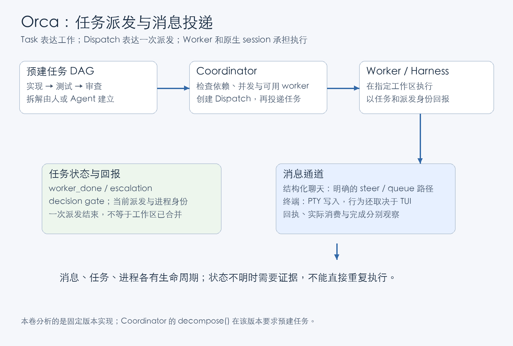

# 《Agent 演义》技术附录 C：协作、投递与恢复

## 概述

运行中追加、派发任务、切换执行者和崩溃恢复，共同难点是确认：谁仍拥有工作，输入送到哪一步，外部操作是否已经发生。Orca 用任务与派发身份、消息回执和进程归属处理这些边界；T3 用持久化状态、命令回执、outbox 和原生会话记录协调恢复。[^orca-send][^architecture]

本附录保留旧机制稿中与使用最相关的消息、监督和恢复分析，并说明 32 项离线探针究竟验证了什么。它们不能扩大为整套产品的“恰好一次执行”或完整故障恢复保证。

**提炼句：** 恢复要从最后一个有证据的阶段继续，同时检查文件与仍在运行的资源。

## 取景框 f(x)

**x｜问题：** 工作台怎样把新要求送给正在工作的 Agent，并在结果不明或进程退出后安全继续？

**f｜取景框：** 分开操作意图、投递确认、执行归属和工程验收，以确认边界解释重试与恢复。

**f(x)｜判断变化：** 不因没有新输出就重复发送，也不因任务 completed 就宣布文件已整合；先查回执、执行身份和真实现场。

## 追加一句话，有几个确认点

| 确认阶段 | 已知事实 | 尚不能推出 |
|---|---|---|
| 工作台接受 | 请求通过准入，可能已保存 | 原生 Agent 已消费 |
| 传输写入 | 对应 frame 已处理 | 要求已改变当前工作 |
| 原生开始／消费信号 | 相应输入进入执行 | 功能合同已满足 |
| 执行结束与结算 | provider 结束，后续结果保存 | 代码质量、整合与发布已完成 |

各 provider 不一定提供这四种独立事件。缺少信号时只能保留较弱的判断，不能用等待秒数补出“已开始”。

Orca 的结构化发送区分运行中 `now` 与 busy 时保留到后续的 `queue`。终端路径向真实 TUI 输入，是否排队与焦点、审批状态有关。operation ID、caller 与 runtime fence 用于约束一次操作及其重试。[^orca-send]

Codex 的代表路径调用 `turn/steer`，携带 thread 与 expected turn 身份，对准当前在途执行；Claude 的代表路径通过保持打开的输入 iterable 交给 SDK。这是 harness 控制，不是把裸 Messages API 的 streaming 等同于在途输入更新。[^steer][^queue]

Orca 的 Claude 队列有一个明确边界：消息 yield 给 SDK 后，`push()` 的 promise 仍未 resolve；SDK 推进 generator 后才确认前一次写入。已 yield 的帧被放弃，属于写入结果不明；尚未 yield 的帧失败，才可认定未写出。离线检查直接导入这份源码验证了这些情况。

因此用户补一句“中文也能搜”，首先要确认投递，再通过具体行为确认采纳。消息已显示、控制请求超时与原生拒绝，不能混作同一状态。

## Orca 的监督为何需要 Task、Dispatch、Worker

Task 保存目标与依赖；Dispatch 保存一次派发和执行权；Worker 是实际承担者。重试要分清新旧尝试，完成回报也不能只凭 task ID 覆盖。派发记录包含终端位置、launch token、process incarnation 和 host 范围，结算再查 task／dispatch 与当前执行者是否相符。[^dispatch][^settlement]

所查 `Coordinator.decompose()` 要求任务预先建立。循环之后选择 ready 任务、可用终端和并发额度，再监督结果；它没有在这里按模型价格或质量自动分工。调度类默认值也不是产品吞吐保证。[^coordinator]

`dispatched-unobserved` 表示任务前文已投递，却未确认开始。保留活跃派发可以避免重复送出；它也不自动剥夺 current worker 的回报权。纯准入检查会拒绝 stopping 或非 current 的进程，`start_unknown` 但仍 current 则不因此拒绝，后续结算还有其他条件。

DAG 的 `all-done` 只表示任务进入终态；有 failed 任务时整个 run 不应据此成功，blocked 且无执行仍可能处于 active。即使阶段名字含 merging，也不能据此认定这个循环已经把所有 worktree 自动合并。任务收敛、工程成功与代码整合必须分别看。[^coordinator][^probe]

## T3 的意图、外部执行与恢复

T3 把命令决定成事件，在事务中提交 event、持久化 projection、command receipt 和 outbox effect，再通知客户端。EffectWorker 在事务外做 provider、文件或 Git I/O，结果再作为命令回来。[^architecture][^sink]

这让客户端重试有回执可查，也避免外部执行阻塞决策事务。但数据库事务包不住模型服务与进程的全部动作：效果已发出、结果未记下时，外部操作可能已发生。不能把 outbox 一律理解为任意副作用都可自动重放一次。

当前 projection 是持续保存的状态来源，事件日志保留的是有界重放窗口。进程丢失后，与旧 provider 进程绑定的效果按恢复规则退休；异步结果写回还要验证 run attempt、provider owner 等条件，防止旧结果覆盖新状态。[^architecture][^sink]

历史注入的 pending 状态绑定原生 thread。检测到注入结果不明时，T3 要求替换 native thread 再重试有界交接；同一原生历史可能已收到内容，直接再注入会重复。斜杠命令或 compaction 不适合 inline 历史时，也可能将投递推迟到后续输入。[^delivery]

## 对话、文件与后台工作要一起看

T3 checkpoint 用隐藏 Git ref 保存文件快照；diff 是审查表示，文件 restore 会改变目录，会话 rollback 又处理原生或可移植历史。三者不能混成一项通用恢复。provider 结束之后，checkpoint 捕获等后续结算还可能待完成。[^architecture][^restore]

恢复检查会比较实际路径与其他 thread 的使用情况，并在接纳与执行前分别确认隔离。闲置、未触碰文件的 side chat 与执行过命令的 side chat，可能得到不同判断。原生不支持直接 rewind 时，某些 ACP 路径会新建会话并使用保留历史，不能称为完整原生回退。[^restore]

父 turn 结束也不表示所有 shell 和子 Agent 已停止。T3 需要按子任务归属路由迟到消息，保持背景 session，必要时请求后续 continuation。产品委派与原生子 Agent 的交互入口不同，用户篇 13 解释怎样操作。[^providers]

Card Gallery 若由 A 实现、B 审查，B 应看当前文件与测试。若恢复了旧对话，却进入另一份目录；或恢复文件时另一位还在修改，都会造成要求与现场不一致。[18｜并行工作](Agent演义_18_工作流_同时推进多项工作_20261126.md)据此选择共享或独立现场。

## 32 项探针证明到了哪里

探针固定两个源码提交，核对被读文件与 Git 对象；T3 选定内核从固定标记提取后由 Bun 运行，Orca Claude 队列直接导入。原结果保留 32 项通过记录，覆盖切换分类、历史预算与锚点、DAG、worker 纯准入和队列边界。[^probe]

两份上游样本分别含 147 条 Codex 与 38 条 Claude 记录。Codex 标为 recorder 产物；Claude 标为真实 `/compact` 捕获与 peer-origin 帧手工移植，不能称为全程原始录制。条目数量包含元数据与收发记录，不是 API 调用数。[^recordings]

教学观察器按顺序处理样本：Codex 子 thread 结束时父 thread 仍 active；Claude 两组 command UUID 经 queued → started → completed。它没有运行 T3 生产 adapter、Orchestrator 与 projection，因此不声称完整集成重放通过。

本次也没有做数据库崩溃、进程丢失或跨 worktree restore 的故障注入。附录依据源码解释设计与分支，离线结果只支持实际覆盖的内核行为。演示 API 测试与报告阅读检查另有用途，不能相加成产品可靠性评分。

[^orca-send]: [Orca turn delivery、operation 与 runtime fence](https://github.com/stablyai/orca/blob/60eb66f230d445107a32e55eae695d7090087acf/src/main/runtime/orchestration/turn-delivery/send-agent-turn.ts)。
[^steer]: [Orca Codex steer](https://github.com/stablyai/orca/blob/60eb66f230d445107a32e55eae695d7090087acf/src/main/codex/structured/turns/codex-structured-turn-steer.ts)。
[^queue]: [Orca Claude 用户消息队列](https://github.com/stablyai/orca/blob/60eb66f230d445107a32e55eae695d7090087acf/src/main/claude/sdk-transport/claude-agent-sdk-user-message-queue.ts)。
[^dispatch]: [Orca 任务派发](https://github.com/stablyai/orca/blob/60eb66f230d445107a32e55eae695d7090087acf/src/main/runtime/orchestration/coordinator/dispatch/coordinator-task-dispatch.ts)、[worker 准入](https://github.com/stablyai/orca/blob/60eb66f230d445107a32e55eae695d7090087acf/src/main/runtime/orchestration/workers/reports/worker-report-admission.ts)。
[^settlement]: [Orca 回报结算](https://github.com/stablyai/orca/blob/60eb66f230d445107a32e55eae695d7090087acf/src/main/runtime/orchestration/db/dispatch-context/worker-report-settlement.ts)。
[^coordinator]: [Coordinator](https://github.com/stablyai/orca/blob/60eb66f230d445107a32e55eae695d7090087acf/src/main/runtime/orchestration/coordinator/coordinator.ts)、[DAG convergence](https://github.com/stablyai/orca/blob/60eb66f230d445107a32e55eae695d7090087acf/src/main/runtime/orchestration/coordinator/coordinator-dag-convergence.ts)。
[^architecture]: [T3 durable state、effect 与 checkpoint 架构](https://github.com/pingdotgg/t3code/blob/2b0f633db3ba23e692750be2f578ecb089d6a852/docs/internals/01_architecture.md)。
[^sink]: [T3 EventSink](https://github.com/pingdotgg/t3code/blob/2b0f633db3ba23e692750be2f578ecb089d6a852/apps/server/src/orchestration-v2/EventSink.ts)、[EffectWorker](https://github.com/pingdotgg/t3code/blob/2b0f633db3ba23e692750be2f578ecb089d6a852/apps/server/src/orchestration-v2/EffectWorker.ts)。
[^delivery]: [T3 ContextHandoffDelivery](https://github.com/pingdotgg/t3code/blob/2b0f633db3ba23e692750be2f578ecb089d6a852/apps/server/src/orchestration-v2/ContextHandoffDelivery.ts)。
[^restore]: [CheckpointRestoreSafety](https://github.com/pingdotgg/t3code/blob/2b0f633db3ba23e692750be2f578ecb089d6a852/apps/server/src/orchestration-v2/CheckpointRestoreSafety.ts)、[CheckpointRollbackService](https://github.com/pingdotgg/t3code/blob/2b0f633db3ba23e692750be2f578ecb089d6a852/apps/server/src/orchestration-v2/CheckpointRollbackService.ts)、[ACP 回退说明](https://github.com/pingdotgg/t3code/blob/2b0f633db3ba23e692750be2f578ecb089d6a852/docs/user/providers-acp.md)。
[^providers]: [T3 provider 背景工作、身份与终止](https://github.com/pingdotgg/t3code/blob/2b0f633db3ba23e692750be2f578ecb089d6a852/docs/internals/03_providers.md)、[用户子 Agent 指南](https://github.com/pingdotgg/t3code/blob/2b0f633db3ba23e692750be2f578ecb089d6a852/docs/user/subagents.md)。
[^probe]: [实验范围和复跑方法](../../experiments/agent-harness-series/README.md)、[保留的真实结果](../../experiments/agent-harness-series/results.json)。
[^recordings]: [Codex 录制样本](https://github.com/pingdotgg/t3code/blob/2b0f633db3ba23e692750be2f578ecb089d6a852/apps/server/src/orchestration-v2/testkit/fixtures/subagent_continue/codex_transcript.ndjson)、[Claude 派生样本](https://github.com/pingdotgg/t3code/blob/2b0f633db3ba23e692750be2f578ecb089d6a852/apps/server/src/orchestration-v2/testkit/fixtures/claude_compact_after_peer_turn/claude_transcript.ndjson)。

---

[返回产品总览](../Agent演义_00_Orca与T3Code_任务接力_20261126.md) · [离线实验](../../experiments/agent-harness-series/README.md)
