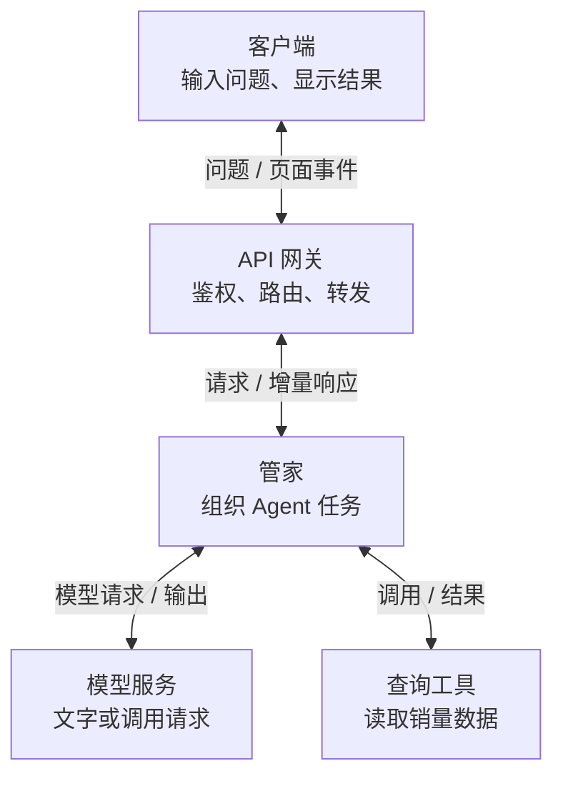

# 答案在逐字出现，Agent 到底做到哪一步了？

你让 AI「查一下 2026 年 6 月杭州空调销量」。屏幕先显示「正在查询」，停了一会儿，答案开始逐字出现。写到一半，网络断了。

这时发生了什么：模型还在生成，工具还在查询，还是事情已经做完、只是最后几句话没送到？重新点一次，会接着显示，还是从头再查？

[前篇《无状态的鹦鹉，怎么学会了连续对话和自己用工具？》](./Agent请求全链路_科普讲解_20260715.md)用「模型与管家」解释了工具调用。这篇接着讲结果怎样来到眼前：**逐字显示能让结果更早可见；任务是否做完、断线后能否继续，要看程序保存了什么，以及怎样确认完成。** 没读过前篇也可以直接往下读。销量查询只作流程示意，本文没有获取真实销量。

这次的研究起点是 Google 于 **2026 年 10 月 22 日**发布的 [API Gateway 流式支持公告](https://developers.googleblog.com/streaming-comes-to-api-gateway-real-time-and-ai-ready-apis-without-changing-your-spec)。下文把它放回 Agent 的完整链路，结合 OpenAI 官方接口、SSE 标准和一个可复现的小实验。正文沿查询过程展开，报文与配置细节放在折叠块中。

## 一、模型在生成，管家在做事，通道在送消息

先沿用前篇的「管家」：它就是 **Harness，负责组织 Agent 运行的程序**。管家把问题和可用工具交给模型，按模型返回的调用请求执行工具，再把结果交回模型。模型服务也可能内置工具和编排能力；这里讲的是职责，并不要求它们部署成几个独立产品。[OpenAI 工具调用流程](https://developers.openai.com/api/docs/guides/function-calling#the-tool-calling-flow)

一次查询可以长这样：



图中的网关是可选的一层，也可以放在管家访问模型或工具的出口。它负责通行规则和转发，模型与管家的职责仍然存在。

这里同时有三条不同的进展：

- **模型输出**：正在写文字，或者逐步写出调用哪个工具、用什么参数。
- **任务执行**：管家是否真的发起了查询，工具是否返回，是否还要继续调用模型。
- **客户端显示**：哪些事件已经经过网络、被解析，并画到了屏幕上。

它们不会始终同步。模型等待工具时，可能没有新文字；管家仍可发送真实的工具进度。模型已经生成文字，某个中间层也可能暂时攒着，页面还没变化。

因此，「正在查询」最好来自**实际开始执行工具的事件**。模型先写了一句「我来查一下」，只能证明它输出了这句话；至于查询是否发出，要看执行记录。这是界面设计建议，不能仅靠一句自然语言判断任务状态。

## 二、同一笔查询，会出现好几次「结束」

### 第一步：模型把调用参数写完整

管家告诉模型有一个查询工具。模型可能逐段输出城市和月份，最后形成类似下面的调用：

```json
{"city":"Hangzhou","month":"2026-06"}
```

这些片段首先是**交给管家的输入**。界面可以展示经过筛选的进度，但没有必要把每段原始参数都转发给用户。

[OpenAI 的流式工具调用文档](https://developers.openai.com/api/docs/guides/function-calling#streaming)明确区分「参数增量」和「参数完成」。多个工具调用也可能出现在同一轮，所以程序要按各自的标识归并，不能把所有片段拼成一个 JSON。

**参数写到一半时，不应按猜测执行。** 即使收到完整参数，管家仍要检查工具名、参数是否合法、当前调用是否被允许，再决定执行。这是执行层的设计要求；格式符合 schema，并不自动证明业务权限正确。

<details>
<summary>接口细节：哪些事件表示参数正在写，哪些表示写完</summary>

以 OpenAI Responses API 的自定义函数调用为例，官方文档列出：

- `response.output_item.added`：新增一个输出项；函数调用项带有名称、ID 等信息。
- `response.function_call_arguments.delta`：某个调用的参数增量。按 `response_id` 和 `item_id` / `output_index` 归并。
- `response.function_call_arguments.done`：该调用参数完成；还会有对应的 `response.output_item.done`。
- 执行后，工具结果通过 `call_id` 对应回原调用，再参与后续模型请求。

这些是具体 API 的事件名，不是所有厂商通用的词汇。这里依据[官方调用示例](https://developers.openai.com/api/docs/guides/function-calling#streaming)解释，未运行真实模型调用。

</details>

### 第二步：工具去查，模型这一轮可能已经结束

模型交出调用请求之后，它这一轮响应可以结束；销量查询此时才开始。工具返回数据和口径，管家再请求模型解释结果。如果资料不足，还可能继续查询。

这正是 [OpenAI Agents SDK 的运行循环](https://openai.github.io/openai-agents-python/running_agents/#the-agent-loop)：调用模型，检查输出；需要工具时执行、回填，再运行下一轮。SDK 对最终输出有自己的判定，也有轮次上限；不能把一次模型响应结束当作整个循环结束。

### 第三步：答案完成，再确认任务交付

最终回答开始流式输出。管家还应确认这次任务约定的工作确实完成：该查询的查到了，结果和说明保存好了，必要的失败也说明了。

| 看到的信号 | 可以说明什么 | 还不能说明什么 |
| --- | --- | --- |
| 工具参数完成 | 一份调用请求写完了 | 工具已执行成功 |
| 模型响应完成 | 这一次模型响应结束了 | Agent 的后续工具和整个任务已完成 |
| 应用确认任务完成 | 应用按自己的完成条件结束了任务 | 结果必然真实、所有分析必然正确 |

最后一项仍要靠工具结果、引用和内容检查来保证质量。**流式事件能记录进度和状态，不能替答案作真实性担保。**

<details>
<summary>接口细节：模型事件与页面事件可以采用不同的格式</summary>

[OpenAI 流式响应指南](https://developers.openai.com/api/docs/guides/streaming-responses)使用 `response.output_text.delta`、`response.completed`、`error` 等类型描述模型响应。

面向页面时，应用可以另行定义「查询开始」「答案片段」「任务完成」等事件。例如下面的 SSE 是**本文设计示意**，不是 OpenAI、Google 或 SSE 标准规定的业务格式：

```text
id: 12
event: answer.delta
data: {"task_id":"sales-demo","text":"这次查询覆盖的范围是……"}

id: 13
event: task.completed
data: {"task_id":"sales-demo","result_ref":"results/sales-demo"}

```

是否保留这些事件、怎样验证 `result_ref`、何时允许发出 `task.completed`，都要由应用实现。一个模型输出流可以结束，再启动下一个模型输出流；页面订阅的同一任务仍可继续。

</details>

## 三、第一段早到，为什么全部完成时间没变

把「边生成边显示」做成一个容易复现的实验：服务器每隔 **0.1 秒**产生一个字，依次是「流、式、响、应」，最后发结束事件。对比两种方式：产生一段就发送，或者先攒完整份再发送。

两种方式都使用 HTTP/1.1 的 chunked 分块传输，也都很早发出响应头。差别只在应用是否攒内容。2026-11-02 的本地复跑中，每种方式交替运行 **5 次**，中位数如下：

| 从请求发起开始计时 | 边产生边发送 | 全部攒齐再发送 |
| --- | ---: | ---: |
| 收到响应头 | 1.358 毫秒 | 1.241 毫秒 |
| 收到首个有效文字事件 | 109.519 毫秒 | 433.304 毫秒 |
| 读完全部响应 | 431.061 毫秒 | 433.373 毫秒 |

来源：[完整运行输出](./assets/api_gateway_streaming_20261102/results.json)与[实验源码](./assets/api_gateway_streaming_20261102/streaming_lab.py)。实验在本机回环网络运行，使用人为延迟，没有调用真实模型或 Google Cloud；这些数字**只演示交付时机，不是云网关性能或模型速度**。

读者的体验有明显区别：前一种约 110 毫秒就有文字，后一种约 433 毫秒才有；但生成四个字所需的等待没有消失。更早得到第一段，并不能推出整项工作更早完成。

这个实验还说明：**响应头来得快，甚至出现了 `chunked`，都不足以证明用户及时看到了内容。** 实际链路中的应用、代理、SDK 或界面，只要有一层整包等待，就可能把逐步产生的内容重新变成整批显示。

### 字节、事件和文字，也不是同一种「块」

模型生成的 token 是模型使用的文本单位；它不保证是一个汉字，也不保证恰好对应一条网络事件。

SSE（Server-Sent Events，服务端发送事件）规定怎样在文本流里分隔事件。HTTP 再把这些内容放进自己的传输单元：HTTP/1.1 可以用 chunk，HTTP/2 使用 DATA frame。客户端一次读取，可能只拿到半条事件，也可能一次拿到好几条。[SSE 解析标准](https://html.spec.whatwg.org/multipage/server-sent-events.html#parsing-an-event-stream)、[HTTP/1.1 §7.1](https://www.rfc-editor.org/rfc/rfc9112.html#section-7.1)、[HTTP/2 §8.1](https://www.rfc-editor.org/rfc/rfc9113.html#section-8.1)

连一个 UTF-8 汉字的字节都可能被拆开。若每收到一小块就独立解码、强行当作完整事件解析，就可能出现乱码或丢数据。稳妥的顺序是：持续解码字节、保留尚未完整的片段，凑成事件以后，再交给业务和界面。

<details>
<summary>实验与协议细节：怎样验证拆包不会丢字</summary>

实验客户端每次最多读取 7 字节；服务器还把一个事件拆成多个 HTTP chunk。解析测试另行覆盖 **221 个单切分位置**、逐字节输入、多行 `data:` 和未结束事件的丢弃。运行输出中的 `parser_tests` 保存了实际结果。

SSE 使用 UTF-8，空行触发事件分派，多条 `data:` 行以换行连接，冒号开头的注释可以作心跳。流结束时，缺少最后空行的未完成事件要丢弃，不能擅自补齐。[SSE 处理规则](https://html.spec.whatwg.org/multipage/server-sent-events.html#event-stream-interpretation)

本文程序只实现实验需要的 **LF 换行子集**，没有覆盖完整标准中的 CR/CRLF、BOM、`retry` 等全部规则，不应当作生产 SSE 解析库。HTTP/2 也没有在本实验中执行；它不能使用 HTTP/1.1 的 chunked transfer coding，这一点来自 RFC。

复现方式（仓库根目录，Python 标准库；本次使用 Python 3.14.5）：

```bash
python3 ai-learning/reports/knowledge_reports/assets/api_gateway_streaming_20261102/streaming_lab.py
```

命令直接输出 JSON；需要保存时可加 `--output <新文件路径>`，程序拒绝覆盖已有文件。

</details>

## 四、Google 的新网关补上了哪一段

把刚才的查询放到云上，可能出现一个现实问题：模型和管家已经能逐段返回，但它们前面的网关不支持这条流式路径。

Google 原文描述的旧处境是：使用 API Gateway，就放弃流式；绕开它，又失去原有的鉴权、API key 约束和观测入口。新能力让流式流量也能经过原来的治理入口。**这是 Google 对自己产品演进的描述，不代表此前所有厂商的网关都不能流式转发。**

原文于 2026-10-22 宣布 Public Preview（公开预览），列出 SSE、增量 HTTP 响应、WebSocket，以及 gRPC 服务端流和双向流。API key 校验、JWT 身份校验、访问后端的服务账号认证、路由与 Cloud Logging / Monitoring 集成继续适用。

这对 Agent 的直接价值是：模型输出和任务进度不必为获得增量交付而另开一条绕过网关的路径。它没有替管家执行销量查询、保存任务状态或判断答案是否完整。

### 「不改规范」仍然有前提

原文标题里的 “without changing your spec”，指没有新增流式专属注解或另一套描述文件。已有的后端仍须支持相应协议，已有的超时字段仍须按任务需要设置。[官方配置文档](https://docs.cloud.google.com/api-gateway/docs/streaming-configure)

而且，原来一次返回完整 JSON 的接口，若改为连续的 SSE 事件，客户端就需要相应解析。能继续使用同一种 API 描述方式，不代表旧客户端的读取逻辑自动兼容。

最容易踩到的数字是：**这个产品中，SSE 默认总时限是 15 秒，最高可设为 3,600 秒。持续发心跳也不会重置这个总时限。** 若销量查询和解释超过 15 秒，却没有调整配置，页面可能在仍有进展时被截断。后端和其它中间层还可能有各自更早触发的限制。

<details>
<summary>配置备查：协议、时限和创建方式</summary>

以下来自 2026-11-02 读取的[官方 streaming 配置](https://docs.cloud.google.com/api-gateway/docs/streaming-configure)，适用于启用流式的网关。

| 类型 | `deadline` 控制什么 | 默认与上限 |
| --- | --- | --- |
| 非流式 HTTP、SSE / HTTP 响应流 | 整个请求或响应的总时长 | 默认 15 秒，最高 3,600 秒 |
| gRPC streaming | 消息之间的空闲间隔 | 默认 300 秒，最高 3,600 秒；总时长固定最多 3,600 秒 |
| WebSocket | 消息之间的空闲间隔 | 默认 300 秒；低于 300 秒的设置被忽略；最高 3,600 秒，总时长也固定最多 3,600 秒 |

后端 gRPC 要用 `h2`；此产品的 WebSocket 路径要求 `http/1.1` 和 Upgrade 握手；SSE 可用 HTTP/1.1 或 `h2`，文档推荐后者。这是该产品的要求，不把它外推为所有 WebSocket 实现的限制。

OpenAPI 2.0 在 `x-google-backend` 中配置协议和 `deadline`；OpenAPI 3.x 在 `x-google-api-management.backends` 的命名后端中配置，再引用该后端。流式开关不会替这些配置作出业务选择。

原文的启用模板是创建网关时使用 `--enable-streaming`。模式创建后不可更改；省略参数时，由 API config 和平台默认值解析，其中配置 Model Router 会得到流式网关。实际状态查看 `effectiveStreamingMode`，不能只凭是否写了 flag 判断。

```bash
gcloud api-gateway gateways describe GATEWAY_ID --location=REGION
```

这里仅列查询模板，本文没有创建或访问云端网关。原文关于 GA 后不再需要 opt-in 的表述仍是计划，不能当作已经正式发布。

</details>

### 三项 AI 功能，不能直接相加

原文把 streaming、模型路由和 MCP 放在一起讨论。要用于 Agent，还需分别看它们具体承载哪条调用路径。

| 功能 | 它处理什么 | 已核验的关键边界 |
| --- | --- | --- |
| 普通流式代理 | 转发后端已经产生的增量响应 | 不替应用创建任务记录或恢复历史 |
| 模型路由 | 读取请求中的 `model`，匹配配置并转发、转码到受支持的模型 | 支持响应 SSE；不支持请求侧流式、gRPC、WebSocket、Gemini Live |
| 内置 MCP 转换 | 把已有 REST API 暴露为 Agent 可调用的 MCP 工具 | 不支持流式或长时间工具调用；开 streaming 后仍返回单个 JSON 正文 |

来源：[模型路由机制与限制](https://docs.cloud.google.com/api-gateway/docs/model-routing-overview)、[MCP 机制与限制](https://docs.cloud.google.com/api-gateway/docs/mcp-overview)、[streaming 限制](https://docs.cloud.google.com/api-gateway/docs/streaming-configure#limitations)。MCP 是模型上下文协议，这里专指 Google 网关的 **REST→MCP 转换功能**，不是对 MCP 标准、其它 MCP 服务器或普通透传路径的结论。

如果管家的销量工具要长时间运行，不能看到「支持 streaming，也支持 MCP」就认定内置转换一定适合。模型路由也只是按请求字段和规则分发，不是自动判断任务难度、挑选最强模型。

<details>
<summary>部署备查：保留原文中的产品分工和预览限制</summary>

- **路由配置**：模型路由要求 OpenAPI 3.x，单个 router 引用的受支持 MaaS 模型须共享规定的 hostname；同一规范不能混合模型路由与普通路由操作。同一 API config 中，MCP 与 Model Routing 也互斥。
- **请求字段**：模型路由文档要求显式提供 `model`。Preview 中缺少该字段时存在错误处理问题，不能依赖服务替客户端正确拒绝。
- **地址变化**：新流式网关采用 `GATEWAY_ID-PROJECT_NUMBER.REGION.gateway.dev`。地址可以预先算出，便于配置和部署；旧地址不会因此自动保持不变，早期 `run.app` 形态也不会自动迁移。
- **接入限制**：当前配置文档仍列出 Terraform、Serverless NEG / 外部 Application Load Balancer 以及依赖该链路的自定义域名限制。Cloud console 启用限制只按原文的初始发布状态记录，本次没有独立验证现状。
- **产品分工**：原文把 API Gateway 定位为轻量入口，更广泛的 AI 策略和 API 生命周期管理指向 Apigee，Agent 连接治理指向 Agent Gateway，并举例说明可以组合部署。组合架构仍要逐段核验能力，不能把几个产品名视作一份配置中可任意叠加的开关。

这些是官方口径，未做云端部署验证；文档页脚日期与博客日期不一致，本文不据此推断功能何时上线、何时修复。

</details>

## 五、断线后，先找任务，再谈重新连接

### HTTP 成功，不足以证明答案完整

服务器可以先返回 `200`，后面才遇到错误。已经发出的最终 HTTP 状态不能改写，流式业务需要通过后续事件或状态查询表达结果。

实验的另一条路径故意只发送「流、式」两个文字事件，随后正常结束 HTTP 响应。客户端拿到 **200、合法的响应结束和正常 EOF**，但没有收到应用约定的 `done` 事件，于是记录 `semantic_complete: false`。[运行输出中的中断案例](./assets/api_gateway_streaming_20261102/results.json)

这里的 `done` 是实验自定义的业务标志；某些接口的 `[DONE]` 也属于上层约定，SSE 标准没有一个通用的「任务成功」事件。

回到销量查询，比较合理的页面行为是：

- 确认任务成功结束，显示已完成。
- 得到明确的失败结果，显示原因和可采取的操作。
- 连接关闭但任务状态尚未确认，保留已收到的文字，标明中断或状态未知，再查询任务。

最后一种不该静默变成「完整答案」，也不应仅凭断线就断言后端失败。

### 重新接上通道，与继续同一个任务，是两件事

SSE 可以给事件编号。浏览器原生 EventSource 在符合标准的重连场景，会把记住的编号通过 `Last-Event-ID` 发回服务器。[WHATWG 重连与事件 ID](https://html.spec.whatwg.org/multipage/server-sent-events.html#the-last-event-id-header)

但这个编号本身没有保存任何历史，更没有保存模型计算。服务端得知道「这个任务是什么、之前发过哪些事件、现在是否还在运行」，才能决定补发还是返回最终结果。

实验用静态事件表演示了最小过程：先收到 1、2；再显式携带 `Last-Event-ID: 2` 请求剩余内容；服务器返回 3、4、5，拼回「流式响应」。**它证明了游标可以帮助取剩余事件，没有实现自动重连、持久任务或模型计算恢复。**

若要让真实的销量查询支持断线续看，可以这样分工。以下是设计建议，未在本项目部署：

1. **给任务稳定的 ID。** 一次查询与一条连接分开，重新连入时找到同一个任务，而非默认重建任务。
2. **保存必要的事件和最终结果。** 规定历史保留时间、游标过期怎么办；恢复接口也要验证当前用户能否访问这项任务。
3. **按业务需要记录已处理的位置。** EventSource 记下事件 ID，不代表业务已把结果持久保存；需要可靠消费时，另行设计确认和去重。
4. **区分恢复展示和重新执行。** 查询已经完成，就返回结果或补发事件；执行失败，才按规则决定是否重试。若后续还包括导出并发送销量报表，这类有副作用的步骤应有幂等保护，避免一次重连发两份。

模型已完成但连接断了，可能只需补送答案；执行进程已崩溃，则需要任务检查点、工具执行记录和框架支持。重新把问题交给模型生成一次，并不等于恢复了上一次运行。

<details>
<summary>客户端备查：原生 EventSource 与 POST 流式接口</summary>

[EventSource 的构造接口](https://html.spec.whatwg.org/multipage/server-sent-events.html#the-eventsource-interface)只暴露 URL 和 `withCredentials`，没有任意 POST body 或 `Authorization` header 的配置入口。常见模型调用却是带 JSON 请求体的 POST。

这类调用可使用支持流式读取的 SDK，或 `fetch` 配合成熟的 SSE 解析器。采用 `fetch` 不会自动获得 EventSource 的重连机制；重连、游标和重试仍要按接口合同处理。不要为了迁就客户端限制，把长期凭据放进 URL。

</details>

## 六、点了停止，后台是否真的停下来了

关闭页面，只直接说明客户端不再接收。任务是否继续，是产品和服务端需要定义的行为：有的任务应取消，有的后台任务应继续运行、稍后取结果。

对于「停止查询」这类明确取消，应该能沿客户端、网关、管家、工具或模型服务追踪取消是否生效。[待验证] Google 的这条真实链路中，断连多久能被感知，后端计算何时释放、成本如何记账，本次资料和本地实验都不能回答。

另一个问题是：用户网络慢，管家和模型却还在快速产生内容。若中间层不断读取上游、把内容塞进没有上限的队列，内存可能持续增长。[推测] 这个后果来自生产与消费速率不匹配；HTTP/2 的流量控制只作用于相邻连接，不能保证一路传回模型生成调度。[RFC 9113 §5.2](https://www.rfc-editor.org/rfc/rfc9113.html#section-5.2)

因此，应用需要队列上限和慢消费者处理方式，还要验证取消如何传递。网关保留身份校验，也不能替代每次工具调用的授权、任务预算和内容检查。需要看完整输出才能决定是否放行的场景，与立即逐段发送存在取舍：已经发出的文字无法靠最后一次检查收回。[OpenAI 流式输出的审核说明](https://developers.openai.com/api/docs/guides/streaming-responses#moderation-risk)

## 七、怎样判断这套流式体验真的做好了

只看「字开始动了」太容易过关。回到同一笔销量查询，可以用下面几件事判断完成度：

| 验证动作 | 应观察到的行为 |
| --- | --- |
| 工具正常执行 | 页面进度能对应真实执行记录；最后能查到结果与任务状态 |
| 比较直连和经过网关 | 分别测首条有效内容、事件间隔和完成时间，定位哪里攒了内容 |
| 在答案中途断网 | 保留部分结果；恢复后明确是续看原任务还是重新执行 |
| 正常结束 HTTP，但省掉业务完成事件 | 客户端识别为未确认完成，而不是把半份答案当成成功 |
| 让工具超过时限、让客户端慢读、再取消 | 能区分超时和取消，并检查队列与后台工作是否释放 |

其中，缓冲对照、正常 HTTP 结束但业务未完成，以及静态事件游标，已经由本文本地程序验证；真实网关、模型、持久任务、慢消费者和取消传播仍待实测。

观测指标也要对应这些问题。Google 原文明确说，网关的 request latency 衡量的是**整条流的生命周期**，不是首字节到达时间。一条持续一分钟的流，不必然意味着用户等了一分钟才看见内容。反过来，发一个空事件或心跳，也不能算首条有效答案。

把「首条有效内容多久到」「多久没有实质进展」「是否确认业务完成」「取消后还剩多少工作」分别记清楚，才能判断体验与成本。本文没有云端吞吐、P95/P99 或成本节省的实测，不据此给出容量或上线保证。

## 思考与追问

### 我真正理解了什么？

一次 Agent 任务可以跨越多轮模型响应和多次工具执行，页面只是在接收其中一部分事件。网关让这些事件及时通过；管家负责把动作组织起来。要判断是否完成，需要找到任务本身的结果和状态，不能只看最后一条网络连接。

### 我还没搞懂什么？

在真实框架里，关闭页面和主动点「取消」分别会触发什么？任务状态已经保存，工具副作用却还没记账时崩溃，恢复后怎样避免重复执行？这些问题要沿具体代码和存储设计检查，单读 SSE 或网关文档不够。

### 下一步读什么或做什么？

沿 [Agents SDK 的运行循环](https://openai.github.io/openai-agents-python/running_agents/)选一个有状态的任务样例，加上中途断连、进程重启和重复提交，再检查结果能否取回、工具是否重复执行。需要部署 Google 网关时，再按[官方流式配置](https://docs.cloud.google.com/api-gateway/docs/streaming-configure)验证默认时限与取消；这两条实验各自回答不同的问题。

## 来源与阅读范围

以下资料于 **2026-11-02**核验。Google 产品能力按当日读取的官方口径记录，未进行云端部署；协议与模型接口的事实、本文的设计建议、本地模拟实验分别说明。

1. [Google Developers Blog：Streaming comes to API Gateway](https://developers.googleblog.com/streaming-comes-to-api-gateway-real-time-and-ai-ready-apis-without-changing-your-spec)，2026-10-22。全文：原有路径冲突、支持模式、API 规范、hostname、AI 产品分工和 Public Preview 限制。
2. [Google Cloud：Configure streaming](https://docs.cloud.google.com/api-gateway/docs/streaming-configure)。后端协议、deadline、创建与实际模式、示例及限制。
3. [Google Cloud：Overview of model routing](https://docs.cloud.google.com/api-gateway/docs/model-routing-overview)。按 `model` 路由的流程、模型范围与协议/配置限制。
4. [Google Cloud：MCP overview](https://docs.cloud.google.com/api-gateway/docs/mcp-overview)。REST 转换流程、流式与长工具调用限制、配置互斥。
5. [OpenAI：Function calling](https://developers.openai.com/api/docs/guides/function-calling)。工具调用流程、调用结果的 ID 关联、Streaming 小节；未声称通读自定义语法等无关章节。
6. [OpenAI：Streaming API responses](https://developers.openai.com/api/docs/guides/streaming-responses)。全文：启用方式、语义事件、响应读取与内容审核边界。
7. [OpenAI Agents SDK：Running agents](https://openai.github.io/openai-agents-python/running_agents/)。The agent loop 与 Streaming 小节；未执行真实模型任务。
8. [WHATWG HTML：Server-sent events](https://html.spec.whatwg.org/multipage/server-sent-events.html)。§9.2.2—9.2.6：EventSource 接口、重连、事件 ID、编码和事件解析。
9. [RFC 9112：HTTP/1.1 §7.1](https://www.rfc-editor.org/rfc/rfc9112.html#section-7.1)、[RFC 9113：HTTP/2 §5.2 与 §8.1](https://www.rfc-editor.org/rfc/rfc9113.html#section-5.2)。分块与响应结束、逐跳流量控制、DATA frame；只核验相关章节。
10. [本地实验源码](./assets/api_gateway_streaming_20261102/streaming_lab.py)与[本次运行输出](./assets/api_gateway_streaming_20261102/results.json)。两种发送方式各 5 次、221 个单切分位置、未完成业务及静态游标恢复；未覆盖完整 SSE 实现、HTTP/2、反向代理、真实模型、持久存储和压力测试。

修订说明：本篇承接《Agent 请求全链路》科普，整合原 Google API Gateway 工程分析，补充模型输出、工具执行与任务交付的区别，并重新运行本地实验。报告、实验与导航统一归入 AI 学习。
