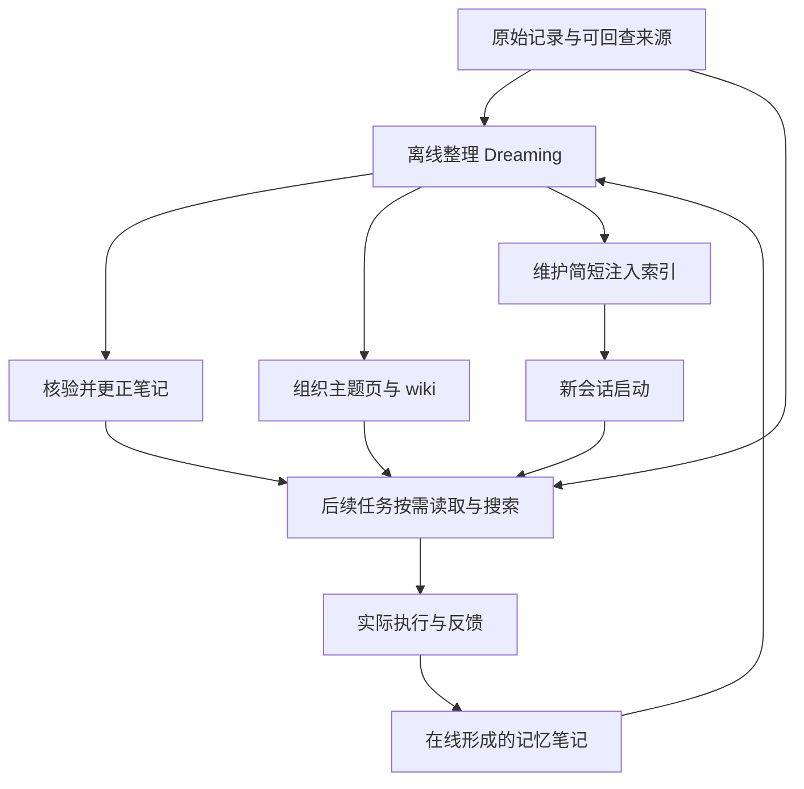

# Agent 应该记住什么，又怎样知道自己记错了？

一个 Agent 在上次任务中记下：“配置文件在旧目录里。”下一次，它认真阅读记忆，找不到文件，花了十分钟排查权限，最后又把这段失败写进记忆。它越来越熟悉自己的历史，却离当前事实越来越远。

Anthropic 在 2026 年 11 月 6 日发表的 [《The components of agent memory》][article] 研究的就是这类问题：跨会话保存的信息怎样变得有用，又怎样避免成为下一次任务的障碍。本文结合原文全部正文、15 幅图的官方说明，以及相关产品文档和教程展开；资料核验于 2026 年 11 月 8 日。原文实验均为 Anthropic 报告的结果，本文没有复现其内部任务或验证模型能力排行。

最值得带走的发现有三项。第一，记忆的价值依赖于模型能否挑出有用经验，并区分猜测与已经检验的规则。第二，离线整理可以回查原始记录、纠错和重组知识，但需要计算，也可能制造新的错误。第三，wiki、搜索和每次启动时加载的短索引承担不同职责；哪种组合更好，要由具体任务和维护成本决定。

已有的 [Agent Memory 总论](./Agent_Memory_系统深度解析.md)偏重保存、检索与注入架构；本文围绕这篇新文章的实验，进一步追问：**经验怎样变成可靠的记忆，记忆又怎样接受再次检验？**

## 1. 本文的“记忆”具体指什么

原文对 Agent memory 使用了一个较窄的定义：Claude 从用户互动和任务经历中获得知识，把它保存在会话之外，供后续会话读取。这里的学习发生在外部资料中，而不是模型权重中。[原文：Memory notes][article]

| 容易混淆的对象 | 保存或改变了什么 | 与本文研究的关系 |
| --- | --- | --- |
| 模型训练、微调 | 模型权重 | 原文不研究这种学习 |
| 单次对话中的上下文学习 | 当前会话里可见的信息 | 原文把它与跨会话保存区分开 |
| Compaction，上下文压缩 | 为继续当前任务而生成的历史摘要 | 能支持任务续接，但原文不把它等同于长期经验记忆 |
| 外部记忆笔记 | 可跨会话读取的事实、规则、计划或经验 | 本文的主要对象 |
| 原始日志和业务资料 | 发生过什么、系统返回了什么、合同写了什么 | 检索与复核的依据，也是纠错的重要来源 |

这个定义不意味着记忆会绕开上下文起作用。新会话仍然要读取某些笔记，把它们放进模型当前可见的上下文。**持久化发生在会话之外，使用发生在本次推理之中。** 这是两个不同层面。

例如，“用户更喜欢先看结论”可以跨会话保存；“刚才运行中的测试还没有结束”首先是当前任务状态；“仓库现在有几个未提交文件”则应从当前 Git 状态读取。把后一类动态事实长期复制进笔记，容易让旧状态与新状态竞争。

原文用人类睡眠期间的记忆巩固作类比。这个类比帮助解释在线记录与离线整理的分工，但文中工程实验没有证明 Agent 拥有人脑相同的记忆机制。

## 2. 四层材料，两个工作时机

原文图 1、9、13 把材料分成四层。这里按各层回答的问题重新排列：[原文图 1、9、13][article]

| 层次 | 回答的问题 | 典型内容 | 主要代价 |
| --- | --- | --- | --- |
| 原始记录 | 当时究竟发生了什么？ | 会话、工具结果、源文档 | 内容长，检索与理解需要成本 |
| 记忆笔记 | 从这次经历中学到了什么？ | 纠错、经验证的操作规则、当前计划 | 可能误判重要性或过度概括 |
| 组织化表示 | 哪些材料有关联，应该去哪里找？ | wiki、主题页、文档之间的链接 | 构建、去重、更新和链接维护 |
| 注入上下文 | 哪些东西值得每次都看到？ | 简短导航、稳定约定、关键提醒 | 每次占用上下文，错误也更容易反复影响行为 |

图中是按原文重构的功能关系，不是要求实现固定的数据库结构。原文允许 Dreaming 从原始记录直接生成不同层次的材料，各层之间也可以修订和重组。

**在线记录**靠近现场，能立即保存刚发现的问题；代价是打断主任务，而且 Agent 还不知道未来真正需要什么。**Dreaming**则是在另一段计算中回顾日志与笔记，做验证、合并、纠错和组织。它得到更多后见信息，却不能保证整理结果马上可用，也需要额外成本。

因此，Dreaming 不能被理解为“定时把聊天摘要再压缩一次”。它可以改变知识的组织方式，修复错误位置，形成新的索引，甚至修改以后怎样构建记忆的指令。关键在于允许它回到来源检验，而不只是对着已有摘要继续改写。

## 3. 同一个记忆目录，为什么不同模型收益差别很大

原文使用 CL-Bench 1.0 的一个数据库问答任务：模型查数据库回答问题，随后得到正确答案，并可以写下经验。每道问题在新会话开始，跨会话保留的是记忆目录。[原文图 3][article]

图 3 左侧报告的是这个任务的 **mean reward，平均奖励**，不是整个 CL-Bench 的总成绩。右侧展示随 30 道问题推进的累计平均奖励。下表数值来自原图的官方替代文本；差值为本文逐项相减。

| 模型 | 无状态基线 | 使用记忆目录 | 平均奖励增加 |
| --- | ---: | ---: | ---: |
| Sonnet 4.6 | 0.330 | 0.364 | 0.034 |
| Sonnet 5 | 0.306 | 0.610 | 0.304 |
| Opus 4.7 | 0.383 | 0.700 | 0.317 |
| Opus 5 | 0.564 | 0.828 | 0.264 |
| Sonnet 5.5 | 0.644 | 0.833 | 0.189 |
| Opus 5.5 | 0.655 | 0.838 | 0.183 |

这些数值不能直接改写成“通用任务成功率提升多少”。图示给出了部分重复次数与误差条，但可公开读取的材料仍不足以独立重建全部运行配置和原始试验数据。

文章对记忆内容的观察比单独看分数更有解释力：

- Sonnet 4.6 会提出失败原因，但留下的很多是未经验证的猜测。
- Opus 4.7 开始把资料整理成统一参考文档，并区分已检查与未确认内容。
- Sonnet 5 会在评分器确认后记录答案，答错时写更正。
- Opus 5 会保存规则、规则成立的依据、旧题答案和已经发现的陷阱；5.5 系列也表现出类似的闭合学习过程。

这里真正重要的是一条可检验的链：**收到反馈 → 提出解释 → 检查解释 → 保存带依据的规则 → 下次调用。** 只把“我猜可能是因为……”写入文件，并没有完成这条链。

### 提示规则何时有帮助

Sonnet 4.6 经常不读记忆，也不检验自己的解释。明确要求它先读取记忆、再检验猜测后，图 5 左侧的平均奖励从“有记忆但未加强指导”的 0.364 上升到 0.641；无记忆基线为 0.330。图 5 的这三个条件各有三次运行，左侧误差条为跨运行标准差，加强提示条件的波动更大；右侧“只记录失败”比较使用标准误，Opus 5 与 Opus 4.7 各三次运行，Sonnet 4.6 仅一次。不能把两侧误差条直接互比，也不能据图宣称效果稳定或统计显著。提示补足了模型没有主动完成的动作。[原文图 5][article]

反过来，“只记录失败”限制了较强模型的判断。图 5 右侧报告，加入这个规则后，Opus 5、Opus 4.7 的**记忆收益分别减少 0.234、0.150 个奖励单位**。这不是说错误应该不记录，而是成功路径、稳定事实、任务结构等也可能值得保存。

可迁移的判断是：先观察系统缺少哪一步，再决定是否补规则。原文支持较强模型在这一任务中从自由判断显著性受益，并没有证明所有任务都应该减少指令，更没有证明权限限制可以交给模型自行决定。

## 4. Pokémon：记忆太多与记忆错误是两种问题

### 4.1 413 个文件为什么没有带来更好进展

文章比较了 Sonnet 3.7 和 Fable 5 各一次游戏运行，在约 10,000 步时查看记忆目录。前者为战斗、物品、人物等大量细节建档，最后有 413 个文件、225 个文件夹，只获得一枚徽章；后者用了两个文件夹中的九个文件，再加顶层 `global.md`，获得四枚徽章。图 4 中后者的文件总数因此是 **10 个**。[原文图 4][article]

Sonnet 3.7 的一个问题是记录了大量很快会变化、屏幕上又能直接看见的信息，例如位置和金钱。原文给出的片段中，它用连续 17 步新建六个文件、删除九个文件，没有执行游戏动作。维护开始挤占任务本身。

Fable 5 更多地保存目标、路线计划和策略。它的 `global.md` 是导航面板，主题文件承接具体路线和玩法经验。后来 Opus 5.5 也使用较小、持续改写的笔记集合，并完成了游戏。

这个比较说明了一个可能的失败机制，但**不是“少写文件导致能力提升”的受控实验**：模型不同、轨迹不同，而且关键比较各取了一次运行。文件数也不是优化目标。一个小而错误的文件，仍然可能比大量正确资料更有害。

原文还举了捕捉鲤鱼王时改变按键等待节奏的记忆。[推测] 这类从局部成功得到的策略，可能混有环境随机性；与数据库题得到评分器反馈不同，不能把一次奏效自动推广成普遍规律。

### 4.2 月见山案例：错误记忆怎样自我强化

月见山入口在西侧，出口在东侧。入口附近有单向台阶，走下去会退回之前的路线。Claude 却把入口附近的 Pokémon Center 记成位于东侧，随后认为自己已经穿过山洞，往前走时又掉回旧路线。[原文图 7、8][article]

麻烦不止发生在第一次判断错误。导航工具没有清楚显示下落，Claude 把退回西侧解释成“走过头了”，从而维持了错误的世界模型。旧笔记指导动作，含糊反馈又被旧笔记解释，错误得以延续。

Dreaming 在这个例子中回读原始会话，发现位置记错，重写笔记。带着更正记忆的运行重新进入山洞，最终到达华蓝市；保留错误记忆的运行三次跌回旧路线，最后仍未到达。

这个例子的关键是**重新打开了已被压缩掉的证据**。如果整理阶段只能读取“已经过山”这句摘要，就难以发现摘要与实际轨迹的矛盾。

同时，日志不天然等于真相。日志里既有工具观察，也有模型错误的自述。检查“Agent 当时说到了目的地”与检查“环境实际返回到达状态”，证据强度不同。官方教程也明确要求把 transcript、记忆文件和运行结果当作待分析的数据，而非应该遵循的新指令。[Dreaming 教程：Define the dreaming agents][cookbook]

## 5. wiki 的价值取决于问题怎样分布在资料中

### 5.1 企业文档实验：搜索仍然不可替代

Anthropic 用 Stainless 的内部语料做实验：约 35 万个文件、4.2 亿 tokens，评估集包含 25 道问题。Opus 5 在连续会话中探索文档、建立链接、修订 wiki、合并重复项并核对来源；后续会话接续之前的成果。[原文图 10][article]

| 回答问题时可用的材料 | 随 wiki 构建规模增加的表现 | 应怎样理解 |
| --- | --- | --- |
| 只有 wiki | 满足评分标准的比例从 13% 到 48% | 更丰富的组织化表示有帮助，但遗漏和抽象损失仍然存在 |
| 只有搜索工具 | 53% | 原始资料检索本身就是强基线 |
| wiki 加搜索工具 | 从 54% 到 61% | wiki 帮助定位与理解，搜索提供回源补充；最佳组合比单独搜索高 8 个百分点 |

这是**评分标准满足比例**，不是“25 道题答对了 61%”。原文还报告，wiki 加搜索每题约节省 20,000 tokens。这个数字描述回答阶段，不能忽略前面的 wiki 构建计算。

图 10 横轴是 Dreaming tokens，范围从 2M 到 128M；正文对应从 2 次到 128 次构建会话。图下注明，这是每会话 1M tokens 的**预算，非实测消耗**。它表示允许投入的整理规模，不能直接当作实际计算账单。实验展示了组合效果，未把“多读了一遍来源”和“wiki 组织形式本身”的贡献完全分离，也未给出足以判断最优投入点的完整成本曲线。

### 5.2 跨文档问题与单文档查找，需要不同的表示

另一项并购资料测试包含 24 道问题，超过一半需要跨多份文档组合信息，一部分还要判断或计算。对原文所指的跨文档等相应项目，wiki 条件得分为 87%，直接搜索为 73%。这一结果不能扩成所有并购问答、整个 Harvey LAB，或全部 24 道题统一的成功率。[原文图 11][article]

为什么这类任务可能获益？一个问题可能同时依赖收购协议、披露文件和补充说明。每次重新搜索都要再发现它们的关系；wiki 可以预先保存实体别名、条款之间的联系和来源入口。

但在另一个 LAB 任务中，大多数评分要求可以从单个文档直接找到，wiki 没有显示清楚优势。还有一个例子，10 份原文只有 115 KB，wiki 却发展成 68 页、203 KB，体积达到原文的约 1.77 倍。图 12 描述的是这样的表示膨胀。[原文图 11、12][article]

因此，应该先问任务经常要求做哪种工作：

- 定位一个原文事实：直接检索可能足够。
- 多次重建跨文档关系：主题页、实体索引和 wiki 可能省去重复劳动。
- 必须精确保留条款：来源原文和逐条核验比泛化摘要更重要。

wiki 的页数和链接数不能单独证明价值。它首先应帮助后续任务少走弯路，同时保留回到原文的路径。

## 6. 合同案例：“100%”背后到底改了什么

一个 LAB 任务要求根据收购相关合同生成简报。初始 wiki 构建指令较宽泛，多个 Agent 同时向共享条款表写入，造成覆盖和摘要遗漏。生成的材料只保住 57 项受评事实中的 41 项，约为 72%。[原文图 14][article]

作者随后让 Claude 反思失败、修改构建指令并重建 wiki。新方案包含几个同时发生的变化：

1. 明确合同条款是任务的重要对象。
2. 每份合同拥有独立页面，由一个 Agent 写入。
3. 条款按原文保存，避免在共享表里过度压缩。

改进后，这个任务的 57 项标准全部得到满足。这里的“100%”仅指这个局部评分口径，**不表示所有合同风险均被识别，也不表示模型已能无误地完成法律工作**。实验同时改变了指令、写入分工与表示方式，不能把全部收益归给其中一个因素。

这一案例把一个常被视为“模型记性差”的问题还原为三个具体故障：写入冲突、表示有损，以及任务要求没有进入构建目标。

另一轮整理还修好了指向不存在页面的九条链接，并增加了三页材料，包括索引。这个改进属于资料结构维护，不等于发现了九项新的事实。[原文图 15][article]

[推测] 在自己的系统中，单独记录“覆盖了多少重要事实”“有多少并发覆盖”“链接是否可达”，会比只统计摘要长度更接近这些真实失败原因。

## 7. 每次自动注入的东西，应接受更严格的筛选

原始日志可以很大，因为只有需要时才查询；顶层记忆一旦在每个会话启动时加载，就会持续占用上下文，并让错误笔记获得反复影响行为的机会。这是四层体系里影响范围最大的层次。

原文以 Claude Code 的 auto memory 为例。当前官方文档规定，启动时读取 `MEMORY.md` 的前 **200 行或 25 KB，以先到达的上限为准**，主题文件按需读取。这个上限只适用于这里的 `MEMORY.md`，不能直接套用到所有指令文件或其他产品。[Claude Code：How it works][code-memory]

一个实用的顶层索引应该让模型知道三件事：有哪些相关知识，什么情况下需要它，以及到哪里查具体证据。具体步骤、长案例和经常变化的数据可以留在下层。

要区分两个问题：模型是否读到了提醒，以及系统是否允许它执行某个动作。Claude Code 文档明确把这些文件当作上下文而非强制配置；需要无条件执行的边界，应由实际权限或工具机制实现。[Claude Code：CLAUDE.md vs auto memory][code-memory]

对错误记忆的处理也不应只追加一条“之前那条错了”。如果旧结论仍在顶层摘要和多个主题页中，被检索到的仍可能是旧版本。更正应追踪派生关系，检查相关页面和索引是否仍然引用它。后一项是本文的工程建议，不是原文已验证的全局删除传播机制。

## 8. 从研究想法到产品：三份文档分别承诺了什么

原文展示的是设计与评测。配套文档提供实现入口，但产品接口的存在不证明它会自动重现文中的收益。以下按 2026 年 11 月 8 日读取内容整理。

| 实现入口 | 读写方式与结果 | 需要注意 |
| --- | --- | --- |
| Managed Agents Memory Stores | 记忆库挂载为文件目录；可读写或只读，写入生成可追踪的版本 | 共享可写材料仍需处理冲突；API 提供 `content_sha256` 前置条件，哈希不匹配时应回读后再处理 |
| Managed Agents Dreams API | 读取已有记忆库和 1–100 个会话，异步生成另一份输出记忆库 | 不修改输入；输出 ID 出现不等于任务完成；失败或取消可能留下部分输出 |
| 官方 Dynamic Workflow 教程 | 分析器按 transcript 提炼记忆，全部完成后由组织器整理；未来任务只读使用 | 教程自建流程会原地更新目标库，和 Dreams API 的“新库输出”约定不同 |

来源：[Memory Stores][managed-memory]、[Dreams][dreams]、[Dynamic Workflow 教程][cookbook]。

Dreams API 在 `completed` 后才把完整输出交给后续使用；用户可以检查、采用或丢弃。`instructions` 用于指导关注领域、保留内容和输出组织，不是逐句编辑器；精确修改某条记忆应走记忆 API。该接口仍是 research preview，按所选模型的标准 token 用量计费。[Dreams：Steer with instructions、Use the output、Billing][dreams]

Memory Stores 的只读权限由文件系统执行。API 的乐观并发条件可以避免把新修改静默覆盖，但有版本记录仍不等于业务语义正确，也不等于自动解决冲突。[Memory Stores：Safe content edits][managed-memory]

教程则提供一套可改造的工作流：分析器完整读取 transcript，验证已有记忆、补充信息、组织主题页；组织器统一修复链接、合并重复项和维护索引。它限制分析器的工具与网络能力，并把历史记录作为不可信输入。教程也提醒，夜间原地更新会在人工阅读前改变后续 Agent 使用的材料；只读挂载能够阻止消费方写坏库，不能保证库里的内容是正确的。[教程：Define the dreaming agents][cookbook]

这些文档提供了可运行入口。本文仅核对其公开合同与说明，没有创建云端 Agent、运行 Dreaming 或使用私人会话做实验。

## 9. 怎样把这个思路变成可验证的学习系统

以下是一套由本文提出、尚待实验的迁移方案。它与 [ALTK-Evolve 学习型 Memory 报告](./ALTK_Evolve_学习型Memory与Agent服务任务_深度解析_20261021.md)中“经验需要来源、适用条件和评测”的问题相接，但没有复验那篇报告的数值。

先从一个重复出现的窄任务开始，例如在代码仓库中定位并修复测试失败。保留四种材料：原始操作记录；带状态的经验；按主题组织的入口；短小的启动索引。经验至少写明它来自哪里、适用于什么条件、最后何时核验，以及目前是猜测、已验证还是已被替代。

假设一次任务发现“测试必须先启动本地数据库”。这可能只适用于集成测试，而不适用于单元测试。如果去掉这个前提，下一次每个小测试都启动数据库，记忆就把局部成功变成了全局成本。整理阶段应检查规则的适用范围，并保留能够反驳或修正它的记录。

### 用相同条件比较，而不是只展示成功案例

在固定模型、任务环境、时间上限和历史资料后，比较以下条件：

| 条件 | 想分离的影响 |
| --- | --- |
| 新会话，仅使用当前任务材料 | 基线能力 |
| 可以搜索历史记录 | 原始历史本身的价值 |
| 历史搜索加在线记忆笔记 | 当场提炼经验的增量 |
| 搜索、笔记加离线整理 | 纠错和重组的增量 |
| 再加入少量固定注入内容 | 提前提示与上下文占用的净影响 |

测试任务与生成记忆的任务必须分开；构建阶段不能看到测试答案或未来反馈。对不同条件保持相同执行预算，另行报告记忆构建与维护花费；用多次独立运行估计波动。尤其应加入“旧事实已改变”“过去模型自述错误”“资料中含指令注入”“删除或撤回一条知识”的场景。

指标至少包括任务成功或评分标准满足率、被旧记忆误导的次数、关键事实保真度，以及每个成功任务的总成本。链接完整率和文件数有助于诊断，但不能代替任务表现。

### 计算什么时候值得提前支付

在任务质量达到可接受门槛后，可以用一个简单收支关系检查 Dreaming 的经济性：

\[
N\,\Delta c > C_{\mathrm{build}} + C_{\mathrm{maintain}}
\]

其中，\(N\) 是后续使用次数，\(\Delta c\) 是每次使用相对基线节省的平均成本，\(C_{\mathrm{build}}\) 是构建成本，\(C_{\mathrm{maintain}}\) 是比较周期内的维护成本。成本单位须一致，并覆盖模型调用、重试和其它纳入核算的资源。这是本文的分析式，不是 Anthropic 给出的定律。

原文企业 wiki 实验给出了最高 128M Dreaming tokens 的预算，以及每题约 20,000 tokens 的回答阶段节省。如果**仅为说明数量级**，额外假定预算被全部用尽、两类 token 成本相同、每题节省稳定、全部构建投入都由这一批查询承担，并忽略维护，则 \(128{,}000{,}000 / 20{,}000 = 6{,}400\) 次查询才抵消这项投入。这只是预算全额用尽时的算术示例。原图明确没有把预算当成实测用量；真实账单还受模型、输入输出价格、缓存和计算构成影响，原文数据不足以给出真实回本点。

这个例子提醒我们：查询便宜了，不代表整个系统已经便宜。对于只读一次的材料，提前构建大 wiki 可能不划算；对于反复处理的跨文档任务，组织知识的投入更可能被摊薄。[推测]

## 10. 最值得继续检验的问题

本文形成的主要判断是：记忆是一套持续作出选择、保存依据、组织材料并接受纠错的过程。模型能力影响这套过程，但来源质量、写入规则、检索路径和任务目标同样重要。

还有几项证据缺口，不能用“模型会自己整理”带过：

- **纠错怎样跨层传播？** 某个事实被撤回后，笔记、wiki 和注入索引能否同时停止使用旧结论？原文没有给出完整的传播与删除实验。
- **什么值得经常重查？** 信息变化频率、影响大小与被使用次数，怎样共同决定整理周期？原文提出按变化与访问情况调整，但没有给出普遍最优策略。
- **整理自身怎样受约束？** 共享写入、错误概括和历史中的恶意指令都会进入整理过程；版本、只读挂载与来源核验能降低不同风险，不能互相替代。
- **怎样区分表示优势与额外计算优势？** 企业 wiki 结果需要同预算、同信息访问条件和多个任务集的对照，才能更精确归因。

下一步最有价值的动作，是在一个重复出现、结果可验证的任务中测试“只搜索历史”和“搜索加离线整理”。如果收益只来自多读了资料，或维护成本超过节省，应该允许实验得出“不需要更复杂记忆层”的结论。

## 来源与核验范围

1. **[Anthropic 原文：The components of agent memory][article]**，2026-11-06。读取全文、原始 HTML、15 幅图的官方替代文本与图注，并通过图像读取核对图 5、10 的误差条和预算脚注；图 3 数值取自官方替代文本。内部语料、完整实验配置和原始运行轨迹未公开取得，结果按厂商报告处理。
2. **[Claude Code：How Claude remembers your project][code-memory]**。核对 auto memory 的加载阈值、按需主题文件，以及上下文提示与强制权限的区别；不代表本文测试了各平台的实际安装版本。
3. **[Managed Agents：Dreams][dreams]**。核对输入输出隔离、完成状态、失败残留、用途及研究预览边界。
4. **[Managed Agents：Memory Stores][managed-memory]**。核对挂载权限、版本和 `content_sha256` 并发前置条件。
5. **[Dreaming with a dynamic workflow][cookbook]**。核对教程的分析器与组织器分工、原地更新方式，以及历史记录作为不可信数据的处理；未运行其云端工作流。

这些来源主要来自同一厂商。实现文档可以澄清接口合同，却不能作为独立复现来证明研究效果。本文的迁移方案、成本推导和后续实验设计均为分析建议，尚未在本地工作台或生产系统验证。

[article]: https://www.anthropic.com/research/components-of-agent-memory
[code-memory]: https://code.claude.com/docs/en/memory
[dreams]: https://platform.claude.com/docs/en/managed-agents/dreams
[managed-memory]: https://platform.claude.com/docs/en/managed-agents/memory
[cookbook]: https://platform.claude.com/cookbook/managed-agents-cma-dreaming-with-a-dynamic-workflow
