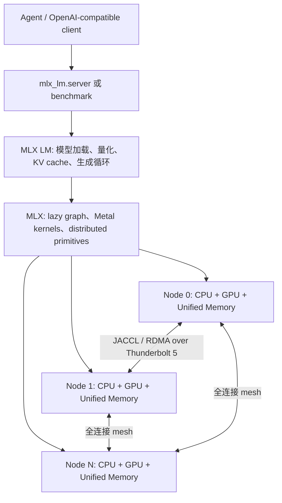

# Apple MLX + RDMA：把多台 Mac Studio 变成桌面级大模型推理集群

> 研究时点：2026-10-21  
> 核心材料：Apple Machine Learning Research《[Local and Distributed Large LLM Inference with MLX and RDMA on Mac Studio](https://machinelearning.apple.com/research/mlx-distributed-inference)》、MLX 0.32.x 官方文档、MLX / MLX LM 源码，以及 GPipe、Megatron-LM 两篇并行计算原始论文。  
> 证据边界：本文没有购置或接入 M5 Ultra 集群，也没有独立复现 benchmark。Apple 的模型速度、内存与功耗数字均标为**厂商自报**；可以从公开代码核验的是测试入口、并行选择、参数含义与部分实现，不是具体跑分。

## 一、结论先行

Apple 这篇文章真正展示的，不只是“Mac 也能跑大模型”，而是一套完整的垂直协同：

```text
大容量统一内存
  × MLX 对 Apple silicon 的执行与量化优化
  × macOS 26.2 的 Thunderbolt 5 RDMA
  × JACCL 低延迟 collective
  × pipeline / tensor parallel 的模型切分
  = 多台桌面 Mac 共同承载单机放不下的模型
```

最值得记住的判断有六条：

1. **统一内存解决单机内 CPU/GPU 数据驻留，RDMA 解决机器之间的传输；它们是两个层次的问题。** 统一内存不会把多台 Mac 自动拼成一块全局内存，模型仍需显式切分，节点间仍需同步。
2. **流水线并行首先解决“放得下”，张量并行才主要解决“跑得快”。** 单请求逐 token decode 时，流水线各阶段仍按层顺序执行，所以两台机器的 decode 速度接近单机；长上下文 prefill 可以通过分块重叠获得加速。
3. **张量并行用高频通信换取层内并行。** 每层都需要广播、聚合或同类 collective，只有 RDMA 足够低延迟时，增加机器才可能抵消通信成本。
4. **Apple 展示的是高质量工程样机，不是通用集群替代品。** 四节点 JACCL 要求 Thunderbolt 全连接 mesh；文章还给每一对机器接两根线。四台机器由此需要 6 对连接、12 根线，每台占用 6 个 peer link。[推测] 这种物理拓扑很难继续横向扩展。
5. **官方数字很亮眼，但证据只支持特定工作负载。** benchmark 是 batch size 1、8,192 或 65,536 token prompt、随后生成 128 token；没有公布误差条、长期并发、质量变化、总拥有成本或同价位 GPU 系统对照。
6. **当前最大的工程警讯来自官方文档自身。** Apple 文章为降低 CPU/GPU 同步开销开启 `MLX_METAL_FAST_SYNCH=1`；当前 MLX 0.32.x 文档却警告该实验开关可能 deadlock 并让 GPU wedged，默认关闭且“best left unset”。因此，文章中的峰值性能和稳态可运营配置不能直接画等号。

对个人使用而言，最现实的价值排序通常是：**先用一台大内存 Mac 跑合适尺寸与量化的模型，再评估两机 pipeline，最后才考虑多机 tensor parallel。** 如果模型本来就在单机内存中、请求量不高，多机复杂度可能大于收益。

## 二、原文在回答什么问题

Apple 的论证可以还原成三层问题。

### 2.1 问题一：单台桌面设备能否承载“大而长”的模型

单机是否能运行模型，首先由内存决定：

\[
M_{total} \approx M_{weights} + M_{KV} + M_{activation} + M_{runtime} + M_{OS}
\]

权重的理想下界可粗略估算为：

\[
M_{weights} \approx P \times \frac{b}{8}
\]

其中：

- \(P\)：参数量；
- \(b\)：每个参数的存储位数；
- 除以 8：从 bit 换算成 byte。

以 Apple 测试的 Muse Spark Open 为例，816B 参数若全部使用 BF16，理想权重占用约为 \(816B \times 2\) bytes，即 1.632 TB，和原文“仅权重就超过 1.6TB”一致。若理想化地全部按 4 bit 存储，下界约为 408GB；Apple 自报实际 NVFP4 模型 footprint 约 493GB。**[推测] 两者差额可能包括量化 scale、元数据、对齐以及未完全按 4 bit 保存的部分**，但原文没有给出分项账。再加运行时中间量，它无法稳妥装进一台 512GB Mac Studio。

长上下文进一步放大 KV cache。对标准 Transformer，可用下式理解其主要缩放关系：

\[
M_{KV} \propto T \times L \times n_{kv} \times d_{head} \times bytes \times batch
\]

其中 \(T\) 是上下文长度、\(L\) 是层数、\(n_{kv}\) 是 KV heads 数、\(d_{head}\) 是每个 head 的维度。不同架构会用 GQA、MLA、量化 KV 等方法改变常数项，但“上下文越长，KV 通常越大”的关系仍成立。

### 2.2 问题二：单机放不下时，怎样切模型

Apple 采用两条经典路线：

- **Pipeline parallelism**：沿深度切，把连续层分给不同机器；
- **Tensor parallelism**：沿宽度切，把同一层的矩阵或张量分片给不同机器。

这不是 Apple 新发明的概念。GPipe 已系统展示按层切分与 micro-batch pipeline；Megatron-LM 则展示在 Transformer 层内插入少量 collective 来实现 tensor model parallel。Apple 的增量在于：把这些方法落到 MLX、Apple unified memory 与 Thunderbolt RDMA 上，并将部署入口压缩到 `mlx.launch` 和 MLX LM 的几个参数中。[GPipe](https://arxiv.org/abs/1811.06965)；[Megatron-LM](https://arxiv.org/abs/1909.08053)

### 2.3 问题三：桌面互联能否满足张量并行的延迟要求

普通网络可以传数据，但张量并行在每层、每个 token 上反复通信。决定成败的不只是峰值带宽，还有小消息延迟、collective 实现和 CPU/GPU 同步开销。

MLX 官方文档称，JACCL 通过 macOS 26.2 起提供的 Thunderbolt RDMA，把通信延迟降到 ring backend 的约一个数量级；这仍是官方描述，本文没有独立测量。Apple 本次配置使用 JACCL；对 tensor parallel 来说，**足够低延迟的互联**是获得加速的必要条件，公开材料并不能证明 JACCL 是唯一可能的后端。[MLX Distributed Communication](https://ml-explore.github.io/mlx/build/html/usage/distributed.html)

## 三、系统架构：四层拼起来才是完整方案



### 3.1 MLX LM：模型与服务层

`mlx-lm` 负责模型下载与加载、量化、生成、KV cache、benchmark 和 OpenAI-compatible server。当前公开 `benchmark.py` 中：

- `-p / --prompt-tokens` 控制 prompt 长度；
- `-g / --generation-tokens` 控制生成长度；
- `-b / --batch-size` 控制 batch；
- 默认计时 trial 数为 5；
- `--pipeline` 打开流水线并行，否则多节点默认走 tensor sharding；
- `--prefill-step-size` 默认 2,048，控制长 prompt 分块。

源码还显示，多节点时统一进入 `sharded_load()`；pipeline group 与 tensor group 二选一。[MLX LM benchmark.py](https://github.com/ml-explore/mlx-lm/blob/master/mlx_lm/benchmark.py)

### 3.2 MLX：单节点执行层

MLX 的关键抽象是：数组位于 Apple silicon 的统一内存池中，CPU 与 GPU 都可以访问。开发者不是先把 tensor 显式搬到 CPU heap 或 GPU heap，再调用算子；而是在执行操作时选择 CPU 或 GPU stream，依赖关系由 MLX 调度器插入。[MLX Unified Memory](https://ml-explore.github.io/mlx/build/html/usage/unified_memory.html)

这降低了框架层设备拷贝和编程复杂度，但不代表访问没有成本：CPU/GPU 仍要同步，内存带宽仍是有限资源，工作集超过物理内存后仍会严重退化。

### 3.3 JACCL：节点间 collective 层

MLX 当前提供 ring、MPI、JACCL 和 CUDA 环境的 NCCL 等后端。JACCL 的公开要求包括：

- macOS 26.2 或更新版本；
- 支持 Thunderbolt 5 的 Mac；
- 进入 Recovery 执行 `rdma_ctl enable`，这一动作不能通过远程 sudo 完成；
- 节点间必须是全连接 Thunderbolt mesh；
- SSH 可达；
- hostfile 记录 rank 0 协调地址和每对节点的 RDMA device；
- 禁用 Thunderbolt bridge，并为物理连接设置隔离本地网络。

`mlx.distributed_config` 可以探测线缆、校验 mesh、生成 hostfile，并在具备免密 sudo 时自动配置；`mlx.launch` 再通过 SSH 启动并监控各 rank。[MLX Launching Distributed Programs](https://ml-explore.github.io/mlx/build/html/usage/launching_distributed.html)

### 3.4 数据路径：不是“GPU 直接隔空读另一台 GPU”

下面是依据 Apple 原文与 MLX 文档整理的**[推测] 派生示意**，用于解释同步边界，不是 JACCL 对 buffer 放置与执行顺序的公开实现合同：

```text
本机 GPU 计算局部层或矩阵分片
  → 结果进入本机统一内存可见的数组
  → CPU 发起或协调 JACCL / Thunderbolt RDMA 通信
  → 对端内存收到数据
  → 对端 CPU/GPU 同步依赖
  → 对端 GPU 继续计算
```

统一内存减少“CPU buffer ↔ 独立 GPU VRAM”的显式搬运；RDMA 减少远端通信栈开销。两者之间仍有同步边界。Apple 文章明确说通信由 CPU 发起、计算由 GPU 完成，这也是它开启快速 CPU/GPU 同步实验开关的原因。

因此，“zero copy”若不附条件就会误导。公开材料最多支持：**在 MLX 编程模型中不需要显式维护 CPU 与 GPU 两套数组副本；跨机路径仍包含 collective、同步、协议初始化与远端内存传输。**

## 四、两种并行方式为什么表现不同

### 4.1 Pipeline parallel：通信少，主要价值是扩容

MLX LM 的 `PipelineMixin` 将连续层分给不同 rank。默认近似均分层数，并保持原层编号以便加载权重。rank 之间只需传递阶段边界的 activation。[MLX LM pipeline.py](https://github.com/ml-explore/mlx-lm/blob/master/mlx_lm/models/pipeline.py)

假设两台机器各保存一半层，单个 decode token 仍要经历：

```text
节点 A：前半层 → 发送 activation → 节点 B：后半层 → 输出 token
```

后半层不能在前半层完成前处理同一个 token。因此，batch size 1 的逐 token decode 没有把两半计算完全并行起来。Apple 自报两机 pipeline 的 decode 速度与单机近似相同，符合这一机制；收益主要是让模型权重跨机器放下。

长 context prefill 不同。MLX 把 65,536-token prompt 按 8,192-token chunk 切分后，节点 B 处理 chunk \(k\) 的后半层时，节点 A 可以处理 chunk \(k+1\) 的前半层。多个 chunk 形成流水，Apple 自报由此获得最高约 1.8× prefill 加速。

Pipeline 的边界：

- prompt 太短或 chunk 太少时，流水填充与排空成本占比高；
- 层的计算量不均时，最慢 stage 决定整体速度；
- decode 依旧受阶段串行限制；
- 某一节点或链路失败会中断整个请求。

### 4.2 Tensor parallel：计算并行，通信也进入每一层

Tensor parallel 将每层的矩阵按宽度切分：各机器同时计算一部分，再通过 collective 合成下一步所需结果。粗略地说：

\[
T_{layer}(N) \approx \frac{T_{compute}}{N} + T_{collective}(N, size, topology)
\]

只有当减少的计算时间大于 collective 增量时，扩容才有效。

这解释了三个现象：

1. **低延迟比单纯峰值带宽更关键。** decode 每个 token 都会在多层上触发小而频繁的通信。
2. **两台机器未必接近 2×。** 通信、同步和负载不均会吞掉一部分收益。
3. **密集模型比 MoE 更容易平滑扩展。** Apple 指出 Muse Spark Open 在大 context prefill 时，还要为不同 expert 输出做额外归一化通信；两机 tensor 一度落后于两机 pipeline，四机才重新占优。

### 4.3 为什么双线连接对 prefill 有效

Apple 在每对 Mac 之间使用两根 Thunderbolt 线。其额外实验显示，在四台 M5 Ultra、Muse Spark Open、65,536-token context 下，单线 TTFT 约 50.5 秒，双线约 40.6 秒，缩短约 19.6%。这是**厂商自报的单一额外实验**，没有重复次数或波动范围。

它说明该 prefill 已能吃到更多链路带宽；也暴露了拓扑成本：

\[
pairs = \frac{N(N-1)}{2}
\]

若每对用两根线，则总线缆数为 \(N(N-1)\)。四节点是 12 根；五节点会变成 20 根，每台还要连接 8 条 peer link。[推测] 没有交换式 RDMA fabric 时，这是一条明显的扩展上限，而 Apple 文章也只展示到四节点。

## 五、性能数字：哪些可以相信到什么程度

### 5.1 原文可直接追溯的结果

下表全部是 **Apple 厂商自报**，并非本文复现：

| 观察 | Apple 报告值 | 测试口径或限制 |
|---|---:|---|
| Muse Spark Open，4× M5 Ultra tensor decode | 36.73 tokens/s | 8,192-token context，生成 128 token，batch 1 |
| Muse Spark Open，2× M5 pipeline decode | 15.74 tokens/s | 同一文章表格；主要作为能放下模型的 baseline |
| Muse Spark Open，2× M5 tensor decode | 24.99 tokens/s | 同上 |
| M5 Ultra 对 M3 Ultra 的 TTFT | 最高 4.6× | Qwen 3.8 / Mistral Medium 3.5，8,192 与 65,536 context；未给原始逐次日志 |
| M5 Ultra 对 M3 Ultra 的 decode | 最高 1.6× | Apple 归因于 1.2 TB/s 对 819 GB/s unified-memory bandwidth |
| 两机 pipeline 长 context prefill | 最高约 1.8× | 65,536 context、8,192 prefill chunk；短 context 无同等收益 |
| Qwen 3.8 27B 内存 | 最高约 68GB | 65,536 context，BF16 |
| Mistral Medium 3.5 128B 内存 | 最高约 158GB | 65,536 context，FP8 |
| Muse Spark Open 权重 footprint | BF16 超过 1.6TB；NVFP4 约 493GB | 还未包含完整推理中间内存 |
| 峰值功耗 | M3 Ultra 约 200W；M5 Ultra 约 300W | 65,536 context；peak power，不是 energy/token |

三个模型不是同精度横向竞赛：Qwen 3.8 用 BF16、Mistral Medium 3.5 用 FP8、Muse Spark Open 用 NVFP4。Muse 是 816B total / 42B active 的 MoE，另外两个是 dense。数字可用于理解同一模型在不同硬件或并行方案下的趋势，不适合拿来判断三个模型谁“更高效”或“更强”。

### 5.2 TTFT 与 decode 为什么受不同硬件瓶颈支配

在文章的 batch 1 场景下：

- **TTFT / prefill**：一次处理大量 prompt token，形成较大的矩阵乘，算术强度高，因此更偏 compute-bound；M5 GPU Neural Accelerators 对矩阵乘的支持带来明显收益。
- **逐 token decode**：每一步只推进少量 token，却要读取大量权重，计算单元经常等内存，因此更偏 memory-bandwidth-bound；M5 Ultra 更高统一内存带宽转化为约 1.6×的厂商自报收益。

这不是普遍定律。更大的 batch、不同量化 kernel、speculative decoding、KV cache 命中、并发服务和模型结构都可能移动瓶颈。正确写法是“在 Apple 本次 benchmark 条件下”，而不是笼统说所有 LLM prefill 都只看算力、decode 都只看带宽。

### 5.3 benchmark 的证据缺口

原文公布了命令、模型、精度、context 和核心结果，复核性优于只放营销图；但仍缺少：

1. 完整机器 SKU、频率、温度、系统后台负载与散热状态；
2. 实验使用的精确源码 commit、每个 configuration 的逐次日志、方差和误差条；公开 `benchmark.py` 可见 warmup、默认五次与算术平均，但不能证明文章运行时使用的版本和逐次数据；
3. 模型输出质量与 NVFP4 量化损失；
4. 长时间并发、排队、p95/p99 延迟和故障恢复；
5. 端到端功耗、空闲功耗与 energy/token 的测量链；公开 benchmark 入口本身不负责采集功耗；
6. 同成本 NVIDIA/AMD 服务器或云实例对照；
7. 购买成本、线缆与运维成本、利用率和折旧；
8. `MLX_METAL_FAST_SYNCH=1` 关闭时的结果。

最后一项尤其关键：当前官方文档明确警告 fast sync 可能 deadlock 并使 GPU wedged。Apple 示例命令开启了该变量，公开数字是在这一配置下测得；由于没有关闭开关的对照，不能量化它对结果的因果贡献。版本后续可能修复，但在 2026-10-21 的资料时点不能忽略这一稳定性差异。

## 六、它适合什么，不适合什么

### 6.1 最适合的场景

- 模型或长 context 工作集大于单机显存，但能落在 2–4 台高内存 Mac 的总容量中；
- 数据不能或不希望离开本地环境；
- 以 batch 1 交互、研究、离线分析或个人 Agent 为主；
- 已有 Apple silicon / Thunderbolt 5 设备，能接受固定物理拓扑；
- 需要在 MLX 中快速修改模型、量化或推理方法；
- 对噪声、机房供电和家用/办公室部署有要求。

### 6.2 不应从文章直接推出的结论

- “四台 Mac 比 GPU 服务器便宜”——原文没有做 TCO 对照；
- “36.73 tokens/s 就足以支持多人生产服务”——没有并发与尾延迟；
- “统一内存等于四台机器共享一块 RAM”——节点内统一，节点间仍分布式；
- “RDMA 后所有通信都零拷贝、无 CPU 参与”——原文明确由 CPU 发起通信；
- “pipeline 两台就有两倍 decode”——厂商结果恰好显示 decode 近似单机；
- “本地运行等于完整隐私保证”——它减少向云端发送模型输入，但主机安全、依赖下载、日志、服务暴露与访问控制仍需单独治理。

### 6.3 个人设备的白话决策表

| 现状 | 优先动作 |
|---|---|
| 只有一台 Apple silicon Mac | 先选合适模型与量化；实测内存、TTFT、decode，不考虑分布式 |
| 模型能放进单台大内存 Mac | 默认单机；只有 TTFT 或吞吐确有瓶颈时再试 tensor |
| 模型略大于单机内存，已有两台 TB5 Mac | 先试 pipeline，目标是“装得下且稳定” |
| 两台以上同代高内存 TB5 Mac，且需要更快 decode | 再试 JACCL tensor，并把通信与同步单独 benchmark |
| 设备主要是 Windows / NVIDIA | MLX + JACCL 不是直接迁移路径，应保留 CUDA 推理栈 |
| 不能进入 Recovery 或不能改网络配置 | 当前 JACCL 不适用 |
| 需要 7×24 小时稳定服务 | 先验证 fast sync 关闭后的性能、故障恢复和长时 soak，再谈上线 |

## 七、对 EverAgent 与个人 AI 工作台的启示

公开仓不记录私人设备拓扑，因此这里给出架构原则和验收方法，不假设具体机器配置。

### 7.1 把 MLX 集群当作一个可替换 provider

Apple 展示了 `mlx_lm.server` 的 OpenAI-compatible 接口。对 Agent Harness，最合理的接法是把它注册成一个推理 provider，而不是把 Mac 集群细节写进任务 prompt：

```text
任务路由
  → 选择模型能力与隐私等级
  → 选择 local-mlx / cloud / cuda provider
  → provider 自己负责 topology、模型加载和健康检查
  → 统一返回 TTFT、tokens/s、失败原因与模型版本 receipt
```

这样能保留现有模型与设备的异构性。MLX 对 Apple silicon 很强，但不能替代 Windows/NVIDIA 侧的转写、媒体、CUDA 或其他既有任务。

### 7.2 评估 Agent 时不能只看 tokens/s

报告研究、代码 Agent 与日报任务更关心：

- 长 prompt 的 TTFT；
- 工具调用正确率；
- 真实任务完成率与报告质量分；
- 64K context 下的峰值内存和稳定性；
- 同一模型重复运行的 p50 / p95；
- 故障后是否可回退到另一 provider；
- 每个完成任务的能耗与摊销成本。

36.73 tokens/s 只说明文本吐出速度。若模型能力、工具协议或长上下文可靠性不足，Agent 总耗时仍可能更长。

### 7.3 建议的四阶段验证

1. **单机基线**：代表性模型分别跑 8K、32K、64K prompt，至少记录 TTFT、decode、peak memory、质量样本和 fast sync 关闭状态。
2. **两机 pipeline**：验证模型装载、长 prefill overlap、进程失败和断线行为；判断“容量收益”是否足以覆盖运维复杂度。
3. **两机 tensor**：在同模型同 prompt 下比较 pipeline，分离 compute、collective 和同步时间。
4. **四机与 Agent 回放**：只有前两级稳定后再组 mesh；用固定 ACE 任务回放比较质量、端到端耗时、P10 质量和故障率。

判断是否值得部署的停止条件应是：**真实任务在质量不下降的前提下，端到端延迟、隐私需求或成本至少有一项形成可量化优势。** 仅仅成功启动 816B 模型，不等于它已经是更好的日常主力。

## 八、Limitations

1. 本报告未在 Mac Studio M5 Ultra 或多机 JACCL 环境运行任何 benchmark，性能数字均来自 Apple。
2. Apple 文章是厂商工程博客，不是经过同行评审的系统论文；没有 raw log、误差条和独立复现。
3. 文章网页的交互图包含 8,192 与 65,536 两档 context，文本抓取未完整暴露所有图中柱值；本文只引用正文明确写出或能从表格与图注唯一对应的数字。
4. MLX 文档与源码快速演进。Apple 文章基于 MLX 0.30.1+；研究时公开文档已到 0.32.x，尤其 fast sync 的可靠性提示可能继续变化。
5. GPipe、Megatron-LM 原论文主要研究训练；本文只用它们说明两种模型并行的概念来源，不把训练结果外推为 MLX 推理性能证据。
6. 未评估模型许可、Muse Spark Open 的实际任务质量、NVFP4 精度损失和长期兼容性。
7. 未纳入私人设备型号、地址、网络或价格信息。对“个人设备是否适合”的最终判断需要在私有基础设施上下文中另做设备级核验。

## 九、思考与追问

### 9.1 Apple 的真正护城河可能是“内存系统 + 桌面形态”

CUDA 生态的优势仍在成熟 kernel、NCCL、调度与生产 serving。Apple 这套路线选择了另一组约束：单节点大统一内存、低功耗桌面、私有本地运行，再用 Thunderbolt RDMA 把少量节点拼起来。它追求的不是数据中心无限扩展，而是把过去需要服务器机架才能做的实验下放到办公室。

### 9.2 四节点也许正是产品边界，而不是过渡状态

[推测] 全连接 mesh 的线缆数按 \(O(N^2)\) 增长，说明 JACCL over direct Thunderbolt 更像 2–4 节点 appliance。若 Apple 想继续扩展，需要交换式 fabric、不同拓扑 collective，或让更多并行停留在节点内。这也是后续最值得观察的系统演进信号。

### 9.3 “能运行近万亿参数”与“值得运行”是两个问题

Muse Spark Open 只有 42B active parameters，MoE 让每 token 计算远小于 816B dense，却仍要保存全部专家权重。这个案例非常适合证明大内存与模型切分能力；是否比更小、更强或更适合工具调用的模型值得日常使用，必须由任务质量、延迟和成本共同回答。

### 9.4 后续应追踪的五个问题

1. `MLX_METAL_FAST_SYNCH` 的 deadlock 问题何时修复，Apple 跑分能否在默认安全配置下复现？
2. JACCL 能否支持非全连接拓扑、链路降级和节点故障恢复？
3. 多请求 continuous batching 下，pipeline 与 tensor 的吞吐和尾延迟如何变化？
4. NVFP4 对 Muse Spark Open 的推理质量影响多大，是否有公开评测？
5. 同一预算下，Mac Studio 集群与单台多 GPU 工作站的每任务成本、能耗和维护时间分别是多少？

## 十、主要来源

### 一手与官方资料

1. Apple Machine Learning Research. [Local and Distributed Large LLM Inference with MLX and RDMA on Mac Studio](https://machinelearning.apple.com/research/mlx-distributed-inference). 访问于 2026-10-21。
2. MLX Documentation. [Distributed Communication](https://ml-explore.github.io/mlx/build/html/usage/distributed.html). 0.32.x 页面，访问于 2026-10-21。
3. MLX Documentation. [Launching Distributed Programs](https://ml-explore.github.io/mlx/build/html/usage/launching_distributed.html). 访问于 2026-10-21。
4. MLX Documentation. [Unified Memory](https://ml-explore.github.io/mlx/build/html/usage/unified_memory.html). 访问于 2026-10-21。
5. Apple Machine Learning Research. [Exploring LLMs with MLX and the Neural Accelerators in the M5 GPU](https://machinelearning.apple.com/research/exploring-llms-mlx-m5). 2025-11-19，访问于 2026-10-21。
6. MLX LM. [`benchmark.py`](https://github.com/ml-explore/mlx-lm/blob/master/mlx_lm/benchmark.py) 与 [`pipeline.py`](https://github.com/ml-explore/mlx-lm/blob/master/mlx_lm/models/pipeline.py). 访问于 2026-10-21。

### 关联原始论文

7. Huang et al. [GPipe: Efficient Training of Giant Neural Networks using Pipeline Parallelism](https://arxiv.org/abs/1811.06965). NeurIPS 2019。
8. Shoeybi et al. [Megatron-LM: Training Multi-Billion Parameter Language Models Using Model Parallelism](https://arxiv.org/abs/1909.08053). 2019/2020。
