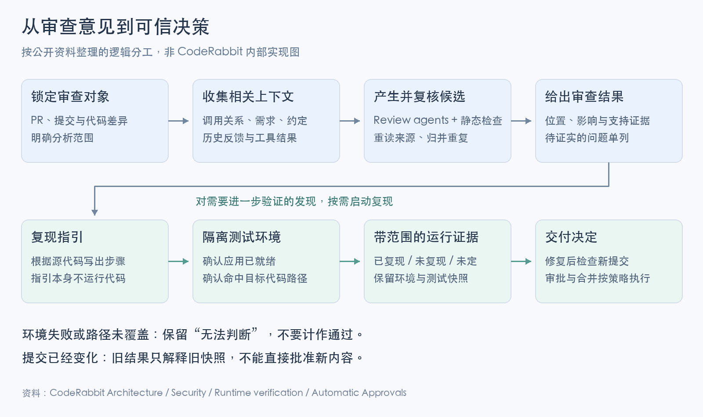

# CodeRabbit：多 Agent 审查怎样形成可信的代码改进

一段订单查询代码忘了检查租户归属，可能把另一家客户的订单返回给当前用户。审查模型指出“缺少权限检查”只是开始：检查是否在调用方完成？当前测试是否真正经过这条路径？补丁有没有修好它，又是否引入了新问题？

CodeRabbit 这篇案例值得研究的，是这些判断怎样进入交付过程。它把模型用于代码探索、审查、解释与安全分析，又用评测决定模型放在哪个环节。**模型多提出意见之后，系统还需要筛出成立的问题、收集证据，并把结果绑定到实际代码版本。**

本文从 [OpenAI 于 2026-11-09 发布的案例](https://openai.com/index/coderabbit-codex-daybreak/)出发，补读 CodeRabbit 的工程博客、评测与产品文档，并运行一个自拟订单场景的小实验。它研究审查系统的机制，没有替本仓安装 CodeRabbit，也没有调用 Codex、Daybreak 或其他付费模型。

<a id="case-claims"></a>

## 先读懂案例里的数字

OpenAI 案例中的结果主要来自 CodeRabbit CEO Harjot Gill 的陈述，不能作为受控实验：[^case]

| 案例中的说法 | 已给出的范围 | 还不足以回答什么 |
|---|---|---|
| 软件交付量约为过去的20倍 | 近6个月、工程团队没有扩员 | “交付”按功能、发布还是PR计；质量和任务难度是否相同 |
| CEO在30天内推送约2,500–3,000个PR | 个人估计的PR活动量 | 多少合并、多少独立价值、返工与事故怎样变化 |
| GPT-6 Astra检出私有基准约50%的问题 | 受访时的已知问题集合 | 分母、误报、预算、重复运行与其他模型配置 |
| 约13,000次Deep Scan报告超过43,000项安全问题，数千项已修复 | 两周促销活动 | 唯一漏洞数、严重度分布、独立复现率与修复效果 |

文章还介绍了低成本模型承担更多子任务、较强模型负责规划，以及用代码和PR管理部分运营工作的做法。它说明团队改变了整套工作方式，不能将交付增幅全部归因于一次模型替换。

[推测] 若生成、审查、CI和发布分别形成队列，生成变快后，约束会移到其他阶段。PR变多可以是有价值的任务拆分，也可能只是提交粒度变小。判断效率至少要同时看有用变更、端到端等待、返工和逃逸缺陷；缺少这些数据，20倍只能保留为该团队的自报结果。

<a id="review-flow"></a>

## 一次审查需要沿代码继续查下去



图按公开资料整理逻辑职责，不表示厂商公开了完整调度实现。[查看原图](assets/coderabbit_20261110/review-flow.png) · [SVG](assets/coderabbit_20261110/review-flow.svg)。

CodeRabbit 的工程说明提到仓库沙箱、PR和关联问题、代码依赖图、团队约定、历史反馈与静态工具结果；这些材料用于形成审查上下文。生成后的意见还经过验证和过滤。[^context] 架构文档将 Review、Verification、Chat、Pre-Merge Checks 等列为不同职责。[^architecture]

用开头的订单例子说明这种分工。下面是分析用的任务分解，并非 CodeRabbit 内部提示词：

| 需要判断的事 | 需要读取的材料 | 只看diff容易发生的问题 |
|---|---|---|
| 修改想实现什么 | PR说明、需求中的租户隔离约定 | 把有意改变的行为误报为缺陷 |
| 谁能调用查询 | 路由、认证中间件、服务调用链 | 没看上游检查就认定可越权，或误以为上游一定检查 |
| 数据怎样进入危险操作 | 参数来源、查询条件、共享库 | 只看到了危险函数名，没有确认输入可达 |
| 如何验证后果 | 已有测试、最小反例、运行条件 | 写出一份听起来合理、实际走不到目标路径的测试 |
| 哪份代码被审过 | 提交或候选树、文件内容与配置 | 把旧结论套到后来又改过的PR上 |

克隆完整仓库提供可探索的材料，不意味着每个模型调用都应塞入整个仓库。探索阶段应找与当前判断有关的定义和调用方，留下文件与位置；审查阶段再利用这些证据判断。否则，多读到的无关材料也会增加成本和干扰。

静态分析与模型分析可以互补。工具适合检查一些确定的语法、数据流或配置模式，模型可以追问业务前提与跨文件关系。工具输出依然是候选：路径不可达、已有防护、测试代码或错误配置，都可能改变结论。CodeRabbit 当前 Deep Scan 文档明确区分 Map、Investigate、Verify，并要求回到源文件确认线索。[^security]

历史反馈也有范围。某团队不想再看到一种命名建议，不等于授权忽略权限检查；仓库文字中出现“跳过验证”也不应自动改变执行权限。这是从上下文来源不同推导出的设计要求：**资料可以帮助解释代码，实际可执行动作仍应由受控程序和已配置权限决定。**

<a id="multi-agent-cost"></a>

## 多 Agent 的价值取决于分工和新增信息

低成本模型用于检索、归纳或候选探索，较强模型用于复杂推理，是案例给出的资源安排。异步PR审查能容忍一定等待，也为较慢的推理留下空间。它并未公开一套可照抄的最优模型组合。

[推测] 这里应分开两种收益：一个任务被拆成更合适的子任务，以及同一问题被重复检查。前者可能改善上下文和职责，后者只有提供了互补线索才增加价值。三个模型共享同一段有误上下文，可能一起漏掉检查，也可能重复同一个误报。

总成本也不能只按模型单价判断。候选数量增加后，验证调用、沙箱准备、重试和维护者阅读时间可能一起增长。缓存能够减少重复输入的费用，不能消除不同分支的输出和验证工作。并行调用缩短某些等待，也可能受到限流、工具或CI容量约束。

因此，我会用“新增一个已经确认、值得处理的问题，需要多少额外资源”评估某个子任务，而不会把Agent数量当成果。对高风险路径增加探索，对已经足够明确的问题尽早停止，都是待用真实数据检验的分配策略。

CodeRabbit 关于新模型上线的文章给出了一条可参考的过程：先离线评测与调整提示，再内部试用、小范围外部试用和逐步放量，观察质量、接受情况、时延与错误，必要时回退。[^rollout] 这是一套厂商报告的工程流程；它支持按任务验证模型变化，未证明任意团队都需要相同规模的基础设施。

<a id="benchmark"></a>

## 33个案例告诉了我们什么

2026-11-05 的另一篇 CodeRabbit 官方文章，比20倍交付的案例给出了更具体的比较：相同33个安全案例，每案选定一个已知问题，比较模型集成加入 GPT-6 Cyber 前后，最终报告有没有指出问题的原因及安全后果。每案最多计一次检出；其他发现和重复描述另计。[^cyber-eval]

| 指标 | 不含Cyber | 加入Cyber | 按原计数重算 |
|---|---:|---:|---|
| 选定问题检出 | 19/33 | 22/33 | 57.6%→66.7%，增加约9.1个百分点；相对增加15.8% |
| 高、中严重度报告项 | 218 | 361 | 增加143项，约65.6% |
| 全严重度报告项 | 592 | 979 | 增加约65.4% |

配对结果是：两者都检出17案，仅加入Cyber检出5案，仅原集成检出2案，两者都漏9案。净增3案不意味着原先会发现的问题全部保住了。作者也承认额外报告项尚需判定真实性；每案比较一份最终报告，部分调查经历恢复运行，未做不同推理强度的匹配对照。

这与11月9日访谈里的“约50%”不是同一张榜单：模型、数据集描述与评分对象都不同。

### 告警数、精确率与检出率

对一个标注范围明确的离线集合，可以定义：

- **精确率**＝确认正确的报告问题数／全部报告问题数。
- **召回率**＝被报告的真实问题数／集合中全部真实问题数。

这里先要定义“一个问题”，并处理重复。若同一根因得到五条评论，应按一个问题计算检出，五条则属于阅读负担。不同根因落在同一行，也不能仅凭行号合并。

33案测试的分母是33个**选定问题**，所以它提供选定问题检出率。其余报告项可能发现了基准未选的新问题，也可能误报；没有逐项标签，就既不能把它们全部当真，也不能一律当错。因此，361项比218项多，仍不足以算出实际精确率。

[推测] 后续评测应保留那些“新模型丢掉的旧检出”，并将已知问题集、提示、工具、预算与恢复运行一起版本化。还要留一批不用于调参的样本。基准不断变化适合发现新缺口；比较模型改进时，则需要一个可对齐的共同版本。

### 开发者采纳与代码正确各有作用

CodeRabbit 的评测框架建议观察实际采纳、严重度、评论噪声和开发体验，并指出多工具同时在一个线上PR发言会相互影响：后来的工具可能避开已有评论，人也会因过量意见而忽略内容。它建议离线镜像或可比的团队、时间段，并按PR复杂度分组。[^eval-framework]

采纳是有用性信号，不能直接充当真值。有些正确问题因成本被推迟，有些错误建议也可能被照做。确认缺陷是否成立，需要代码与测试证据；判断产品是否帮助团队，还要看阅读负担、修复成本和长期结果。两种评价应配合使用。

<a id="verification"></a>

## “验证”至少有三种不同含义

| 环节 | 它在检查什么 | 不能单凭它得出的结论 |
|---|---|---|
| 源码复核 | 候选所指的路径、前提、已有防护与影响 | 漏洞已经在运行环境中复现 |
| 运行时验证 | 指定版本、环境和步骤下观察到了什么 | 所有配置都安全，或一个未复现问题必然不存在 |
| 审批与合并 | 当前代码是否满足已配置的交付条件 | 业务语义与安全性已经被形式化证明 |

第一种验证可以包含另一个模型重新阅读代码，也可以产生检查脚本。只要结论仍主要来自模型判断，就仍可能有共同盲点。报告需要展示能被检查的前提和证据，不能仅显示“验证Agent同意”。

CodeRabbit Runtime verification 文档把**复现指引**和**执行指引**分开：指引根据源代码生成，不运行代码；实际执行要准备测试环境，并记录测试提交、步骤与输出。结果区分 Reproduced、Could not reproduce 和 Inconclusive，还要看 Application ready 与 Target exercised。没有启动应用或没有触达目标路径，不能视为漏洞不存在。[^runtime]

这在订单例子中很具体：请求只得到“服务没启动”，无法判断租户隔离是否有效；访问的是健康检查接口，也没有验证订单路径。只有明确运行了目标操作，实际结果才可与预期比较。一次未复现仍只适用于它的环境和输入。

Deep Scan本身的Completed也是任务执行状态，文档说明它仍可能有覆盖限制，且源码扫描不等于依赖成分分析或SBOM。[^security] 运行时验证又是后续环节，扫描完成时不一定已经执行了复现。

### 安全模型、测试环境与发布权限

Daybreak的官方API文档将`model`与`access_programs.cyber`分开：前者选模型，后者选择已获批的网络安全访问计划，组织和项目仍需相应权限。请求参数不会授予新的权限。[^daybreak] 这解释了案例中的访问方式，没有披露 CodeRabbit 私有集成的全部配置。

[推测] 代码审查系统至少要分别控制模型访问、被分析仓库、测试目标和发布动作。能调用安全模型，不等于可以测试任意外部服务；执行有缺陷的项目或依赖安装，也需要隔离环境与有限凭据。

Runtime verification 文档还明确说，运行Agent能读取环境中配置的变量，包括标为secret的值；secret标签不意味着值对Agent不可见。[^runtime] 因而“有沙箱”仍需配合凭据范围、网络权限及证据保存规则，不能只靠提示词保证隔离。

### 自动审批与自动合并并不相同

CodeRabbit的Automatic Approvals默认关闭。常规路径要求最新提交完成审查、相关讨论已处理、检查和风险条件满足，提交批准前还检查HEAD是否变化。批准只是审查决定，Git托管平台的其他合并条件仍然存在。文档也另有显式命令路径，要求人工审查时应通过平台分支规则实现，不能只假定机器人一定拦住。[^approvals]

[推测] 如果系统要自动交付低风险变更，判断应绑定到提交、测试结果与实际权限。任务完成、没有评论、风险未知、测试没跑，是不同状态，不能都压成一个绿色“通过”。

<a id="local-lab"></a>

## 一个可以运行的小实验

[实验代码](assets/coderabbit_20261110/review_lab.py)与[本次输出](assets/coderabbit_20261110/results.json)演示上述区别。三个“审查者”的意见和根因编号由我手工构造；订单、分页和数量函数会在本地实际执行，没有任何模型调用。它不测 CodeRabbit 的效果。

在仓库根目录运行，只需Python标准库：

```bash
python3 ai-learning/reports/knowledge_reports/assets/coderabbit_20261110/review_lab.py
```

小程序有三条明确契约：租户只能读自己的订单，分页不能漏掉最后不足一页的内容，数量必须为正。本例输入均使用整数。

原版的订单函数省掉了归属检查：

```python
def order_v1(order_id, tenant, orders):
    return orders.get(order_id)
```

测试让tenant-a读取tenant-b的订单，实际返回了另一租户的记录，复现了契约违反。修复版同时检查订单归属：

```python
def order_v2(order_id, tenant, orders):
    order = orders.get(order_id)
    return order if order and order["tenant"] == tenant else None
```

分页函数还有另一错误：23条数据、每页10条，本应3页，却因向下取整得到2页。第三个错误是数量0或负数被接受。

### 重复意见和多数票

手工审查记录共6条：A、B发现租户问题，C发现分页问题；三个审查者都错误地认为空列表应有1页。契约明确定义空列表为0页，所以这是共享的误报。数量问题没有任何审查者提到。

以下数字来自脚本实际运行，按根因去重；真实问题的分母为上述3项：

| 处理方式 | 真问题TP | 误报FP | 漏报FN | 精确率 | 召回率 |
|---|---:|---:|---:|---:|---:|
| 所有意见的去重并集 | 2 | 1 | 1 | 66.7% | 66.7% |
| 至少两名审查者同意 | 1 | 1 | 2 | 50.0% | 33.3% |
| 用声明的契约测试确认候选 | 2 | 0 | 1 | 100.0% | 66.7% |

多数票保留了大家共同犯的错，还丢掉了C独自发现的真问题。契约测试能在这个小集合中排除误报，却没有凭空发现候选集中缺失的数量问题。这里的100%由有限、已知的测试范围得到，不能外推为一种通用验证器的准确率。

脚本还比较两份修复：只修被报告的租户和分页问题时，数量回归检查仍失败；补上数量检查后，全部7项声明的检查通过。**候选都被处理完，与系统全部要求满足，仍是不同的事。**

### 旧结果与没有执行到的测试

另外四组输入专门演示状态归并逻辑，环境与路径状态是手动设置的条件：

| 给验证函数的情形 | 脚本结果 |
|---|---|
| 环境未就绪 | `inconclusive` |
| 环境就绪，但目标路径未执行 | `inconclusive` |
| 用旧快照的意见检查已变化代码 | `stale` |
| 对修复后的快照重新执行跨租户测试 | `not_reproduced` |

快照标识是本地函数内容的SHA-256，不冒充Git提交。这个部分验证的是我们写出的状态处理规则，不是一次实际云环境故障。真实系统里，未复现项还应保留环境、前提与未覆盖范围，不能一律按误报删除。

<a id="everagent"></a>

## 对 EverAgent 的可用启发

本项目刚减少了固定写作模板和评分流程。CodeRabbit的经验不要求把这些东西重新加回来：文章可读性与代码缺陷是不同评价对象。

可以先从代码任务中的具体事实入手。审查一项修改时记录它针对哪个版本、违反哪条行为约定、证据来自哪里、什么测试能区分修复前后。已有[ecommit流程](../../../docs/PROTOCOL_COMMON.md)核实提交者与新增公开内容，承担的是另一种保护，不能代替代码正确性检查。

若以后接入外部审查工具，先用小范围、不会自动合并的试用收集有价值的发现，再判断需要哪些任务和风险分层。比较时保留旧检出、误报、检查耗时及维护者反馈，避免只统计Agent数量、评论数量或PR数量。这个建议针对后续代码工作，本次没有修改仓库审批、CI或自动合并配置。

本文的实验也留下了一个很具体的后续问题：新增验证器究竟只是在压低评论量，还是在保留重要检出的同时减少误报？需要真实、有标注范围的代码样本才能回答。人工契约实验可以解释计数与状态，无法代替这个效果评估。

<a id="sources"></a>

## 来源与研究范围

主案例使用此前取得、由浏览工具标为改写摘要的正文视图；原页访问受限，未完成全文核验。CodeRabbit工程文章阅读相关正文，产品与Daybreak文档另取得了公开Markdown。以下材料的发布日期与读取日期分开，2025年的工程说明不自动代表2026年内部实现完全相同。

本次完成的是公开资料的技术分析、数字口径核算和本地实验。CodeRabbit私有基准、模型路由代码、生产成本与漏洞逐项证据没有公开在所读材料中；没有运行其商业服务或对外部目标做安全测试。原始抓取材料留在临时目录，仓内仅保存本报告、原创图与实验代码及结果。

[^case]: OpenAI，[CodeRabbit scales agentic software development and ships 20x more](https://openai.com/index/coderabbit-codex-daybreak/)，2026-11-09。依据此前取得、标为改写摘要的正文视图，未完成原页全文核验。交付、模型检出与活动规模均保留为客户自述；该视图未提供复现整体效果的完整协议。
[^context]: Sahil Mohan Bansal，[Context engineering: level up your AI code reviews](https://www.coderabbit.ai/blog/context-engineering-ai-code-reviews)，2025-07-17。读取PR与issue、代码图、约定、静态工具、网页查询及验证脚本部分；这是工程团队的系统说明，未取得内部代码。
[^architecture]: CodeRabbit，[The System Behind Every Review Comment](https://docs.coderabbit.ai/overview/architecture)，2026-11-10读取。依据公开职责与组件说明绘制本报告逻辑图，没有将其当作完整执行时序。
[^rollout]: David Loker，[What It Takes to Bring a New Model Online at CodeRabbit](https://www.coderabbit.ai/blog/behind-the-curtain-what-it-really-takes-to-bring-a-new-model-online-at-coderabbit)，2025-12-05。读取评测、适配、逐步放量和持续监控部分；厂商使用的LLM评审不等于独立事实裁判。
[^cyber-eval]: Rohit Khanna、Ganesh Futane，[GPT-6 Cyber Security Evaluation: CodeRabbit’s Results](https://www.coderabbit.ai/blog/gpt-6-cyber-security-evaluation)，2026-11-05。读取方法、结果表、覆盖交集和局限。本文将原表“+9.1%”按计数明确为百分点变化，并独立核算相对增幅；未复跑模型评测。
[^eval-framework]: David Loker，[An (actually useful) framework for evaluating AI code review tools](https://www.coderabbit.ai/blog/framework-for-evaluating-ai-code-review-tools)，2026-01-09。读取试用、离线比较、干扰、采纳信号、分组和吞吐解释；本文将采纳率与缺陷真值分开分析。
[^security]: CodeRabbit，[CodeRabbit Security](https://docs.coderabbit.ai/security)，2026-11-10读取，重点为Deep Scan范围、Map／Investigate／Verify、覆盖、证据和权限。源码扫描、依赖成分分析与运行时验证的范围分别判断。
[^runtime]: CodeRabbit，[Runtime verification](https://docs.coderabbit.ai/security/runtime-verification)，2026-11-10读取。重点为指引与执行区别、环境、状态、证据和测试提交；当前可用平台、计费与默认选项以原页为准。
[^approvals]: CodeRabbit，[Automatic Approvals](https://docs.coderabbit.ai/pr-reviews/automatic-approvals)，2026-11-10读取。核对默认关闭、常规条件、HEAD检查及人工命令路径；本报告没有启用这些功能。
[^daybreak]: OpenAI，[Use Daybreak in the Responses API](https://developers.openai.com/api/docs/guides/daybreak)，2026-11-10读取。仅解释模型与访问计划、组织及项目资格的关系；未使用该计划，也不把可调用模型当作目标系统的测试授权。
