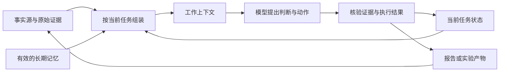

# 上下文工程的失效与修复：从长对话到可维护的记忆

> 学习对象：[《上下文工程全景：何时写死代码，何时交给模型》](https://mp.weixin.qq.com/s/WObu5DV2r11AyREz6P99uQ)。
> 英文原文：Drew Breunig，[The State of Context Engineering](https://www.dbreunig.com/2026/10/24/the-state-of-context-engineering.html)，2026-10-24，附 AGNTCon「Context Fails & Fixes」演讲文字与幻灯片。
> 研究日期：2026-10-27。微信解读与英文原文均完整读取；涉及实验的关键结论另查论文及官方材料。本文没有开展新的模型对比实验。

## 先读这几段

一个 Agent 研究同一问题很久，仍然可能越做越保守：最初选了一条路线，后来不断围绕它修补；新证据已经出现，却没有真正改变方向。把旧对话压短，未必能解除这种影响，因为摘要也可能继续强调原先的判断。

Breunig 的文章把上下文工程从“怎样装进更多材料”推进到三个问题：**现在该让模型看到什么，哪些历史应该退出，以及哪些事情必须由代码保证。** 其中最有价值的提醒是：保留成果和保留产生这些成果的全部对话，可以分别决定。[S2]

但文章中的几个抓眼球的说法需要留住条件：20 万 token 是作者个人的经验警戒点；90 分钟是 Anthropic 特定评估的一轮时限；“遗忘”研究集中于有明确评分器的自动研究任务。它们都不足以推出“所有 Agent 每隔固定时间清空记忆就更好”。[S2][S6][S7][S8]

对 Personal Context，更稳妥的迁移是：**原始证据与事实源可追溯，当前任务状态可靠保存，工作上下文可以重建，长期记忆能够更正和失效。** 第 7 节给出具体分工，第 8 节给出小规模评估办法；两节属于本文的工程建议。

## 1. 作者到底在解决什么问题

### 1.1 x → f → f(x)

| 环节 | 文章的论证 |
| --- | --- |
| **x：问题** | 窗口越来越大，但 Agent 仍会误用信息、重复动作、沿着错误方向继续工作；长期记忆还会把不同场景混在一起。 |
| **f：解释与办法** | 区分上下文故障，组合检索、工具筛选、隔离、裁剪、卸载和摘要；进一步识别权重偏好与历史惯性，必要时从保留下来的成果重新开始。 |
| **f(x)：工程判断** | 模型适合判断相关性与提出方案，代码负责预算、边界、状态和可核验结果；具体配置随模型、任务与 harness 重新评估。 |

这是一篇工程经验综述，串联作者观察、演示与外部研究。它提供了一张问题地图，但没有给出一个在所有模型上测过的统一算法。[S2]

演讲用“2023 年的 prompt engineering → 2025 年的 context engineering → 2026 年的 harness engineering”串起变化：从人手写提示，扩展到系统动态组装输入，再到管理长期执行。这里是作者的叙事分期，不是这些术语首次出现的历史年表。真正变化的是工程对象：除了给模型什么材料，还要管理工具、状态、预算和执行反馈。[S2]

### 1.2 “长窗口就不需要筛选”的问题

文章从长上下文热潮讲起：如果模型能看百万级 token，是否可以把资料全部塞进去，让模型自行处理？作者随后用故障案例反驳这种用法。[S2]

这里至少有三件不同的事：

1. **装得下**：接口允许提交多长的输入。
2. **找得到、用得对**：模型能否识别当前需要的信息，并正确处理其出处、时效和冲突。
3. **行动有进展**：多轮工具调用是否产生新的、可验收的成果。

第一项不能代替后两项的评估。反过来，材料更多也不必然更坏：比较大量合同、交叉阅读多篇论文，本来就需要广泛证据。问题在于当前输入是否组织得当，而不是追求最短上下文。

因此，本文不沿用微信解读中对产品成败、某条模型产品线后续发展的概括，也不把作者列出的时长数字重新包装成当前模型排名。那些旁支判断不是这篇文章工程结论的必要前提。[S1][S2]

## 2. 四种常见故障：先判断坏在哪里

Breunig 在 2025 年的文章中系统列出 poisoning、distraction、confusion、clash；本次演讲继续沿用它们。它们描述的是故障表现，未必互斥，也不是对注意力机制的完整解释。[S2][S3]

下表的研究场景是本文自拟的例子。

| 故障 | 白话解释 | 研究任务里的例子 | 首先检查 |
| --- | --- | --- | --- |
| **Poisoning，中毒** | 错误内容进入历史，随后被不断当作事实使用。 | 首轮把论文测试对象认错；后续摘要、对比表、结论都继承这个错误。 | 回到原始证据，更正对应判断；检查摘要和派生产物是否仍带着旧错误。 |
| **Distraction，分心** | 过长的历史牵走模型的注意，重复旧行为压过新的规划。 | 搜索工具已经返回新论文，Agent 却反复搜索原来的关键词。 | 统计重复操作与新增证据，判断是否还在推进任务。 |
| **Confusion，混淆** | 无关材料或能力描述干扰当前选择。 | 阅读论文时同时加载部署、旅行、邮件等大量技能说明，开始调用不相关工具。 | 缩小任务材料和工具集合，清楚标注各材料的用途。 |
| **Clash，冲突** | 多份内容互相矛盾，模型不能稳定决定该听哪份。 | 全局偏好写着“简短”，深度研究要求完整论证，旧模板又要求填满所有栏目。 | 明确适用范围、优先级和唯一维护位置，处理重复规则。 |

这些检查对应不同动作。例如，删掉一半工具说明有助于混淆，却未必修复已经写进摘要的事实错误；增加一个更强模型，也不会自动解决两份规则没有明确适用范围的问题。

其中“中毒”不只指恶意提示注入。普通笔误、错误推断、工具返回的过期内容，也可能形成错误的起点。审计时应沿着“原始内容 → 摘要 → 结论”的链条检查，不能只看最终文字是否流畅。

## 3. 六种修复：每一种都有代价

六种办法来自作者的修复框架，以下解释与代价是结合研究任务的分析。[S2][S4]

| 方法 | 做什么 | 适合解决的问题 | 新问题与必要约束 |
| --- | --- | --- | --- |
| **Augmentation / RAG，补充检索** | 在需要时补入相关证据。 | 当前上下文缺少事实，或需要更新旧知识。 | 检索错、切片缺上下文、来源过期，都会带来新错误；重要判断要能回到原文。 |
| **Tool loadout，工具筛选** | 每轮只提供当前可能需要的工具。 | 能力描述太多、工具名称相似、模型选错工具。 | 筛选器可能漏掉必要能力；要有明确的补充获取路径，代码核对工具 ID 与允许范围。 |
| **Quarantine，隔离** | 让独立上下文处理一个子问题，再返回结果。 | 不希望某个分支的大量细节淹没主任务。 | 主 Agent 只收到摘要时可能失去反例与证据；交接应包含来源、结论、未解决问题。 |
| **Pruning，裁剪** | 删除当前任务不再需要的历史。 | 重复、无关、已被替代的记录仍占据工作输入。 | 相关性判断可能误删；授权、待完成操作与当前约束不能仅凭模型判断丢弃。 |
| **Offloading，卸载** | 将大结果和状态放到文件等外部存储，按需再读。 | 工具输出或中间产物很大。 | “已经保存”不等于下一轮知道怎么找到；需要有效路径、版本及简短定位信息。 |
| **Summarization，摘要** | 用压缩后的内容替代部分历史。 | 需要交接、缩短输入或继续长任务。 | 摘要会损失细节，也会保留偏见；应区分已证实、已否定和未验证。 |

工具筛选有一个直观案例：作者遇到某企业团队的 Agent 表现突然变差，检查时发现系统在每位工程师启动时加载了 **600 个 skills**，于是建议先筛选当前需要的能力。这个数字来自作者的现场观察，没有统一条件的因果对照；它说明工具描述也会占据工作上下文，不能据此规定“超过多少个工具必然失败”。[S2]

### 3.1 裁剪与摘要，顺序会影响结果

作者演示的一种组合是：先判断哪些历史还相关，再对保留部分做摘要。这样可以减少把杂项与旧错误一起压进去的机会。[S2]

假设一次论文研究已经收集了 20 个搜索结果，其中 5 个打不开、8 个重复、4 个只是转述，3 个是可用原始材料。摘要若只是“尽量压短以上内容”，很可能继续突出出现次数最多的转述。先识别来源与读取状态，再压缩可用部分，更容易得到有价值的交接材料。这里的数字是示例，不是实验结果。

但“相关”与“真实”也不同。相关性筛选器可以留下切题的错误材料，甚至把纠正它的短句裁掉。因此，来源核验应作为独立步骤；不能指望一次裁剪同时完成事实检查。

### 3.2 “十几行”展示的是原理

原文用 DSPy 演示工具筛选、隔离／委托子 Agent、裁剪和摘要，称增加约 16 行修改即可把四种动作放进一个循环；其中使用了一个小型决策模型辅助筛选。这里的隔离是让独立上下文处理子问题，与把大结果保存到外部存储的“卸载”不同。[S2]

这说明这些动作可以放在 harness 的循环里，不必全部变成大段提示词。它没有证明完整生产系统只需这些代码：异常处理、状态恢复、来源定位、权限约束以及评估仍需单独设计。

实际可以先从简单做法开始：明确类型的重复结果由代码去重；不确定的相关性让模型判断；最终保留集合再由代码检查。没有必要为了“用了上下文工程”给每次短问答加上六道流程。

## 4. 新问题一：上下文在与模型已经学到的东西竞争

作者把这种情况叫 **fighting the weights**。模型的输出受当前上下文影响，也受训练后形成的知识、表达习惯与行为偏好影响。原文的“Context × Weights”是一种帮助理解的图示，不是一条已建立的数学乘法定律。[S2]

作者观察到，小模型第一次调用 Playwright MCP 时会误填参数，随后才调整；他解释为训练时熟悉的工具形态与当前接口不一致。演讲还展示了一组 Claude Code 提示与工具说明，其中不同的并行调用要求分别重复了 7、4、3、2 次，部分使用全大写强调。这些是作者用来说明行为偏好的例子；重复措辞本身不能证明训练偏置的因果关系，也没有验证不断追加同义指令能持续改善执行。[S2]

### 4.1 为什么补入正确资料后，仍可能答错

作者用两代 Pokémon 游戏中“给守卫饮料”的差异说明：相似场景可能激活另一版本的知识，Agent 继续按熟悉的方案行动，而没有正确落实当前版本的条件。[S2]

官方 Gemini 2.5 技术报告的 p.70 给出了更具体的过程：在 **Red/Blue** 中，玩家从自动贩卖机买 FRESH WATER、SODA POP 或 LEMONADE 给守卫；在重制版 **FireRed/LeafGreen** 中，则需要特殊物品 TEA，初代根本没有这个物品。Gemini 2.5 Pro 玩初代时，却多次确信必须找茶，花了许多小时寻找或试图交付 TEA。[S10，p.70]

关键不只是答错了一次。官方分析指出，错误会进入 goals、summary 等多个位置，撤销很慢，模型因而反复追求不可能或无关的目标。第二轮明确要求它扮演全新玩家、忽略已知事件与物品位置，研究者说跨版本幻觉得到部分缓解；但这也可能削弱对有效常识的利用，在一些关键位置妨碍表现。因此，“完全忽略已有知识”同样有代价。[S10，p.70]

研究工作也有类似风险：模型熟悉某个模型的旧架构，新技术报告已经改了组件，回答却把新版术语套进旧结构里。这时再多放一份资料未必足够。

本文建议把冲突改写成一个可检查的小任务：

> 当前版本使用哪个组件？请定位到原文段落，并指出这与旧版本描述有什么不同。没有读到的部分保持未知。

这种要求把“看起来理解了”变成能核验的判断。它仍不能保证模型一定遵从，但给了独立复核一个明确对象。涉及工具执行时，版本兼容性和允许操作应进一步由代码检查。

### 4.2 一手论文说明了什么

《Do as I Say, Not as I Do》研究 **instruction-induction conflict**：先给一条明确用户指令，再插入与其相反的、人工写入的 assistant 历史，观察模型何时从遵循指令转向模仿历史模式。论文评估 13 个模型、16 种指令；主要条件的人工历史从 1 轮增加到 50 轮。[S5，§2]

每个“模型 × 条件 × 历史轮数”组合使用 **35 组独立种子的问题集**，temperature 为 0，模型之间共享问题种子。评分也有区别：固定输出按 exact match，语言任务用语言检测，代码风格用格式启发式，人格与偏好任务采用三个 LLM judge 的多数票；后两类含有判断性，不能当成全部由客观程序评分的实验。[S5，§2.1、§2.4]

三个发现对上下文设计很有用：

1. **各模型差别很大。** 固定输出条件下，跨轮数与条件的平均指令遵循率在模型间从 1% 到 99%；到 3 轮相反历史时，只有 6/13 模型仍高于 50%。但 Llama 3.3 70B 到 50 轮仍约 95%。论文说每个模型至少在某些条件中会明显受到影响，不等于所有模型在所有条件下都失败；这套实验也不能按普通能力榜单简单推算。[S5，§3.1、§3.2]
2. **指令内容有影响。** 与训练价值或事实偏好一致的指令，通常更能抵抗相反历史，但程度随模型变化。
3. **推理有帮助，却不是保险。** 论文只在 GPT-5.2 和 Hermes-4 两个模型家族中比较启用推理的影响；不能把结果推广成所有模型调到最高思考就不会漂移。[S5，§3、§5]

论文还发现，输出的长度与多样性影响这套实验里的稳健性；告知模型历史是人工写入的，能缓解部分冲突，但没有彻底消除它。作者明确说实验受控且较人工，真实部署里是否呈现相同规律仍需实测。[S5，§3.4–3.6、§5]

因此，最合理的迁移是**分别评估当前模型在长期历史中的指令遵循情况**。不能推出“所有未来模型都一定在同一个点失败”，也不能为了提高短输出任务的表现，强行要求所有结果都写成长文。

## 5. 新问题二：历史让 Agent 不愿再换方向

### 5.1 压缩对话，未必摆脱思路惯性

**Context inertia，上下文惯性**，指 Agent 在持续积累的历史中更倾向于延续已有思路。本文用它描述工程上的路径依赖，并不声称已经定位到某个唯一神经机制。[S2]

例如，Agent 最初断言“性能瓶颈是通信”，后面一直围绕通信微调。测量已经显示计算部分更慢，交接摘要却仍写着“继续优化通信”。新的会话虽然很短，起点仍被旧判断限制。

这解释了为什么摘要有时只解决长度问题。它若保存的是“上一轮坚持的解释”，而不是“测量支持的事实与仍开放的方向”，会把惯性带进下一轮。以下两篇自动研究论文分别研究了更强的干预。

### 5.2 Fork-and-Flush：保留工作区，清空对话，再分支探索

《Fork-and-Flush: Escaping Idea Basins in Autoresearch Agents》的方法是：复制当前工作区，让多个分支以新对话开始；各分支探索固定预算后，选择评分最好的继续。这里保留的是整个累计工作区，清除的是继承的聊天历史。[S6，§4]

论文在 **13 个研究与工程任务**上比较相同计算预算。主实验的 min–max 归一化平均分为 0.78，单条连续路线为 0.47，best-of-4 为 0.54；论文据此报告相对改善 66.0% 和 44.4%。这些是特定归一化汇总分的相对变化，**不是“所有工程任务成功率提高 66%”**。[S6，表 1、§5.2]

其方法与结果还有几项关键条件：

| 项目 | 一手材料中的实际条件 |
| --- | --- |
| 预算 | 各组总计算预算匹配；分支的花费计入总预算。 |
| 触发 | 主实验按预设预算进度触发分支；不能说论文已经验证了自动检测停滞的最优时机。 |
| 分支与重置 | 11 个任务上的消融比较显示，单独分支或单独清空对话都有收益，两者组合更好。 |
| 结果差异 | 12/13 个任务的平均分最高，LWE-rec 是未胜出的例子。 |
| 解释证据 | “Idea basins”由功能相似性判断及嵌入图支持；图是研究证据，不是对所有解空间的完整数学证明。 |

研究支持“在这些有评分反馈的长任务中，重新探索能改善结果”。它没有证明每一篇阅读报告都值得分出四条路线，更没有消除分支的成本。[S6，§3、§5、§8]

### 5.3 Scaling Discovery Requires Forgetting：进一步清掉搜索历史

另一篇论文《Scaling Discovery Requires Forgetting》更激进：清空每个 Agent 的会话和搜索状态，**只保留当前最好候选及其分数**，让团队开始下一轮。它的工作区不再提供先前的候选历史；这与 Fork-and-Flush 保留整个工作区不同。[S7，§3]

论文使用 Pi harness 和 DeepSeek V4.1 Flash，在四个优化任务上比较单 Agent、四个独立并行 Agent、带通信和遗忘的团队；每个配置每项任务运行三次，总模型花费预算相同。[S7，§4]

例如，VLIW 优化中，团队的平均最终周期数是 1,097，独立并行组是 1,220，越低越好；Frontier-CS Q171 的平均分分别是 80.8 和 70.2，越高越好。两个例子说明了指标方向与比较对象为何必须一起写清，不能合并成一个泛化的“质量提升百分比”。[S7，表 1]

它还做了从同一停滞状态出发的“继续／遗忘”对比。在 AHC014 上，三种 Agent 设置遗忘后的下一轮进展都比继续旧历史更大；但这项进一步比较只覆盖一个任务，不是又在全部任务、全部模型上完成了一遍验证。[S7，§4.3、表 3]

论文记录的一类失败尤其贴近实际体验：Agent 不断宣布已到平台、结束回合，却没有提交新候选。此时增加运行时长，不等于增加有效实验。[S7，§5]

### 5.4 两篇论文放在一起，能推到哪一步

两篇研究使用不同 harness、模型与任务集合，都支持重新组织历史有助于部分自动研究任务继续探索。它们提供了相互呼应的证据；**不是一个普适配方的完整跨场景复现**。[S6][S7]

迁移到写报告时有一个重大差别：优化任务往往有确定评分，最好的代码可能已经包含大部分成果；研究报告则可能必须保留某个失败路线的证据，因为它正是一个重要反例。让语言模型选择“最好版本”，还可能偏爱篇幅、语气与结构，而漏掉关键事实。

所以，报告任务更适合先尝试“保留来源、已核验结论和当前稿件；独立复核时使用新上下文”。丢掉全部证据历史并从最顺眼的文本继续，反而可能降低可信度。

## 6. 三个数字，三种不同口径

| 常被记住的说法 | 实际出处与范围 | 不能据此得出的结论 |
| --- | --- | --- |
| **约 20 万 token 要重置** | Breunig 前文说会在约 20–30 万附近检查，举过 25 万时主动重置的例子，后文说约 20 万是自己的警戒点。[S2] | 所有模型共用一个硬阈值，或低于这个长度就可靠。 |
| **Gemini 超过 100k 开始重复** | Gemini 2.5 官方技术报告 §4.1、p.17–18：在特定 Pokémon Agent 设置里，显著超过 100k 后更倾向重复历史动作；原文明确称其为 anecdotal observation。[S10] | 百万窗口没有任何价值，或所有类型长上下文任务都会在 100k 失效。 |
| **每 90 分钟清空一次** | Anthropic 的 Memento 评估让新实例继承代码、环境与简短笔记；相关实验每轮 1.5 小时、总时限 6 小时。这是自我复制能力研究中的推理部署评估，并非一般产品 QA。[S8，附录 A] | 生产 Agent 应无条件每 90 分钟重启，或清空对话一定有收益。 |

Google 在同一段也说，约 100k 的上下文对使用复杂工具、维持较连贯的策略起了重要作用。将“长上下文有价值”与“长轨迹里仍会重复”一起读，才能理解它提出的模型与 scaffolding 协同设计问题。[S10]

Memento 也提示了一个容易被忽略的差别：它会传递策略、失败和表现笔记；上节的 Forgetting 则主动削减候选历史。二者都开启新实例，但**传什么**才是上下文设计的核心决定之一。[S7][S8]

另一个口径是 METR 的 **time horizon**。它按人类专家完成任务所需时间衡量任务长度，并关联给定的成功率；常见表述使用 50% 可靠性。它不是“Agent 实际连续运行多久”。一个较长的人类任务时域，也不直接证明 Agent 的长期记忆治理已经解决。本报告核验其定义，没有逐项复核演讲所列的模型时长数字。[S9]

演讲引用 GPT-5 约 3.4 小时、Gemini 3.1 约 6.4 小时、Opus 4.6 约 12 小时，并强调配合相应 harness。这组引文解释了作者为什么从提示转向长期执行：任务跨度扩大后，重复动作和错误固着更值得关注。这里保留的是 **2026-10-24 演讲中的数字**，没有逐项重验对应榜单、配置和置信区间，不把它们当成当前排名或独立核验后的模型成绩。[S2]

## 7. 对 Personal Context 的启发：长期保存与当前输入分别设计

[待验证] 以下是工程建议，没有经过本报告的新实验验证。

### 7.1 先分清四类东西

| 类型 | 具体内容 | 重建上下文时的处理 |
| --- | --- | --- |
| **事实与原始证据** | 原文、来源、已读范围、时间、实验输出。 | 按需读取；重要结论仍能追溯，不能只剩上一轮的概括。 |
| **当前任务状态** | 最新用户要求、授权范围、待完成操作、真实产物、未知结果。 | 可靠持久化，再重新加载；不能随着对话清空而消失。 |
| **长期记忆** | 已确认的偏好、项目知识、经过验证的做法。 | 保留适用范围、来源与更正关系；对过期或相互冲突的内容处理失效。 |
| **工作上下文** | 这一次模型实际收到的规则、证据、摘要和工具说明。 | 按任务组装；可以裁剪、隔离和重建。 |

“能忘记”不要求原始证据只能保留一天，“有记忆”也不要求每轮把所有历史重新输入。

重建时，先从事实、状态和产物恢复；上一轮的解释只是可选择的信息，不能天然成为新一轮的最高优先级。只有核验后的结果才适合进一步沉淀为长期知识。

### 7.2 三个实际场景

**文章学习。** 当前稿件已经完整，但某个关键数字有争议。新一轮应拿到用户要求、原文、待核验数字和稿件，不必继承生成者如何为该数字辩护的长对话。评审者先从来源判断应覆盖的主题，再检查稿件，可以降低“只在现有结构内找小错”的影响。

**设备或服务任务。** 上一轮发起一个操作，但没有确认结果。新实例必须首先查询真实状态；清空对话不能把“结果未知”改成“从未操作”，否则可能重复执行。外部操作的标识与状态应可靠保存，这类任务无法只靠一段自然语言交接恢复。

**跨会话记忆。** 某次临时要求“今天的答复短一点”，不应自动成为所有深度研究任务的永久规则。记忆需要描述范围和有效性；更正一条旧偏好时，派生摘要与检索缓存也应更新，避免旧内容继续被召回。

### 7.3 战略性遗忘，必须与删除个人信息区分

为了重新思考，把一段历史从工作输入中排除，是上下文操作。用户要求删除个人信息，则涉及原始存储、记忆索引、摘要、缓存和副本。只清空当前对话，并没有完成信息删除。

另一方面，不能因为论文里“忘掉失败历史”有益，就物理删除审计证据和未完成任务记录。工程上可以保留档案，同时让下一轮只读取必要内容。具体保存期限与删除要求由场景和用户决定。

作者担忧长期助手的记忆、技能和指令不断积累后，会变得杂乱、相互冲突；他对未来记忆体验的判断是经验与预测，尚不能据此推出“使用六个月必然失效”。不过，它提出了一个实用的问题：新增记忆之外，系统有没有明确的更正、失效和撤回路径？[S2]

### 7.4 与公开项目已有做法的关系

本仓公共协议已经要求按任务路由、最小加载、来源可追溯，并对报告独立复核。这些设计与文章讨论有交集；是否真的减少读取量、改善质量，仍应看执行记录和评估，不能根据文档结构判断已经有效。

下一步较小的改进可以是：

1. 在交接中明确列出已核验结论、已否定判断与未解决问题，避免摘要混成一段。
2. 独立评审先画来源内容地图，再读稿件，核对“遗漏了什么”，而不只找“写错了什么”。
3. 记忆更正同时检查派生摘要，保留唯一事实维护位置。

相关公共入口：[Context 设计](../../../docs/CONTEXT_ENGINEERING.md)、[报告质量门](../../../docs/REPORT_QUALITY_GATE.md)、[此前 GPT-6 Astra 指令架构学习](./GPT6_Astra指令架构_从Prompt堆叠到按需控制_深度解析_20261015.md)。本文没有修改运行中的部署和调度机制。

## 8. 什么时候写代码，什么时候交给模型

### 8.1 模型判断提案，代码保证约束

| 决策 | 模型可以承担 | 代码应保证 |
| --- | --- | --- |
| 补什么资料 | 判断缺口、提出检索问题。 | 返回实际读取状态，记录出处与版本；读取失败不能伪装成功。 |
| 留哪些工具 | 判断当前可能需要哪些能力。 | 工具来自允许集合，参数符合结构，操作在授权范围内。 |
| 删哪些历史 | 标注重复、过时、无关的内容。 | 固定保护当前用户要求、任务状态和执行边界，保留可恢复的事实源。 |
| 何时重建 | 发现重复、矛盾、无进展，建议重新开始。 | 预算上限、重建次数、状态继承与未知结果检查。 |
| 哪个候选更好 | 比较论证、解释差异，提出反例。 | 有客观评分就使用真实评分器；报告的硬要求与来源检查不能由语气好坏代替。 |
| 怎么记住 | 提炼候选记忆、标注范围。 | 存储、版本、更正关系及删除传播实际执行并可核验。 |

这不是要求每项判断都经过两套完整系统。一个简单去重脚本加一次有来源的复核，可能已足够。应把工程成本放在最容易产生实质损失的地方。

### 8.2 如何知道重建到底有没有帮助

可以先比较三种继续方式：

| 组别 | 相同起点后的动作 | 要回答的问题 |
| --- | --- | --- |
| A：继续 | 保留当前历史继续工作。 | 增加预算本身能带来多少进展？ |
| B：摘要 | 用摘要替代部分历史。 | 缩短输入是否已经足够？ |
| C：重建 | 保留原始证据、当前成果、用户要求与必要状态，新会话继续。 | 去掉旧推理轨迹是否提供额外价值，是否丢了关键信息？ |

先挑三个固定案例：一个有旧错误和更正证据的报告、一个存在范围冲突的记忆问答、一个需要恢复“操作结果未知”的模拟任务。每组用同一模型与 harness，同一起始快照、同样工具条件和总预算；每个案例至少重复三次，仅作为小规模筛查，不能据此声称普适收益。

主要看五件事：

- **事实与覆盖**：关键判断是否有来源，来源里的核心主题有没有遗漏。
- **错误延续**：已更正的错误是否再次出现，临时偏好是否继续被当成永久规则。
- **实际进展**：新增可验收产物或有效实验；重复动作不计为新进展。
- **交接损失**：用户约束、反例、未解决问题和待查询状态是否丢失。
- **总成本**：读取、摘要、模型调用、分支与评审一起计入；同时记录耗时，不能只比较最终一次回答。

若引入分支，每个分支的消耗都计入该组总预算。评审者不读生成者的辩护过程，来源覆盖与错误恢复按相同规则评分。低成本的小改进应先于多 Agent 长跑。

**没有预算条件下的质量收益、没有状态完整性的重建，都不足以说明方案更好。** 本节是评估设计，尚未执行；本报告的独立评审也不能替代这些模型行为实验。

## 9. 限制与尚未解决的问题

1. **经验综述的范围。** 文章把多种观察连在一起，不是统一条件下的跨模型基准；阈值不能直接转成系统默认值。
2. **论文的范围。** 指令冲突实验较人工；推理对照只覆盖两个家族。两篇遗忘研究主要面对有评分器的优化任务，重复次数也有限。
3. **机制尚未完全解释。** “惯性”和“Idea basins”有行为与嵌入证据；不能将其当成已经证明的唯一内部机制。
4. **读取范围与观察仍有边界。** Gemini 官方技术报告核验了相关 Agent 段落与 p.70 的跨版本幻觉案例，未重验其全部基准；其中的 100k 重复现象仍是特定设置的经验观察。METR 只核验指标定义，不据此重做模型排名。
5. **应用收益没有实测。** Personal Context 分层、记忆更正与三组比较属于本文建议；没有证明本仓或某种多设备部署已取得量化改善。
6. **记忆治理仍开放。** 何时更正、哪些历史要退出、如何检测冲突与撤回派生信息，需要独立设计；重新开一个会话不会自动完成这些事情。

### 思考与追问

1. 如果只保留最好候选有助于搜索，哪些失败记录又必须保留才能避免报告缺反例、操作重复或结论失真？
2. 一个更强的新模型进入同一 harness 后，应该先检查哪些故障与成本，再决定删掉旧规则还是保留它们？
3. 长期记忆怎样把“当时合理、现在失效”的内容退出召回，同时留下足够记录说明为什么更正？

## 来源与读取说明

| ID | 来源 | 本报告使用范围 |
| --- | --- | --- |
| S1 | [微信：上下文工程全景](https://mp.weixin.qq.com/s/WObu5DV2r11AyREz6P99uQ) | 完整读取；作为学习起点与中文解读，不代替论文实验依据。 |
| S2 | [Drew Breunig：The State of Context Engineering](https://www.dbreunig.com/2026/10/24/the-state-of-context-engineering.html) | 完整读取演讲文字与幻灯片描述；经验、演示、二手引用各自保留性质。 |
| S3 | [How Long Contexts Fail](https://www.dbreunig.com/2025/06/22/how-contexts-fail-and-how-to-fix-them.html) | 完整读取；四种故障的作者原始框架。 |
| S4 | [How to Fix Your Context](https://www.dbreunig.com/2025/06/26/how-to-fix-your-context.html) | 完整读取；六种修复框架。 |
| S5 | [Do as I Say, Not as I Do，arXiv:2605.20382v3](https://arxiv.org/html/2605.20382v3) | 读取摘要、实验设置、结果及限制；关键判断按论文条件表述。 |
| S6 | [Fork-and-Flush，arXiv:2610.07447v1](https://arxiv.org/html/2610.07447v1) | 读取正文、主结果、消融与结论；未在本报告重新运行源码实验。 |
| S7 | [Scaling Discovery Requires Forgetting，arXiv:2610.20563](https://arxiv.org/abs/2610.20563) | PDF 读取方法、实验、表 1–3、机制分析与结论；没有重新实施实验。 |
| S8 | [Anthropic：Self-replicating AI](https://www.anthropic.com/research/self-replicating-ai) | 读取研究背景及附录 A，核验 Memento 的继承内容与时限；不研究执行自我复制。 |
| S9 | [METR：Measuring AI Ability to Complete Long Tasks](https://metr.org/blog/2025-03-19-measuring-ai-ability-to-complete-long-tasks/) | 读取指标方法；用于区分人类任务时域、成功率与 Agent 实际运行时间。 |
| S10 | [Google DeepMind：Gemini 2.5 Technical Report](https://storage.googleapis.com/deepmind-media/gemini/gemini_v2_5_report.pdf) | 官方 PDF，读取 §4.1 的 Pokémon Agent 分析、p.17–18 的长上下文观察及 p.70 的 TEA 案例与第二轮提示代价；未逐项复核报告全部基准。 |

抓取说明：先使用项目的 typed 网页能力。部分长页面返回内容被截断，外层成功状态不足以证明已读全文；本轮改用完整页面或 PDF 补齐，研究快照留在任务临时目录。完整原文没有复制进入公开仓。
