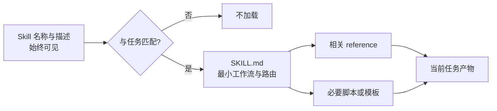
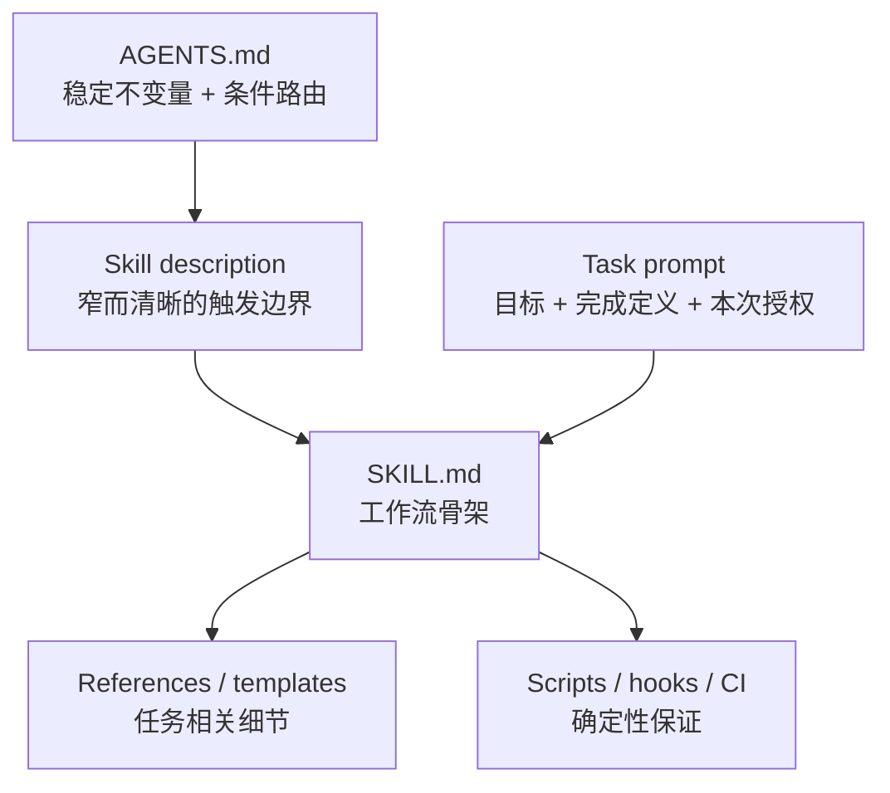

# GPT-6 Astra 指令架构：从 Prompt 堆叠到按需控制

> 原文：Eric Provencher, [Rethinking skills and prompts for GPT-6 Astra](https://developers.openai.com/blog/rethinking-skills-and-prompts-for-gpt-6-astra)，OpenAI Developers，2026-09-11。
> 核验日期：2026-10-15。本文只使用 OpenAI 官方材料核对产品行为；涉及机制解释与 EverAgent 改造建议的部分均明确标为分析或建议。

## x → f → f(x)

- **x：作者在处理什么问题？** 当编码模型升级后，为什么过去为了帮助旧模型而不断增加的 skills、`AGENTS.md` 和任务提示，反而会让 GPT-6 Astra 选错技能、读取过量上下文、过度测试、频繁停下或提前交付？
- **f：作者给出的核心回答是什么？** 把长期指令重新设计成分层、按需加载的控制系统：skill 描述只负责准确触发，`SKILL.md` 负责路由到具体资料，`AGENTS.md` 只保留稳定规则与条件化入口，任务提示明确授权范围和完成标准。
- **f(x)：接受这个框架后应如何行动？** 每次换模型都要审计现有脚手架，删除已被模型能力吸收的补丁，收窄触发条件，把硬约束迁到代码与校验器，并用真实任务评测“删掉规则后是否更好”。**验证状态：OpenAI 官方产品经验与文档相互印证，但没有公开受控实验、样本量或效果数字，属于高相关的一手工程指导，不是已完成因果验证的研究结论。**

---

## 一页结论

这篇文章最重要的判断是：**模型能力升级会改变最优 Harness。** 旧模型需要大量步骤提醒、权限刹车和验收提示；GPT-6 Astra 的指令遵循、长任务连贯性和主动验证能力更强，同一批规则可能从帮助变成阻力。[原文](https://developers.openai.com/blog/rethinking-skills-and-prompts-for-gpt-6-astra)与[GPT-6 官方提示指南](https://developers.openai.com/api/docs/guides/latest-model/gpt-6-astra#prompting-best-practices)都明确提醒：Astra 更敏感地执行 skills 与 `AGENTS.md` 中的内容，也更容易在不确定或权限边界处停下。

它给出的工程方向可以压缩成五句话：

1. **Skill description 是路由标签。** 它要提高触发判断的区分度，不能承担完整教程。
2. **`SKILL.md` 是按需工作流入口。** 复杂细节继续放进 references、scripts 和模板，以渐进式披露控制上下文。
3. **`AGENTS.md` 是常驻控制面。** 只放跨任务稳定、确实会改变行为的规则，以及“什么任务读什么文档”的条件路由。
4. **任务提示是本次任务的合同。** 写清目标、交付物、完成定义、允许自主推进的范围与真正需要停下的决策点。
5. **硬保证交给确定性机制。** 安全边界、格式、提交身份、路径和质量门禁，能由脚本、hook、类型或 CI 保证时，不应只靠更长的文字提醒。

对 EverAgent 最直接的启示是：当前根 `AGENTS.md` 与 `ai-learning/AGENTS.md` 合计 **21,482 bytes**，占 Codex 官方默认 `AGENTS.md` 合并上限 32 KiB 的 **65.6%**。容量还没有触顶，但同一 Token Plan 规则在根文件中多次复述，历史备忘也进入常驻上下文。下一步真正值得做的是一次带任务回放的指令审计，而不是简单追求更短。

---

## 1. 这篇文章是什么性质的证据

| 来源 | 能证明什么 | 不能证明什么 |
|---|---|---|
| [S1：OpenAI 开发者博客原文](https://developers.openai.com/blog/rethinking-skills-and-prompts-for-gpt-6-astra) | OpenAI 团队观察到的常见失败模式，以及针对 Astra 的工程建议 | 没有公开测试集、对照组、成功率或 token 降幅 |
| [S2：GPT-6 官方提示指南](https://developers.openai.com/api/docs/guides/latest-model/gpt-6-astra#prompting-best-practices) | Astra 在主动性、指令遵循、写作、委派、测试上的已知行为倾向 | 不能保证这些倾向在每个产品、推理档位和任务分布上相同 |
| [S3：官方 Build skills 文档](https://learn.chatgpt.com/docs/build-skills) | Skill 的实际加载机制与预算：先加载名称、描述和路径，选中后再读完整 `SKILL.md` | 不能给出某个具体 skill 描述的最优长度 |
| [S4：官方 AGENTS.md 文档](https://learn.chatgpt.com/docs/agent-configuration/agents-md) | 指令发现、合并和覆盖顺序；默认合并上限为 32 KiB | 不能说明 32 KiB 内的内容都同样有用，也不能替代任务评测 |

因此，本文适合被视为一份**官方运行经验总结**。它的方向可信度高，量化强度低。凡是“应该删多少”“能快多少”“成功率会提高多少”之类问题，都需要在自己的任务分布上做实验。

---

## 2. 作者的四组建议，逐层拆解

### 2.1 Skill：描述负责选中，正文负责执行

官方 Skills 文档给出了关键运行事实：ChatGPT 和 Codex 启动时先看到每个 skill 的名称与描述；Codex 还会看到路径。初始 skill 列表默认最多占上下文窗口的 **2%**；上下文长度未知时使用 **8,000 characters**。技能太多时，系统先缩短描述，数量继续增加时可能直接省略部分技能并告警。[S3]

这意味着 description 的目标不是“把能力讲完整”，而是帮助模型完成一次多标签路由判断。一个好描述至少应包含：

- 这个 skill 完成什么动作；
- 哪类用户意图或输入会触发；
- 最容易混淆的邻近任务何时不触发。

原文用 Postgres migration 举例：把触发条件写成“数据库、查询、模型或持久化”会覆盖几乎所有后端任务，造成大量误触发；收窄到“新增、修改 migration 或审核 rollout”后，类别边界才清晰。[S1]

可以把 skill 选择当成一个分类问题：

| 失败 | 表现 | 后果 |
|---|---|---|
| 假阳性 | 不相关任务加载了 skill | 上下文膨胀、规则冲突、执行路径被带偏 |
| 假阴性 | 相关任务没有加载 skill | 漏掉专用工具、流程或安全边界 |
| 类别重叠 | 多个描述都声称必须触发 | 多份流程同时生效，优先级不清 |
| 描述被截断 | 关键触发词放在末尾 | 模型只看到泛化开头，选择准确率下降 |

所以，“越短越好”只是方向，真正目标是**单位字符提供更高的区分信息**。官方文档也要求把关键用例和触发词前置，使描述被缩短后仍可匹配。[S3]

### 2.2 渐进式披露：把 skill 根文件写成路由器

文章建议复杂 skill 的根文档只保留最小工作流，并指向 supporting docs 与 scripts。[S1] 这不是简单拆文件，而是在建立一条加载链：



每一层只回答下一步需要的问题：

- metadata 回答“要不要进入”；
- `SKILL.md` 回答“采用哪条工作流”；
- reference 回答“这一条工作流的具体知识是什么”；
- script 回答“哪些步骤需要确定性执行”。

这套结构同时降低三种成本：无关 token、不同工作流之间的冲突、长对话更早触发 compaction 的概率。它也提醒我们，**拥有大量 skill 并不等于免费拥有大量能力**。官方机制存在明确的初始预算、描述截断与技能省略行为。[S3]

### 2.3 `AGENTS.md`：从百科全书改成常驻控制面

`AGENTS.md` 与 skill 最大的区别是生命周期。官方文档说明，Codex 每次运行都会从全局目录到当前工作目录构建一条指令链，并按根目录到子目录的顺序合并；越靠近当前目录的规则越晚出现，因此可以覆盖上层规则。合并内容默认最多 **32 KiB**。[S4]

文章据此反对“每次改任何东西都先读完整架构、数据库、部署文档”的写法。更合适的写法是把文档与任务条件绑定：改服务边界时读 architecture，改 schema 时读 database，准备部署时读 deployment。[S1]

`AGENTS.md` 最适合承载三类内容：

1. **稳定不变量**：安全红线、数据隔离、提交身份、不可逆操作的审批规则；
2. **条件路由**：遇到某类任务去读哪个领域协议或 reference；
3. **默认授权**：哪些本地、可逆、已知安全的动作可以持续执行到完成。

教程、历史背景、长篇解释、特定模型的临时补丁更适合放在按需文档中。只看文件是否低于 32 KiB 不够；相关性和冲突比容量本身更关键。

### 2.4 决策边界与持续性：提示重点转向授权和终止条件

GPT-6 官方指南把 Astra 描述为更愿意在“额外输入可能实质改变结果”时提问，也更敏感地遵循 skills 与 `AGENTS.md`。[S2] 这会产生两个常见现象：

- 旧规则里的“先问我”“不要擅自做”被严格执行，模型在可逆步骤前也停下；
- 用户只描述目标，没有定义何时算完成，模型做出首版后过早返回。

原文给出的修复方向是：对已知安全的工作流明确授权，并在任务开始时定义完成标准。[S1] 这实际上把 prompt engineering 的重点从“教模型每一步怎么做”转向两个更高层的问题：

1. **它能独立决定到哪里？**
2. **满足哪些可观察条件才算完成？**

一个适合 Astra 的任务提示可以写成：

```text
目标：完成 X，并把结果落到 Y。
完成条件：A、B、C 均满足；检查失败时修复并重跑受影响检查。
自主范围：本地、可逆、只读或任务明确授权的步骤可直接继续。
停止条件：需要发布、删除生产数据、扩大外部权限，或存在会改变方案的关键歧义。
```

这样的提示保留模型的判断能力，也给出了清晰的行动边界。

---

## 3. 更深一层：模型越强，坏指令的代价为什么会上升

文章看似在讨论“少写点”，背后其实是模型与 Harness 的共同演化。

### 3.1 旧脚手架会形成指令债务

过去积累的指令通常来自一次具体失败：模型忘记测试，于是加“必须测试”；模型擅自行动，于是加“任何操作先询问”；模型读不懂仓库，于是加“开始前通读全部文档”。这些补丁解决了当时的问题，却很少带有适用模型、失效日期和退出条件。

模型升级后，它可能已经能自主完成原本需要提醒的动作。旧补丁仍被完整执行，于是出现：

- 重复阅读与重复验证；
- 过度保守和频繁确认；
- 多条历史规则互相冲突；
- 把精力花在流程完整性，而不是当前任务结果。

**[分析模型]** 可以把一条长期指令的净价值写成：

```text
净价值 = 对当前任务的有效行为增益
       − 常驻上下文成本
       − 错误触发成本
       − 与其他规则的冲突成本
       − 随模型升级产生的维护成本
```

模型能力提升会减少第一项中的“基础能力补偿”，同时更强的指令遵循会放大后三项。因此，一条规则过去有效，并不能推出它对新模型仍有效。

### 3.2 指令遵循越强，规则质量越像软件质量

弱模型可能忽略含糊规则；强模型更可能忠实执行它。于是，模糊、重复和冲突不再只是文字问题，而会变成真实的控制流问题：该读哪些文件、是否调用工具、何时询问、是否继续、跑多少测试。

这使 skills 和 `AGENTS.md` 更接近配置代码：

- 需要明确作用域与优先级；
- 需要版本与退役机制；
- 需要真实任务回放；
- 需要观察误触发、早停和无效工具调用；
- 修改后需要比较行为，而不是只做文字审美判断。

### 3.3 具体性应该沿加载链逐层增加



越靠上层，出现频率越高，内容越应该稳定、短小、跨任务；越靠下层，越可以具体。这个分层比“所有规则都塞进一个大 prompt”更能随模型升级而调整。

---

## 4. 文章没有充分回答的五个问题

### 4.1 没有公开量化实验

文章没有报告：skill 选择准确率、平均输入 token、compaction 次数、任务成功率、澄清次数或测试调用量。因此，“缩短后更好”目前是官方经验，不是公开可复现的因果结论。

### 4.2 “短”可能造成漏触发

描述过宽会误触发，描述过短也可能失去领域关键词、输入类型和排除条件。合理目标应是路由精度，而不是字符数本身。至少需要用一组正例、负例和邻近任务测试 description。

### 4.3 安全边界不能靠模型声誉删除

文章称 Astra 的判断与对齐更强，建议重新审视旧的强限制。[S1] 这不等于移除安全、隐私、财务、生产和不可逆操作的硬边界。更稳妥的做法是把“所有动作都先问”改成按风险分级：本地可逆动作自动继续；外部写入、发布、生产数据和权限扩大保留审批。

### 4.4 多模型仓库需要共同核心

原文承认，帮助 Sol 或 Luna 的规则可能限制 Astra。[S1] 同一仓库又常被多个模型使用。若为每个模型维护整套协议，配置会迅速分叉。更可持续的结构是：仓库保留模型无关的不变量和领域事实，模型行为调节放入小型 overlay，并通过评测决定是否继续保留。

### 4.5 “模型会自己测试”不能替代测试策略

官方指南同时指出 Astra 可能在小任务上跑过宽的测试。[S2] 正确动作是规定测试范围与扩展条件，例如“先跑受影响测试；只有出现失败、跨模块改动或未解决风险时再扩大”，而不是彻底删除验证要求。

---

## 5. 与 EverAgent 既有知识的连接

### 5.1 对《Agent Skills 生态深度解析》的纠偏

旧报告曾把渐进式披露描述为“可以知道成百上千个 skill，上下文永远不会被撑爆”，并用固定的 30–50 token 元数据成本估算。这一表述现在过强。官方文档已经明确：初始 skill 清单有预算，过多时会缩短描述，继续增加时会省略部分技能。[S3]

新的准确表述应是：**渐进式披露显著降低平均上下文成本，但 skill 数量和 description 总量仍受预算约束，发现能力会随规模退化。**

### 5.2 与进化式 Harness 的共同结论

《不训模型，进化 Harness》的一手案例显示，最有效的改动往往是确定性校验与交付修复，而不是继续增加提示词。本文从另一条路径得出相容结论：模型更强后，过多提示会限制能力；明确接口、校验和完成条件更有价值。

两者合起来形成一条工程原则：

> 用文字表达目标、语义边界和项目事实；用代码表达可判定的硬约束。

### 5.3 与 Personal Context 正交论的同构

Personal Context 的价值来自提供模型训练中没有的个人事实与偏好。长期指令也应遵循同样的正交性：优先保存项目局部事实、非显然约束和真实授权边界，减少模型已经普遍掌握的通用步骤。模型能力越强，重复能力说明的边际价值越低。

---

## 6. EverAgent 当前结构的针对性审计

本节只做静态审计，没有改动现有协议。

### 6.1 量化快照

| 文件 | 行数 | 字节数 | 角色 |
|---|---:|---:|---|
| 根 `AGENTS.md` | 218 | 16,849 | 全仓路由、Token Plan、通用规则、历史说明 |
| `ai-learning/AGENTS.md` | 65 | 4,633 | AI 学习工作流、报告体裁、收尾要求 |
| 当前路径合并 | 283 | **21,482** | 占官方默认 32 KiB 合并上限 **65.6%** |

容量没有触顶，说明当前风险主要来自**重复、常驻内容的相关性和强指令叠加**。

### 6.2 已经符合文章方向的设计

- 根文件用 A–F 意图路由到子项目，属于条件化加载。
- 各领域有就近 `AGENTS.md`，符合官方的分层覆盖机制。
- eacli、证据纪律、敏感信息隔离属于稳定不变量，适合常驻。
- git 身份由 `ecommit.sh` 和 hook 强制，体现了“硬保证交给代码”。
- 用户本次明确要求“深度分析并出报告”，目标与交付物清楚，无需额外确认兴趣。

### 6.3 值得审计的指令债务

1. **Token Plan-first 在根文件多处复述。** 顶部托管块、兜底规则、全局规则和文末再次出现。语义一致时可以由一个权威段落拥有，其余位置只链接。
2. **历史备忘进入常驻上下文。** `§4.6 Karpathy 的 LLM Wiki` 更像研究资料，可迁入 docs 或 wiki，由相关任务按需读取。
3. **领域工作流存在重复。** `ai-learning/AGENTS.md` 前半已说明七步流程，后半又重复反馈、自检和脚本顺序，可以保留一个入口并链接体裁 skill。
4. **读取要求可以进一步条件化。** 深度报告确实需要 PROFILE、MAP、open-questions；小型格式修复、错字或索引更新不一定需要三份全读。
5. **仓库协议服务多个模型。** 模型无关规则应保留在仓库；Astra 的主动性、测试范围和委派倾向更适合放在运行时模型配置，避免影响 Sol、Luna 或其他 agent。

### 6.4 建议的重构顺序

| 顺序 | 动作 | 为什么先做 |
|---:|---|---|
| 1 | 标记每条规则为：不变量、路由、工作流、模型补丁、历史说明 | 先理解来源，避免误删安全约束 |
| 2 | 合并完全重复的 Token Plan 与提交规则 | 风险低，立即减少常驻重复 |
| 3 | 把历史说明和长教程移到按需文档 | 不改变行为，只改变加载时机 |
| 4 | 给读取、测试、审批规则补触发条件 | 直接减少过度读取、过测和早停 |
| 5 | 建立旧版与精简版任务回放 | 用结果决定保留哪些规则 |

---

## 7. 如何验证这套建议，而不是凭感觉删 prompt

选取 20–50 个历史真实任务，至少覆盖：小修复、跨文件实现、研究报告、联网核验、高风险外部写入。对同一模型和推理档位比较旧协议与候选协议。

建议记录以下指标：

| 指标 | 要观察的问题 |
|---|---|
| 任务成功率 | 精简后结果是否真的更好 |
| 首次行动前输入量 | 是否减少无关读取 |
| skill 触发 precision / recall | 是否少误触发，同时保留关键技能 |
| 澄清与审批次数 | 是否仍在非关键步骤停下 |
| 首版后早停率 | 是否完成全部交付条件 |
| 工具调用与测试量 | 是否存在无收益的重复验证 |
| compaction 次数 | 长任务是否更晚压缩 |
| 安全与边界违规 | 精简不能以越权为代价 |

对每条候选删除规则，都写清：它原来解决什么失败、哪类任务会触发、现在由模型能力还是确定性机制替代、什么信号出现时需要恢复。这样才能把一次清理变成可持续的 skill curation。

---

## 8. 最终判断

这篇文章的价值在于，它宣布了 Agent 工程的一次重心转移：早期 prompt 主要补模型能力缺口；面对 GPT-6 Astra，prompt 更重要的任务是**分配上下文、授权和停止条件**。

最需要避免的误读有两个：

- 文章没有证明“越短越好”。它要求的是更高的相关性、更清楚的触发边界和更少的冲突。
- 文章没有证明“更强模型不需要 Harness”。它要求 Harness 从密集步骤说明转向薄控制面、按需知识和确定性保障。

对长期 Agent 系统，真正可持续的资产不是不断增长的规则数量，而是持续完成三件事：观察失败、定位失败属于模型还是 Harness、及时删除已经过期的补丁。

---

## 思考与追问

### 1. 我真正理解了什么？

我理解了这篇文章的中心并非几条提示词写法，而是一个随模型升级而变化的系统设计原则：**更强的模型需要更少的过程代办和更清楚的控制边界。** Skill 描述、`AGENTS.md` 与任务 prompt 分别承担路由、常驻治理和单次交付合同；把三者混成一份巨大说明书，会同时损害选择、上下文和执行。

### 2. 我还没搞懂什么？

- Skill description 的长度、类别重叠度与触发 precision / recall 之间是否存在可复用的经验曲线？
- 一个同时服务 Astra、Sol、Luna 与其他模型的仓库，应采用共同协议加模型 overlay，还是让运行时自动改写提示？哪种维护成本更低？
- “模型已学会，因此可以删掉”的判断如何避免被少量成功案例误导？最小回归集需要覆盖多少种任务？

### 3. 下一步读什么 / 做什么？

1. 对 EverAgent 根与 `ai-learning` 指令做一次逐条分类审计，产出候选精简版，不直接替换现行协议。
2. 从历史任务中抽取 30 条回放集，对旧版与精简版测 skill 触发、早停、测试量和最终质量。
3. 深挖 GPT-6 Astra 的 compaction、prompt caching 与 instruction precedence，把“上下文更少”进一步转换为可测的延迟与成本模型。

---

## 资料来源

1. Eric Provencher. [Rethinking skills and prompts for GPT-6 Astra](https://developers.openai.com/blog/rethinking-skills-and-prompts-for-gpt-6-astra). OpenAI Developers, 2026-09-11.
2. OpenAI. [Using GPT-6 — Prompting best practices](https://developers.openai.com/api/docs/guides/latest-model/gpt-6-astra#prompting-best-practices). 访问于 2026-10-15.
3. OpenAI. [Build skills](https://learn.chatgpt.com/docs/build-skills). 访问于 2026-10-15.
4. OpenAI. [Custom instructions with AGENTS.md](https://learn.chatgpt.com/docs/agent-configuration/agents-md). 访问于 2026-10-15.
5. EverAgent 本地资料：`AGENTS.md`、`ai-learning/AGENTS.md`、`Agent_Skills_生态深度解析.md`、`46_evolve_the_harness_2026.md`、`PersonalContext正交论_PC构建指南_20261010.md`。
