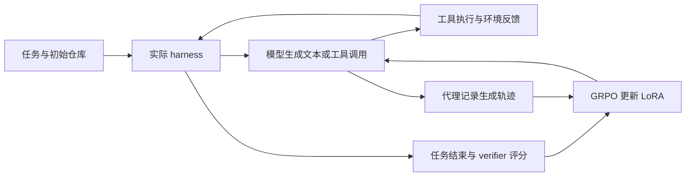

# Harness adapters：在真实 Agent 环境里训练，怎样得到更会用工具的模型

同一个开放模型，放进不同 Agent 程序，表现会变。程序给它的提示、工具、结果格式、上下文压缩和停止规则，都影响它下一步看到什么、决定做什么。Hugging Face 的这篇研究尝试让模型在部署时真正使用的 harness 里训练，而不是只在一个近似的训练循环里学会答题。

**Harness adapter 是训练出的 LoRA 权重增量。** 它改变模型在具体环境中的行为，不是给 Agent 多装一个工具，也不是给系统提示换个模板。作者为 Qwen3.8-27B 分别训练 pi、Hermes Agent 和 OpenCode 的适配器，再尝试把三份增量合成一份。[原文](https://huggingface.co/blog/harness-adapters-at-scale)

结果支持一个较具体的结论：在所测软件工程任务与预算下，环境内 RL 可以同时改善通过率和执行效率。它还没有证明对所有 harness、业务任务或安全行为都有效。理解这项工作，需要一起看任务验证、组内学习信号、训练环境、模型合并和评测口径。

## 模型学到的，是与整个执行环境配合

原文中的 harness 按实际发布的程序运行：pi 1.5.2、OpenCode 2.2.7、Hermes Agent v0.22.6。模型服务由 vLLM 提供，harness 与模型之间的代理记录实际生成的 token，训练器从这些轨迹学习。Harbor 与 OpenEnv 负责承载任务和验证环境。[原文：Training inside agent harnesses](https://huggingface.co/blog/harness-adapters-at-scale#training-inside-agent-harnesses)

这样做要减少一种训练与部署差异。若训练框架自己重写 Agent 循环，模型训练时看到的工具签名、错误消息、压缩过程或停止条件，可能与上线后不同。在真实 harness 中采样，至少让这些环境动作进入训练轨迹。

完整循环可以概括为：

图中模型生成的内容与工具反馈是不同对象。策略更新要针对模型实际采取的选择，不能把环境返回的测试结果也当成模型生成的目标文本。本文据原文解释这一分工，没有取得该实验代理与 AsyncGRPOTrainer 的完整固定版本实现来独立核验所有 token mask 和更新细节。

“在真实 harness 里训练”也不等于训练环境与任意用户安装环境完全一致。上述版本、工具、提示和数据范围共同定义了实验。以后改了上下文压缩或工具合同，仍要重新测量适配器是否合适。

## 为什么首先要验证任务与评分器

RL 需要能重复尝试的任务，也需要能区分对错的 verifier。模型若找到一种让错误实现拿高分的办法，优化过程会强化这种办法。

作者从三类来源构建任务：SWE-smith 向真实仓库注入缺陷；SWE-Gym 使用真实 issue 与合入修复；Tasksmith 从已合入 PR 生成指令和测试。Tasksmith 检查参考实现和另一种正确实现应通过，未修复版本与已知错误实现应失败。随后所有任务还要经过统一验证。[原文：Generating custom RL tasks](https://huggingface.co/blog/harness-adapters-at-scale#generating-custom-rl-tasks-on-hugging-face)

统一验证包括：

| 检查 | 它排除的风险 |
| --- | --- |
| `semantic.oracle_max` | 参考解无法得到满分，任务或测试可能本身有问题 |
| `semantic.floor_gap` | 什么都不做也能拿到相近奖励，评分不能区分修复贡献 |
| `semantic.canary_floor` | 已知错误答案比“不做”得分更高，存在评分漏洞 |
| `runtime.episode_determinism` | 重放同一参考解奖励变化，训练噪声可能来自环境 |

元数据筛选还去掉重复、禁止训练的任务、目标评测中的 253 个任务及那些评测使用的仓库，并要求可接受的训练来源与许可。原文报告 1,127 个 Hub 候选中 858 个通过验证，多数失败来自基础设施，也找到了接受不完整实现或错误答案的 verifier。[原文：Validation with openenv validate](https://huggingface.co/blog/harness-adapters-at-scale#validation-with-openenv-validate)

这些检查验证的是具体参考解与控制样例。一个 verifier 通过了 canary 测试，仍可能接受别的错误实现；参考解能通过，也不证明指令中的全部要求都被测试覆盖。验证集需要随着新失败持续增加，不能把通过一次检查当作评测器已被证明完备。

## GRPO 要从同一问题的不同结果里获得信号

GRPO 对一个任务采样多次，再比较这些尝试的奖励。用一个简化的组内标准化公式说明：

\[
\hat A_i = \frac{r_i-\bar r}{s_r+\varepsilon}
\]

其中，\(r_i\) 是第 \(i\) 次尝试的奖励；\(\bar r\) 是这组尝试的平均奖励；\(s_r\) 是奖励标准差；\(\varepsilon\) 用于处理零方差。正优势对应比同组平均更好的尝试，策略更新倾向于增加其选择的概率；负优势对应较差尝试，方向相反。具体 loss、长度归一化与裁剪还取决于训练器配置。[TRL：Computing the advantage](https://huggingface.co/docs/trl/grpo_trainer#computing-the-advantage)

若奖励只有通过或失败，四次全过或全失败时，所有奖励都等于均值，没有正确性的组内相对信号。`[0, 0, 1, 1]` 则提供了明确比较。因此作者先让底座尝试任务，保留“有时能解、有时不能解”的部分。

原文在 442 个已评分任务上统计：151 个每次都解出，120 个每次都失败，171 个介于两者之间。每题通常试 4 次；按仓库分层抽出的部分任务试 8 次。这是有限次探测，不是对“永远能解”或“绝对不可解”的证明。[原文：Difficulty check with the base model](https://huggingface.co/blog/harness-adapters-at-scale#difficulty-check-with-the-base-model)

一个自拟概率计算能说明采样次数的影响。假设每次尝试独立、成功概率为 \(p\)，一组 \(G\) 次尝试出现成功和失败混合的概率是：

\[
1-p^G-(1-p)^G
\]

\(p=0.5\) 时，4 次探测得到混合结果的概率为 87.5%；\(p=0.05\) 时只有约 18.55%。增加到 8 次，后者升到约 33.66%。所以“全失败而被过滤”有时只是没有采到少见的成功轨迹。此算例不模拟实际任务的相关性，也不估计原实验成功率。

还有一个容易遗漏的条件：最终训练奖励并非只有二元正确率。文章加入了系数为 0.1 的工具效率奖励，却没有在正文给出完整计算函数。因此，“全过或全败时没有正确性相对信号”不能写成“这组完全没有任何梯度”；效率项、其他 loss 项或不同归一化仍可能产生更新。

TRL 当前文档还指出，按组内标准差缩放可能产生问题难度偏差，可配置其他缩放方式。本文使用上述公式建立直觉，没有声称它就是本实验 AsyncGRPOTrainer 的全部精确目标或默认配置。

## 任务数量不能拼成一条假漏斗

文章中的几个数量来自不同视图，复核时不能直接连成一个筛选比例：

- `151 + 120 + 171 = 442`：底座难度探测这一批的结果，内部一致。
- 数据集表的总任务数为 871，三个来源任务数 `717 + 130 + 24 = 871`。
- 同表 qualified 分项为 `144 + 27 + 22 = 193`，总计却写 171；这项算术不一致尚未解释。
- 正文又提到 278 个直接进入后续数据的任务，以及对 522 个剩余任务做修复和复杂化。
- 最终训练混合另行写为 750 个 harness-adapters 环境加 300 个 Termgrade 环境，共 1,050 个任务。

因此，本报告把 171 作为 442 任务探测批次的局部统计，不把它当作最终训练集总量，也不自行修改 qualified 表的分项来凑总数。本次未能从数据集查看接口取得可绑定这份发布稿的完整 split；原文中间批次之间的映射仍需作者的任务清单或生成日志才能校准。[固定发布稿](https://github.com/huggingface/blog/blob/1f46819d70cad02df7ea96ec032fb0014dcf1c3e/harness-adapters-at-scale.md)

作者还设计了四组短训练：未验证、已验证、已验证但不具备混合结果、以及 qualified。每组 32 个任务，最多 50 步，使用相同 OpenCode 配置及 8×H200 作业。这适合检验过滤方法的影响；其动态结果页本次返回 401，因此这里不为四组编造增益排序或数值。最终适配器评测的正文、表格和公开图表数据则已经读取。

## 异步训练解决的是 rollout 长短不一

一个 Agent rollout 可能很快完成，也可能反复查文件、跑测试、修代码。若训练器必须等待所有 rollout 完成，较快任务完成后，相应资源会等待最慢的任务。

原文使用 `AsyncGRPOTrainer`，主要目的是不必等所有 rollout 完成才做下一次优化。最终每个适配器使用 2 张 B200，一张运行 vLLM，一张训练；底座冻结，只训练 `all-linear` 范围的 LoRA。rollout 阶段关闭 thinking，最终学习率为 `2e-5`。原文先试过其他学习率，较大的设置出现轨迹变短、熵上升等不稳定迹象。[原文：Training setup](https://huggingface.co/blog/harness-adapters-at-scale#training-setup)

按 token budget 组织训练时，轨迹变短可以让每一步容纳更多任务组，带来更多任务来源。作者报告三次训练累计 598 步、78,114 个样本、167M 训练 token，并观察到每步可容纳的组数增加。它描述的是该训练设置，不是任何异步 RL 都会得到的固定加速倍数。

异步化也带来实现问题：某条长轨迹采样时使用的策略，可能落后于训练器当前策略。要怎样限制延迟、计算采样概率、处理未完成的组和同步权重，需要对应实现证据。本文只依据正文解释其调度目的与一般风险，没有取得本实验 AsyncGRPOTrainer 的固定实现版本，因而不补造它的陈旧轨迹处理参数。

## 三份 LoRA 怎样合成一份

对一层权重，LoRA 可以写成：

\[
W=W_0+\Delta W,\qquad \Delta W=sBA
\]

\(W_0\) 是冻结底座；若原权重形状为 \(d_{out}\times d_{in}\)，\(B\) 为 \(d_{out}\times r\)，\(A\) 为 \(r\times d_{in}\)；\(r\) 是低秩维度，\(s\) 含该适配器的缩放因子。训练优化的是较小的增量表示。

作者为三个 harness 训练了 rank 32 的适配器，再用 PEFT 的 `combination_type="cat"` 沿 rank 维度拼接，得到 rank 96 的增量。目标是：

\[
\Delta W_{merged}=w(\Delta W_{pi}+\Delta W_{hermes}+\Delta W_{opencode})
\]

拼接能保持这个加和，是因为横向拼接 \(B\)、纵向拼接 \(A\)，矩阵乘积成为各对应块乘积之和。每个原适配器的缩放也必须正确带入。若简单把三个 \(A\) 相加、三个 \(B\) 相加再相乘，会产生不属于原更新的交叉项。

[mechanism_check.py](./examples/harness-adapters/mechanism_check.py) 用自拟小矩阵实际检验了这件事。两份更新按 0.5 缩放后的加和，与正确拼接都得到 `[[4.5, -0.5], [2.0, 2.5]]`；错误地相加因子后得到 `[[7.5, 5.0], [4.5, 3.0]]`。这是代数验证，没有加载 LoRA 或训练模型。[原文：Super-adapter](https://huggingface.co/blog/harness-adapters-at-scale#super-adapter-merging-all-adapters-into-one)

三个更新的逐层余弦相似度约为 0.01—0.02，是作者观察到的近正交性。它不能保证合并后功能互不干扰：同一网络里，增量还会共同改变激活与后续决策，所以仍需要评测合并权重。

作者比较了 `1/3`、`1/2` 与 `1`。在 step-120 适配器的 Terminal-Bench 2.1 评测中，三 harness 平均通过率分别为 49.2%、52.5%、50.0%；简单全强度相加使调用明显减少，却没有在每个 harness 上保持最好表现。最终合并选择 0.5，使用 pi step 160、Hermes step 160 和 OpenCode step 150 的发布检查点。

## 先锁定分母，再看“提升了多少”

评测预定覆盖 Terminal-Bench 2.1 的 89 个任务与 SWE-bench Pro 最难的 51 个任务；每题只尝试一次，温度为 0.8，最多 100 个 Agent step 和 131,072 个 token。时间预算分别为一小时、两小时。

同一 harness 内的底座与适配器才是主要比较。pi 自动压缩上下文，另外两个默认不压缩；这些差异影响上下文溢出和可用预算。因此，不能根据横跨三种 harness 的分数，直接宣布某一个程序普遍更好。[原文：Evaluation setup](https://huggingface.co/blog/harness-adapters-at-scale#evaluation-setup)

下表采用 super-adapter 图表的共同评分任务口径。它与 specialist 单独成对比较或名义全量任务的分母不完全相同：

| Harness / 基准 | 共同评分任务 n | 底座，thinking 关 | 专用 adapter，关 | 合并 adapter，关 | 底座，thinking 开 | 合并 adapter，开 |
| --- | ---: | ---: | ---: | ---: | ---: | ---: |
| pi / SWE-bench Pro | 50 | 40.0% | 64.0% | 46.0% | 74.0% | 74.0% |
| Hermes / SWE-bench Pro | 51 | 29.4% | 43.1% | 47.1% | 45.1% | 60.8% |
| OpenCode / SWE-bench Pro | 51 | 35.3% | 51.0% | 45.1% | 47.1% | 66.7% |
| pi / Terminal-Bench | 85 | 40.0% | 56.5% | 48.2% | 52.9% | 57.6% |
| Hermes / Terminal-Bench | 85 | 44.7% | 58.8% | 55.3% | 58.8% | 63.5% |
| OpenCode / Terminal-Bench | 82 | 47.6% | 52.4% | 52.4% | 54.9% | 58.5% |

数字与 n 由[公开图表数据](https://harness-hub-harness-adapters-figures.static.hf.space/super-data.js)核对。thinking 开启时使用文章所述默认 effort `xhigh`，专用适配器训练时没有开启 thinking。任务未进入共同评分集合的原因，本次没有逐条复核；这限制了对名义全量任务绝对通过率的外推。

另一个公开 specialist 图的数据，pi / SWE-bench Pro 使用 `39.2% → 64.7%`。它与上表的 `40.0% → 64.0%` 并非可以随意互换的四舍五入：共同任务集合不同。[specialist 图表及口径注释](https://harness-hub-harness-adapters-figures.static.hf.space/results.js)

原文报告合并 adapter 在 thinking 关闭时，六个 harness–benchmark 配对的平均通过率 `39.5% → 49.0%`；thinking 开启时 `55.5% → 63.5%`。这类配对平均不能当作单一任务全集的通过率，因为各配对的 n 不同，而且同一个基准任务可能在多个 harness 下重复出现。

还有两处选参会影响解读：合并系数用 Terminal-Bench 选出，作者承认该基准结果可能略偏乐观；OpenCode 检查点选择也使用了部分该基准任务，文章因此另报 66 个未参与选择任务上的结果。排除训练任务污染，与防止在评测集上选择超参数，是两个不同问题。

## 更省工具调用，不等于全部成本下降同样幅度

文章开头给出 pi 的概括：通过率约 `39% → 55%`，平均 token 用量约 `2.9K → 1.5K`。详细效率图另采用双方都解出的任务，比较工具调用数量；图表实现注明它是共同成功任务上的中位数比较。

专用适配器在这类任务上的工具调用减少约 53—72%，合并适配器约 53—73%。这个口径有用，因为它比较同样成功完成的工作，但不能把未成功任务的成本直接算进去，也不能乘在所有 API 费用、总延迟或训练成本上。[效率图数据与注释](https://harness-hub-harness-adapters-figures.static.hf.space/results.js)

一次调用可能是一条很快的 shell 命令，也可能是一项耗时很长的测试；token 还要区分输入、输出和计费方式。要评估实际经济性，还需要把所有尝试的成本、成功率、模型服务和训练摊销一起计算。

关闭 thinking 后，作者观察到适配器在工具调用前写一些短文字，底座则较少这样做。他们称之为“reasoning leakage”。这不使同预算通过率比较自动失效，但说明“关闭 thinking”不等于模型完全没有生成计划或推理样式文本，也不能把 gains 全部解释成单纯减少思考。需要后续实验区分格式变化、规划能力、调用策略和预算利用。

## 迁移与安全，证据到哪里为止

pi 适配器在 OpenCode 和 Hermes 的软件工程基准上保留了一部分收益，支持相近任务和环境间的迁移。到了 300 个 AutomationBench 商务自动化任务、使用其自己的 Agent 循环时，收益没有明显保持：底座 23.0%，pi 27.0%，OpenCode 25.3%，合并 23.7%，Hermes 17.7%。[原文：Out-of-distribution evaluation](https://huggingface.co/blog/harness-adapters-at-scale#evaluation-on-out-of-distribution-tasks-and-setup)

作者认为多数差异仍可能处于噪声范围，Hermes 可能例外。没有完整成对样本与重复运行，本报告不自行补造显著性判断。至少这组结果不能支持“训练代码任务后，所有业务 Agent 都会更好”，也不能保证没有退化。

安全方面，训练调用经 safeagents 的具体正则和模式规则检查。原文累计约 1.3M 次工具调用，阻止 647 次，并观察到每千次调用的阻止数量下降。这个信号说明模型与这组规则的冲突变少；可能因为执行更合规，也可能因为动作分布变化，不能据此宣布整体安全性已经提高相同幅度。需要另测规则未覆盖的错误、授权边界与分布外任务。[原文：safeagents in the loop](https://huggingface.co/blog/harness-adapters-at-scale#safeagents-in-the-loop)

## 如果要应用，先复现哪一部分

对一个只用单一 harness、主要执行软件工程任务的系统，优先比较该 harness 的专用适配器与底座；原文中关闭 thinking 时，专用适配器通常保留更多收益。需要跨 harness 或开启 thinking 时，合并适配器值得单独测，但不应只根据平均分替每个任务选择。

任务集合比训练按钮更早成为瓶颈。先检查参考解、错误控制样例和重复性，再测底座的成功分布；同时留出不用于挑学习率、检查点或合并系数的评估任务。训练和评测要记录 harness 版本、提示、工具、压缩、预算、模型模板和规则配置，才知道下次变化改进了什么。

对本项目的迁移判断是：与其先追求一份泛用“会学习的 Agent”权重，不如先让具体学习任务的完成证据可检验。例如，引用确实支持结论，摘要与原文不冲突，报告能被读取，远端提交能被读回。这些可以帮助构建 verifier，但还需要防止“只讨好检查项”的奖励漏洞。本文没有为本仓训练模型，也没有在闭源 API 上实施 LoRA。

## 来源、校准与实际实验

主材料为 2026 年 11 月 20 日的 [Harness adapters at scale](https://huggingface.co/blog/harness-adapters-at-scale)，完整 Markdown 固定在 [huggingface/blog 的 `1f46819`](https://github.com/huggingface/blog/blob/1f46819d70cad02df7ea96ec032fb0014dcf1c3e/harness-adapters-at-scale.md)。本次读取完整正文，核对公开结果图的 JavaScript 数据与 [TRL GRPO 官方文档](https://huggingface.co/docs/trl/grpo_trainer)。原文 qualified 总数矛盾、部分中间数据集映射、受限短训练图，以及未取得的 AsyncGRPO 实现版本，已在相应结论旁说明。

本仓实际运行了[小矩阵与组内奖励算例](./examples/harness-adapters/mechanism_check.py)，验证拼接更新等于加和、错误的因子相加产生交叉项，以及二元奖励边界与有限采样的基本性质。没有训练 27B 模型，没有复跑基准，也没有把作者的 GPU、通过率或效率数据写成本仓实验结果。
