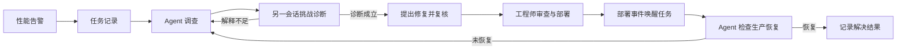

# Performance Factory：让 Agent 查性能回退，怎样从一个解释走到生产恢复

一个性能告警触发后，Agent 写出“可能是这次部署引起的”，离问题解决还有很长一段路。工程师需要判断这个解释是否能解释全部症状，检查修复是否引入别的问题，决定要不要上线，再看生产指标是否恢复。

OpenAI 的 Performance Factory 把这些工作组织为一个持续保存状态的流程。**任务记录负责保留问题与证据，Agent 负责推进当前能做的步骤，事件订阅负责在代码审查或部署之后唤醒工作，工程师负责决定什么可以发布。** 它的主要进步，是把“自动写一份调查回复”扩展成可以跨执行会话、跨等待阶段继续推进的工程工作。[原文](https://openai.com/index/how-openai-performance-factory-keeps-chatgpt-fast)

这是一篇内部系统的工程介绍。本文依据完整原文，分析其状态、诊断、复核和验证机制；没有访问 OpenAI 的生产遥测、内部 Codex API 或历史故障数据。

## 为什么已有 Codex 和工具，还需要一个工厂

原文描述了团队使用方式的演变。早期，性能工程师读指标、日志和代码，逐渐积累了三十多种性能工具。Codex 加入后，更多工程师能在不熟悉的服务里做调查，但仍需要人告诉它何时用哪个工具。

随后，团队把调查方法写进 `perf-forensics` skill：先查变慢从何时开始，再找受影响请求，再检验部署和配置变化。对历史故障进行评测后，某些类型的回退可以从一个告警开始，在一次执行中得到诊断。到这一步，工程师却开始充当传话人：把告警复制给 Codex，再把结果复制回 Slack。

云端自动调查去掉了这段手工传递，但仍没有处理后续责任。回复发出来以后，谁写修复、谁决定发布、怎样找回等待中的工作、怎样确认修复有效，都留给人。在大量 Slack 线程里识别哪些故障还没有解决，本身又成了一份工作。[原文：The path from manual investigations to automated workflows](https://openai.com/index/how-openai-performance-factory-keeps-chatgpt-fast/)

Performance Factory 解决的是这个连续性问题。它把故障作为长期存在的任务，把每次 Codex 执行作为推进任务的一次机会。执行结束后，任务仍保存当前状态、已建立的事实、待验证的假说和下一步依赖。后来的 Agent 或工程师接手时，不必靠原 Agent 一直保持上下文来维持工作。

## 四个部件怎样配合

原文明确列出四个组成部分：

| 部件 | 保存或处理什么 | 与其他部件的关系 |
| --- | --- | --- |
| 任务服务 | 工作流状态、允许的迁移、哪些步骤需要人，以及每步的 Markdown 指令 | 给下一次执行提供当前任务合同和已有发现 |
| 派发循环 | 周期性检查哪些任务已准备好继续 | 为当前状态启动一个 Codex turn |
| 云端 Codex 执行 | 在内部网络环境中读仓库、指标、日志、trace、CPU profile 和内存快照 | 用服务身份执行受范围限制的调查与修改 |
| 事件订阅 | PR 审查意见、CI 失败或部署完成等后续变化 | 匹配事件使任务重新可执行，再由派发循环安排继续 |

配置文件描述状态和迁移，Markdown 文件描述 Agent 在某一步应做什么。两者分工很重要：指令可以教模型怎样调查，但“哪些状态允许发布”“什么事件之后可以验证”仍需要工作流控制。[原文：The Performance Factory system’s four parts](https://openai.com/index/how-openai-performance-factory-keeps-chatgpt-fast/)

原文没有公开内部任务配置的完整 schema，也没有公开调用云端 Codex 的内部 API。下图按文章概括工作关系，节点不是可以直接提交给某个公开 SDK 的参数：

这套订阅不是要求一个模型永远在线等待。原文说，等待中的任务订阅事件，事件匹配后变为 ready，再由派发循环安排 Agent。它也不是一份公开的“运行中追加消息”接口说明。通知使工作恢复，与新信息如何进入一个正在生成的响应，是两个需要分别实现的问题。

## 先判断“什么变慢了”，再寻找谁造成的

告警时间不是故障开始时间。指标越过阈值时，回退可能已经存在数小时。若直接把告警时刻附近的部署当成候选，真实变化可能被漏掉，碰巧相邻的部署反而会被怀疑。

原文中的调查先找三个对象：指标变化起点、受影响请求、受影响服务和路径。之后才检查部署、feature flag 与代码，并追踪某项变化何时真正到达这批请求。一个部署已开始，并不意味着每个用户、区域或请求都已暴露给它。[原文：Agents find the root cause](https://openai.com/index/how-openai-performance-factory-keeps-chatgpt-fast/)

第二个关键问题是请求构成。总体延迟变坏，可以来自同类请求真的变慢，也可以来自本来就慢的请求占比变高。两个原因需要不同的修复。

下面是自拟的离线计算，刻意让组内耗时完全不变，以隔离请求构成的影响：

| 请求组 | 固定耗时 | 变化前占比 | 变化后占比 |
| --- | ---: | ---: | ---: |
| 短请求 | 100 ms | 90% | 10% |
| 长请求 | 1,000 ms | 10% | 90% |

总体平均耗时从 `0.9 × 100 + 0.1 × 1,000 = 190 ms` 变为 `0.1 × 100 + 0.9 × 1,000 = 910 ms`，看上去变慢约 4.79 倍。但是把变化后的组内耗时按原来的请求构成重新加权，仍得到 190 ms。没有一组请求的执行速度下降。

本次用 Python 实际算出了这三个数。它说明总体均值不能单独证明代码性能回退；这是教学数据，不是 ChatGPT 测量结果。例子只计算均值，不能拿同一公式直接推导 P95 或 P99。生产调查需要在请求长度、路径、模型、区域或其他相关分层中比较，并按所查指标保留尾部与分布信息。

## 另一个 Agent 要努力推翻解释

原文说，早期 Agent 有时在找到第一个合理解释后就停止。团队因此加入了一个独立 Codex 会话，专门挑战诊断。它检查假设，也检查反事实：

- 如果某次 rollout 是原因，没有暴露给它的相似请求是否保持正常？
- 如果回滚去掉了那个原因，受影响指标是否恢复？
- 某个相关服务已恢复，症状为什么仍持续？

文章给出的真实案例是图片下载失败。调查 Agent 将问题归因于负责定位文件的内部服务；复核会话发现，该服务已经恢复，图片请求却仍然失败。这个解释不能覆盖持续的症状，因此调查被重新打开。[原文：Adversarial review strengthens the diagnosis](https://openai.com/index/how-openai-performance-factory-keeps-chatgpt-fast/)

这里的作用来自检查任务的分工。调查者寻找解释，复核者寻找解释不能成立的地方。两次执行用了不同上下文和不同目标，有机会减少过早收敛；但同类模型仍可能共享盲点。最终更有价值的证据，是暴露与未暴露请求的差异、实际回滚结果、trace 中的执行路径和仍未解释的症状。

文章的数字应按原有口径理解：

| 厂商公布的信息 | 可以说明什么 | 不能推出什么 |
| --- | --- | --- |
| 三个多月跟踪超过 1,700 次调查，找到超过 600 个案例的根因 | 系统已经处理相当数量的工作 | 不能直接用案例数除调查数计算诊断准确率 |
| 约每天 17 次自动调查 | 调查吞吐达到一定规模 | 不等于每天自动修复并上线 17 个问题 |
| 人工审查 100 个根因建议，70% 被评为准确 | 这批建议中仍有明显的改进空间 | 不是对所有生产故障的随机抽样准确率，也没有给出增加复核前后的完整消融 |

其余 30% 在原文中包括需要进一步修订或尚未充分建立因果的建议，不能全部称为完全错误。文章提出拆成调查、挑战和修复等聚焦执行，但没有提供一个可独立复算的“加入 Reviewer 后准确率提高多少”的最终数字。

## 诊断成立，修复也可能不合适

找出原因不等于找到好修复。原文提到两类问题：Agent 可能写出比必要方案复杂的修改，也可能在解决一个症状时引入新问题。团队因此对修复本身也加入挑战性审查。

缓存是一个具体例子。增加缓存也许能降低耗时，却会引入数据过期与一致性问题。是否接受这项交换，取决于服务的业务含义与架构。测试可以证明某段代码更快，却未必能替工程师判断“多旧的数据仍可接受”。[原文：Fixing the regression is the hard part](https://openai.com/index/how-openai-performance-factory-keeps-chatgpt-fast/)

文章中的生产流程仍由工程师审查 PR、决定合并并部署。工程师可以直接修改 PR，也可以依据诊断另写修复；审查意见会成为新的唤醒事件。让 Agent 自动选择低风险修改并发布，是作者正在探索的方向，不能当作已经覆盖全部修复的现状。

从修复提案到工程师最终合入的修改之间，也能积累训练和评测材料。原文正在把这些差距纳入评测，并探索合成性能测试，让 Agent 在交给工程师前测量和修订提案。这些是工程方向；文章未公开完整合成测试集，也未证明合成测试可以代替上线后验证。

## 上线后的验证，才回答这次修复是否有用

部署完成使任务重新可执行。Agent 观察指标是否回到原来基线，随后决定任务怎样迁移。原文分别描述了三种结果：

| 观察结果 | 原文中的任务处理 |
| --- | --- |
| 性能恢复 | 将任务标记为 resolved |
| 只有部分恢复 | 关闭原回退任务，为残余减速另开任务；残余可能有别的原因 |
| 没有改善 | 保存实际结果，返回调查阶段 |

其中“部分恢复后拆任务”需要特别小心。**本文判断：部分改善本身不足以证明原始根因已经消除。** 拆分时应保存原问题的指标范围、已验证消除的原因和残余症状，并说明为何将残余视为另一个问题。否则，任务面板上的 resolved 数量可能提高，用户实际经历的慢请求却仍存在。

验证基线也不能只取一个发布前后均值。需要核对流量构成、负载、请求类型和服务版本是否可比。若优化降低延迟但提高错误率或内存消耗，单个指标恢复也不足以结束工程判断。这些是从原文因果诊断方法推导出的验证要求，文章没有公开统一的统计检验、观测窗口或所有服务的验收阈值。[原文：Fixing the regression is the hard part](https://openai.com/index/how-openai-performance-factory-keeps-chatgpt-fast/)

## 评测必须还原当时能看见的东西

Performance Factory 对两件事分别评测：Agent 是否调查得好，以及摘要是否能让工程师接手。将它们混成一个“报告质量分”，会掩盖两种不同失败。

调查评测以历史生产事故为材料。每次启动新的调查者，只提供原始信号，去掉可能泄露答案的内容；禁止读取旧调查记忆、事故复盘和前轮结果。Agent 可以在限制内看代码和查遥测，事后还检查执行记录是否接触到泄露答案的信息。

这个设计仍有时间问题：历史指标和 trace 会过期，恢复后补收的证据又可能泄露原因。一次调查是否做得好，要结合它当时能看到什么来判断。原文因此分别评估起点时间、影响规模、受影响请求、候选原因排序和不确定性解释。起点找对了，不代表部署归因也对。[原文：Evaluating investigations](https://openai.com/index/how-openai-performance-factory-keeps-chatgpt-fast/)

摘要评测使用保存的任务快照，对外部遥测过期的依赖较小。grader 看一个不熟悉系统的工程师能否理解问题与影响、是否保留有用图表、建议的下一步是否有证据支持。摘要可以很清楚但诊断错误；诊断也可以正确，却因为没有给出图表和关键条件而难以审阅。

因此，报告写作值得保存的是“结论对应什么图、什么请求范围、什么反证、下一步谁决定”。继续增加一段泛泛的总结，通常不能减少接手者的工作。

## Agent 运行失败，也要作为被调查的问题

调查工具坏了、权限缺失或 profile 无法取得，可能只在执行记录中出现。Agent 最终的长报告不一定让这些失败足够醒目。原文因此安排每天查看近期消息和日志，识别反复的工具失败与权限错误。

当同一错误阻塞多次调查，系统创建一个修复工具的任务；Agent 可以提出修改，工程师审查合入，再通过评测确认原来卡住的步骤是否能继续。它使用相同的工作流机制修复自身的执行链。[原文：Turn recurring failures into self-repair](https://openai.com/index/how-openai-performance-factory-keeps-chatgpt-fast/)

这也说明健康检查需要分层。某个后端返回健康，不等于完整任务已经具备输入读取、执行环境、权限和结果保存能力。对学习系统也一样：ASR 模型可用、转写任务可运行、全文覆盖完整和报告结论有根据，是不同层面的证据。

## 对学习工作台，值得借鉴的是什么

最有价值的迁移是保存工作和证据，而不是照搬内部的多 Agent 布局。一个学习任务可以保留来源、当前材料、已回答的问题、实验结果和等待原因；后续继续时先读这些实际产物，再安排下一步。模型换了或会话结束，也不应丢失任务状态。

第二个迁移是把几个完成条件拆开：资料已取得、分析已完成、实验已验证、报告已写好、提交已产生、远端已读回，不能用一个模糊的“完成”代替它们。反复失败的获取或工具步骤，应记录真实故障层，再修复或明确缺口。

第三个迁移是照顾人的注意力。报告先呈现问题、主要发现、证据和会改变结论的限制。用户需要选择下一篇时，一份可追溯、能独立阅读的报告更有用；堆积许多工具日志并不会自动带来深度。

这些是对本项目的工程与编辑判断。本次没有改造工作台调度器或部署一个 Performance Factory，也没有把 OpenAI 的内部实现当作本仓已经具备的能力。

## 来源与实际验证

主来源为 OpenAI 工程师 Okay Zed 与 Cyrus Forbes 的 [How OpenAI’s Performance Factory keeps ChatGPT fast](https://openai.com/index/how-openai-performance-factory-keeps-chatgpt-fast)，发布于 2026 年 11 月 19 日，本次精读完整正文和工作流说明。系统数据均为作者自报，内部代码、事故数据、诊断样本选择与完整评测没有公开供本次复现。本文的请求构成例子是实际执行过的自拟 Python 算例；它验证加权计算，不验证 OpenAI 的生产效果。
