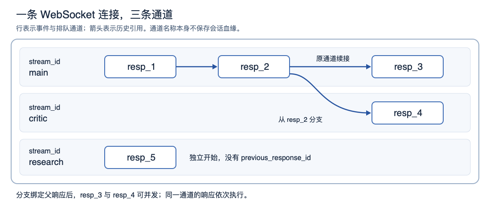

# OpenAI Responses WebSocket 与 Steering

用户让模型定位并修复测试失败，模型开始读测试结果。过了一会儿，用户又说：“先不要修复，改为只分析原因。”此时客户端既要把更新交进去，也要保住已经取得的结果，还要知道应该等服务端继续，还是自己再发一次请求。

OpenAI 的 [WebSocket mode](https://developers.openai.com/api/docs/guides/websocket-mode) 和 [Mid-turn steering](https://developers.openai.com/api/docs/guides/steering) 分别说明了这段过程的两部分：前者规定长连接中的请求、并发通道和历史续接；后者规定如何把用户更新交给正在运行的响应，并在后继响应中应用。**WebSocket 让多个响应共用连接；steering 让新要求及时进入后续推理。理解它们的关键是跟踪响应之间的关系，而不只盯着一条连续的文本流。**

本文深入这两篇指南，字段和边界条件辅以其链接的官方 API 参考。所有示例 ID、任务、工具结果和时序案例均为自拟；报文只展示所讨论的字段。涉及客户端结构和恢复策略的内容标作实现分析，核验日期为 2026-11-11。两家 API 的横向区别另见[《运行中追加消息与修改目标》](./OpenAI与Anthropic_API通信与运行中追加消息_技术研究_20261110.md)。

<a id="connection-and-create"></a>

## 1. 一条连接可以承载多次生成

连接入口是 `wss://api.openai.com/v1/responses`。连接建立后，客户端发送 JSON 事件，服务端在同一连接上返回 Responses 流式事件。开始一次生成用 `response.create`；其主体接近 HTTP Responses create 请求，但不使用 `stream`、`background` 这样的传输相关字段。[^ws][^connect]

下面开始一项测试诊断，选用命名通道 `main`：

```json
{
  "type": "response.create",
  "stream_id": "main",
  "model": "gpt-6-astra",
  "store": false,
  "instructions": "根据测试证据分析问题，并遵守用户当前任务范围。",
  "input": "定位并修复测试失败。",
  "tools": [{
    "type": "function",
    "name": "get_test_results",
    "description": "读取已经保存的测试结果。",
    "parameters": {
      "type": "object",
      "properties": {},
      "required": [],
      "additionalProperties": false
    },
    "strict": true
  }]
}
```

服务端创建响应后，通过 `response.created` 返回 `response.id`，例如 `resp_1`。后续事件属于这次响应，直到它完成、失败或以其他终态结束。若响应提出客户端函数调用，实际执行与结果回填仍由应用负责；改用 WebSocket 不会自动获得一个替你执行本地工具的 Agent。

这使几个“结束”有了不同含义：一段文字输出完，不代表 response 已结束；response 结束，不代表工具已经返回；工具返回，也不代表整项测试诊断已完成。连接则可以继续承载后面的 response。

当前指南给出的 Python 依赖安装方式是 `pip install "openai[realtime]>=3.8.0"`，连接方法为 `client.responses.connect()`。这里的依赖 extra 名称不改变本文使用的 Responses 端点。不同语言的最低依赖与 SDK 支持见原指南；本文不以某种 SDK 的便利方法代替线上事件契约。[^ws]

<a id="lanes-and-lineage"></a>

## 2. 通道决定排队，响应 ID 决定接着哪段历史

长连接本身没有替客户端回答“这次请求属于哪段对话”。官方将这个问题拆成了两个字段：

| 字段或标识 | 负责什么 | 示例 |
|---|---|---|
| `stream_id` | 同一连接上的有序通道，决定排队与事件归属 | `main`、`critic` |
| `response.id` | 标识一次响应 | `resp_1` |
| `previous_response_id` | 指定这次请求引用哪个已有响应的上下文 | 从 `resp_1` 继续，或从它分支 |
| `steer.id` | 标识服务端接受的一次用户更新 | `steer_a` |
| `call_id` | 将客户端工具结果配回对应调用 | `call_tests` |

`previous_response_id` 引用的是 response ID，并没有另外创造一种会话对象。`stream_id` 则只在当前连接中定义通道；它不是持久会话 ID。[^ws][^events]



图中箭头表示历史引用，横向距离不代表耗时。`main` 依次从 `resp_1` 续接到 `resp_2`、`resp_3`；`critic` 从已完成的 `resp_2` 分支到 `resp_4`；`research` 独立开始 `resp_5`。

由此可以直接读懂几种请求组合：

| 下一次 `response.create` | 结果 |
|---|---|
| 同一个 `stream_id`，带上一响应 ID | 在原通道排队，并续接指定历史 |
| 同一个 `stream_id`，省略 `previous_response_id` | 在同一通道开始新的响应链，不自动继承先前对话 |
| 新的 `stream_id`，引用已完成的父响应 | 在另一通道分支，父响应需仍可取得 |
| 新的 `stream_id`，不引用父响应 | 开始独立对话 |

这些组合是官方字段语义的展开。特别容易写错的是第二行：应用复用了 `main`，便误以为服务端会自动把上次对话接上。实际决定上下文的是 `previous_response_id`。[^ws]

### 并发发生在不同通道之间

同一通道内的请求按 FIFO 执行，不重叠；不同通道可以并发，返回事件也可以交错。比如 socket 上依次读到 `main` 的文本、`research` 的文本、`main` 的完成事件，属于正常情况。

官方因此要求用一个读取循环读取连接，再按 `stream_id` 路由。若让两个独立循环都读取同一 socket，各自只保留“自己的事件”，就可能消费并丢弃对方需要的事件。这个问题发生在客户端事件分发处，与模型有没有理解任务无关。[^ws]

命名通道的服务端事件带有相应 `stream_id`，包括终态和能够归属到请求的错误。省略字段使用默认通道，该通道的事件也不带 `stream_id`；空字符串不是默认通道的写法。允许的命名长度为 1–256 个字符，字符限字母、数字、下划线、连字符和句点。`stream_id` 用在 WebSocket `response.create` 中，不放进普通 HTTP create 请求。[^ws]

### 三个限制分别约束什么

| 当前连接限制 | 含义 | 对客户端的影响 |
|---|---|---|
| 最多 16 个活动 response | 命名与默认通道合计；更多 create 请求可以进入队列 | 发出请求不等于已经开始生成 |
| 最多 32 个不同的命名 `stream_id` | 默认通道不占这个名额 | 长会话宜复用通道名，不为每条用户消息生成新通道 |
| 连接最长 60 分钟 | 到期需要重连，影响该连接的所有通道 | 应事先具备逐通道恢复能力 |

因此“32 个通道”不等于“32 次生成都能同时运行”；16 个活动响应的限制也不等于整条连接只能接受 16 次请求。[^ws]

<a id="context-cache"></a>

## 3. 增量续接依赖上下文可用，不只是 ID 字符串有效

普通续接仍发送 `response.create`，其中 `previous_response_id` 指向父响应，`input` 只带新增条目，例如工具结果或下一条用户消息。服务端据此构成后继响应的上下文。WebSocket 与 HTTP 使用相同的历史链接语义，WebSocket 额外提供活动连接上的内存状态复用。[^ws]

指南将它称为 **connection-local previous-response state**：每个通道保留最近响应的连接内缓存，继续引用该通道最新响应时可以较快复用。文档没有公开其完整内部表示，本文不把它等同于某种已知布局的 KV cache。

### `store=false` 仍能在活动连接上续接

`store=false` 的含义不能简化为“服务端完全没有上下文状态”。当前连接上的临时内存状态仍可用于续接，所以 WebSocket 可以与 `store=false`、ZDR 配合。真正的分界发生在父响应不在这份缓存时：[^ws]

| 父响应状态 | `store=true` | `store=false`／ZDR |
|---|---|---|
| 在连接内缓存中 | 可复用连接状态 | 可复用连接状态 |
| 不在连接内缓存中 | 若持久状态可用，服务端可以重新加载；失去内存路径的延迟优势 | 没有持久回退，返回 `previous_response_not_found` |
| 连接已断开 | 可尝试从有效的已保存响应恢复 | 新连接上要重建所需上下文 |

应用保留了 `resp_1` 这个字符串，只说明自己记得它的标识。它能否继续被服务端解析，取决于对应状态是否还可取得。

也要把这份连接缓存与 prompt caching 分开。这里讨论的是“如何找回父响应状态、建立后继请求”；prompt caching 讨论的是输入处理能否复用。仅凭成功使用 `previous_response_id`，不能证明所有历史 token 都免于处理或计费。这两篇指南也没有给出“增量上传等于只按增量计费”的承诺。

### 一个 400 也可能改变后续恢复路径

WebSocket 指南给出了一条不太直观的规则：**同通道续接返回 4xx 或 5xx 时，所引用的父响应会被逐出连接缓存；跨通道分支请求出错，则保留共享父响应，原通道可以继续。**[^ws]

按这条规则推演：应用以 `store=false` 从 `resp_1` 续接，第一次请求因为参数错误返回 400；应用修正参数后再使用同一个父 ID，可能接着遇到 `previous_response_not_found`。第二个错误并不说明第一次参数修复无效，而是它面对的缓存状态已经变了。

因此恢复逻辑要同时处理“本次请求为什么失败”和“父上下文是否仍然可用”。只按 HTTP 状态决定退避后原样重发，可能把这两个问题混为一谈。

<a id="fork-race"></a>

## 4. 分支案例：为什么发送成功后还要等 `response.in_progress`

现在 `main` 已完成 `resp_2`。应用希望一边让 `main` 补充方案，一边让 `critic` 检查遗漏，于是发送：

```json
{
  "type": "response.create",
  "stream_id": "critic",
  "model": "gpt-6-astra",
  "store": false,
  "previous_response_id": "resp_2",
  "input": "检查这个诊断是否遗漏了边界条件。"
}
```

若连接中的活动 response 已占满，分支请求会排队。此时原通道继续前进，或者原通道续接出错，都可能使 `resp_2` 在分支真正启动前从缓存中消失。`store=false` 又没有持久回退，分支就会失败。[^ws]

下面是按文档条件构造的失败时序：

| 时刻 | 应用或服务端动作 | 关键状态 |
|---|---|---|
| ① | `main` 的 `resp_2` 完成 | 父响应在连接缓存中 |
| ② | 应用发送 `critic` 的分支 create | 请求因容量限制排队，尚未绑定父响应 |
| ③ | 应用立即让 `main` 继续 | 原通道推进，旧父响应可能被淘汰 |
| ④ | `critic` 获得执行机会 | 若父状态已不可用，返回 `previous_response_not_found` |

官方给出的处理办法是：**等分支通道发出 `response.in_progress`，再推进原通道。** 此处等待的是分支已经开始、完成父状态绑定的边界，不只是客户端完成发送。若已经失败，可以用 `previous_response_id: null`，携带分支所需完整输入重新开始。[^ws]

这也解释了为什么不能为所有操作共用一个含义模糊的“已成功”标记：分支需要观察 `response.in_progress`；后文 steering 的输入提交点则是后继 `response.created`。两者确认的是不同事实。

<a id="steering-lifecycle"></a>

## 5. Steering：先接收更新，再创建带更新的后继响应

原生 steering 当前限 **GPT-6 系列与 Responses WebSocket**，GPT-5.6 及更早模型不支持。官方事件参考还限定为适用的单 Agent response，排除绑定 `conversation` 或使用自动 compaction 的响应。建立了 WebSocket 连接，只满足传输条件，不能跳过这些能力检查。[^steer][^events]

这里“单 Agent response”约束的是一次响应的执行模式；WebSocket 多通道则是在一条连接上承载多次响应。两者的作用对象不同，不能把这个限制理解成整条连接只能运行一段对话。Steering 通过目标 response ID 找到所属通道，并按该响应的模型与配置判断支持情况。[^ws][^events]

### `response.steer` 到底修改什么

收到 `resp_1` 的 `response.created` 后，用户在它运行期间修改要求，客户端可向同一连接发送：

```json
{
  "type": "response.steer",
  "previous_response_id": "resp_1",
  "input": "先不要修复，改为只分析原因。"
}
```

这里的 `previous_response_id` 定位被更新的响应。`response.steer` **只接收** `type`、`previous_response_id`、`input`；目标响应已确定通道，不再发送 `stream_id`。输入可为字符串或非空 user 消息数组，支持的内容包括文本、图片和文件；工具结果、system/developer 角色与新生成配置不通过这个事件提交。[^events]

所以，“修改目标”是用户输入的语义，例如从修复改成分析。它不意味着同一个事件还可以把模型、工具定义或推理配置一并改掉。

服务端接受后分配 `steer.id`：

```json
{
  "type": "response.steer.accepted",
  "stream_id": "main",
  "sequence_number": 4,
  "steer": {
    "id": "steer_a",
    "previous_response_id": "resp_1"
  }
}
```

`accepted` 表示服务端验证并接管了这条排队输入。**它还没有证明模型已经按新目标行动。** 在无需客户端工具结果或审批的情况下，服务端完成当前输出 item 及已经运行的托管工具工作，再创建包含更新的后继响应。[^steer]

### 自动续接的两种结束方式

| 原响应怎样结束 | 客户端应怎样解释 |
|---|---|
| `response.incomplete`，`incomplete_details.reason` 为 `steered` | 原响应在规定边界让出，继续等后继响应 |
| 原响应先正常 completed | 已接受的 steering 仍可能产生后继响应，不能立即关闭连接 |

两条路径都可能进入后继 `response.created`。官方将这个事件称为 steering 的**提交点**：更新进入了后继 response。此后仍需观察输出与工具行为，才能判断模型是否完成新目标。[^steer][^events]

这段生命周期可以写成：

```text
用户更新已发送
  → accepted：服务端排队
  → 原 response 到达结束边界
  → 后继 response.created：更新已提交
  → 后继继续输出、调用工具或完成
```

这是后继响应机制。公开契约不保证在同一次未结束的隐藏解码状态中直接改写输入，也不保证原响应绝不停止。已经发出的文本、已经完成的动作和已经启动的工具，不会被 steering 自动撤销。[^steer]

自动后继响应继承原请求设置，客户端此时应继续读事件，不额外再发一次 create。收到后继 ID 后，后续用户更新改为定位新的活动 response。若用户更新恰好赶在响应交接之间，客户端需要按已知终态和活动 ID 处理，不能把“最后见到的 ID”永久当作可 steer 的目标。

### 同一份历史不等于同一套请求设置

| 续接方式 | 后继响应由谁创建 | 请求设置怎样确定 |
|---|---|---|
| 普通显式 `response.create` | 客户端 | 由新请求指定；`previous_response_id` 不自动继承旧 `instructions` |
| steering 自动续接 | 服务端 | 继承原请求设置 |
| steering 等待工具结果后的显式续接 | 客户端回填结果 | 使用这次显式请求自己的设置，已接受的 steer 由服务端合并 |

前一项来自 create 参数说明，后两项在 steering 指南中明确区分。应用应按每种分支准备 `instructions`、工具与其他需要持续生效的设置，不能把“引用了父响应”统一理解成“复制了整个旧请求”。[^create][^steer]

自动后继还会分别应用每个 response 的 token 与工具调用限额。原响应的单次上限不会自动变成整条 steering 链的总预算；需要控制整项任务开销时，应用应累计各响应的使用量。[^steer]

<a id="pending-tools"></a>

## 6. 完整工具案例：两条更新，只回填一次结果

回到测试诊断。这个案例中的 `resp_1` 会给出读取测试结果的调用：

```json
{
  "type": "function_call",
  "call_id": "call_tests",
  "name": "get_test_results",
  "arguments": "{}"
}
```

在 `resp_1` 仍运行、尚未结束时，用户连续提交两条更新，服务端分别接受为 `steer_a`、`steer_b`：

- `steer_a`：“先不要修复，改为只分析原因。”
- `steer_b`：“只根据已读取的测试结果作答，结论用中文。”

随后 `resp_1` 正常完成并给出上述工具调用，应用执行读取，结果尚未回填。服务端不能凭空取得本地结果，两个更新继续排队；应用可能分别收到针对它们的 pending 通知，例如：

```json
{
  "type": "response.steer.pending",
  "stream_id": "main",
  "sequence_number": 12,
  "steer": {
    "id": "steer_a",
    "previous_response_id": "resp_1"
  },
  "reason": "waiting_for_required_input",
  "required_input": [{
    "type": "function_call_output",
    "call_id": "call_tests",
    "name": "get_test_results"
  }]
}
```

`required_input` 是缺失结果或审批决定的标识，不是让应用重新执行工具的命令。官方规定每条 steering submission 最多发一次这种通知；同一个父响应上的多条更新可以指出同一份所需结果。客户端续接的单位因此是**父响应**，不是 pending 通知数量。这里排队的是原响应结束前已经接受的更新，不能据此推断任何已结束 response 都继续接受新 steer。[^events]

读取结果到达后，应用在同一连接、同一 `main` 通道回填一次：

```json
{
  "type": "response.create",
  "stream_id": "main",
  "model": "gpt-6-astra",
  "store": false,
  "previous_response_id": "resp_1",
  "instructions": "根据测试证据分析问题，并遵守用户当前任务范围。",
  "tools": [],
  "tool_choice": "none",
  "input": [{
    "type": "function_call_output",
    "call_id": "call_tests",
    "output": "测试期望空列表，实际返回 null。"
  }]
}
```

这个案例中，用户已经要求只按现有结果解释，所以显式请求不再提供后续工具。应用没有把两条更新再抄进 `input`。服务端会按接受的提交顺序，把仍排队的更新放到这次新增输入之前：[^steer][^events]

```text
已有父响应上下文
  + steer_a：改为只分析原因
  + steer_b：只用现有结果，用中文
  + function_call_output：call_tests 的实际读取结果
  → 后继 resp_2
```

这是逻辑上下文示意，不是客户端发送完整 JSON 的另一种格式。若显式请求还带了新的用户输入，那些条目位于这次请求的 `input` 中，排在服务端补入的已接受 steer 后面。

### 工具结果先到时，不用等 pending

假如应用较早拿到结果并发送了匹配的 create，服务端可以直接处理，不先发 pending。**等待 pending 才允许回填，是客户端多加的一道等待，不是官方契约。** 正常工具流程应持续推进。[^steer]

这几条事件可能相邻到达，客户端需要按状态处理：

| 到达的事情 | 要保存或推进的状态 |
|---|---|
| 完整工具调用 | 记录调用身份，调度一次执行 |
| 用户更新被 accepted | 记录更新 ID、目标父响应与顺序 |
| 一个或多个 pending | 合并该父响应缺失的结果；不重复调度已执行调用 |
| 工具完成 | 保存真实结果，检查该父响应是否可以显式续接 |
| 后继 `response.created` | 将更新记为已提交，登记后继 ID |

其中按父响应合并续接、按调用身份复用结果，是对官方要求的客户端实现分析。内存中加一个“已执行”布尔值只能覆盖当前进程；若要跨进程恢复，还需把实际执行结果和业务操作身份记录下来。

<a id="client-state"></a>

## 7. 客户端应保存哪些状态，怎样避免把事件接错

一个只做单响应演示的循环，可以遇到 `response.completed` 就退出。但同时存在多通道、工具和 steering 时，退出条件应由应用等待的那项工作决定：其他通道完成、被 steer 的原响应结束、工具响应完成，都不一定满足它。

按前面的契约，客户端可以把状态分成以下几部分。这是实现建议，表中的本地字段不是 OpenAI API 字段：

| 应用记录 | 为什么需要 |
|---|---|
| 本地连接代次，例如 `connection_epoch` | 重连前后的同名通道不共享原来的内存缓存 |
| 通道到业务会话的映射 | `main` 只是传输通道名，业务历史应有自己的归属 |
| 响应的 ID、父 ID、通道、终态 | 区分正常完成、steered 结束、分支和后继 |
| 用户更新原文、本地提交顺序、可选 `steer.id`、处理状态 | 处理接受、失败和断线时的不确定结果 |
| 工具调用身份、执行状态和真实结果 | 防止重复执行，也便于回填与重放 |
| 每个父响应的显式续接记录 | 多条 pending 可以共享同一次结果提交 |
| 每次显式请求所需设置 | 历史续接与指令／工具设置的继承规则不同 |

连接读取器负责收事件和分发；通道调度器处理状态迁移；工具执行器产生结果后再把结果通知调度器。读取器不应在接到工具调用后停下来等待整个工具结束，否则会耽误其他通道的事件和已经到达的用户更新。

“按通道分发”也不能简单写成“凡是不带 `stream_id` 都是连接坏了”。默认通道的正常事件本来就不带该字段；错误还需要结合 `error.code`、目标响应映射和连接状态判断。使用命名通道可以减少这类归属歧义，但无归属错误仍要保留处理入口。[^ws]

官方示例为了突出单个流程，常常只等待某个事件便返回。将示例组合进常驻客户端时，等待某个分支开始或某个响应完成的辅助逻辑，应让总读取器继续分发其他事件，而不是顺手丢掉暂时不关心的通道。

<a id="recovery"></a>

## 8. 断线恢复：找回历史与核对更新是两件事

连接关闭后，所有通道的连接缓存消失。恢复某个通道时：若已保存的父响应仍有效，可以在新连接引用它；若 `store=false` 或父响应无法取得，就以 `previous_response_id: null` 或省略该字段开始新链，重放该通道下一步所需完整上下文。[^ws]

“完整上下文”应包括所需用户消息、模型输出条目、工具调用及其结果，而不只是屏幕上的最终答案。应用先根据实际执行记录填入已发生的结果，再继续推理；重建上下文并不要求重新执行历史中的每个工具动作。

### Steering 的待处理队列不会随父响应保存

Steering 指南单独规定：待处理更新只在当前连接中，**不会作为原 response 的一部分持久保存**。因此即使使用 `store=true` 找回了父响应，也不能据此认定未提交的 steer 自动恢复了。[^steer]

客户端还可能在事件交接时断线，所以应区分“明确失败”与“结果未知”：

| 断线前已观察到什么 | 可以确认什么 | 还需要核对什么 |
|---|---|---|
| 已发送 steer，没有确认 | 本地发起过提交 | 服务端是否接收、是否继续处理；无确认不证明被拒绝 |
| 已 accepted，没有看到后继 created | 服务端曾接管输入 | 断线前是否已创建了客户端未见的后继 |
| 已看到匹配的后继 created | 更新已经提交到后继 | 后继生成及工具执行到哪一步 |
| 收到 `response.steer.failed` | 该更新没有通过 steering 应用，且不会稍后自动应用 | 按错误原因修正或改用显式请求恢复 |

事件参考特别说明：分配 ID 后的失败沿用同一个 `steer.id`；在分配 ID 前就失败时，该字段可以缺失。连接丢失或确认缺失留下的是未知状态。应用因此也需要自己的输入记录，不能只依赖服务端分配的 ID。[^events]

从这些约束可以得出一个实现结论：**仅靠这两种接口，不能推出跨断线的“恰好处理一次”保证。** 客户端应对照响应事件、保存的上下文和工具执行记录决定重放；不确定的外部操作状态需要先查明，不能通过重复生成来猜测。

### 错误名说明失败发生在哪个对象上

| 错误 | 所在流程 | 处理重点 |
|---|---|---|
| `previous_response_not_found` | 普通续接或分支 | 父响应状态不可用；必要时重放上下文并开新链 |
| `response_not_found` | steering | 目标响应必须仍在同一 WebSocket 连接上可用 |
| `steering_not_supported` | steering | 检查模型及响应配置，不能靠重复发送解决 |
| `too_many_pending_steers` | steering | 若缺工具结果则回填；否则等待后继，不重发已接受输入 |
| `invalid_stream_id`／`websocket_stream_limit_reached` | 通道创建 | 修正名称、复用已有通道或换连接 |
| `websocket_connection_limit_reached` | 连接寿命 | 重连并逐通道恢复 |

能够归属到命名通道的请求错误不必使其他通道一起退出。另一方面，一条连接关闭会影响它承载的全部通道。把更多业务放在同一连接上减少了连接管理数量，也扩大了一次连接中断需要恢复的范围，这是应用需要权衡的地方。[^ws][^steer]

<a id="compaction-and-warmup"></a>

## 9. 预热和压缩怎样接进这套流程

### `generate: false` 预先准备请求状态

当应用已知道即将使用的工具、指令或消息，可以发送 `response.create` 并设置 `generate: false`。它不生成模型输出，但准备请求状态，并返回可用于后续链接的 response ID；下一次生成仍通过 `previous_response_id` 续接。[^ws]

因此预热响应有 ID，并不表示模型已分析完用户问题。应用也不应把“无模型输出”直接翻译成“无任何费用”或“总能降低延迟”；这两篇指南没有给出足够的计费或基准数据来支持这些结论。

### 两种压缩入口，产生不同的续接材料

| 压缩方式 | 得到什么 | WebSocket 下一步 |
|---|---|---|
| `context_management` 的服务端自动压缩 | 正常响应链中的压缩处理 | 仍引用最新 `previous_response_id`，只带新增 input |
| 独立 HTTP `/responses/compact` | 新的压缩后输入窗口，不是可续接的 response ID | 用完整返回窗口作为 input 基础，追加新条目，并省略父 ID 或设为 null |

独立 compact 返回的窗口应按原样保留，不自行删去看似多余的返回条目。这里发生的是用压缩窗口建立新响应链，所以不要把某个压缩条目的 ID 当成 `previous_response_id`。[^ws]

还有一个必须并排阅读两篇文档才能看出的限制：**WebSocket 支持自动压缩；当前 steering 事件参考却排除了启用自动 compaction 的 response。** 不能因为两项都属于 Responses API，就在同一请求上默认组合。[^ws][^events]

若应用需要压缩历史后继续支持用户更新，可以研究在明确边界使用独立 compact，再以返回窗口开新链的设计。但 compact 与仍排队的 steer 怎样交接，需要由应用明确处理；这两篇文档没有提供一个可以原子地“压缩、迁移待处理更新并开始后继”的复合操作。这里是设计分析，不是新增的官方兼容性承诺。

<a id="latency"></a>

## 10. 性能收益主要来自哪里，怎样判断是否适合自己的任务

OpenAI 在 WebSocket 指南中自报：包含 20 次以上工具调用的工作流，曾观察到最高约 40% 的端到端提速。该段没有给出完整基线、样本分布和原始耗时；本文保留“最高约”“特定工作流”和厂商自述的范围，不将它写成普遍的延迟下降比例。[^ws]

对一条串行的模型—工具链，可以用一个简化分解理解收益：

```text
总耗时 ≈ 各轮（模型生成时间 + 工具执行时间 + 续接准备时间）之和
```

“续接准备时间”包括请求传输、父上下文定位和进入下一轮生成之前的开销。长连接与连接内状态复用主要改善这部分。模型本身生成很久、工具本身执行很慢时，减少续接开销对总耗时的占比就会变小。若模型与工具存在重叠，应该沿实际关键路径分析，不能直接将所有并发工作时间相加。这是性能分析模型，不是官方测量公式。

多通道则解决独立工作能够并行推进的问题。它未自动分解任务，也未保证任意两个步骤可以并发；存在先后依赖的步骤仍需等待结果。Steering 解决用户更新多久能进入后续判断，它也不承诺零等待：当前输出 item、已启动的托管工具以及尚缺的客户端结果都会影响交接。

如果后续做真实集成实验，比单独测“第一个 token 多快”更有用的是记录：用户提交更新、收到 accepted、后继 created、第一项按新要求执行的动作各在何时发生；同时记录整项任务耗时、请求与工具次数、缓存回退和断线恢复。这样才能分别看出接收延迟、交接延迟和实际完成时间，而不把它们压成一个含义不明的“更快”。此实验尚未执行。

<a id="sources-and-scope"></a>

## 来源与核验范围

本报告完整读取了用户指定的两篇官方指南正文，按问题重组为协议分析；不逐段翻译各语言的重复 SDK 示例。WebSocket 事件参考用于确认 steering 字段、提交点、缺失结果与失败语义；create 参考用于确认显式续接的 `instructions` 行为。

本次没有调用真实模型、执行付费 API 或抓取个人会话。图和时序案例解释文档允许的过程，不是线上 trace；性能部分没有新增实测数据。旧报告的离线教学实验也不作为本篇并发、分支缓存或重连行为的验证。报告 completed 表示本次文档研究完成。

若希望继续对照 SDK 与工具循环，可读[《OpenAI、Anthropic API 开发者中文译解》](./OpenAI与Anthropic_API开发者中文译解_请求与执行循环_20261110.md#runtime-updates)；若要比较 Claude 的对应能力，可回到[官方 API 对照报告](./OpenAI与Anthropic_API通信与运行中追加消息_技术研究_20261110.md)。

[^ws]: [OpenAI：WebSocket Mode](https://developers.openai.com/api/docs/guides/websocket-mode)，连接、增量续接、连接缓存、并发与分支、预热、压缩、限制和恢复；完整正文读取于 2026-11-11。
[^steer]: [OpenAI：Mid-turn steering](https://developers.openai.com/api/docs/guides/steering)，模型支持、接受与续接、工具结果／审批、失败与断线；完整正文读取于 2026-11-11。
[^events]: [OpenAI：Responses WebSocket events](https://developers.openai.com/api/reference/resources/responses/websocket-events)，`response.steer`、accepted、pending、failed 的字段与条件；相关条目读取于 2026-11-11。
[^create]: [OpenAI：Create a model response](https://developers.openai.com/api/reference/resources/responses/methods/create)，`instructions` 与 `previous_response_id` 的关系；相关条目读取于 2026-11-11。
[^connect]: [OpenAI：Connect](https://developers.openai.com/api/reference/resources/responses/methods/connect)，WebSocket URL、握手认证与事件接口；读取于 2026-11-11。
