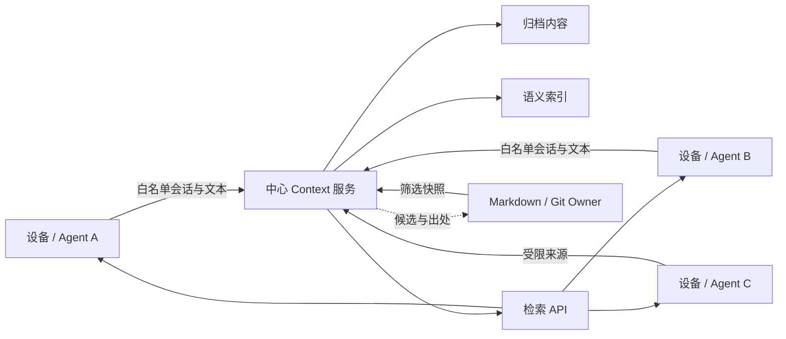
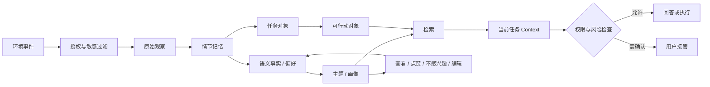
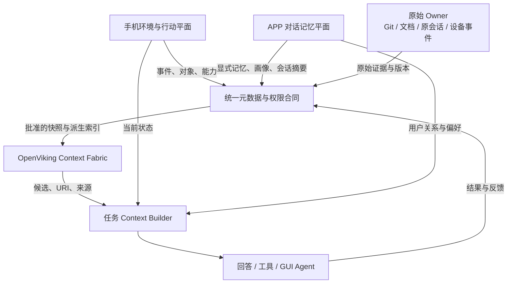

# 个人 Context 与 Memory 三层架构：OpenViking 多设备、手机环境与 APP 跨对话记忆

> 资料时点：2026-10-25。本文统一分析三个容易混在一起、实际职责不同的系统：OpenViking 多设备上下文服务、手机视角的环境与行动上下文、豆包 APP 的跨对话记忆。公开产品事实来自官方文档；项目现状来自一轮脱敏受控研究，只公开架构级结论，不公开个人设备、网络、账号、用户内容或可执行访问路径。

## 一页结论

这三个视角不是三种同类数据库，而是个人 AI 系统的三层平面：

1. **本文把 OpenViking 归纳为 Context Fabric。** 官方定位是 context database；本文强调它在个人系统中连接多设备与多 Agent 的作用。它把文档、会话、Memory 和 Skill 组织成可检索的上下文空间。[S1][S2]
2. **手机是 Environment & Action Plane。** 它看到当前应用、屏幕、交互、位置、设备状态等环境信号，也能调用系统能力执行动作。它提供的是“此刻发生了什么、现在能做什么”，不等同于长期聊天记忆。[S8][S9][S16]
3. **APP 是 Conversational Memory Plane。** 豆包 APP 公开说明的是：从对话文本和语音转写中提炼记忆，在未来对话中作为回复背景；同时支持用户明确要求“记住/忘记”。它主要解决“这个用户是谁、过去说过什么、以后如何更贴合地回答”。[S7]
4. **当前项目里的 OpenViking 仍是集中式服务。** 多设备负责采集和访问，中心实例负责归档、索引与检索。它不是离线多主数据库，也没有形成已经验证的跨设备冲突合并、自动故障切换和完整删除传播。[S15]
5. **OpenViking 当前官方主线能力比项目固定版本更快演进。** 2026-10-25 的官方文档描述了递归层级检索、多租户、主存储加多个备份存储等能力；项目试点固定版本的检索与存储语义不同。不能拿主线文档替代已部署版本的实测。[S3][S4][S5][S15]
6. **手机逆向研究证明了丰富的数据模型和权限门，但没有证明完整闭环。** 当前能确认采集、情节记忆、画像、主题、索引、反馈、导出候选链等实现线索；尚未成功读取有效记忆正文，也没有把同一事件从采集、提炼、检索到删除串成可复现链路。[S16]
7. **APP 的公开产品合同已经暴露了关键架构语义。** 自动提炼与显式记忆是两条不同写入路径；关闭开关不等于删除，删除聊天不等于删除记忆，删除记忆也可能延迟生效。这说明会话、记忆、检索索引和用户控制面至少是相互区分的状态。[S7]
8. **真正需要统一的是数据合同与生命周期，而不是把三者塞进一个库。** 最小统一链路应是：

```text
采集 → 归一化 → 原始 Owner → 派生记忆/索引 → 检索 → 注入
    → 回答或行动 → 用户反馈 → 更新/删除传播 → 审计与恢复
```

如果只记住一句话：**OpenViking 管“到哪里找上下文”，手机管“世界正在发生什么以及能做什么”，APP 管“用户在对话中逐渐形成的长期关系”；三者通过来源、身份、权限、版本和删除语义连接。**

---

## 1. 先把 Context 与 Memory 分开

“Context”和“Memory”常被混用，但工程上最好分开：

- **Context**：本轮任务实际送进模型或工具决策的有限材料；
- **Memory**：跨轮次保留、可以更新或遗忘的信息；
- **Source**：产生事实的原始证据，例如原对话、文档、手机事件；
- **Index**：帮助找到 Source 或 Memory 的派生结构，例如摘要、关键词和向量；
- **Action state**：任务是否已执行、待确认、失败或完成。

一个记忆系统并不是把所有历史都拼进 Prompt。它要先决定保存什么，再从保存内容中找到本次需要的少量信息。LongMemEval 将长期对话记忆拆成 indexing、retrieval、reading 三阶段，并用信息提取、多会话推理、时间推理、知识更新和拒答五类能力评估系统；这比“向量命中了没有”更接近真实使用。[S10]

2026 年的一篇综述进一步用 forms、functions、dynamics 组织 Agent Memory：什么承载记忆、记忆为任务做什么、记忆如何形成和演化。本文采用生命周期视角，也是为了避免只讨论存储形态而忽略更新与遗忘。[S13]

可以写成一个最小关系：

```text
Memory_t = update(Memory_t-1, NewEvidence, UserFeedback)
Context_t = select(CurrentTask, Memory_t, Sources, Policy, Budget)
Action_t  = decide(Context_t, Permission, Risk)
```

这里最关键的是三个动词：`update`、`select`、`decide`。它们分别对应记忆演化、上下文装配和行动授权，不能由一次向量搜索同时代替。

---

## 2. 三个视角到底各自看见什么

| 视角 | 主要输入 | 主要时间尺度 | 最重要的输出 | 主要风险 |
|---|---|---|---|---|
| OpenViking 多设备 | 文档、Agent 会话、Skill、批准导入的 Memory | 天、月、项目生命周期 | 可追溯的候选上下文 | 过时召回、权限串域、索引与原文漂移 |
| 手机环境 | 屏幕、应用状态、交互事件、传感与系统能力 | 毫秒、分钟、事件窗口 | 当前环境事实、可执行对象 | 过度采集、误推断、越权行动、能耗 |
| APP 跨对话 | 用户与助手的文本、语音转写、显式记忆指令 | 多轮、多会话、长期关系 | 用户偏好、事实、历史关系与回复背景 | 错误画像、记忆污染、删除不一致、越界个性化 |

它们也有不同的“真相来源”：

- OpenViking 中，文档或原会话应该保留来源位置与版本；
- 手机中，原始事件是观察，不自动等于稳定用户事实；
- APP 中，用户明确说“请记住”通常比模型从多轮对话自动总结更高权威；
- 任何一层的检索命中都不自动产生行动授权。

CoALA 把语言 Agent 组织为模块化 Memory、内部和外部 Action Space、以及选择动作的决策过程。这正好解释了为何“记得一个地址”和“可以用它提交订单”属于两个系统阶段。[S12]

---

## 3. OpenViking：多设备上下文的中心 Fabric

### 3.1 官方产品模型

OpenViking 官方把上下文分为三类：[S1][S2]

- **Resource**：用户导入的文档、代码、知识和规则；
- **Memory**：从交互和任务中持续提炼的用户画像、偏好、实体、事件、经验和轨迹；
- **Skill**：Agent 可调用的能力定义。

内容通过统一 URI 和文件系统组织，内容层与向量索引分离；L0、L1、L2 提供从短摘要、目录概览到完整内容的渐进加载。会话 `commit` 先形成归档，再触发后台记忆提炼和语义处理；调用返回不代表后台产物已经完成，必须等待任务进入真实完成状态。[S1][S2][S6]

这套设计的价值在于：Agent 不必每次先读整个仓库或全部历史，而可以先找到目录和候选，再按预算展开正文。

### 3.2 “多设备”不等于“多主分布式数据库”

当前项目的准确形态是：



多台设备是采集器和客户端；中心服务拥有归档副本与索引。在当前项目的明确配置中，Markdown/Git 被指定为规范、报告和已核实事实的 Owner，OpenViking 保存筛选后的归档副本与派生索引。这是**多设备接入的集中式 Context Fabric**，并不是每台设备各有一份可离线写入、重连后自动解决冲突的多主系统。[S15]

当前官方主线已经提供更多分布式构件：

- 多租户在一个服务器内用 `account` 和 `user` 建立身份与隔离边界；`peer` 是 user 边界内的内容范围。这些都属于访问与命名空间模型，不是副本一致性协议。[S4]
- multi-write storage 支持一个 primary 和多个 backup，可选择同步或异步复制，也明确说明不会自动把 backup 提升为 primary。[S5]
- 当前队列文档区分 `pending`、`processing` 和 `unacked`，说明后台任务完成语义不能由“队列看起来空了”推断。[S6]

这些能力能组成更可靠的服务，但仍不自动提供完整的离线同步、多主冲突合并、端到端删除传播和业务级自动故障切换。

### 3.3 项目试点已经证明了什么

脱敏受控试点已验证：[S15]

- 多设备文本能够送达中心服务；
- 原文归档、语义索引和重启后读取可用；
- 文本快照可以在隔离环境中恢复；
- 当前项目的受控导入设计记录来源清单、原文哈希与检索 URI，用于事后核对；这不是 OpenViking 原生的一致性保证；
- 当前项目保留确定性 context 路由作为只读降级入口，并与 OpenViking 语义检索并存；这是项目配置，不是官方产品的默认承诺。

这说明它已经是一套可用的“共享索引与归档服务”，但还不能宣称为成熟的分布式个人记忆系统。

### 3.4 试点也暴露了真正的问题

受控检索诊断发现：[S15]

1. **语义召回仍会漏。** 精确原话容易命中，不同表达方式的查询仍可能把正确内容排到较后位置。
2. **来源头会改变 embedding。** 把来源、会话角色等信息直接拼到正文前，会改变表示；移除这些头信息能改善部分改写查询，却不能解决全部漏召回。
3. **重复正文会改变排名。** 同一内容的多个副本可能占据候选位，让“命中了很多条”看起来很好，实际信息增量很低。
4. **主线文档不能替代固定版本实测。** 当前官方文档描述递归层级检索，而试点固定版本采用不同检索流程。
5. **索引恢复不等于 Memory 恢复。** 可重建的 embedding 与用户确认过的长期事实具有不同恢复要求。

因此，OpenViking 在本项目中的最佳定位是：

> **可重建的语义目录、会话归档与候选检索层，而不是事实的最终 Owner。**

### 3.5 真正的多设备上下文还缺什么

要从“多客户端中心服务”走到“可靠的多设备个人 Context”，至少还需要：

- **稳定身份**：设备、用户、Agent、会话、项目和来源的独立 ID；
- **幂等导入**：同一事件重复上传不能生成多份事实；
- **双时间模型**：事件发生时间与系统观察/索引时间分开；
- **版本与血缘**：摘要和向量必须能回到原始记录与版本；
- **删除墓碑**：来源删除后要传播到归档、摘要、向量、缓存和备份；
- **冲突策略**：用户编辑、较新来源和模型推断发生冲突时有确定优先级；
- **灾难恢复**：分别验证内容、索引、长期记忆和权限配置；
- **效果评估**：证明召回质量、Prompt 消耗、时延和任务成功率确有改善。

---

## 4. 手机视角：环境上下文与可行动记忆

### 4.1 手机比聊天 APP 多看到一层“世界”

手机平台可能提供的不是一段更长聊天记录，而是环境状态。下面列的是公开产品能力与受控静态研究中发现的候选字段和系统对象；字段或接口存在不等于运行时会持续采集全部内容：[S8][S9][S16]

- 当前应用与页面；
- 点击、滚动和用户触发方式；
- 屏幕内容与多帧变化；
- 时间、位置、移动状态和设备状态；
- 通知、日程、联系人、地址、待办等系统对象；
- 可以调用的系统或应用动作。

受控静态研究发现了从原始观察、情节记忆、语义画像、主题聚合、向量检索、反馈与导出候选链的实现线索；部分候选实体字段还可表达来源、时间、用户编辑、历史版本和生成理由。这里描述的是静态数据合同，不是已跑通的运行闭环。[S16]

这支持下面的分析模型：



这是一张基于公开资料和静态证据形成的架构模型，不是豆包官方完整内部架构图。

### 4.2 观察、事实和画像是三种不同东西

例如手机看到用户三次点餐都备注“不加香菜”：

```text
观察：三次订单页面都出现“不加香菜”
情节：用户在三次点餐中主动去掉香菜
画像：[推测] 用户通常不吃香菜
行动候选：下次点餐时建议去掉香菜，提交前确认
```

如果系统把第一条观察直接写成永久画像，就会把偶然行为误当稳定偏好。好的手机 Context 系统要保存：

- 原始证据是什么；
- 推断由哪些事件支持；
- 用户是否确认或修改过；
- 结论何时可能失效；
- 本次任务能否使用；
- 能否据此执行外部动作。

### 4.3 可行动记忆需要三道门

| 门 | 要回答的问题 | 示例 |
|---|---|---|
| 记录权 | 这条信息能否长期保存？ | 是否记录家庭地址 |
| 使用权 | 本轮能否调入模型 Context？ | 回答“我的常用地址是什么” |
| 行动权 | 能否据此改变外部状态？ | 填地址并提交订单 |

豆包手机助手的公开白皮书描述了全局记忆的授权、开关、查看和删除等用户控制；SAEP 则把 Agent 身份、系统基线、应用策略、用户授权和接管机制用于动作治理。[S8][S9]

所以一个最低行动条件应是：

```text
execute = retrieved
          ∧ identity_verified
          ∧ purpose_allowed
          ∧ app_policy_allowed
          ∧ risk_check_passed
```

即使检索正确，高风险操作仍可以要求用户确认。

### 4.4 逆向研究目前最重要的价值是纠偏

当前受控研究不能支持以下强结论：[S16]

- 不能因为 Android 组件声明可导出，就说任意普通 APP 都能读取；调用方身份、签名、UID、功能开关和数据库状态仍可能阻断访问。[S14][S16]
- 不能把空返回解释为“用户没有记忆”；它也可能是权限、数据库未打开、Stub 行为或参数不完整。
- 不能把用户审核页的短期快照当长期 Memory Owner；快照过期不等于用户删除原始记忆。
- 不能把存在导出、备份或迁移相关代码写成跨设备恢复已经跑通。
- 不能把参数校验响应写成成功读取记忆正文。
- 某些看似读取的调用会触发旧快照维护，因此不适合作为未经验证的后台轮询接口。

到目前为止，成立的是“系统具备复杂的个人上下文结构和候选数据通路”，尚未成立的是“普通第三方已经获得稳定、只读、完整、可增量同步的记忆 API”。

---

## 5. APP 视角：跨对话记忆如何形成

### 5.1 豆包 APP 已公开的产品合同

豆包《记忆功能 FAQ》给出了比很多产品更明确的行为边界：[S7]

- 输入来自用户与豆包的**对话文本和语音转写文本**；公开说明排除了上传的图片、文件、链接和视频通话画面；
- 系统会从历史对话中自动提炼对未来回复有用的信息；
- 自动提炼有刷新周期，不能保证实时更新；
- 用户明确要求“记住/忘记”的记忆可以随指令实时变化；
- 用户明确要求保存的显式记忆有条数限制，超出上限后较新的显式记忆会覆盖较早记录；
- 用户可以在设置页查看和逐条删除显式记忆；
- 关闭记忆开关后不再使用或更新，但不会自动删除已保存记忆；
- 删除聊天记录不等于删除从聊天中提炼出的记忆；
- 删除记忆后，停止被回答引用可能存在延迟；
- 清空后若开关仍开启，系统还会形成新记忆。

这些公开语义说明至少存在四种不同状态：

1. 原始对话；
2. 模型自动提炼的滚动记忆；
3. 用户显式要求保存、可在面板管理的记忆；
4. 用于当前回复的检索或注入结果。

它们不应被理解成一张表的不同字段，因为它们的更新频率、用户可见性、容量和删除语义不同。

### 5.2 一个最低风险的 APP Memory 分层模型

下面是根据产品合同与通用 Agent Memory 研究构造的**分析模型**，不是对豆包 APP 私有实现的断言：

| 层 | 内容 | 生命周期 | 权威性 |
|---|---|---|---|
| Message Log | 用户与助手的原始消息 | 随会话保留或删除 | 原始证据 |
| Session Summary | 单次会话主线、任务和未决事项 | 会话结束或压缩时生成 | 模型派生 |
| Explicit Memory | 用户明确要求记住的事实 | 即时更新、用户可管理 | 高 |
| Derived Profile | 从多次对话归纳的偏好、身份与关系 | 周期性滚动更新 | 中，需可纠正 |
| Topic / Entity Memory | 围绕人、项目、兴趣形成的主题记忆 | 随证据累积和合并 | 中 |
| Retrieval View | 关键词、向量、时间索引和重排信号 | 可重建 | 非事实 Owner |
| Prompt Context | 本轮真正注入的少量记忆 | 一次请求 | 临时 |

本轮上下文可以抽象为：

```text
C_t = policy_filter(
        current_request
      + recent_session
      + retrieved_explicit_memory
      + retrieved_derived_memory
      + safety_state,
      budget
)
```

公式只表达职责，不代表豆包的实际 Prompt 顺序。

### 5.3 跨对话难点不在“存”，而在“更新”

用户可能先说“我住在北京”，几个月后又说“我搬到上海了”。系统不能简单保留两个同权事实。它需要：

- 区分事实发生时间、用户说出时间和系统更新时间；
- 判断新内容是补充、例外、临时状态还是替代旧事实；
- 保存版本与来源，避免直接覆盖后无法解释；
- 在回答时优先使用当前有效版本；
- 对冲突和低置信度信息选择追问或拒答。

LongMemEval 把 knowledge updates 和 abstention 单独列为核心能力，正是因为“记得旧信息”有时比“不记得”更危险。[S10]

### 5.4 删除语义必须覆盖派生物

APP 的删除至少涉及：

```text
原始消息
  ├─ 会话摘要
  ├─ 显式记忆
  ├─ 自动画像
  ├─ 主题与实体关联
  ├─ embedding / 关键词索引
  └─ 已生成但尚未过期的缓存
```

只删聊天记录不删记忆，可能是产品刻意允许两种生命周期；但用户一旦明确删除某条记忆，系统就需要让所有会影响未来回答的派生视图最终停止引用它。FAQ 明确说删除生效可能延迟，因此评估不能只看 UI 中条目是否消失，还要观察后续回答是否仍被影响。[S7]

### 5.5 APP Memory 与手机全局 Memory 不能互相外推

豆包 APP FAQ 的范围是跨对话个性化；手机白皮书讨论的是系统级全局记忆和行动安全。两者可能共享模型、账号或部分能力，但公开资料没有给出完整的共享数据模型、同步协议和删除传播合同。[S7][S8]

因此不能据 APP FAQ 推断手机会读取哪些屏幕内容，也不能据手机静态组件推断 APP 的内部 Prompt 组装方式。

---

## 6. 三层如何组成一个完整的个人 Context 系统

### 6.1 推荐的职责分工



- **OpenViking**：找资料、找历史、找经验，控制展开预算；
- **手机**：提供当前环境和可行动对象；
- **APP**：提供跨对话的人格化关系与用户确认过的长期事实；
- **Owner**：保存原始证据与正式规范；
- **Context Builder**：按任务、权限和预算组装本轮上下文；
- **Action Gate**：在回答之外独立决定能否执行。

### 6.2 统一的是 Envelope，不是存储引擎

每条可进入个人 Context 的记录建议至少包含：

| 字段 | 作用 |
|---|---|
| `record_id` | 全局稳定标识，用于幂等与引用 |
| `source_type` / `source_id` | 来自文档、对话、手机事件或用户编辑 |
| `subject` / `scope` | 属于哪个用户、项目、APP、设备或 peer |
| `event_time` | 事情实际发生时间 |
| `observed_at` | 系统何时看到或导入 |
| `valid_from` / `valid_to` | 事实在哪段时间有效 |
| `authority` | 用户明确、系统观察、模型推断、外部导入 |
| `confidence` | 对派生结论的置信度 |
| `sensitivity` / `purpose` | 敏感等级与允许用途 |
| `actionability` | 只读、可建议、需确认、可自动执行 |
| `provenance` | 原始 URI、版本、哈希和推导链 |
| `revision` / `supersedes` | 更新和冲突关系 |
| `completeness` | 完整、部分、窗口快照、未知 |
| `deletion_state` | 活跃、已请求删除、已传播、仅过期 |

这个 Envelope 可以被 OpenViking、手机适配器和 APP Memory 各自映射，而不要求三者共享同一个物理数据库。

### 6.3 冲突优先级

建议默认遵循：

```text
用户本次明确指令
  > 用户已确认或编辑的长期记忆
  > 可追溯的较新原始证据
  > 多次一致观察形成的推断
  > 单次模型自动总结
```

但“更新”必须结合有效时间。例如旧护照号码被新号码取代，而童年经历不会因为记录较旧就失效。

### 6.4 三条硬边界

1. **手机原始观察不能直接晋升为 APP 稳定画像。** 需要用途许可、聚合证据和用户纠正入口。
2. **APP 记忆不能直接充当手机行动授权。** “喜欢某家餐厅”不等于允许自动下单。
3. **OpenViking 检索结果不能直接改写正式 Owner。** 它可以召回候选，正式规范仍由原仓或用户确认流程接纳。

---

## 7. 怎样评估三层架构是否真的更好

### 7.1 先把研究 benchmark 转成产品问题

LongMemEval 的五种能力可直接变成 APP 与 OpenViking 的基础测试：[S10]

| 能力 | 产品问题 |
|---|---|
| 信息提取 | 能否从历史中找到用户真正说过的事实？ |
| 多会话推理 | 能否组合不同日期、不同设备和不同会话的信息？ |
| 时间推理 | 能否区分过去、现在和计划？ |
| 知识更新 | 用户改变偏好后是否停止使用旧结论？ |
| 拒答 | 缺少证据或存在冲突时是否会说“不确定”？ |

LoCoMo 进一步覆盖长达多会话的问答、事件总结和多模态对话，并显示长上下文和 RAG 虽有改善，仍明显落后于人类对长期时间与因果关系的理解。[S11]

手机层还必须增加权限与行动安全，OpenViking 层还必须增加跨设备一致性、出处和恢复。

### 7.2 推荐指标

| 维度 | 指标示例 |
|---|---|
| 采集 | 应采事件覆盖率、误采率、重复率、跨设备送达延迟 |
| 检索 | Recall@K、Precision@K、MRR、过时命中率、重复候选占比 |
| 读取 | 回答正确率、来源引用正确率、冲突识别率、拒答准确率 |
| 更新 | 新事实生效延迟、旧事实残留率、版本链完整率 |
| 删除 | 删除传播 p50/p95、残留召回率、缓存与备份覆盖率 |
| 隔离 | 跨用户/项目/peer 越界命中数，目标必须为 0 |
| 行动 | 错误动作率、未授权动作率、应确认却未确认的比例 |
| 效率 | 端到端时延、实际 Prompt tokens、服务端模型 tokens、失败重试 |
| 恢复 | 重启恢复、内容恢复、索引重建、权限恢复、RPO/RTO |
| 用户控制 | 纠正成功率、解释可理解度、每项记忆的管理成本 |

“Prompt tokens 下降”必须测完整任务输入，而不是只看 OpenViking 自身 telemetry；“召回更多”也必须同时看噪声和任务正确率。[S15]

### 7.3 一组能暴露真实问题的场景

1. 用户在一次对话中明确保存偏好，下一次新会话正确召回；
2. 用户后来反转偏好，系统使用新版本并能解释来源；
3. 两台设备重复上传同一会话，只生成一份事实；
4. 同一正文带不同来源头，检索仍返回正确 Owner；
5. 同一内容存在多个副本，不挤占全部 Top-K；
6. 用户删除聊天但保留显式记忆，系统行为符合产品合同；
7. 用户删除记忆后，UI、检索、回答、缓存和备份恢复均不再复活它；
8. 手机看到一次临时行为，不自动固化成长期画像；
9. 手机检索到地址后，回答可以使用，提交外部操作必须再过行动门；
10. 权限不足或数据窗口不完整时，系统明确返回“不完整”，不把空结果写成“没有”；
11. 中心服务不可用时，Agent 可解释地降级到确定性 Owner 路由；
12. 恢复后来源、版本、权限与删除墓碑仍一致。

### 7.4 A/B 评估方法

对同一批真实任务固定：模型、推理档位、语料版本、权限、Prompt 预算和时间点，比较：

- A：只用确定性文件路由和近期会话；
- B：增加 OpenViking 语义检索；
- C：再增加 APP 式显式与派生记忆；
- D：最后加入手机当前环境，但行动仍受独立权限门控制。

只有 B/C/D 在**正确性、隐私和行动安全不退化**的前提下，减少上下文、降低时延或提高任务成功率，才值得扩大覆盖。

---

## 8. 对当前项目的落地建议

### 阶段 1：把 OpenViking 做成可靠的只读 Context Fabric

- 保持 Markdown/Git 为正式 Owner；
- 导入前剥离不应进入 embedding 的来源头，把出处作为结构化元数据保留；
- 对同源重复内容做候选折叠，而不是简单删除所有副本；
- 建立 source-first 的新问题集，避免继续在旧题上调参；
- 分别验证内容快照、向量索引和用户确认 Memory 的恢复；
- 补删除传播与 namespace 隔离测试；
- 用完整任务 tokens 和正确率评估收益。

### 阶段 2：增加 APP 式显式 Memory

优先做用户能直接控制的最小闭环：

```text
“请记住 X” → 保存来源与时间 → 用户可查看/编辑
             → 新会话按需召回 → “忘记 X” → 全链停止使用
```

先把显式记忆做对，再引入自动画像。显式记忆权威更高、验收更清晰，也更容易发现删除和版本问题。

### 阶段 3：自动提炼只作为候选

- 自动摘要、偏好和经验先进入 `candidate` 状态；
- 保存支持证据和生成理由；
- 多次证据一致或用户确认后再升级；
- 低置信度、敏感或可行动信息默认不自动升级；
- 所有派生记录都能回到原始来源。

### 阶段 4：手机 Context 先走正式导出或受控事件接口

- 当前不要把带维护副作用的审核接口当后台轮询源；
- 优先验证官方 UI 导出或明确的只读数据合同；
- 获取器必须标明调用身份、时间窗口、游标、完整性和来源版本；
- “窗口中消失”只能标为不可见，不能自动生成用户删除事件；
- 手机原始内容进入私有 Owner，Agent 只取当前任务必要字段。

### 阶段 5：最后打通行动

只有前四阶段通过评估后，才让记忆参与工具或 GUI Agent：

- 读取与执行使用不同权限；
- 高风险动作要求用户确认；
- 记忆正文中的指令按不可信数据处理；
- 每个动作记录用了哪些记忆、为什么允许、结果是什么；
- 失败结果回写为任务事实，不能自动改写用户长期偏好。

---

## 9. 最终架构判断

当前最合适的整体设计是：

```text
OpenViking = 跨设备 Context Fabric
手机        = 环境事件 + 系统能力 + 行动平面
APP         = 跨对话用户 Memory + 个性化平面
Git/原会话  = 可追溯 Source Owner
eacli       = 身份、领域路由、访问边界、预算与出处控制面
```

它们之间通过统一 Envelope 和事件生命周期协作。不要让某个向量库同时承担原始证据、用户画像、权限、行动状态和删除真相。

从现有证据看，项目下一阶段最有价值的工作不是继续增加采集源，而是完成三件事：

1. 冻结跨层数据合同和冲突/删除语义；
2. 用新问题集证明 OpenViking 检索确实改善真实任务；
3. 做一条用户可查看、可纠正、可彻底忘记的显式 Memory 闭环。

这三件事通过后，手机环境 Context 才有一个安全、可解释的落点。

---

## 10. 局限与证据边界

- OpenViking 官方文档处于快速演进中；本文明确区分了 2026-10-25 主线文档与项目固定版本，未来升级后需重做版本实测。[S1][S3][S15]
- 项目试点的原始语料、设备和运行记录位于私有环境，公开读者只能复核本文的脱敏结论，不能独立重放全部实验。[S15]
- 豆包手机研究主要来自静态实现与受控只读探针；没有成功读取有效记忆正文，也没有完成一条真实记录的端到端生命周期。[S16]
- 豆包 APP 内部分层是根据官方 FAQ 和通用 Memory 研究形成的最低架构模型，不代表官方公开了精确实现。[S7][S10][S12]
- 豆包手机白皮书和 SAEP 能证明厂商公开承诺与接口设计，不能替代独立安全审计。[S8][S9]
- 本文没有声称 OpenViking 已降低总体 token 成本、提升 RSI，或已经具备离线多主同步和自动故障切换。

---

## 思考与追问

### 我真正理解了什么？

个人 AI 的长期能力并不来自“记得越多”，而来自三种选择都做对：什么可以留下、当前任务应该取什么、哪些信息可以驱动行动。OpenViking、手机与 APP 分别擅长其中不同部分。

### 我还没搞懂什么？

- 豆包手机的原始事件、长期实体、审核快照与用户删除之间，真实运行时的一致性协议是什么？
- 豆包 APP 的自动滚动记忆与显式记忆发生冲突时，实际采用什么优先级与刷新策略？
- OpenViking 主线的多写存储、层级检索和多实例队列，在目标固定版本升级后能否保持当前出处与恢复边界？

### 下一步读什么或做什么？

1. 冻结 20–30 个 source-first 跨设备问题，先评 OpenViking 的正确率、重复候选、过时命中和完整 tokens；
2. 实现显式 Memory 的写入、查看、纠正和删除传播最小闭环；
3. 手机侧只验证一条用户授权的正式导出或只读样例，覆盖分页、重连、更新、删除和快照过期；
4. 最后组合一条“对话形成偏好 → 新会话召回 → 手机任务使用 → 高风险动作确认 → 用户删除后不再出现”的端到端回归。

---

## 来源

- [S1] OpenViking, [Architecture Overview](https://docs.openviking.ai/en/concepts/01-architecture)，访问于 2026-10-25。
- [S2] OpenViking, [Context Types](https://docs.openviking.ai/en/concepts/02-context-types)，访问于 2026-10-25。
- [S3] OpenViking, [Retrieval Mechanism](https://docs.openviking.ai/en/concepts/07-retrieval)，访问于 2026-10-25。
- [S4] OpenViking, [Multi-Tenant](https://docs.openviking.ai/en/concepts/11-multi-tenant)，访问于 2026-10-25。
- [S5] OpenViking, [Multi-Write Storage](https://docs.openviking.ai/en/concepts/14-multi-write-storage)，访问于 2026-10-25。
- [S6] OpenViking, [Transaction Model](https://docs.openviking.ai/en/concepts/09-transaction) 与 [Queue State and Completion Semantics](https://docs.openviking.ai/en/concepts/16-queue-lifecycle)，访问于 2026-10-25。
- [S7] 豆包，[记忆功能 FAQ](https://www.doubao.com/legal/memory_faq)，访问于 2026-10-25。
- [S8] 豆包手机助手，[隐私安全白皮书](https://o.doubao.com/whitepaper)，正文读取于 2026-10-19，入口复核于 2026-10-25。
- [S9] 豆包手机助手，[屏幕自动化操作声明协议应用开发接入文档](https://o.doubao.com/SAEP_Protocol)，访问于 2026-10-19。
- [S10] Wu et al., [LongMemEval: Benchmarking Chat Assistants on Long-Term Interactive Memory](https://arxiv.org/abs/2410.10813), arXiv:2410.10813v2, 2025。
- [S11] Maharana et al., [Evaluating Very Long-Term Conversational Memory of LLM Agents](https://arxiv.org/abs/2402.17753), arXiv:2402.17753, 2024。
- [S12] Sumers et al., [Cognitive Architectures for Language Agents](https://arxiv.org/abs/2309.02427), arXiv:2309.02427v3, 2024。
- [S13] Hu et al., [Memory in the Age of AI Agents](https://arxiv.org/abs/2512.13564), arXiv:2512.13564v2, 2026。
- [S14] Android Developers, [Permission-based access control to exported components](https://developer.android.com/privacy-and-security/risks/access-control-to-exported-components)，访问于 2026-10-19。
- [S15] EverAgent OpenViking 多设备 Context 试点、固定版本源码与检索诊断的脱敏受控复核，2026-10-24 至 2026-10-25；原始证据保留于私有环境。
- [S16] 豆包手机个人上下文静态研究与受控只读行为复核，2026-10-13 至 2026-10-21；原始证据保留于私有环境，未读取有效用户记忆正文。
