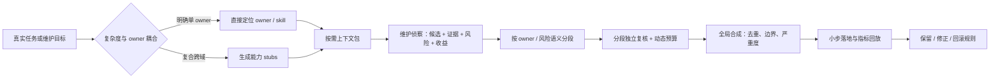

# 下一轮双仓重构参照：证据驱动维护、复杂度路由与分段深审

> 用途：作为下一次公开仓 EverAgent 与私有仓 EverAgent-infra 重构的研究参照。本文不执行重构，也不包含私有仓设备、服务、网络或凭据信息。

## 参照材料

| 原始材料 | 本轮精读报告 | 提供的核心能力 |
|---|---|---|
| [OpenAI：Maintaining software with the GPT-6 family](https://developers.openai.com/blog/maintaining-software-with-the-gpt-6-family) | [GPT-6 软件维护](./GPT6软件维护_从广义侦察到证据驱动清理_深度解析_20261020.md) | 证据驱动的维护侦察、小 PR、收益排序和模型成本校准 |
| [Apple：Plan or Retrieve First?](https://arxiv.org/abs/2610.19068) | [工具发现架构](../paper_analyses/49_plan_retrieve_tool_discovery_2026.md) | 简单任务直接检索、复杂任务先分解能力再检索 |
| [Google：Paper Assistant Tool / Deep Review](https://arxiv.org/abs/2606.28277) | [Deep Review 深度分析](../paper_analyses/50_paper_assistant_tool_deep_review_2026.md) | 语义分段、动态预算、局部深审与全局合成 |
| [OpenAI：Rethinking skills and prompts](https://developers.openai.com/blog/rethinking-skills-and-prompts-for-gpt-6-astra) | [既有分析](./GPT6_Astra指令架构_从Prompt堆叠到按需控制_深度解析_20261015.md) | 薄常驻控制面、按需知识与确定性保障 |

## 一页结论

下一轮双仓重构不应再以“把文档写短”或“重新整理目录”为中心，而应形成一个闭环：



四条总原则：

1. **任何删除或合并都先证明它已失效。** 重复文字不自动等于重复行为；必须查看 owner、调用点、Git 历史、真实任务和确定性门禁。
2. **路由不能只有一种。** 用户已点名路径、技能或对象时直接检索；跨仓、跨 owner 的复杂目标先拆成能力 stubs，再分别取上下文。
3. **复核不能平均用力。** 安全、隐私、权限、关键数字和删除规则使用高预算；导航和低风险格式使用轻审。
4. **最终交付不是新 Context，而是行为改善证据。** 若 skill precision/recall、P10、无关读取、澄清和返工没有改善，文字更整齐不算成功。

## 1. 三篇原文怎样拼成一套系统

### 1.1 OpenAI 回答“怎样安全地产生重构候选”

OpenAI 的维护循环不是让模型直接删全仓，而是：给宽泛目标，允许读取 PR、历史、项目跟踪与生产指标；要求每项清理给出证据；遇到 `Permanent` 或 kill switch 升级给人；先做小 draft PR；用 review feedback 改写下一轮提示；最后按 CPU、CI 分钟和成本排序。

迁移到双仓后，侦察产物至少包含：

```text
候选规则/文件
唯一 owner 与调用方
它原来解决的失败
最近仍命中的真实任务
现有脚本/门禁是否已替代
删除或迁移风险
预期收益与可观察指标
建议 workstream
```

缺少这些字段的“看起来可以删”不进入实施阶段。

### 1.2 Apple 回答“当前任务该取哪些上下文”

双仓 Context 检索也有 Intent–Registry Coupling：

- “修改 `web-surfing` 技术博客渠道”直接包含 owner 与对象，属于高耦合单域任务，应走 RtP：直接定位 skill 和注册表。
- “根据三份文章重构双仓并建立评估”包含多个子目标，属于低耦合复合任务，应先生成 stubs，例如 `context owner audit`、`public/private boundary`、`skill routing`、`behavior replay`、`quality review`，再分别检索。

关键约束：stub 不得覆盖用户提供的 proper noun。仓库路径、命令、skill 名、设备名和服务名必须原样保留，否则会重现论文中 PtR 对简单 query 的误路由。

### 1.3 Google 回答“怎样审查候选重构”

一次性让一个 Reviewer 通读全部改动，容易像单次长上下文调用一样稀释注意力；简单并行多个 Reviewer 又会像 Pass@k 一样重复和制造误报。更合理的是按语义和风险切分：

| Segment | 典型内容 | 预算 |
|---|---|---|
| 公共不变量 | 安全、提交、证据、外部写入 | High |
| 双仓边界 | 私有 owner、公开引用、复制风险 | High |
| 意图路由 | 根/领域 AGENTS、Skill 触发 | Medium/High |
| 工作流 | report、podcast、web、infra 流程 | Medium |
| 确定性层 | scripts、schema、hooks、CI | High |
| 导航与说明 | README、索引、示例 | Light |

每个 Reviewer 聚焦一个 segment，但必须看到根不变量、相关 owner 和本次任务合同。最后由 synthesis pass 检查跨 segment 冲突、重复 owner、私有信息泄漏和严重度。

## 2. 双仓的目标结构

### 2.1 公开仓 EverAgent

公开仓拥有模型无关的共享控制面：

- 稳定安全与证据不变量；
- 项目意图路由；
- 公共 skills、schemas、报告工作流和评估工具；
- 可公开复现的报告、任务集和指标定义。

公开仓不保存私有设备、网络、账号、服务状态或凭据，也不通过“示例”间接复制这些事实。

### 2.2 私有仓 EverAgent-infra

私有仓拥有设备、网络、服务、运行手册和个人事实的唯一 owner。它可以复用公开仓的工作流合同和脚本接口，但私有事实仍在本地解析，不把第二份真相复制回公开仓。

### 2.3 两仓共享什么

[推测] 下一轮重构中，两仓可共享**协议形状**，但不共享事实正文：

```text
catalog → get/search → owner → action → verify
```

例如两仓都可以有“先目录、再最小上下文、再 owner”的入口，但目录内容、权限与敏感级别分别维护。

## 3. 下一轮重构的执行顺序

### Phase 0：冻结目标与评估样本

- 固定公开仓和私有仓基线 commit；
- 选择覆盖单 owner、同域多 owner、跨仓复合任务的真实回放；
- 记录模型、推理档位、设备与工具条件；
- 定义不可退化项：隐私、安全、证据正确性和交付完整性。

### Phase 1：证据驱动维护侦察

按 OpenAI 模式扫描候选：重复规则、无人引用 reference、过期模型补丁、失效命令、重复事实、被脚本替代的文字约束。每个候选只进入报告，不直接改仓。

优先级按预期收益排序：

```text
高频误触发 / 高 token / 高返工 / 高安全风险
> 纯字节节省
> 视觉整齐
```

### Phase 2：路由 A/B

把回放任务分三类：

1. 明确对象与 owner：直接检索；
2. 多步骤但同域：生成 2–4 个 capability stubs；
3. 跨仓复合任务：先保留 proper nouns，再生成双仓 stubs。

比较旧路由、直接路由和复杂度自适应路由。不要把 PtR 直接部署为统一入口。

### Phase 3：分段重构与独立复核

- 每轮只改一层：AGENTS、skill、reference 或 script；
- 同一 workstream 产出小 diff；
- Reviewer 先读对应 owner 与原始失败证据，再看候选修改；
- synthesis reviewer 最后检查跨层冲突。

### Phase 4：行为验收

至少记录：

| 维度 | 指标 |
|---|---|
| 维护侦察 | 候选数、接受率、误删/恢复、每项验证成本 |
| Context | 首次行动前文件数与 bytes、无关读取、compaction |
| 路由 | Skill/owner precision、recall、跨仓漏取 |
| 执行 | 澄清次数、早停、工具调用、返工 |
| 质量 | 报告五维、P10、hard failure、false critique |
| 成本 | token、墙钟时间、稀缺模型调用 |
| 安全 | 私有信息复制、越权写入、审批缺失 |

只有关键错误为零、P10 不下降，同时至少一项成本或效率改善，候选结构才进入主线。

## 4. 三个可直接使用的任务合同

### 4.1 维护侦察合同

```text
目标：寻找可删除、合并或迁移的规则与文档，不直接修改。
证据：检查 owner、调用方、Git 历史、行为回放和现有确定性门禁。
保留：安全、隐私、权限、提交与不可逆操作边界。
交付：按 workstream 输出候选、证据、风险、收益与建议验证。
停止：事实 owner 冲突、私有边界不清或缺少可观察验证时标待裁定。
```

### 4.2 复杂度路由合同

```text
若请求明确点名路径、命令、skill 或 owner，直接读取。
若请求包含多个相互独立的交付物，先生成 2–5 个 capability stubs。
Proper nouns 原样保留；每个 stub 只能定位一个 owner。
记录未命中与重叠命中，不用最相似的单一文档替代所有子目标。
```

### 4.3 分段复核合同

```text
先从 owner 和原始失败证据列出本 segment 的核心要求。
再读候选修改，检查遗漏、误删、重复和边界变化。
关键 claim 要能回到原文、代码、命令输出或真实回放。
输出严重度、支持证据和未解决项；不要以平均分抵消 hard failure。
最终由 synthesis pass 检查跨 segment 冲突。
```

## 5. 不应从三篇原文推出什么

1. OpenAI 删除 80 万行代码，不意味着双仓也应追求大规模删减；其组织拥有内部 telemetry、owner 和 review 基础设施。
2. Apple 论文没有证明“复杂任务总要先规划”；G3 在 gpt-oss 上已经轻微反转，且没有执行工具验证最终成功率。
3. Google PAT 的 89.7% 是 29 个 proof/equation error 上的 detection，不代表一般报告 review precision，也不是自动合并许可。
4. 更强模型不能替代私有边界、安全审批和确定性门禁。
5. 多 Reviewer 不等于 Deep Review。没有语义分工、动态预算和最终 synthesis 的并行调用只会制造重复意见。

## 6. 原文附件与关键锚点

为避免复制完整版权文本，本仓不保存三篇原文全文；下面保留官方入口和足以定位核心机制的短锚点。

### OpenAI 原文

- [完整原文](https://developers.openai.com/blog/maintaining-software-with-the-gpt-6-family)
- 关键提示结构：允许查 Slack/Statsig/历史与生产证据；保留 kill switch；一项清理一个小 draft PR；全仓扫描先输出 workstream 报告；用同 snapshot A/B 单条 `AGENTS.md` 指令。
- 关键数字：1,400+ PR、80 万+ 删除行、镜像 3.31→1.72 GB、Sol Ultra 以 14% 成本取得 Astra Ultra 92% 的发现数。

### Apple 原文

- [arXiv HTML](https://arxiv.org/html/2610.19068v1) · [PDF](https://arxiv.org/pdf/2610.19068)
- 核心公式：`RtP = TopK sim(query, tool_docs)`；`PtR = TopK max sim(stub, tool_docs)`。
- 关键结论：G1 直接检索胜，G2 先分解胜；PtR token 增加 75%–104%；复杂度路由可减少约 36% discovery overhead。

### Google 原文

- [论文 HTML](https://arxiv.org/html/2606.28277v1) · [PDF](https://arxiv.org/pdf/2606.28277)
- [Deep Review 发布博客](https://research.google/blog/analyzing-technical-documents-with-deep-review/)
- 核心流水线：semantic segmentation → adaptive budget → deep parallel review → global synthesis/grounding。
- 关键边界：SPOT 26 篇/29 错误；作者侧 opt-in 试点；grounded 满意度 55.8%/64.8%；最终责任仍在人。

## 7. 最终决策准则

下一轮双仓重构的合格产物应同时满足：

- 每个删除与迁移都有事实证据；
- 简单任务保持直接命中，复杂任务不漏 owner；
- 高风险部分得到更深复核，低风险部分不过度消耗；
- 私有事实不进入公开仓；
- 真实任务 P10 与 hard failure 不退化；
- 所有新增机制都有退出条件，模型升级后可以重新裁定。

如果只能记住一句话：**先让 agent 证明“为什么要改、该读什么、哪里最危险”，再让它改。**

## 思考与追问

### 1. 我真正理解了什么？

Context、工具路由与报告复核不是三个独立问题。它们共同决定 Agent 在有限预算下把注意力投到哪里，并通过什么证据进入人类决策。

### 2. 我还没搞懂什么？

- Capability stub 的最小粒度怎样定义，才能既不漏 owner 又不让上下文重新膨胀？
- 分段 Reviewer 的预算应按风险、历史失败率还是信息密度分配？
- 私有仓的运行指标如何生成可公开比较、但不泄露私有事实的归一化结果？

### 3. 下一步做什么？

下一次真正重构时，先完成 Phase 0 和 Phase 1，产出候选与基线；在用户确认进入实施后，再按 workstream 修改并运行路由 A/B 与分段复核。
