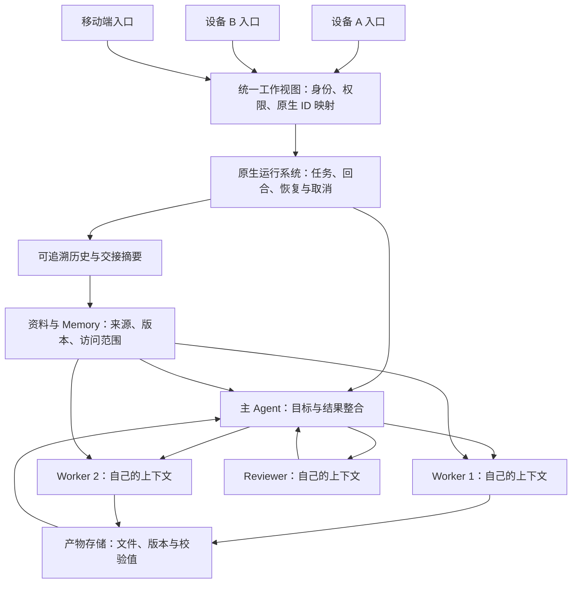
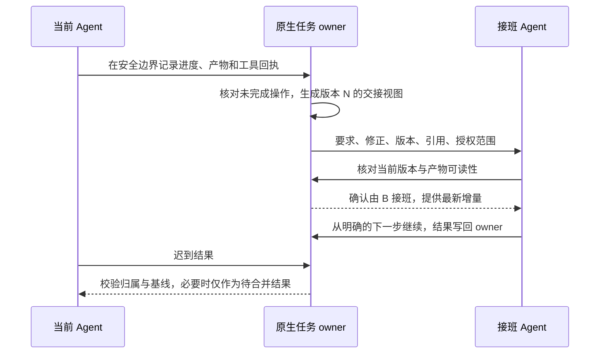

# 多设备、多 Agent 怎样共用上下文与续接会话

在电脑 A 上让 Agent 研究一篇文章，出门后用电脑 B 继续追问，再让另一个 Agent 审稿。理想的体验是：不用重讲背景，前面纠正过的要求仍然有效，已经做完的工作不用重做，最后只有一份可信的结果。

这件事可以实现到什么程度，取决于“同一份 context”包含什么。共用资料比较容易；接班需要保存任务状态和产物；连正在运行的工具、文件和浏览器现场一起恢复，要求运行系统提供相应能力。Manus 的公开材料提供了很好的产品样本，但没有公开一套可直接移植到任意 Agent CLI 的底层实现。[^s1][^s2][^s3]

**本报告的架构建议是：共用有出处的资料，维护统一的工作视图，每个 Agent 按职责读取自己的上下文。** 用户可以看到“同一个任务”，背后可以有多个独立会话、分支和执行环境。这里的“统一”指要求、版本、进度和结果能对上；模型各自仍有自己的输入窗口。这个建议来自下面的机制比较，实际收益需要实验验证。

> 研究日期：2026-10-29。以 Manus 原文为起点，核对 Manus、OpenAI、Anthropic、LangGraph、OpenViking、MCP 和 A2A 的一手材料。厂商文档说明的是产品或接口合同；本报告没有实测其服务可用性，也没有部署新的会话系统。文中 `[推测]` 表示架构推导，`[待验证]` 表示需要实现或实验才能确认的部分。案例中的设备、路径与 ID 均为虚构。

## 1. 先把“同一份 context”和“同一个 session”说清楚

可以把一项工作想成一间工作室：资料架放参考资料，工作台放当前任务，抽屉放做事经验，工具区保留正在运行的程序。换个人来工作，需要知道每样东西在哪里、哪些决定已经确认。

| 对象 | 实际保存什么 | 能解决什么 | 还需要什么 |
| --- | --- | --- | --- |
| Project context | 项目指令、资料、Skills、连接器配置 | 不同任务从相同背景开始 | 任务进度、配置版本与访问权限 |
| Conversation / thread | 用户消息、回复，以及框架保存的工具调用和结果 | 继续讨论已有话题 | 文件与运行环境可能另外保存 |
| Working state / checkpoint | 当前步骤、待办、分支、执行记录与恢复点 | 接班、恢复或重试工作 | 副作用核对、兼容运行环境 |
| Long-term memory | 可跨任务复用的事实、偏好、经验 | 下次少重复解释 | 来源、更新、撤回与范围控制 |
| Model context | 本次模型调用实际看到的内容 | 决定这一步如何行动 | 持久存储、筛选与加载由应用安排 |

上述区分能在官方接口中找到对应：LangGraph 将 thread 内的短期记忆与跨 thread 的 namespace store 分开；OpenAI Conversations 保存持久的 conversation items；Claude Agent SDK 的会话历史与文件系统各自持久化。它们都提示我们：存下很多内容，与每次让模型正确读到需要的内容，是两个环节。[^s9][^s11][^s15]

### 1.1 两种“同一个 session”

**原生会话续接**：仍由同一个运行系统处理。例如 Codex 恢复自己的 thread，Claude Agent SDK 恢复自己的 session。其 ID、历史格式和运行环境由对应系统解释。[^s10][^s11]

**逻辑工作续接**：换了 Agent、模型或 Harness，仍在完成同一个用户目标。新 Agent 收到可读的要求、决定、进度、证据和产物，再开始自己的原生会话。这种续接可以保留工作的连续性；不承诺恢复另一家模型的内部状态。

`session_id` 的含义取决于发号的系统。OpenViking 的 session、Claude 的 session、Codex 的 thread、业务工作 ID，可以互相建立映射。光给它们取同一个字符串，不会让历史、权限和执行状态自动互通。[^s10][^s11][^s16]

还有一种命名容易混淆：本仓的 Session v2 用于识别 actor、执行设备、checkout 和原生任务绑定。它提供身份与出处；工作聊天的续接仍由原生任务或会话系统负责。[^s23]

## 2. Manus 原文到底给了哪些答案

### 2.1 Business：把可复用背景放在 Project

《Manus for Business》明确写到：相关任务可以共享指令、文件、Skills 和连接器配置，定时任务也能使用 Project context。管理员可以安排团队使用统一的 Skills。这可以降低重复配置，但原文没有解释多设备如何迁移进程、如何合并外部 Agent 的原生历史，也没有公布并发写入协议。[^s1]

因此，从这篇文章学到的第一件事是：**把长期背景从单次对话里提出来，让任务引用它。** 对每个任务仍要保留“本次实际使用了哪个版本”的记录。

### 2.2 Projects：资料共享与任务共享有各自的权限

官方 Projects 文档说明，邀请成员进入 Project 后，他们能访问共享指令和知识库，但不会自动看到其他成员创建的任务；分享具体任务需要另外邀请。[^s2]

它还区分了配置更新的生效时间：

| 更新 | 文档列出的生效时间 | 对架构设计的启发 |
| --- | --- | --- |
| Project 指令 | 当前任务下一次发送消息时 | 用户修正可能改变后续行为，需要记录生效点 |
| Project 文件 | 更新后新建的任务 | 旧任务可能仍基于旧资料，需要显式升级或续接说明 |

同页随后又笼统说旧任务不受影响，与指令更新这一行存在表述含混。本报告保留分项表的区别；**具体产品版本中如何执行，需要实测确认**。不能据此假设所有任务都会实时热更新。[^s2]

### 2.3 Collab：多个入口操作同一个云任务

Collab 支持多人查看同一 task，看到彼此的提示与回复，并参与任务。这很接近用户想要的“一份工作现场”。但公开文档展示的是多人共同使用 Manus 任务，不是任意外部 CLI Agent 都能写入 Manus 内部会话。[^s3]

一个细节很有启发：第一位协作者加入时，sandbox 中的登录 cookies 会被清除。共享任务同时涉及执行环境与权限，不能只处理聊天记录。厂商对“没有版本冲突”的产品表述，也不能替代对文件写入和外部操作的独立验证。[^s3]

### 2.4 Branch 与 Wide Research：共同起点，独立工作

Branch 从指定消息处分出新会话，继承到该点的历史、文件与指令；主线保留，新分支独立。它适合把一段已确认的研究转成报告、演示稿或代码等交付物。继承的是分叉时的背景，不代表不同分支之后的修改会持续自动合并。[^s4]

Wide Research 的公开描述则是主控拆分任务，worker 各有独立虚拟机、工具和新上下文，结果回到主控整合。由此可见，同一目标可以由多个独立模型上下文完成。文中的“第八或第九项开始失真”“成本指数增长”“没有质量断崖”等广泛表述缺少足以支撑通用规律的独立数据，本报告不把它们作为设计依据。[^s5]

### 2.5 学习型 Projects：经过确认的经验再进入共享背景

《Projects That Learn From Every Task》描述了从任务中发现可复用决定，提出指令、文件和 Skills 的更新建议，解释原因，经授权后应用。它提供的经验是：一次任务中的讨论、猜测与试错，需要经过筛选才能变成后续任务的共同背景。[^s6]

综合这六篇材料，Manus 的产品思路可以归纳为：**Project 承载可复用背景，task 承载一次工作，branch 或 worker 承载独立方向，确认过的经验再回到 Project。** 这是从公开功能得到的归纳，底层存储、并发控制与跨设备恢复实现仍未公开。

## 3. 推荐架构：多个入口、一处任务权威、多个 Agent 上下文

下面是 `[推测]` 的参考架构，表示职责关系，不要求新建所有框内的服务。已有工具承担某项职责时直接复用。



### 3.1 资料的 owner 与任务的 owner 分开

这里的 `owner` 指维护某项事实的负责方，其他系统通过引用读取它。

资料库负责“这条规则来自哪里、现在是什么版本、谁能看到”。原生运行系统负责“任务是否还在跑、谁拥有写入权、哪个 attempt 成功、如何取消或恢复”。统一工作视图只保存映射和出处，并从 owner 查询实时状态。

例如已有 Orca 或其他调度器管理 Task / Run / Dispatch，就让它继续作为任务状态来源。可以增加按工作主题查找这些原生对象的入口；没有必要再复制一套 `running / completed / failed` 状态库。否则两个系统迟早会对同一任务给出不同答案。本仓已有协议也要求公共 Session core 消费原生任务 owner，未绑定时如实保留 unbound。[^s23]

### 3.2 一处权威，可以有多份缓存

这里的“一处”指每类事实有明确的负责方，可以是数据库、Git 文件或原生 Task。设备上的缓存、检索索引和交接摘要是派生视图，要带来源版本及更新时间。

例如用户刚把“全文重写”改成“仅修订第三节”，新 Agent 应直接收到这条最新修正。等后台 Memory 提炼后再靠检索找它，会造成更新窗口。在 LangGraph 的区分中，background memory 的写入频率本身就影响其他 thread 多快获得新信息。[^s15]

**[推测] 最小读取顺序**：先加载本次原始要求和生效中的修正，再加载任务进度与产物引用，最后按需检索长期背景。旧助手意见、网页中的命令和模型猜测要保留各自身份，不能自动升级为用户指令。

### 3.3 “同一份 context”应有版本，而不只是同一个目录

任务开始时记录使用的项目规则版本、资料版本和工作基线。执行中允许升级某些内容时，把升级原因与生效点写回 owner。跨设备的副本如果还没同步，需要显示它落后到了哪里。

这让“大家都读过项目文件”变成一个可检查的问题：“他们读的是不是同一版？后来修改的要求是否已送达？”Manus 的配置更新表和分支继承行为，正好展示了为什么版本语义不能省略。[^s2][^s4]

## 4. 换设备、换 Agent，分别怎样接续

### 4.1 换设备：优先继续连接同一个 runtime

**[推测] 对个人多设备使用，优先把设备当作多个操作入口。** Agent 继续在固定的中心或执行设备运行；切换入口时找到原生 session / task，读取当前状态，再发送后续消息。

这样无需搬迁正在运行的进程、文件系统和工具。代价是依赖执行设备可用性与网络，中心故障的恢复能力仍由其存储和运行系统决定。

OpenAI Agents API 提供一个具体接口样本：session 保存配置、对话和 saved work；idle 时的新消息开新 turn，active turn 中的新消息用于 steer 当前 turn。这支持“多个入口继续同一项工作”的设计，但接入端仍需鉴权并处理并发输入。[^s7]

换设备或断线后还要**主动核对已保存状态**。同一文档说明，event stream 不回放漏掉的事件，应通过 session 与 saved items 取回记录；idle 不等于成功，turn completed 也不保证所有工具成功。界面显示“已经停止”不能作为交付完成的唯一依据。[^s7]

### 4.2 同一个 Harness：用它自己的 resume / fork

| 系统 | 原生续接能力 | 需要保留的边界 |
| --- | --- | --- |
| Codex app-server | `thread/resume` 恢复该服务器保存的 thread；`thread/fork` 创建继承历史的新 thread | `thread/read` 只是读取；本次引用文档未给出把 thread 迁到另一主机的合同 |
| Claude Agent SDK | 按明确 session ID 恢复或 fork；会话历史落在磁盘 | history fork 不复制文件系统；跨主机需要相应会话文件与正确目录映射 |
| OpenAI Conversations + Responses | 持久 conversation ID，保存消息、工具调用与输出，可跨设备或工作调用继续使用 | conversation state 与完整 Agent 执行环境是不同合同 |
| LangGraph | 以 thread ID 读取 graph state 与 checkpoint | 恢复可能重放节点；并发调度策略需要运行服务安排 |

这些能力均来自对应官方文档。Codex 的这个接口说明支持恢复服务器保存的 thread；换设备仍可连接原服务器，迁移执行主机则需要额外核实。Claude 文档明确给出跨主机条件，也提供替代方式：把已确认决定、代码变化和工具结果作为应用状态传给 fresh session，跨主机时常比搬会话文件更稳妥。[^s9][^s10][^s11][^s12]

多会话环境下应使用明确 ID。Claude 的 `continue` 会取当前目录最近会话；“最近”不一定就是要接班的工作。[^s11]

### 4.3 跨 Harness：生成交接视图，建立新的原生会话

**[推测] 交接应覆盖以下内容，按任务大小选择字段；它是从 owner 生成的快照，不另立一份事实来源。**

| 交接内容 | 为什么需要 |
| --- | --- |
| 原始要求与后续修正 | 防止摘要把用户原意改写掉 |
| 已确认决定及出处 | 分清“用户确认”“证据支持”“模型建议” |
| 已完成、进行中、未决项 | 防止重复研究或误报完成 |
| 工具结果与调用回执 | 知道做过什么、结果是否确定 |
| 产物引用、版本和校验值 | 新设备能读到审过的同一份文件 |
| 原生 task / session 映射 | 可以回查真正的执行记录 |
| 环境条件与授权范围 | 知道可用工具、目录、允许操作及需重新登录的能力 |
| 快照版本与后续增量 | 发现交接过程中又来了新要求 |

一个虚构的研究任务，可以交接成：

```yaml
work_id: demo-context-study
snapshot_revision: 12
owner_ref: runtime://demo/task-42
request:
  original: "研究多设备多 Agent 如何共用 context，出深入报告"
  active_correction: "只做公开研究，暂不部署"
decisions:
  - text: "先区分资料共享、逻辑续接和执行恢复"
    source: "用户要求与已核实的官方文档"
artifacts:
  - ref: artifact://demo/draft-v3.md
    sha256: "<实际文件的 SHA-256>"
pending:
  - "核实会话摘要与后台记忆完成的边界"
  - "独立复核后整理结论"
tool_receipts:
  - ref: receipt://demo/read-official-docs
environment:
  checkout_revision: "<实际源码或资料版本>"
  scope: "只读公开资料；可修改本任务报告"
```

这些 URI 是示意，不是现有 API。字段中的版本从 owner 取得；未确认的工具结果必须明确记为未知。引用应附带接收方能使用的访问方式，文件 hash 能校验内容一致，但不能替代传输与权限。

跨厂商交接也有保真边界。OpenAI 的无状态 reasoning 续接可能要求保留完整 output items，包括相应 reasoning items 和 assistant phase。仅复制可见聊天文字会遗漏原生格式要求。这类原生数据应留在支持它的系统内；跨厂商可移植的部分是允许导出的任务事实、证据和产物，不能声称“恢复了另一模型的完整思考”。[^s9]

### 4.4 接班必须经过一个明确的切换点

下面仍是 `[推测]` 的协议示意：



先暂停或撤销旧执行者继续写入的权力，再确认新执行者接班。旧 Agent 晚到的结果仍可保留，却不能直接覆盖新进度。若使用租约，还需要 fencing：过期执行者即使恢复网络，也会被权威写入端识别并拒绝；只靠锁超时并不充分。

原生系统没有暴露安全切换能力时，可以先让当前 run 结束，再开新 session。接班前必须核对仍在运行的工具；切断聊天连接，并不能证明某项外部操作已经取消。LangGraph 的 graceful drain 也只在 super-step 边界起作用，不抢占已开始的操作。[^s13]

## 5. 多 Agent 并行：共享目标与资料，控制写入和合并

### 5.1 每个 Agent 读到完成职责所需的上下文

OpenAI 的 multi-agent 文档明确规定，子 Agent 各有自己的 context，由主 Agent 协调并合并结果；同时，它们共用同一 environment 文件系统，spawn 不会创建独立环境。Manus Wide Research 描述的 worker 则各有独立虚拟机。**上下文隔离和执行环境隔离是两个维度。**[^s8][^s5]

一个可用的研究分工是：主 Agent 保存用户目标与整合框架；研究 worker 获得问题、相关来源与预期交付；Reviewer 获得原始要求、来源和待审产物，独立判断。把所有 worker 的全部过程逐条塞回主线，会增加主线处理量；更合适的回传是结论、证据、未决项和产物引用。这一分工属于架构建议，质量收益仍需对照评估。

### 5.2 共享文件时，要有明确的写入范围

**[推测] 优先按产物或目录分工：**不同 worker 写不同文件；涉及代码时，可使用独立 checkout / worktree，再由负责合并的 Agent 处理差异。确实需要改同一文件时，记录 base revision，提交 patch，由 owner 检查基线、冲突与语义。

对结构化状态，可以为每类字段指定合并方法，例如去重追加来源列表、显式更正事实、由单一负责人更新最终状态。对报告正文、确认过的决定、授权范围，不宜使用“最后一次写入赢”掩盖冲突。

文件锁只能控制某次写入的互斥；它不能判断两份研究结论哪份更可靠，也不能证明写入者依据的是当前要求。OpenViking 对派生摘要采用版本检查和短锁，正是在处理“生成较慢的旧结果晚到”这一类问题。[^s17]

### 5.3 同一任务同时收到两条指令，必须定义处理方式

LangSmith Agent Server 给出四种 double texting 策略：enqueue、reject、interrupt、rollback。这是运行服务的合同，不能归到一个开源 checkpointer 的全部能力上。[^s14]

**[推测] 初始选择：**新任务排队；对当前任务的补充按系统支持的 steer / interrupt 处理；互相冲突的修改保留来源并明确处理顺序。离线设备发出的旧指令也携带其看到的版本，恢复联网后检查是否仍适用。

rollback 只回退框架定义的状态。已经发送的邮件、支付、发布或远端写入，不会随 graph checkpoint 自动撤销。工具取消、任务取消与外部效果的核对，需要各自处理。[^s13][^s14]

### 5.4 重试时核对副作用，结果未知时先查证

LangGraph 的持久执行从节点或 entrypoint 等位置重放，不是从进程中断的那一行继续。应将副作用和非确定性操作封装为可记录的 task；即便如此，操作完成但结果尚未持久化时，恢复仍可能再次执行，需要幂等或查询已有结果。[^s13]

它也保存同一 super-step 中成功节点的 **pending writes**：其他节点失败后，已持久化的成功结果可在恢复时复用，避免整步重做。完整 checkpoint 仍在 super-step 边界形成。恢复保证还取决于 durability mode：[^s12]

| 模式 | 何时保存 | 主要取舍 |
| --- | --- | --- |
| `exit` | 执行成功、报错或人工 interrupt 退出时 | 中间进度不持久化，无法从中途进程崩溃恢复 |
| `async` | 下一步执行时异步保存 | 开销较小，崩溃时可能还有 checkpoint 未写完 |
| `sync` | 写好 checkpoint 后再开始下一步 | 恢复点更可靠，需要等待持久化 |

这些模式控制框架状态的保存；外部操作完成但回执未保存的窗口，仍需要前述幂等与结果核对。[^s12][^s13]

**[推测] 外部操作的幂等键按逻辑动作定义**，重试同一动作继续用同一个键，真正的新动作才换键。并保存工具回执与实际对象引用。网络超时只能说明没有拿到确定回复；先查目标系统，再决定是否重试。这类约束由工具与运行系统落实，交接摘要负责把状态如实传给接班者。

## 6. OpenViking 在这里负责哪一层

### 6.1 适合承担共享资料、检索、历史和 Memory

本仓 2026-10-25 的公开报告已经讨论过 OpenViking、手机环境和 APP 记忆的三层关系。本篇继续追问“正在做的任务怎样换人接班与并行”，不把那次试点记录当成今天的实时运行结论。[^s22]

OpenViking 官方 session 流程是 create → interact → commit。消息支持文本、图像、上下文引用与工具 Part；commit 归档会话，并生成摘要与长期 Memory 变更记录。它可以成为“这项工作留下了哪些可查资料”的入口。[^s16]

但一份 session 归档中即使有工具结果，也不足以证明它保存了对应 CLI 的完整 checkpoint、后台进程、浏览器现场与重试队列。**[推测] 适合的职责划分是：OpenViking 提供资料和可追溯记忆，原生运行系统保留 task / attempt / checkpoint 与副作用状态，二者通过引用关联。**

### 6.2 accepted 与可用的记忆分开确认

session 文档里的 commit 返回 `accepted`、`task_id`、`archive_uri` 等字段，后台任务另有 pending / running / completed / failed 状态。接班者应确认原始记录可读，再检查所需摘要与 Memory 是否完成；不应把 accepted 当成所有处理已经成功。[^s16]

这里还有一处文档差异：session 页将摘要放在异步阶段；transaction 页的 commit 示例把生成归档摘要放在 Phase 1。未核对具体版本源码与部署前，无法确定所有步骤的精确时序。本报告只采用可验证的合同：**提交受理、资料可读、后台完成分别检查**，具体时序列为待验证项。[^s16][^s17]

### 6.3 同一个服务也有不同的共享范围

官方多租户文档把 account、user、peer 分开：account 内可共享 resources；用户 Memory、Skills 和 sessions 默认处于 user 边界；peer 是 user 内更细的内容范围。`viking://~/sessions/...` 按当前认证用户展开。共享服务地址或 session ID，都不能替代访问授权。[^s18][^s16]

**[推测] 个人多设备**可以映射到同一被授权的用户身份，各设备使用在执行端解析的凭据；多人的团队则应使用各自身份，按资料与任务单独授权共享范围。Agent 身份是可追溯的执行者，不应被用来抹掉用户之间的权限边界。

OpenViking 的 path lock、redo 和版本控制保护它管理的存储一致性；官方将文件系统视为 source of truth、向量数据库视为派生索引，并明确 LockContext 没有完整数据库式 undo / journal / commit 语义。不能把这些机制直接解释为任意 Agent 对话和外部工具的全局事务。[^s17]

## 7. MCP、A2A 和框架，应该怎样选

### 7.1 MCP 可以提供 context 工具，业务会话仍要由应用管理

可以通过 MCP 暴露“读当前任务”“查资料”“取产物”等能力。MCP 提供的协议连接本身，不包含一套通用的业务会话、原生恢复和多人写入合同。

本次读取的 **2026-07-28** 规范已移除协议层 session 与 `Mcp-Session-Id`，需要跨调用状态的服务使用显式 handles 作为普通工具参数；该版也不支持原来的 SSE 重连回放方式。较早的 2025-11-25 等版本行为不同。部署时应按实际 client / server 的协商版本判断，不能把旧 transport session ID 用作统一工作会话设计。[^s19][^s20]

### 7.2 A2A 可以交换任务和产物，远端 Agent 内部保持不透明

A2A 定义 Agent Card、Task、Message、Artifact 与相关交互方式，`contextId` 可以把相关 Task 逻辑分组。它把远端 Agent 视为不透明系统，并不公开其内部 Memory 或工具。所以 A2A 有助于让不同 Agent 接任务、回传结果；共享哪些资料、结果怎样合并、能否恢复运行，仍由应用约定。[^s21]

### 7.3 按需求选择，少增加一套系统

| 需求 | 优先路径 | 主要代价或边界 |
| --- | --- | --- |
| 多设备继续同一工作 | 多入口连接既有 runtime，使用原生 task / session ID | 执行端可用性、网络、鉴权与并发输入 |
| 把同一 Harness 的执行端换到另一主机 | 按该厂商明确支持的方式迁移；Claude 文档给出会话文件与 cwd 条件 | Codex 本次引用页只说明恢复服务器内 thread；跨主机迁移能力需另核实 |
| Claude / Codex / 其他 Agent 相互接班 | 可读交接视图 + 新的原生会话 | 逻辑连续性；原生状态无法保证完全互换 |
| 多 Agent 独立研究再汇总 | 原生分支 / worker，明确职责与合并 owner | 调度、整合、重复工作与总成本 |
| 多 Agent 复用长期资料 | OpenViking 或已有 store，保留来源和访问范围 | 写入治理、检索质量、更新窗口 |
| 自建可恢复的 Agent 应用 | LangGraph + 持久 checkpointer + 运行服务 | 需要自己定义队列、副作用、环境与运营能力 |

表中是基于官方能力的设计建议，不是相同任务上的性能排名。对已有多设备、多个 CLI 和 OpenViking 的环境，**[推测] 第一阶段增加可查的任务映射与可读交接，比整体替换 Harness 更容易验证价值。** 在它们不足以支持明确需求时，再引入额外运行框架。

## 8. 用一个完整案例检查设计是否够用

下面是虚构演练，尚未运行：

1. **设备 A 开始研究。** 创建原生 task，引用 Project 规则与公开来源，产出草稿 v1。工作视图记下原生 ID；资料 owner 和任务 owner 各自保留事实。
2. **设备 B 继续追问。** 查询同一 task 的实时状态，收到最新要求与草稿引用。A 上的 runtime 仍在执行；B 是另一个入口。
3. **用户改变要求。** “暂不部署，只研究。”运行系统确认该修正的生效点，后续 worker 必须收到这条要求，旧分支结果合并前重新核对。
4. **另一个 Agent 接班。** 当前 Agent 到安全边界，保存源码或资料版本、进度及工具回执；新 Agent 核对产物可读性与当前要求，再建立自己的原生 session。
5. **Reviewer 独立审稿。** 它阅读原始请求、来源和指定版本报告。审稿结论绑定报告版本，防止主 Agent 改了正文后仍拿旧评审证明质量。
6. **主线合并。** 检查修改基线，保留可追溯结果。旧 worker 若仍在输出，它的建议进入待处理结果，不能覆盖新报告。
7. **形成可复用经验。** 最终报告进入公开知识库；获准复用的规则进入 Project 或 Memory。一次性的工具失败和模型猜测保留在任务记录中。

同一案例也能暴露设计缺口：如果新设备看得到摘要却打不开草稿，产物交接没完成；如果接班后又执行了一次发布，副作用恢复没完成；如果最终报告仍遵循旧要求，修正传播或合并控制没完成。每类失败都应找到对应 owner，避免统称为“模型没记住”。

## 9. 怎样评估，才能证明它真的好用

本轮完成的是资料研究与报告复核。以下是 `[待验证]` 的行为评估方案，不是已跑过的结果。

### 9.1 先比较两组，再拆出贡献

先固定模型、Harness、工具、任务材料和停止条件，比较：

- **A：现有方式。** 正常的新会话、现有历史与检索。
- **B：任务映射 + 有出处的交接。** 提供最新要求、决定、进度、回执和可读产物。

如果 B 有稳定收益，再加入长期 Memory，或做“去掉修正记录”“去掉产物校验”等消融，判断收益来自哪里。同 Harness 的 native resume 与跨 Harness 接班分别成组；模型换了的结果不能单独证明 context 设计改进。

同一任务可以使用配对材料，并调整运行顺序；历史会话、缓存与上一次实验形成的 Memory 要隔离，避免后跑的一组借到先跑结果。成本从起始任务累计到最终验收，包含交接生成、检索、worker、整合和 Reviewer。

### 9.2 观察接班行为，而不只观察“回答像不像”

| 场景 | 验收证据 | 主要指标 |
| --- | --- | --- |
| 同任务切换设备 | 明确原生 ID、最新输入与实时状态 | 找对任务率、恢复时间 |
| 用户要求被后续修正 | 最终产物是否遵守生效中的要求 | 修正遗漏次数、违规动作次数 |
| 新 Agent 接班 | 原进度与最终交付逐项对照 | 接班成功率、遗漏待办、无必要重做 |
| 多 Agent 改同一产物 | 基线、patch、合并记录与最终文件 | 静默覆盖次数、冲突处理结果 |
| 旧 worker 迟到或掉线恢复 | 旧基线结果是否被阻止直接覆盖 | 过时结果覆写次数 |
| 工具完成但回执丢失 | 用模拟外部系统核对实际动作 | 重复副作用次数、未知状态处理 |
| Memory 尚未完成 | 最新原始要求与摘要版本 | 错用旧摘要次数、更新延迟 |
| 未授权设备或用户访问 | 隔离请求及返回内容 | 越权暴露次数 |
| 引用存在但文件不可读 | 接班设备实际读取与 hash 核对 | 产物可读率、一致率 |

每次“成功”都绑定最终文件、工具结果和要求检查，不能只记录 Agent 自述成功。报告评分另行评价证据忠实度、覆盖、推理、可读性和局限。

### 9.3 第一阶段的停止条件

**[推测] 先选三类高频场景：换设备续接、跨 CLI 接班、独立审稿后合并。** 再用合成任务注入旧要求、迟到结果和回执丢失，暴露边界。小样本先用于找故障，不能据此宣称普遍收益。

出现越权、静默覆盖或重复外部副作用，先修原因，继续使用有问题的自动接班会扩大损失。研究型任务的重复只读成本，则按实测收益与总耗时权衡。B 组如果质量没有提高，交接与调度耗时反而明显增加，应缩小字段和工作范围。

## 10. 结论、尚未确认的部分与下一步

多设备多 Agent 共用 context，可以分三步建立：

1. **共用资料。** 给规则、来源和 Memory 明确 owner、版本与访问范围。
2. **继续一项工作。** 多入口先连接既有 runtime；需要换 Agent 时，交接最新要求、进度、回执与产物。
3. **并行产出。** 每个 Agent 保持自己的上下文和职责，最终结果由指定 owner 合并。

Manus 提供了 Project、task、协作、分支和经验更新的产品参考；OpenAI、Claude 与 LangGraph 给出了各自的会话和恢复合同；OpenViking 可以提供可追溯资料与记忆层。组合它们时，最需要讲清的是每项事实谁负责、版本何时生效、接班能恢复到哪一层。[^s1][^s4][^s7][^s11][^s13][^s16]

本次研究的限制：

- Manus 的底层存储、并发机制和任意外部 Agent 的会话互操作方式未公开；不能从产品界面反推它们已经解决。
- 官方网页会更新。MCP 按本次读取的 2026-07-28 版本讨论；各部署需要核对实际协商版本。OpenAI Agents API 示例使用 beta 命名，本轮未验证账号、SDK 与服务端可用性。
- Manus 指令生效描述和 OpenViking commit 时序存在文档含混或差异，已在对应章节保留，尚未通过源码与实测裁定。
- 未证明不同 Harness 原生历史可以完全互换，未测试跨设备恢复文件、浏览器和未完成工具；交接视图只能承诺它实际保存且接收方核对过的部分。
- 没有运行端到端 A/B，因此“更省 token”“接班质量更高”“多 Agent 更快”均不是本报告已经得到的实验结论。
- 本报告使用公开材料说明架构，未公开私有设备、网络、账号、真实会话或部署细节。

**下一步 `[待验证]`：**在已有运行系统上做一次小型接班演练，先证明新设备能找对任务、新 Agent 能遵守最新修正、Reviewer 能读到同版本产物。拿这三件事的真实记录决定是否扩大；暂不新增通用调度平台或第二套任务账本。

### 思考与追问

1. 跨 Harness 的交接中，哪些字段对接班正确率最有贡献？摘要遗漏与“加载了但未遵守”怎样分别测量？
2. 运行中的用户修正，如何传播到旧分支，并在结果合并时证明已经按最新要求复核？
3. 原生系统未提供可移植 checkpoint 时，如何界定可安全恢复的只读工作与必须人工或工具核对的外部操作？

## 来源与阅读路径

先读 Manus Business 和 Projects，理解产品里的共享单位；再看 Branch / Wide Research，理解共同目标与独立上下文；需要实现时读对应 Harness 的原生续接文档。OpenViking 的三篇概念页重点用于区分记忆归档、完成状态和权限范围。

以下来源均于 2026-10-29 核对。官方网页正文通过 eacli 的 `web.read` 获取；只采用成功读取的页面或明确读到的相关章节。抓取失败或截断的页面未作为核心依据。网页内容没有整份复制进公开仓；证据账本保存来源、读取日期、成功快照的校验值与结论映射。

[^s1]: S1 — Manus， [Introducing Manus for Business: Become an AI-native company today](https://manus.im/blog/manus-team-plan)。起点原文；共享 Project 背景与团队工作能力。
[^s2]: S2 — Manus， [Projects](https://manus.im/docs/features/projects)。项目与任务的权限区别、配置更新的生效时间。
[^s3]: S3 — Manus， [Collab](https://manus.im/docs/features/collab)。多人操作同一任务，以及共享时的 sandbox cookies 处理。
[^s4]: S4 — Manus， [Introducing Branch: One Context, Many Parallel Directions](https://manus.im/blog/manus-branch)。分叉时继承背景与之后的独立会话。
[^s5]: S5 — Manus， [Wide Research: Beyond the Context Window](https://manus.im/blog/manus-wide-research-solve-context-problem)。主控与独立 worker 的厂商架构描述；性能泛化表述未作为实证。
[^s6]: S6 — Manus， [Projects That Learn From Every Task](https://manus.im/blog/manus-projects-self-updating)。经授权更新 Project 指令、文件与 Skills。
[^s7]: S7 — OpenAI， [Run and continue sessions](https://developers.openai.com/api/docs/guides/agents-api/sessions)。读取官方 Markdown 版；session / turn、断线核对与完成状态。
[^s8]: S8 — OpenAI， [Multi-agent](https://developers.openai.com/api/docs/guides/agents-api/multi-agent)。读取官方 Markdown 版；独立上下文、共享 environment 与协调要求。
[^s9]: S9 — OpenAI， [Conversation state](https://developers.openai.com/api/docs/guides/conversation-state)。读取官方 Markdown 版的持久 conversation 与 reasoning 续接相关章节。
[^s10]: S10 — OpenAI， [Codex app-server](https://developers.openai.com/codex/app-server)。读取官方 Markdown 版的 lifecycle、thread 与恢复相关章节。
[^s11]: S11 — Anthropic， [Agent SDK sessions](https://platform.claude.com/docs/en/agent-sdk/sessions)。原生会话持久化、跨主机与文件系统边界相关章节。
[^s12]: S12 — LangChain， [LangGraph checkpointers](https://docs.langchain.com/oss/python/langgraph/checkpointers)。thread、checkpoint、pending writes、重放与 durability 相关章节。
[^s13]: S13 — LangChain， [Durable execution](https://docs.langchain.com/oss/python/langgraph/durable-execution)。重放、task、副作用、幂等与 graceful drain。
[^s14]: S14 — LangChain， [Double texting](https://docs.langchain.com/langsmith/double-texting)。Agent Server 的 enqueue / reject / interrupt / rollback 策略。
[^s15]: S15 — LangChain， [Memory overview](https://docs.langchain.com/oss/python/concepts/memory)。读取官方 Markdown 版的短期 / 长期记忆与后台写入章节。
[^s16]: S16 — OpenViking， [Session](https://docs.openviking.ai/en/concepts/08-session)。会话 Part、commit 受理、后台状态、归档与 Memory diff。
[^s17]: S17 — OpenViking， [Transaction](https://docs.openviking.ai/en/concepts/09-transaction)。path lock、redo、派生摘要版本控制及 commit 时序相关章节。
[^s18]: S18 — OpenViking， [Multi-Tenant](https://docs.openviking.ai/en/concepts/11-multi-tenant)。account / user / peer，以及资料、Memory、Skills、sessions 的权限范围。
[^s19]: S19 — MCP， [2026-07-28 Key Changes](https://modelcontextprotocol.io/specification/2026-07-28/changelog)。显式 handles、移除协议 session 等版本变化。
[^s20]: S20 — MCP， [2026-07-28 Streamable HTTP](https://modelcontextprotocol.io/specification/2026-07-28/basic/transports/streamable-http)。与旧版本区别，以及该版不提供 SSE 回放的合同。
[^s21]: S21 — A2A， [Core Concepts](https://a2a-protocol.org/latest/topics/key-concepts/)。Task、Artifact、contextId 与不透明远端 Agent。
[^s22]: S22 — 本仓公开报告，[个人 Context 与 Memory 三层架构](./个人Context与Memory三层架构_OpenViking_手机环境_APP跨对话_深度解析_20261025.md)。既有公开分析；10-25 的记录不作为 10-29 实时运行事实。
[^s23]: S23 — 本仓公开协议，[AGENT_SESSION.md](../../../docs/AGENT_SESSION.md)。Session v2 的身份与执行出处、原生任务 owner 和 unbound 边界。
