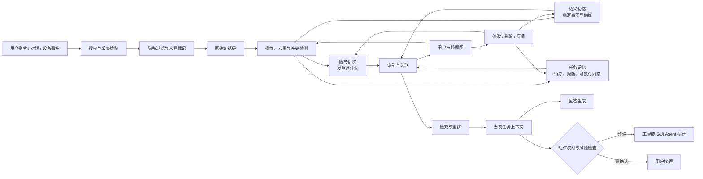

# 豆包手机 Memory 机制：从全局记忆到可行动个人上下文

> 资料时点：2026-10-19。公开产品事实主要来自豆包手机助手隐私安全白皮书与 SAEP 官方文档；通用 Agent Memory 机制来自原始论文。本文也吸收了一轮受控本地静态研究，但只公开不会暴露个人设备、用户内容或可执行访问路径的架构级结论。

## 一页结论

豆包手机的 Memory 不宜理解成“把聊天记录塞进向量数据库”。更准确的理解是：它试图在手机操作系统里建立一套**个人上下文生命周期**，把用户授权产生的零散信息转成可查看、可检索、可纠正，并能在具体任务中调用的记忆。[S1][S7]

从公开材料和受控研究能共同支持的最低风险模型是：

1. **记忆先是数据治理问题，再是检索问题。** 系统必须先回答能不能采集、采集什么、保留多久、谁能读取、怎样删除，之后才轮到 embedding、RAG 和大模型总结。[S1][S2]
2. **记忆至少有五种形态。** 原始证据、事件经历、稳定事实或画像、供用户审核的派生视图、当前任务临时上下文不是同一份数据，也不应由同一个表或向量索引充当唯一真相。[S4][S6][S7]
3. **“记住”与“使用记忆执行动作”是两次授权。** 知道用户常用地址，不等于可以自动填写并提交；回忆联系人，不等于可以直接发送消息。检索结果进入工具调用前还需要身份、应用策略和风险检查。[S1][S2]
4. **端侧优先不等于完全不上云。** 官方白皮书描述的是端云协同：高敏感处理优先在本地完成，复杂能力可能调用云端，并通过加密、假名化和处理后删除降低风险。这些属于厂商公开声明，本文未进行独立安全审计。[S1]
5. **最新研究进展的价值主要是纠偏。** 现阶段不能声称普通 App 已能持续读取豆包全局记忆，也不能把“存在向量、导出或备份相关组件”写成端侧 RAG 已完整跑通、用户已能完整迁移数据。当前成立的是接口、权限门、派生快照和候选导出链的存在；真实记录读取、多页增量、删除一致性和第三方接入仍待验证。[S10]

如果只记住一句话：**AI 手机的 Memory 是“带权限、版本、来源和行动边界的个人数据系统”，向量检索只是其中一个零件。**

---

## 1. 先用一个收纳系统理解 AI 记忆

可以把手机助手想成一位长期秘书。桌面上同时存在五类东西：

- **收件箱**：刚看到的屏幕内容、一次对话、一个地点或一条收藏；
- **日记**：某天发生了什么，例如“周五把车停在 B2”；
- **通讯录与偏好卡**：比较稳定的事实，例如常用地址、饮食偏好；
- **索引卡**：为了快速寻找而生成的关键词、摘要和向量；
- **工作台**：当前任务真正需要摆到模型上下文里的少量信息。

糟糕的 Memory 系统会把所有东西都扔进同一个抽屉。它可能记得很多，却分不清原始事实、模型总结和过期推测；用户删除一条记忆后，向量索引里仍有残留；一次错误总结又会反过来污染未来回答。

好的 Memory 系统会区分：

```text
发生了什么 → 保存什么证据 → 提炼出什么 → 用户如何纠正
            → 怎样检索 → 本次任务能否使用 → 能否据此执行动作
```

这也是 Generative Agents、MemGPT、CoALA 和近年的 Agent Memory 综述共同指向的方向：记忆不是一段无限增长的 Prompt，而是一个持续形成、更新、检索和遗忘的系统。[S4][S5][S6][S7]

---

## 2. 公开资料已经确认了什么

### 2.1 手机“全局记忆”与豆包 App“对话记忆”不是同一概念

豆包手机助手白皮书把“全局记忆”描述为保存和调用停车位置、取件码、行程偏好、常用信息等个性化内容的系统能力，并声明以下用户控制：[S1 §5.4]

- 功能启用前需要用户授权；
- 可以随时关闭，并提供快速关闭入口；
- 可以删除部分数据或清空全部记录；
- 记录过程有状态提示；
- 查看记忆需要锁屏凭据验证；
- 高敏感个人记忆数据库采用额外的数据库加密保护。[S1 §4.1.1]

豆包 App 的《记忆功能 FAQ》描述的是另一组范围：从用户与豆包的对话中提炼兴趣、偏好等文本记忆，或响应用户明确的“记住/忘记”指令。该 FAQ 明确说，当前提取来源包括对话文本和语音转写文本，不包括用户上传的图片、文件、链接和视频通话画面；自动提炼存在刷新周期，明确指令写入可以实时变化，记忆总量还有上限和覆盖机制。[S3]

| 维度 | 豆包手机助手“全局记忆” | 豆包 App“对话记忆” |
|---|---|---|
| 公开资料范围 | 手机助手隐私安全白皮书 | 豆包记忆功能 FAQ |
| 主要目标 | 在系统任务中保存和调用个人信息 | 个性化未来对话回复 |
| 公开举例 | 停车位置、取件码、行程偏好、常用信息 | 职业、饮食偏好、兴趣爱好等 |
| 用户控制 | 授权、开关、部分/全部删除、状态提示、查看鉴权 | 开关、逐条/全部删除、对话中要求忘记 |
| 已公开限制 | 没有公开完整内部数据模型和检索实现 | 自动提炼非实时、容量有限、删除生效可能有延迟 |

因此，不能用豆包 App FAQ 直接推断手机全局记忆的全部输入来源、保留策略或内部结构；也不能把手机白皮书的安全声明自动外推到所有豆包产品。

### 2.2 SAEP 证明的是 Agent 操作治理，不是记忆开放 API

SAEP 是豆包手机助手公开的 GUI Agent 协作协议。它允许第三方应用按 App、页面和业务意图声明 Agent 的操作边界，系统结合 Agent 身份、系统安全基线、应用策略与用户授权，给出 `ALLOW`、`BLOCK`、`CALL_USER` 等决策，并记录审计信息。[S2]

SAEP 对理解 Memory 很重要，因为它说明手机助手把安全分成了三个相互独立的阶段：

1. **可以感知或读取什么；**
2. **可以把什么写成长期记忆；**
3. **可以依据记忆执行什么动作。**

SAEP 只直接覆盖第三项及其相关的页面读取、截图、点击和输入边界。它并没有公开承诺普通第三方 App 可以读取全局记忆数据库。把“系统提供 Agent 协作协议”解释成“系统开放个人记忆接口”，会混淆两套权限面。[S2]

---

## 3. 一个公开可讨论的 Memory 架构模型

下面的图是本文综合公开资料、Agent Memory 文献和脱敏研究结论形成的**分析模型**，不是豆包官方公布的精确内部架构图。



这套模型里有四个容易被忽略的分离：

- **原始证据与模型总结分离**：总结可能错，必须能回到来源；
- **主记录与检索索引分离**：向量只是派生视图，不能成为唯一数据 owner；
- **长期记忆与审核快照分离**：供用户查看的一页卡片不一定等于底层完整记录；
- **检索与执行分离**：搜到某条记忆不代表已经获得执行高风险动作的授权。

---

## 4. 写入机制：什么值得被记住

### 4.1 记忆形成不是“全部保存”

Generative Agents 把完整经验流保存为 memory stream，再根据相关性、时间接近度和重要性检索，并周期性生成更高层反思。[S4] 最新 Agent Memory 综述进一步把记忆研究拆成形态、功能和动态：记忆怎样形成、怎样演化、怎样被取回。[S7]

手机场景还要额外加入授权与敏感性。可以用一个简化的写入门表示：

```text
keep(e) = consent(e)
          ∧ useful(e)
          ∧ safe_to_store(e)
          ∧ confidence(e) ≥ τ
```

- `consent(e)`：用户是否授权该来源与用途；
- `useful(e)`：该信息是否可能改善未来任务；
- `safe_to_store(e)`：是否包含密码、验证码或不应长期保存的第三方信息；
- `confidence(e)`：提取结果有多可靠；
- `τ`：不同记忆类型的最低写入阈值。

这不是豆包公开的真实公式，而是解释产品设计所需的最低决策结构。白皮书所说的“合理必要”“优先端侧处理”和用户可控，分别约束了 `useful`、`safe_to_store` 与 `consent`。[S1]

### 4.2 从事件到画像需要逐层压缩

一条屏幕信息或对话首先只是事件。要变成长期个人上下文，通常会经历：

1. **规范化**：提取时间、来源、对象和动作；
2. **情节化**：组成“何时、何地、发生了什么”的事件记忆；
3. **语义化**：从多次事件中归纳稳定事实或偏好；
4. **任务化**：识别待办、提醒、联系人、地址等可以用于后续行动的对象；
5. **建立来源链**：保存由哪些原始记录推导而来，是否被用户编辑过。

例如：

```text
原始事件：用户连续三次说“不要香菜”
情节记忆：三次点餐都要求去掉香菜
语义记忆：用户通常不吃香菜
任务记忆：下次点餐时默认提出“不要香菜”，提交前仍让用户确认
```

“通常不吃”是模型归纳，不是不可更改的身份事实。如果用户之后说“现在可以吃了”，系统需要更新或降权旧结论，而不是简单再追加一条互相矛盾的向量。

---

## 5. 读取机制：不是搜得越多越好

MemGPT 把有限上下文看成 RAM，把外部记忆看成磁盘，通过显式函数在不同层之间分页和搬运信息。[S5] 这个比喻适合手机助手：完整个人历史不应每次都进入 Prompt，系统需要只取当前任务真正相关的少量记忆。

一个可解释的检索分数可以写成：

```text
score(m, q) = α · relevance(m, q)
            + β · freshness(m)
            + γ · importance(m)
            + δ · source_trust(m)
            + ε · task_fit(m, q)
            - λ · sensitivity(m)
            - μ · conflict(m)
```

- `relevance`：与当前问题的语义相关度；
- `freshness`：信息是否仍新鲜；
- `importance`：忘记它的代价；
- `source_trust`：用户明确确认通常高于模型自动推断；
- `task_fit`：这类记忆是否适用于当前任务；
- `sensitivity`：调入上下文是否会扩大隐私暴露；
- `conflict`：是否与更新的记录冲突。

LoCoMo 的长期对话评测显示，Agent Memory 不能只测“能否搜到一句话”，还要测单跳、多跳、时间推理和对抗性问题；其研究也观察到，检索更多上下文不一定持续改善结果，信噪比下降会伤害回答。[S8]

所以一个成熟的读取链应该是：

```text
任务查询 → 权限过滤 → 候选召回 → 时间/来源/冲突重排
        → 生成最小上下文 → 回答时附带不确定性或来源
```

---

## 6. “可行动记忆”为什么是 AI 手机的关键

聊天机器人记住“用户住在上海”，主要用于更贴合地回答；手机助手记住地址后，还可能把它带入地图、打车、日历或外卖。这使 Memory 从信息检索变成了行动输入。

CoALA 把语言 Agent 描述为模块化记忆、内部与外部行动空间以及决策过程的组合。[S6] 豆包手机公开材料也把本地信息调用、跨应用操作和 SAEP 风险控制放在同一产品架构中。[S1][S2]

因此应该把三个权限拆开：

| 权限 | 问题 | 示例 |
|---|---|---|
| 记录权 | 这条信息能否进入长期记忆？ | 是否记住家庭地址 |
| 使用权 | 当前任务能否把它调入模型上下文？ | 回答“我常用地址是什么” |
| 行动权 | 能否据此调用工具并改变外部状态？ | 填写地址、提交订单 |

可以把行动门写成：

```text
execute = memory_retrieved
          ∧ identity_verified
          ∧ purpose_authorized
          ∧ app_policy_allows
          ∧ risk_check_passed
```

即使前四项成立，高风险动作仍可以进入 `CALL_USER`，让用户完成最终确认。这正是 SAEP“系统基线不可被应用放宽”和用户接管机制的价值。[S2]

---

## 7. 端云协同：本地优先，但不要写成“全部本地”

豆包手机助手白皮书公开描述了以下设计：[S1]

- 端侧具备 NPU、TEE 与文件加密能力；
- 一部分高敏感 AI 算法在本地执行；
- 个人记忆数据库采用额外加密；
- 复杂任务可以走云端，传输和存储采用加密与权限控制；
- 部分请求使用假名化标识；
- 对需要云端处理的全局记忆数据，白皮书声明处理完成后删除；
- 模型防护覆盖 Prompt、图片、工具调用和记忆等输入来源。

最后一点尤其重要：**记忆正文也可能包含提示词注入。** 一条网页摘录、聊天内容或屏幕文本即使进入了 Memory，也仍然应该被当作不可信数据，不能升级成系统指令。白皮书在屏幕问答章节明确提出把屏幕内容视为“被解释对象”，并通过模型安全策略和工具约束隔离外部页面指令。[S1 §5.3]

端云选择可以按以下原则理解：

| 任务 | 更适合端侧 | 可能需要云端 |
|---|---|---|
| 权限判断、开关、加密存储 | 是 | 通常不需要 |
| 简单分类、去重、敏感信息检测 | 优先 | 低端设备或复杂模型时可能需要 |
| 大规模多模态理解、复杂归纳 | 受算力限制 | 可能需要 |
| 最终工具授权与用户确认 | 应在可信端完成 | 云端只提供建议 |

这些属于架构原则。白皮书是厂商自述，并不等价于对每条数据流做过独立验证。

---

## 8. 最新受控研究带来的六个纠偏

本节只给出不包含设备信息、内部标识、调用参数、代码位置和用户内容的公开摘要。其作用是限制结论强度，不提供第三方访问或绕过路径。[S10]

### 8.1 静态交付版本不等于运行时版本

研究发现记忆实现可以通过宿主内的动态模块交付。由此得到的工程结论是：分析某个安装包只能证明“该实现随版本交付过”，不能自动证明运行进程正在加载同一份实现。以后每条行为证据都应绑定运行时版本或至少绑定可验证的产物哈希。

### 8.2 “组件可导出”不等于普通 App 可读

Android 官方安全文档同样指出，导出的 Activity、Service 或 Content Provider 仍可在方法体中检查调用者 UID、签名或自定义权限。[S9] 受控研究观察到的行为与这一模型一致：当前证据只能证明特定受控身份到达了参数校验层，不能外推为第三方 APK 已获得个人记忆读取能力。

### 8.3 空结果不等于数据库为空

一个空返回可能表示：没有记录、数据库未打开、调用者权限不足、查询入口本身不提供枚举、请求格式无效，或中间层做了降级。没有游标状态、错误语义和真实样例，就不能把“没有结果”写成“用户没有记忆”。

### 8.4 审核视图不等于长期数据 owner

受控研究确认存在面向审核或反馈的派生记录和分页结构，但该视图具有自己的版本、时间窗口和维护规则。它更像“待用户查看的一叠卡片”，不是永久历史数据库。审核卡片消失，不能直接解释为原始记忆被用户删除；反过来，删除主记录也需要验证索引、快照和缓存是否同步清理。

### 8.5 读取动作也可能有维护副作用

部分看似读取的入口会同时安排快照维护任务。源码存在维护逻辑不代表本轮确实删除了数据，但它足以推翻“所有读取天然无副作用”的假设。采集器设计需要区分：纯查询、读取后标记、读取后维护、显式写入。

### 8.6 导出链存在不等于迁移已经成立

存在文件打包、分享或旧数据包装组件，只能证明系统考虑过数据搬运。要宣称“用户可以完整迁移记忆”，还必须验证：入口真实可达、导出范围完整、格式可解释、接收方可读取、恢复后语义一致、更新与删除没有丢失。

截至本报告完成时，受控研究仍未验证：真实记忆正文读取、固定窗口多页增量、普通 App 持续接入、删除事件流、断线补采和完整迁移。因此，本轮没有继续读取真实个人记忆；下一步只应使用明确授权的脱敏样例或官方文件导出进行有界验证。[S10]

---

## 9. 最容易失败的地方

### 9.1 把模型推断写成用户事实

“用户三次点无香菜”可以支持“可能不喜欢香菜”，不能直接升级为不可更改的身份标签。每条派生记忆至少需要保存来源、提炼时间、置信度和是否经用户确认。

### 9.2 更新了主记录，却忘了派生视图

一个事实可能同时存在于全文索引、向量索引、用户画像、审核快照、Prompt 缓存和历史摘要中。删除或纠正必须传播到所有派生面，并能区分“尚未同步”与“已永久删除”。

### 9.3 只按语义相似度检索

相似度高的旧地址可能覆盖刚更新的新地址；一段情绪化对话可能错误压过用户明确确认的偏好。检索必须综合时间、来源可信度、冲突和任务适配性。

### 9.4 记忆污染行动

来自网页或第三方消息的文本可能包含恶意指令。记忆必须保留来源边界，并在进入工具调用前再次经过权限与提示词注入检查。[S1]

### 9.5 用户看不懂系统为什么“记得”

只有编辑和删除按钮仍不够。更理想的卡片应回答：这条信息来自哪里、何时形成、为什么现在被调用、它影响了哪个回答或动作。

---

## 10. 怎样评估一套手机 Memory 是否真的好用

公开材料没有提供豆包手机全局记忆的完整质量评测。参考 LoCoMo 与 Agent Memory 研究，至少应建立以下五组指标：[S7][S8]

| 维度 | 核心问题 | 示例指标 |
|---|---|---|
| 写入质量 | 该记的是否记住，不该记的是否拒绝 | 写入精确率/召回率、敏感信息漏拦率、重复率 |
| 检索质量 | 是否在正确任务中取回正确记录 | Recall@k、证据精确率、时间推理、多跳正确率 |
| 演化一致性 | 更新、纠正和遗忘是否传播完整 | 更新时间、删除生效时间、冲突残留率、重连补采完整率 |
| 行动安全 | 记忆是否导致越权或错误操作 | 错误执行率、用户接管率、策略绕过率、注入攻击成功率 |
| 用户控制 | 用户能否理解并管理系统 | 来源可解释率、编辑成功率、删除可验证率、误记投诉率 |

评测数据还要覆盖容易被平均分隐藏的情况：

- 新旧地址冲突；
- 同名联系人；
- 用户否认模型总结；
- 第三方隐私混入；
- 设备离线后重新连接；
- 删除发生在分页遍历中间；
- 记忆文本包含提示词注入；
- 检索正确但行动权限不成立。

只展示“它记住了我喜欢什么”的 Demo，无法证明系统具备长期可靠性。

---

## 11. 对 Personal Context 系统的可复用启示

### 11.1 保留唯一事实源，索引与报告都是派生物

原始来源、规范化记录、向量索引、用户审核卡片和模型 Prompt 应分别建模。任何派生物都记录来源 ID、版本和生成时间，不能反过来静默覆盖原始事实。

### 11.2 把完整性状态当成一等字段

一次同步应明确是 `complete`、`partial`、`stale` 还是 `unknown`。没有删除事件流时不能声称镜像完整；一次空查询也不能把本地存量清零。

### 11.3 对“为什么记”和“为什么用”分别解释

- 写入解释：为什么认为这条信息值得长期保存；
- 检索解释：为什么当前任务需要它；
- 行动解释：为什么允许据此执行某个动作。

三种解释对应三种不同的责任链。

### 11.4 用户编辑优先于模型自动推断

用户明确确认的记录应拥有更高的来源可信度。模型推断被用户否认后，应降低或删除相关派生结论，避免下一轮提炼再次把旧错误“复活”。

### 11.5 先评估数据合同，再决定是否接入某个来源

一个来源只有在以下问题都有答案后，才适合成为长期 Personal Context 输入：

1. 能否稳定识别版本和身份？
2. 是否有可重复的增量游标？
3. 更新和删除如何表达？
4. 读取是否有副作用？
5. 数据能否追溯到原始来源？
6. 用户能否撤销授权并验证删除？

这比“能否临时读出一条记录”更重要。

---

## 12. 局限与结论边界

1. [S1] 和 [S2] 是厂商官方材料，可以证明公开设计承诺与开发接口，不能替代第三方安全审计。
2. 豆包 App 记忆 FAQ [S3] 与豆包手机助手全局记忆属于不同产品范围，本文只做明确标注后的比较。
3. 受控本地研究 [S10] 的原始证据保留在私有环境，公开读者无法完整复现；因此本文不把其内部实现细节当作公开确定事实，也不发布操作路径。
4. 本轮没有读取真实用户记忆正文，也没有验证普通 App 接入、删除 feed、重启持久性或跨设备恢复。
5. 本文的分层架构、写入门和检索公式属于分析模型，用于解释设计权衡，不代表豆包官方实现。
6. 产品与动态模块会继续更新；版本变化、白皮书修订或官方 SDK 发布后需要重新核验。

---

## 思考与追问

### 我真正理解了什么？

AI 手机的竞争壁垒不会只是更大的端侧模型，而是能否把个人数据变成一套可信的长期上下文：来源可追溯、提炼可纠正、检索有边界、行动需授权、删除能验证。Memory 的产品质量最终由整个生命周期决定。

### 我还没搞懂什么？

- 全局记忆的主记录、审核视图和检索索引之间，更新与删除如何保证最终一致？
- 当端侧与云端模型对同一事件给出冲突总结时，哪个版本拥有决定权？
- 用户删除一条记忆后，缓存、向量、历史摘要和已生成任务中的引用分别何时失效？
- 动态模块升级后，旧记忆的 schema、embedding 和置信度是否会重新计算？

### 下一步读什么或做什么？

1. 使用一个专门创建的脱敏样例，验证“写入—检索—更新—删除—过期”的完整生命周期。
2. 若官方 UI 提供文件导出，优先验证用户主动导出、文件接收与 schema，而不是扩大实时接口探测。
3. 用 LoCoMo 的单跳、多跳、时间和对抗分类，建立手机 Personal Context 的最小回归集。

---

## 来源

- **[S1]** 豆包手机助手，[《豆包手机助手隐私安全白皮书》](https://o.doubao.com/whitepaper)，重点为 §2、§3、§4、§5.1–5.4；访问于 2026-10-19。
- **[S2]** 豆包手机助手，[《屏幕自动化操作声明协议应用开发接入文档》](https://o.doubao.com/SAEP_Protocol)；访问于 2026-10-19。
- **[S3]** 豆包，[《记忆功能 FAQ》](https://www.doubao.com/legal/memory_faq)；访问于 2026-10-19。
- **[S4]** Park et al., [Generative Agents: Interactive Simulacra of Human Behavior](https://arxiv.org/abs/2304.03442), UIST 2023。
- **[S5]** Packer et al., [MemGPT: Towards LLMs as Operating Systems](https://arxiv.org/abs/2310.08560), 2023/2024。
- **[S6]** Sumers et al., [Cognitive Architectures for Language Agents](https://arxiv.org/abs/2309.02427), TMLR 2024。
- **[S7]** Hu et al., [Memory in the Age of AI Agents: A Survey](https://arxiv.org/abs/2512.13564), v2，2026-01。
- **[S8]** Maharana et al., [Evaluating Very Long-Term Conversational Memory of LLM Agents](https://arxiv.org/abs/2402.17753), 2024；LoCoMo benchmark。
- **[S9]** Android Developers, [Permission-based access control to exported components](https://developer.android.com/privacy-and-security/risks/access-control-to-exported-components)，更新于 2024-09-24。
- **[S10]** 受控本地静态与只读行为研究的脱敏摘要，完成于 2026-10-18 UTC；原始产物、内部标识、设备信息和用户内容不随公开仓发布。
