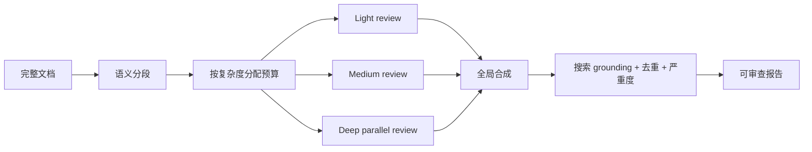

# Deep Review 与 Paper Assistant Tool：把长文复核从 Pass@k 改造成分段推理系统

> 主要原文：Rajesh Jayaram 等，[Towards Automating Scientific Review with Google’s Paper Assistant Tool](https://arxiv.org/abs/2606.28277)，Google Research，2026；产品与后续扩展：[Analyzing technical documents with Deep Review](https://research.google/blog/analyzing-technical-documents-with-deep-review/)，2026-10-14。

## 一句话总结

Deep Review 的关键不是“多调用几次模型”，而是**按文档语义分段、按复杂度分配推理预算、让每个 reviewer 聚焦局部但持有全局上下文，最后用搜索 grounding、去重和严重度判断做统一合成。**

## 1. 作者在解决什么问题

生成式 AI 加速了论文、代码、实验和技术文档生产，验证能力却没有同步增长。论文把这称为 scientific validation bottleneck：内容生成吞吐上升，专家逐行检查证明、实验设计和引用的时间仍然固定。

最直接的两个 baseline 都不够：

1. **单次长上下文调用**：模型的有效注意力和 thinking token 会被整篇文档摊薄，深证明与复杂实验容易被略过；
2. **独立 Pass@k**：召回率会上升，但多个调用会重复审查同一部分，并产生大量幻觉批评。论文举例：若每次提出 10 个问题、每次找到关键错误的概率为 10%，跑 10 次可能迫使人从约 100 个问题中找出 1 个真的。

因此，问题不是简单增加调用次数，而是如何**调度验证注意力**。

## 2. PAT / Deep Review 的四阶段架构

### 阶段 1：Document Segmentation

Segmenter 按逻辑主题拆分文档，例如 Introduction、Theory、Methodology、Experiments。Segment 可以重叠，也可以跨越不连续页面，避免机械按页数切分破坏论证链。

### 阶段 2：Adaptive Budgeting

系统根据每段的信息密度和复杂度动态分配 Light、Medium、High Thinking。简介和结论可以低预算，证明与核心实验使用高预算。这里的目标不是“每段公平”，而是把计算投向最可能隐藏关键错误的位置。

### 阶段 3：Deep Review

专门 reviewer 深查分配到的 segment，但仍把整篇论文放在上下文中。局部 focus 负责深度，全局 context 负责避免把跨章节定义、假设和实验条件割裂。

### 阶段 4：Global Synthesis

Synthesis agent 合并各段结果，执行：

- critique 去重；
- 严重度检查；
- Google Search grounding，检查不存在的论文、定理和日期；
- 形成统一 review。

这套架构同时修复 Pass@k 的两个缺陷：语义分段减少重复覆盖，协调式 deep review 与最终 grounding 降低 precision 崩塌。

## 3. SPOT 实验：29 个真实错误

作者从 SPOT benchmark 中筛出 Mathematics / Computer Science 且属于 equation/proof error 的子集，共 **26 篇论文、29 个错误**。系统生成错误报告，再由专用 LLM grader 判断是否与 ground truth 逻辑等价；一名作者人工审计每个 grader 结果。

Table 2：

| 方法 | Detection accuracy / recall |
|---|---:|
| Original SPOT SOTA | **21.1%** |
| Gemini 3.1 Pro zero-shot | **55.2%** |
| PAT + Gemini 3.1 Pro | **89.7%** |

PAT 相对 zero-shot 提高 **34.5 个百分点**。论文写作“34% improvement”，从表格看应理解为百分点差，而不是相对增幅。

这些数字有三个边界：

1. 新 grader 允许“逻辑等价”而不要求关键词完全匹配，论文明确说明不能与原 SPOT 数字直接横比；
2. 子集只含 29 个错误，置信区间和跨领域泛化没有充分展开；
3. 这是 recall/detection，不等于 critique precision。系统在无错误论文上会产生多少严重误报，Table 2 没回答。

## 4. 真实试点：从 4,700 到 16,000 篇文稿

论文记录的是较早阶段：STOC 2026 与 ICML 2026 两个预投稿试点，共审查超过 **4,700** 份 submission，系统基于 Gemini 2.5 Deep Think。2026-10 的 Deep Review 博客更新到四个会议：STOC 2026、ICML 2026、NeurIPS 2026、ICLR 2027，共有超过 **16,000** 份作者自愿参加的文稿。

这两个数字不是冲突，而是不同时间点和覆盖范围。论文的 survey 与定量结果只对应 STOC/ICML，不能自动外推到后续四会总样本。

## 5. 作者反馈说明了什么

Table 3 的 survey 样本为 STOC `n=124`、ICML `n=733`：

| 问题 | STOC | ICML |
|---|---:|---:|
| 愿再次使用 | 97.0% | 92.1% |
| 改善清晰度/可读性 | 85.1% | 87.0% |
| 有教育价值 | 75.2% | 83.9% |
| Very/Mostly helpful | 92.7% | 90.7% |
| Mostly/All grounded | 55.8% | 64.8% |
| 发现重大理论缺口 | 11.6% | 35.4% |
| 因反馈运行新实验 | — | 31% |

这组数据最值得冷读的不是 90% helpful，而是只有 **55.8% / 64.8%** 的反馈被认为大多或全部 grounded。这意味着即使作者总体满意，复核者仍需验证相当比例的批评。

“发现重大理论缺口”与“运行新实验”同样来自自愿反馈，不是随机对照。使用者、回复者和成功案例都可能存在选择偏差。它能证明 PAT 产生了高价值个案，不能证明对所有文稿的平均净收益。

## 6. 已观察到的失败模式

试点最常见的三类问题：

1. 日期幻觉与知识截止过旧；
2. PDF parsing 错误；
3. 模型误解论证，错误宣称证明或推理不成立。

前两类可通过搜索和 parser 改进；第三类属于 reasoning failure，不能靠更多格式规则根除。Deep Review 的产品化把目标从“自动给出最终裁决”限制为“提供技术验证材料”，保留人类判断。

## 7. 四级自动化角色与治理边界

论文提出：

| 角色 | AI 做什么 | 人类责任 |
|---|---|---|
| Role 1 | 作者提交前的检查工具 | 作者对论文负责 |
| Role 2 | reviewer 的辅助工具 | reviewer 对最终 review 负责 |
| Role 3 / 3.5 | 独立生成技术 review，或附评分建议 | Area Chair 判断 |
| Role 4 | 全自动 peer review | 制度层承担系统风险 |

作者认为 PAT 已适合 Role 1/2，并讨论向 Role 3 演进。Role 4 仍带来观点集中、deskilling、算力不平等、对抗性 gaming 和责任归属问题。

对工程仓库而言，当前合理位置也是 Role 1/2：agent 生成分段审计与候选结论，human owner 决定是否合入；不能让 review 分数直接替代 owner 的高后果决策。

## 8. 与 EverAgent 报告机制的关系

现有 `report-v2` 已包含几个同构部件：evidence manifest、source-first reviewer、claim 核验、五维评分和最终 synthesis。Deep Review 提供了三项可继续吸收的原则：

### 8.1 先做来源地图，再读报告结论

这可以防止 Reviewer 只核对生成者主动登记的 claims，漏掉整块未覆盖内容。播客报告已经采用 source content map；长篇文章、论文与旗舰重构参照也可以按来源先列核心单元。

### 8.2 按风险和信息密度分配预算

不是所有段落都需要同样强度：

- 关键数字、权限边界、跨仓隐私和删除规则：High；
- 方法、路由与评估设计：Medium/High；
- 导航、格式和低风险说明：Light。

### 8.3 Segment reviewer 必须看到全局约束

只给 reviewer 一个局部文件容易漏掉跨文件 owner、继承关系和安全边界。更合适的是“当前 segment + 根级约束摘要 + 相关 owner”，而不是把整个仓库无差别塞入上下文。

## 9. 论文与产品材料的局限

- SPOT 样本小，且 evaluator 由作者设计并人工审计，没有外部盲评。
- 会议试点是 opt-in、作者侧、预投稿使用，没有随机对照或最终接收质量比较。
- Survey 只覆盖部分用户；对未回复者和不满意用户缺少分析。
- PAT/Deep Review 是 proprietary pipeline，动态预算、prompt、模型版本与成本未公开，难以复现。
- 产品博客的 16,000 文稿扩展没有公开与论文同等详细的效果数据。
- 系统强调 finding recall，真实生产还需要 critique precision、严重度校准、人工验证时间和漏检率。
- Role 3/4 属前瞻治理讨论，不是实验已经证明的可用状态。

## 思考与追问

### 1. 我真正理解了什么？

长文复核的核心瓶颈不是上下文长度，而是验证注意力的调度。独立多跑几次会同时增加召回与噪声；真正有效的系统必须知道“哪一段值得多少计算、谁负责合成、怎样过滤重复和幻觉”。

### 2. 我还没搞懂什么？

- PAT 的 critique precision、每篇人工验证时间和单位成本是多少？
- 动态预算器如何判断段落复杂度，是否会漏掉看似简单但藏有关键假设的段落？
- 作者知道 AI 会审查后，是否会出现针对 reviewer 的 reward hacking？

### 3. 下一步读什么或做什么？

把分段复核架构用于双仓重构候选：按 owner 与风险切分 workstream，为每段分配审计预算，最终由跨仓 synthesis 检查重复、边界与整体一致性。

## 来源

- [论文 HTML](https://arxiv.org/html/2606.28277v1) · [PDF](https://arxiv.org/pdf/2606.28277)
- [Google Research：Deep Review 发布与后续四会扩展](https://research.google/blog/analyzing-technical-documents-with-deep-review/)
