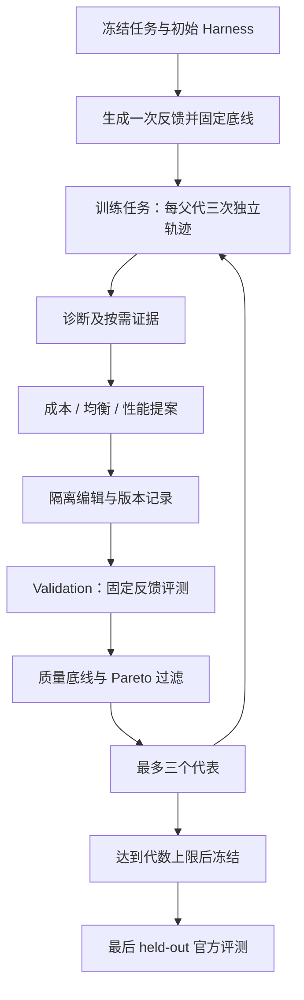

# HarnessPro 精读：用可执行反馈与帕累托选择约束 Harness 递归改进

## 一句话总结

HarnessPro 把 **固定模型、读取执行轨迹、修改 Harness、用冻结的可执行反馈评测、保留质量与成本的非劣候选** 连成有界循环。对 EverAgent 最有价值的增量是把“上下文精简是否有用”变成可以复核的实验；落地时优先复用现有报告质量门与行为评测。

论文的最醒目数字需要带上口径：GPT-5.5 / Codex 在 SWE-Bench Pro 上，Medium 相对 RHO 的执行成本从 **$2.68 降至 $1.26 / 任务，约下降 53.0%**，通过率从 **80.0% 到 79.0%，下降 1.0 个百分点**。这是作者的基准实验结果，不能作为本项目的预期节省承诺。[S1，Table 2]

## 1. 来源、版本与实际阅读范围

| 材料 | 固定范围 | 本报告如何使用 |
|---|---|---|
| 量子位微信文章，梦晨 / QbitAI | 用户提供的文章；2026-10-23 读取正文 | 重构传播中的论证，逐项对照原论文；未核实的文章发布时间不补写 |
| HarnessPro 论文 | `arXiv:2610.26770v1`，2026-10-19 17:27:38 UTC 提交，41 页 | 读主文、公式、Algorithm 1、全部附录与代码 listings；核对 Figure 2、Table 2 / 3 |
| HarnessPro 开源代码 | `8ae622eb4a4923dbb4b515be7ded614f88fd4f38` | 静态追踪 runtime、hooks、agent adapter、评测 runner 和来源边界 |
| RHO、SkillMOO | 对应 arXiv v2 的摘要 | 定位方法差别与新颖性边界；没有将摘要读取写成全文复现 |

论文页眉为 **Under review**，本报告按预印本处理，不声称已通过同行评审。源码快照与论文实验是两种证据：本轮下载并研究了代码，**没有运行三套 benchmark，也没有复现 Table 2 的分数**。[S1–S5]

取证优先经过 eacli Token Plan。网页正文读取成功；新 GitHub 仓的 typed 仓库接口未被索引，长论文 reader 的内部结果又在 32,000 字符处截断，因此补用官方 Git / GitHub API 与固定版本 PDF。不能把外层 `ok=true` 当成全文完整。PDF SHA-256 为 `da167e436b2f2c2b5898789d27c22820b92ccb922a8d420e51c341227d9c8676`；原始缓存留在研究环境，公开仓只保存分析及可复核定位。

## 2. 微信文章的论证与需要收窄的表述

文章的论证可写成：

- **x：** 轨迹驱动的 Agent 自进化能提高成功率，却可能增加反复探索、验证和日志输入。
- **f：** 增加成本感知的诊断、三个优化方向、固定生成测试及帕累托筛选。
- **f(x)：** 在若干基准上得到更好的质量与执行成本组合，产出 Lite / Medium / Heavy 三类代表。

这条主线与论文相符。传播表述里的几个边界会直接影响工程判断：[S1；S3]

| 文章表述 | 原文与源码核对 | 应采用的解释 |
|---|---|---|
| 无标签自进化 | 搜索不使用官方测试、标准答案或其标签；最终结果仍用官方评测 | 无标签限定的是改进阶段的反馈来源，不是取消验收 |
| 生成候选后经“测试集”验证 | Algorithm 1 用 validation 选择；held-out test 在最终冻结后评测 | 必须区分训练、选择与最后检验 |
| 四个 Agent 每轮流水线 | Test Synthesizer 在初始化阶段为任务生成一次固定测试；三角色负责后续诊断、规划、编辑 | 测试不能随着候选反复被改成更容易通过 |
| 同等性能下省 53% | SWE / Medium 为 79.0% 对 80.0%，$1.26 对 $2.68 | 高性能接近，不是分数完全相等，也不是每个任务都省 53% |
| 工具达到 44 次立即拦截 | TB2 Medium 的 standard 阈值为 44；代码条件为 `count > finalize` | 前 44 次尝试未被这个预算分支拒绝，第 45 次开始拒绝 |
| 一个任务吞 251 万输入 token | Mailman 第三条轨迹累计输入 2,517,861 token | 累计请求输入，不能换算成一次 context window 大小 |
| 提醒完美保护前缀缓存 | 提醒以运行时追加的方式减少对稳定前缀的扰动 | 是缓存友好的设计；论文没有单独证明所有接口的缓存命中保证 |
| 全场最高通过率、全面降延迟 | Heavy 在 Table 2 的三个基准比较中领先；部分小幅差距与标准差重叠，延迟有反例 | 结论限制于报告的配置与任务集 |

另一个新颖性边界：在 HarnessPro 之前，SkillMOO 已研究 skill bundle 的成功率 / 成本多目标搜索及 NSGA-II 选择。HarnessPro 的重点是更广的 Harness 组件、轨迹诊断和固定生成测试的组合。因此不能仅凭微信文章，把“首次在 Agent 进化使用帕累托优化”扩成全领域历史事实。[S8，仅摘要核对]

## 3. RSI 改什么：模型固定，Harness 是搜索对象

Harness 在这里包含指令、skills、工具、执行配置、上下文管理和验证辅助。RSI 每一代修改这些可执行资源，使同一个求解模型后续工作的方式变化；论文没有训练模型权重。[S1，§3–4]

三个层次要分别记账：

| 层次 | 论文中的职责 | 本项目应观察什么 |
|---|---|---|
| Solver | 固定底座模型，完成任务 | 真正交付的质量、缺失行为、失败和重试 |
| Harness | 约束读取、路由、工具反馈、收敛和验证 | 哪项行为改变了，保留了哪些必要证据 |
| 改进系统 | 诊断、提案、编辑、评测及选择 | 搜索的额外成本、评测独立性与晋级依据 |

“一次任务结束时还剩多少 context”属于单次可用容量；多轮请求的累计输入、未缓存输入与输出属于消耗。二者相关，但没有固定换算关系。要诊断 context 消耗，必须同时看初始注入量、工具输出、重复读取、compaction 和真实完成路径，而非仅看总 token。[S1，Appendix C.1；分析者推断]

### 与相近方法的关系

| 方法 | 改进对象与反馈 | 适合借鉴之处 | 比较边界 |
|---|---|---|---|
| RHO | 过去轨迹、困难任务 coreset、self-validation / consistency、成对 self-preference | 从真实失败找更新方向 | HarnessPro 的对照实现与原 RHO 摘要的实验口径分别保存 |
| SkillMOO | skill bundles，成功率 / inference cost，NSGA-II | skill 的删减、替换也可以是搜索操作 | 本轮仅读摘要；其 SkillsBench 数据不与 HarnessPro 直接排名 |
| HarnessPro | 更广的 Harness，固定生成测试，质量底线与 Pareto 代表 | 把诊断、执行反馈、效率选择组合成实验 | 开源 evaluation release 的能力范围小于论文的完整循环 |

这组比较支持“先尝试有界的 Harness 实验”，不足以证明需要在项目中另建通用进化平台。[S1；S7；S8]

## 4. 方法深读：反馈冻结、证据按需、候选有界

### 4.1 先固定任务、反馈与质量底线

Algorithm 1 先收集初始 Harness `h0` 在 train / validation 上的轨迹，再为每个任务合成 `S(x)`；`S(x)` **只生成一次**。初始 Harness 在 validation 上经这些测试得到的 `PRval(h0)` 成为本轮质量底线。[S1，pp. 3–5]

测试合成器允许读取公开任务材料与冻结的初始产物。初始产物只用于了解接口和诊断执行，不能拿其输出当正确答案。附录要求十个有意义的 unittest case，使用公开参考、已知答案、必要属性或 metamorphic relation；不得为凑数量填无条件通过的测试。[S1，Appendix C.3]

`status=ok, passed=false` 表示测试执行完并发现可能的产品失败；目标不是把初始产物调成通过。修改测试只能基于公开证据证明的测试缺陷，并须重跑。`infra_error` 表示结论尚未成立。合成器的自审在同一次调用中完成，**不能替代本项目要求的独立 Reviewer**。

### 4.2 用困难性与多样性选择十个训练任务

训练 coreset 在进化前选一次并冻结：

1. 用初始轨迹得到难度 `r ∈ [0,10]` 与去掉任务专名的失败指纹。
2. 对失败指纹的 embedding 做单位归一化，以 cosine similarity 形成 `S`。
3. 设 `q_i=max(r_i/10, 0.1)`，`w_i=(q_i/max_j q_j)^[θ/(2(1−θ))]`，`θ=0.7`。
4. 构造 `K=diag(w) S diag(w)`，逐步加入让子矩阵 determinant 最大的任务，直到十个。

论文介绍 k-DPP 的概率形式，但实际选择采用贪心近似最大概率子集，**没有按该分布随机采样**。困难性偏好避免只选容易题，determinant 抑制相似失败的重复；十个任务仍然很小，不能保证覆盖新的任务家族。[S1，Appendix A.1，Eq. 10–12]

### 4.3 Analyzer：同时诊断失败和成功中的浪费

每个父 Harness、每个训练任务，采集 **G=3 个独立 rollout**。Analyzer 读取这些轨迹及质量、成本、耗时，输出问题、影响和来源。诊断必须给出轨迹文件路径及 event 范围；汇总诊断超过 64K tokens 时才总结。[S1，§4.2]

附录的两个案例解释了为什么“更多推理”不能统一解决问题：

- **Caffe / CIFAR-10：** 三次都没有完成训练。共同瓶颈包括过高编译并发造成 OOM、构建或下载未收口。关于缺 OpenCV 的后续风险被明确标成预测，不能写成已发生失败。
- **Mailman：** 三次都通过生成测试，却分别累计约 106 万、176 万、252 万输入 token。无关配置倾倒和重复检查造成浪费；一次 smoke test 提前创建 root-owned 邮箱，反而触发临时投递故障。

高价值诊断把环境瓶颈、工具误用、验证不足、验证诱发问题与真实能力失败分开，且保留判断的证据边界。[S1，Appendix C.1]

### 4.4 Planner 与 Editor：同一问题，三种方向

Planner 默认接收诊断、指标、当前源码及候选之间的 diff；不默认读所有完整轨迹，需要时沿证据路径读取。这与 EverAgent 的按需 context 方向一致。[S1，p. 5]

每个父代各产生三个方案：`I1` 减成本，`I2` 改质量 / 成本组合，`I3` 优先修高价值失败。三个方案都要求完成质量，不能靠跳过任务或弱化验证省成本。Editor 在隔离 workspace 实现，各自产生 Git 提交。

每代最多保留三个不同父代，因此最多产生九个新候选，与父代合并最多十二个；初始只有一个父代时是三个新候选加一个父代。三个模式可能选中同一个 Harness，不保证每代一定存在三份不同实现。[S1，Algorithm 1；Appendix B]

### 4.5 先过滤，再选帕累托代表

质量 `P` 越高越好，平均执行成本 `C` 越低越好。候选需满足 `P≥P0`；若另一候选质量不低、成本不高且至少一项更好，则当前候选被支配。[S1，§4.3]

在可行非劣池中，使用归一化的“距理想点距离”：

```text
d_perf = (P_max − P) / (P_max − P_min)
d_cost = (C − C_min) / (C_max − C_min)
J_m    = α_m × d_perf² + β_m × d_cost²
Lite   = (α,β)=(1,2)
Medium = (α,β)=(1,1)
Heavy  = (α,β)=(2,1)
```

模式是不同偏好，不是质量认证级别。质量底线相对的是初始 Harness 的 validation 表现，也不保证官方 held-out 的每项结果、每类任务都提升。论文没有交代零极差和完全并列时的具体实现；复用时需要明确退化维度、去重、tie-break 及无可行候选时保留父代的规则。[S1，Eq. 7–9；分析者实现建议]



## 5. 实验与数字：成绩、成本、延迟分别看

### 5.1 实验设计

| 项目 | 作者设置 |
|---|---|
| 任务 | TB2 终端操作、SWE-Bench Pro 仓库修复、ProgramBench 程序重建 |
| 最终 held-out | 分别 59 / 100 / 100 个任务 |
| 训练 / validation | 其余任务中用 DPP 选十个 train，剩余作为 validation |
| 模型与 Harness | GPT-5.5 + Codex 0.147.0；GLM-5.2 + Claude Code 2.1.231 |
| 进化次数 | TB2 / SWE 三代，Program 四代 |
| 采样 | 训练每任务每父代三次；validation 每候选每任务一次 |
| 最终重复与误差 | TB2 / SWE 三次，Program 两次；`±` 为 sample standard deviation |
| 成功口径 | TB2 / SWE 要全部官方测试通过；Program 是每任务测试通过比例的宏平均 |
| 时间与成本 | 时间不含 grader；成本按输入、缓存输入、输出的历史 API 价格估算 |

上述 ProgramBench 的“69.6%”不能解释为 69.6% 的完整程序全部重建成功。模型之间的 reasoning 与时间预算也不完全相同，因此这张表适合在同一模型列内比较 Harness，不适合作公平的跨模型能力排名。[S1，§5.1；Appendix A]

### 5.2 GPT-5.5 / Codex：Table 2 核心数据

每格为 **通过率 % / 美元每任务 / Solver 秒每任务**；HarnessPro 的 `±` 与论文一致。

| 配置 | TB2 | SWE-Bench Pro | ProgramBench |
|---|---|---|---|
| Vanilla | 69.5 / 0.89 / 260 | 59.0 / 1.88 / 337 | 60.3 / 2.65 / 669 |
| RHO | 76.3 / 1.09 / 354 | 80.0 / 2.68 / 437 | 68.8 / 3.59 / 928 |
| RHO + Iteration | 76.3 / 0.82 / 328 | 80.0 / 1.90 / 375 | 68.3 / 3.13 / 789 |
| HarnessPro Lite | 72.9±1.7 / 0.43±0.01 / 230±32 | 72.3±0.6 / 0.80±0.02 / 203±19 | 64.3±0.04 / 2.18±0.06 / 985±70 |
| HarnessPro Medium | 76.3±1.7 / 0.56±0.04 / 253±35 | 79.0±1.0 / 1.26±0.03 / 326±25 | 67.9±0.47 / 2.90±0.13 / 745±61 |
| HarnessPro Heavy | 80.8±1.0 / 0.72±0.05 / 310±31 | 80.7±0.6 / 1.97±0.02 / 333±10 | 69.6±1.03 / 2.95±0.13 / 888±32 |

三个可直接复算的结论：[S1，Table 2]

- SWE Medium：`1−1.26/2.68≈52.99%`；通过率变化为 `79−80=−1.0pp`。
- TB2 Heavy：`80.8−76.3=4.5pp`，`1−0.72/1.09≈33.94%`。
- Program Lite 虽比 Vanilla 便宜约 17.7%，耗时却为 **985 对 669 秒，约慢 47.2%**。降低 token 成本不保证降低延迟。

RHO + Iteration 是重要对照：它也运行同等代数的成本感知优化。HarnessPro Medium 在 TB2 与其同为 76.3%，成本是 $0.56 对 $0.82；优势不能全部归因于“比 RHO 多跑了几轮”。

### 5.3 GLM-5.2 / Claude Code

同样每格为 **通过率 % / 美元每任务 / Solver 秒每任务**。[S1，Table 2]

| 配置 | TB2 | SWE-Bench Pro | ProgramBench |
|---|---|---|---|
| Vanilla | 74.6 / 0.92 / 963 | 56.0 / 1.17 / 402 | 59.7 / 11.34 / 3847 |
| RHO | 78.0 / 1.00 / 1318 | 75.0 / 2.17 / 520 | 63.3 / 17.00 / 6434 |
| HarnessPro Lite | 75.1±1.0 / 0.43±0.03 / 665±8 | 70.7±0.6 / 0.70±0.02 / 289±3 | 60.1±0.6 / 11.10±0.28 / 3907±32 |
| HarnessPro Medium | 76.3±0.0 / 0.50±0.01 / 968±17 | 75.0±1.0 / 0.87±0.01 / 332±10 | 63.0±0.4 / 13.74±0.16 / 5893±132 |
| HarnessPro Heavy | 81.4±1.7 / 0.62±0.02 / 1080±15 | 77.3±0.6 / 1.01±0.03 / 412±11 | 64.4±0.8 / 14.95±0.08 / 5925±110 |

同方向收益出现于另一组模型 / Harness，但公开 release **不包含论文使用的 GLM-5.2 进化快照**；公开 Claude backend 支持不等于完整复现这些结果，更不证明可直接迁移到 GLM-5.3。[S5]

### 5.4 Figure 2：生成测试改善失败召回，样本只有二十个

矩阵行是官方判定，列是预测判定：[S1，Figure 2，p. 6]

| 官方结果 | LLM Judge 预测 Pass / Fail | 生成测试预测 Pass / Fail |
|---|---|---|
| Pass，8 个 | 8 / 0 | 7 / 1 |
| Fail，12 个 | 7 / 5 | 2 / 10 |

失败 recall 从 `5/12=41.7%` 到 `10/12=83.3%`，增幅约 41.7 个百分点。生成测试仍漏掉两个失败，并误判一个成功；二十个样本的示例不构成大型统计保证。它证明值得改善外部反馈，不能证明合成测试天然可靠。

### 5.5 Table 3：组合搜索有效，单抄策略有退化

SWE-Bench Pro / GPT-5.5，`CoP` 为平均成本除以成功率（按 0–1 计）：[S1，Table 3]

| 配置 | 通过率 % | $ / 任务 | CoP $ |
|---|---:|---:|---:|
| HarnessPro Medium | 79.0 | 1.26 | 1.59 |
| 去掉 Planner | 73.0 | 1.42 | 1.95 |
| 去掉 Test Synthesizer | 69.0 | 1.37 | 1.99 |
| RHO | 80.0 | 2.68 | 3.35 |
| RHO + 动态路由 | 76.0 | 2.13 | 2.80 |
| RHO + 预算 hooks | 75.0 | 1.75 | 2.33 |
| RHO + low effort | 59.0 | 1.08 | 1.83 |

TB2 Medium 去掉 Planner 为 74.6% / $0.61，去掉测试合成器为 72.9% / $0.82，完整配置为 76.3% / $0.56。结果支持这套实验配置中诊断、规划与反馈的价值；仍不能据此精确分离每条 prompt、每种工具预算和机制交互的因果贡献。

## 6. 进化产物与源码：哪些机制值得学

### 6.1 根据“可获得的证据”路由

TB2 / SWE 使用 `compact / lean / standard / deep / research` 五种 profile。路由 rubric 关注公开要求、可执行 oracle、未解决假设数量、每次验证的代价和 watchdog；不因专业术语、文件多或“看起来难”就统一加大 effort。[S1，Appendix D.1–D.2]

源码以 `policy.json` 中的执行值为准。例如 TB2 Lite 的 rubric 继承了部分 Medium 的文字，而 policy 将 deep / research effort 降为 medium。SWE Medium 还把低置信度的 lean 选择提高到 standard 的预算。**自然语言建议、路由结果与最终执行配置需同时可追溯。**[S4；S5]

ProgramBench 使用固定 high profile，没有同款路由 rubric；Medium / Heavy 的公开 policy 与 hook 相同，指令内容仍可能不同。九个目录不等于九种独立运行机制。

### 6.2 分阶段提醒，硬限制必须有完成语义

TB2 Medium standard 在第 14 次尝试进入 economy，第 26 次及其后指定间隔提示收敛，第 45 次起拒绝。Program Medium 的 finalize 为 76，再留 `max(8, reminder)` 的 grace，超过 84 才拒绝。[S1，pp. 27–29、39–41；S6]

这些阈值衡量的是 hook 看到的尝试；一次 batch 可包含多个命令，不能当通用 token 上限。迁移到交互式项目时，还必须让“无法验收、无法提交或预算耗尽”保留为未完成状态，避免提前宣称成功。[分析者建议]

### 6.3 输出缩小，原件可恢复

TB2 / SWE hook 保存原始工具结果，再折叠连续重复行、保留头尾，并给出恢复路径。history token limit 是**每个工具输出的保留上限**，不是模型的 context window。[S1，Appendix D；S6]

值得借鉴的是“简短诊断 + 原件引用 + 定向展开”。全文或 JSON 被截断后应明确缺失范围，错误栈和关键验收证据不能靠无条件摘要代替。当前源码遇到缺失 / 损坏的 selection 时可能回到空对象，预算控制会失效；这是静态发现的降级风险，本轮未执行复现。[S6；分析者判断]

RTK 改写有窄 allowlist，因为过宽改写曾破坏 `rg --files` 和 `find` 的语义。优先缩小展示输出；改写执行命令需要独立的语义检查，尤其要保留 exit code、stderr 和真实操作对象。

### 6.4 不完整测量不能进入效率晋级

`trajectory_cost_summary` 与 `qualify_metrics` 区分完整计量、部分已观测金额与 `indeterminate`。缺 usage 或未知价格不能当成本零；结果集不完整、仍有 pending 或基础设施失败超限也不通过。[S4，`src/rho/observability.py`、`qualification.py`]

实验结果 cache 可以重放 workspace；它与 provider 的 prompt cache 是两回事。三次独立 rollout 不能靠复制同一份缓存结果凑样本。Harness 内容哈希还应绑定模型证据、CLI 版本、执行权限、配置及评测版本，单独的文件内容 digest 不足以复现实验环境。[S4，`agent/cache.py`、`stores/harness.py`；分析者建议]

### 6.5 公开代码的复现边界

该包自称 `harnesspro-evaluation`，提供九套已进化 Harness、三类评测 runner 和相关 adapter。`src/rho/protocols.py` 留有 Diagnosis / OptimizeStrategy 等类型；当前 `orchestrators/` 只有 solve 与辅助文件，结合 package 入口和全局检索，**没有发现可启动论文完整 Analyzer → Planner → Editor → TestSynth → Pareto 多代循环的入口**。[S4；S5]

默认 TB2 splitter 还保留 30 / rest 两段划分、test 为空的 RHO 注释；论文实验采用十个 train、剩余 validation 与独立 held-out。复现需使用明确任务清单及实际 runner 的选择逻辑，不能把同名 split 当成论文协议。代码是重要的产物与评测参考，直接获得完整 RSI 系统仍有实现缺口。

## 7. Limitations：哪些结论尚不能外推

1. **预印本与单次公开快照。** 尚未独立重跑论文结果；对照实现和环境差异会影响收益。
2. **训练反馈仍是模型生成。** 固定反馈防止每代改评分尺，但不能排除缺失行为、弱 oracle、测试偏见和共有盲区。
3. **验证反馈会产生选择过拟合。** 三到四代、多个候选反复看 validation 指标；held-out 的独立性必须维持。
4. **小样本与误差。** 十个训练任务、二十个 Figure 2 样本、最终两到三次重复，不能可靠估计新任务家族上的尾部风险。
5. **不同成功口径。** Program 的宏平均测试比例与另外两个基准的全通过率不可直接平均成统一“成功能力”。
6. **执行成本与研发成本分开。** Table 2 不是整个进化过程、测试合成和人工验收的总拥有成本。部署需单列搜索开销及摊销次数。
7. **历史 API 价格不等于 Token Plan 账单。** 固定套餐的边际费用、配额窗口、context 容量、人类返工和有效产物价值需独立计算。
8. **更低成本不保证更短等待。** Program Lite 的延迟反例尤其提醒不能只优化 token。
9. **模型 / Harness 迁移待测。** GLM-5.2 快照未公开；切换 Claude solver backend 不自动切换独立分类器使用的模型和 Responses 协议。
10. **运行边界需要重新设计。** 部分 benchmark adapter 有宽权限或 Docker 假设；SWE runner 也实现了 clean permission profile。不能把这些实验配置整体部署到保存个人资料的主机。
11. **解释不是因果分解。** 多机制一同变化，消融支持组合效果；缓存、环境预热、任务分布等替代解释需更窄实验检验。
12. **研究用 held-out 不能循环变训练集。** 作者称 Figure 4 中间 test 点仅作事后可视化；本项目不应把类似可视化结果返给 Planner 再选同版本候选。

## 8. 对 EverAgent 的可行方向

以下是基于研究的工程提案，不是已测得的项目收益。[分析者建议；本仓公共 owner：S9–S10]

### 首个问题：重复读取和巨大输出是否造成无收益的 context 占用

先做一个有界试点：固定模型 / Harness / effort，固定任务及验收；候选只改按需读取路由、引用格式和可恢复的输出展示。分别记录任务质量、最差样本、未缓存输入、可观察 context 占用、耗时和人类返工。

公开仓可维护可迁移的方法、脱敏 fixtures 与通用小原语；真实执行环境、权限、日志和个人资料继续按其原始边界保存。合成测试补充覆盖，继续使用 [报告质量流程](../../../docs/REPORT_WORKFLOW.md) 与独立 Reviewer，不另造一个由候选自评分的权威。

### 可以复用、需要适配与暂缓的部分

| 建议 | 理由 | 晋级所需证据 |
|---|---|---|
| 复用：诊断给轨迹引用，Planner 按需展开 | 减少每个角色重复吃全文 | 引用能恢复，关键要求与负面证据未丢 |
| 复用：质量底线、完整计量与非劣候选 | 避免把跳过工作误当省成本 | 完整任务集、独立样本、尾部质量和失败成本 |
| 适配：raw 输出保存 + 有界展示 | 直接针对大日志占 context | 二进制 / 图片 / JSON 语义及错误诊断不退化 |
| 适配：阶段提醒与收尾预算 | 控制无效探索 | 预算耗尽仍明确 incomplete，必要验收可完成 |
| 后续：按证据质量分配 effort | 小任务的 classifier 也可能比 Solver 贵 | 支持的接口、真实模型证据、分类开销与误分代价 |
| 暂缓：完整九套 runner 整体引入、长期无限循环 | 当前已有报告与执行控制；公开进化入口尚不完整 | 首个实验验证缺口后，再决定是否新增组件 |

晋级顺序应为 **提出假说 → 隔离小改动 → 固定反馈对照 → 独立复核 → 人工查看晋级结果**。如果没有合格候选，保留基线是有效结果。用户授权研究本身不等于批准自动修改权限、评分器或常驻调度。

## 9. 思考与追问

1. **如何区分少读和读对？** 假说：带来源范围的 recoverable 输出比单纯缩短 prompt 更稳定。判别实验应包含“关键错误在被截掉中段”的任务，检查恢复次数和遗漏率。
2. **真正的瓶颈是哪个层次？** 初始注入过大、日志回灌、重复源码读取和推理输出增长需要不同措施；累计 input token 无法单独回答。
3. **生成测试如何被独立审查？** 让 Reviewer 先从公开合同建立覆盖地图，再读测试，能否发现测试作者完全漏掉的行为？
4. **有限套餐中应该优化什么？** 目标应是每个配额窗口的可复用合格产物、等待与返工；token 越少或越多都不是独立成果。
5. **迁移失败应怎样定位？** 用同一模型的窄实验验证 Harness 机制，再换模型；否则无法区分模型能力、接口语义与路由变化。
6. **递归循环何时值得保留？** 若两代没有新增非劣候选，或搜索开销无法在真实任务中摊销，应停止扩张。自动产生更多提案不能证明能力提高。

## 参考资料

- **S1 — 论文全文：** Zhuoshi Pan 等，[HarnessPro: Recursive Harness Self-Improvement with Pareto Optimization for Performance-Cost Trade-offs，v1 PDF](https://arxiv.org/pdf/2610.26770v1)。重点：§3–5、Algorithm 1、Figure 2 / 4、Table 2 / 3、Appendix A–D。
- **S2 — 版本元数据：** [arXiv:2610.26770v1](https://arxiv.org/abs/2610.26770v1)。
- **S3 — 二手文章：** 梦晨 / 量子位，[智谱唐杰署名RSI新成果开源！Agent自我进化成本还狂降53%](https://mp.weixin.qq.com/s/1nbncYhO5xZ7HAk6F3N0Dw)。
- **S4 — 固定源码：** [HarnessPro @ 8ae622e](https://github.com/pzs19/HarnessPro/tree/8ae622eb4a4923dbb4b515be7ded614f88fd4f38)。关键路径：`src/rho/harness_runtime.py`、`observability.py`、`qualification.py`、`stores/harness.py`、`agent/cache.py`、`datasets/terminal_bench_2/splits.py`。
- **S5 — 官方 release 边界：** [docs/evaluation.md](https://github.com/pzs19/HarnessPro/blob/8ae622eb4a4923dbb4b515be7ded614f88fd4f38/docs/evaluation.md)、[docs/claude-code.md](https://github.com/pzs19/HarnessPro/blob/8ae622eb4a4923dbb4b515be7ded614f88fd4f38/docs/claude-code.md)。
- **S6 — 实际 hook：** [TB2 Medium hook.py](https://github.com/pzs19/HarnessPro/blob/8ae622eb4a4923dbb4b515be7ded614f88fd4f38/harnesses/terminal-bench-2/medium/runtime/hook.py)、[Program Medium hook.py](https://github.com/pzs19/HarnessPro/blob/8ae622eb4a4923dbb4b515be7ded614f88fd4f38/harnesses/programbench/medium/runtime/hook.py)。
- **S7 — RHO，仅摘要：** [Evolving Agents in the Dark: Retrospective Harness Optimization via Self-Preference，v2](https://arxiv.org/abs/2606.05922v2)。
- **S8 — SkillMOO，仅摘要：** [SkillMOO: Multi-Objective Optimization of Agent Skills for Software Engineering，v2](https://arxiv.org/abs/2604.09297v2)。
- **S9 — 本仓报告与证据 owner：** [REPORT_WORKFLOW.md](../../../docs/REPORT_WORKFLOW.md)、[REPORT_QUALITY_GATE.md](../../../docs/REPORT_QUALITY_GATE.md)。
- **S10 — 本仓 context 架构：** [CONTEXT_ENGINEERING.md](../../../docs/CONTEXT_ENGINEERING.md)。

所有外部材料的本轮访问日为 **2026-10-23**。论文、源码和本项目建议的证据身份分别保存；后续模型、CLI、源码或评分协议变化时需重新核验。
