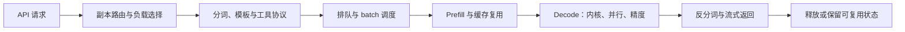

# 大模型推理全链路：服务质量、量化、编译搜索与 Agent 缓存

## ⚡ 速览

- 同名模型，也可能产生不同质量的 token。
- 推理优化要兼顾速度、质量和真实流量。
- KV 缓存复用计算，不负责长期知识治理。

## 1. 阅读范围与核心问题

这期 YC Paper Club 长约 110 分钟，四位讲者分别从生产服务、开放模型质量、编译器和 Agent 内存管理讨论推理。Y Combinator 原视频发布于 **2026 年 10 月 24 日**，描述中有六章；B 站转载来自 KrillinAI俊希。本文使用 B 站英文原声完整转写，时间戳以 1:50:49 的转载版本为准，原视频时长为 1:50:48。[S1、S2]

贯穿全场的问题是：**怎样让一个请求在既定成本与延迟下，稳定产生满足任务要求的结果？**`model.forward` 只是链路中的一部分。路由、排队、分词、工具协议、量化、内核、缓存和并行都会改变实际表现；一项局部优化也可能把问题转移到别的环节。

本文逐段重构主讲与现场问答，用 DeepSeek-V3、PagedAttention、SGLang 论文及官方仓库核验关键概念。讲者给出的未公开性能数据保留口播性质。没有编译、部署或运行这些框架，因此不能从本文推出当前设备上的可用性或实际收益。

## 内容地图：六章、四位讲者与问答

| 官方章起点 | 讲者与问题 | 本文落点 |
| --- | --- | --- |
| 00:00 | 推理为什么重要；12x 的计算；延迟与吞吐指标；DeepSeek 口播数据 | [§2 12x 的口径](#ratio)、[§3 性能指标](#metrics) |
| 08:24 | 模型、运行时、Harness 三类创新 | [§3 三层优化](#metrics) |
| 12:14 | Dan Fu：请求生命周期、内核、并行、量化；后半问答涉及校准与模型架构 | [§4 完整请求](#request)、[§5 量化与评价](#quantization) |
| 42:18 | Jeff Morgan：同名模型的服务差异、监测、透明度；问答涉及长 Context 和漂移 | [§6 服务质量](#fidelity) |
| 1:04:31 | Joe Fioti：primitive IR、等价改写、搜索与编译；问答涉及数值语义和搜索成本 | [§7 编译搜索](#compiler) |
| 1:30:30 | Liangsheng Yin：RadixAttention、CPU/GPU overlap、HiCache、混合架构、统一树与池、物理整理、RL rollout | [§8 缓存与调度](#cache)、[§9 混合状态](#hybrid) |

表中标题按原视频描述与对白概括。前三位讲者有现场问答，本文把影响主张边界的回答纳入各节。SGLang 在尾部连续讲解并收束节目，转写没有一段同样形式的独立问答，不补造问答内容。[S2、S12]

## 2. “推理比训练重要 12 倍”是怎样算出来的

### 2.1 主持人用的是 GPU 小时，结论是近似量级

主持人在开场引用 DeepSeek 的旧数据：训练 V3 约花费 280 万 H800 GPU 小时，服务约消耗每天 4.3 万 H800 GPU 小时。按一年 365 天计算，服务相当于一次训练的约 5.6 倍，口头约为 6 倍；再假设一份权重使用两年，得到约 11.2 倍，口头约为 12 倍。[S1，01:30–02:39]

`43,000 × 365 ÷ 2,800,000 ≈ 5.6`

`5.6 × 2 年 ≈ 11.2，取量级约为 12`

因此，标题表达的是持续服务的资源支出可能显著超过单次训练，促使研究与工程关注推理成本。它不是测得的智能价值比，也不是所有模型都成立的常数。

### 2.2 一手资料还能揭示两处不对称

DeepSeek-V3 技术报告写的是正式训练合计 **2.788M H800 GPU 小时**，包括预训练、Context 扩展与后训练，但不包括此前的研究和消融成本。[S3，摘要、表 1 与表后说明]

2025 年开源周 Day 6 的服务统计，覆盖 **2025 年 2 月 27 日 12 时至 2 月 28 日 12 时，UTC+8**。V3 与 R1 合计平均占用 226.75 个节点，每节点 8 张 H800，对应每天 43,536 GPU 小时。这与主持人的约 4.3 万一致，但它是 **V3/R1 合并服务**，分母却是 V3 的正式训练。[S4]

进一步还要注意，主持人使用 FLOPs 一词，但输入数字是 GPU 小时。两种工作负载的利用率、精度和硬件瓶颈不同，相同 GPU 小时不等于相同已执行 FLOPs。两年权重寿命也是假设，没有由该统计证明。

较可靠的读法是：**持续服务值得单独优化，精确比例要按模型、时期和工作负载重新测量。**不能把“12x”转成通用的训练与推理预算分配规则。

### 2.3 新旧 DeepSeek 指标不能混在一起

开场又口头转述一组“新数据”，包括约 60K 未命中缓存的 prefill token/s/GPU、约 96% 缓存命中、计入缓存后的约 1.5M 输入 token/s/GPU，以及首 token 与 decode 的指标。讲者没有在可读转写中给出绑定版本、实验条件和完整表格；他说的 “yesterday” 也不能直接根据视频发布日期推定具体日期。[S1，约 04:00–08:24]

本文没有获得对应新表的一手来源，**不使用这些数字评价当前 DeepSeek 服务或可部署性能**。它们被保留为口播核验缺口。

尤其不能把它们与 Day 6 的 **73.7K 输入 / 14.8K 输出 token/s/每 H800 节点**混算。后者输入吞吐包含缓存命中，而且单位是节点，不是 GPU；其缓存命中率也是旧统计的 56.3%，不是新口播的 96%。[S4]

## 3. 优化什么：延迟、吞吐、质量与三层技术

### 3.1 一个快数字不能回答全部问题

节目讨论了 TTFT、每 token 延迟、吞吐以及算力和带宽利用率。[S1，00:00–08:24] 可以把它们放回用户体验中理解：

| 指标 | 表示什么 | 常见误读 |
| --- | --- | --- |
| TTFT | 从发请求到看到首 token 的时间 | 只当 prefill 时间，忽略排队、分词和网络 |
| TPOT | 后续每个输出 token 的时间 | 用平均值掩盖停顿、长尾和流式缓冲 |
| Throughput | 单位时间处理多少请求或 token | 用大 batch 高吞吐代表单用户响应更快 |
| Goodput | 在质量与服务目标内完成的有效吞吐 | 把超时、失败和质量不合格输出也计作收益 |
| MFU / MBU | 算力 / 内存带宽的利用情况 | 把硬件利用率当业务任务正确率 |

这张表是基于节目指标的解释，不是本期给出的服务测量表。TTFT 低、总吞吐高和端到端结果正确，可能需要不同的优化；goodput 的具体约束也应由实际服务目标定义。[推测]

### 3.2 Prefill 与 decode 的瓶颈不同

Prefill 处理输入前缀，生成后续计算要用的状态；decode 逐步生成后续 token，并读取模型与缓存。前者通常有较多可并行计算，后者受串行依赖、内存读写与 batch 条件影响。随着负载、模型结构和硬件变化，瓶颈也会变化，不能绝对化为“prefill 永远只受算力限制，decode 永远只受带宽限制”。[S1，开场与 Dan 主讲；S6，§2]

**算术强度（arithmetic intensity）**把这个区别说得更具体：每搬运一字节数据，完成多少次浮点运算，单位为 FLOPs/byte。主持人用“从 DRAM 搬四字节到 SRAM 后，能做多少计算”来解释。相同权重若能服务更多 token，或者搬入的数据被多次复用，就可能提高算术强度；若每做少量计算就要重新搬大量数据，计算单元再快也容易等内存。[S1，06:53–08:32；概念解释]

主持人以 RNN、图像 diffusion 的迭代计算作高复用例子，与他描述的 LLM 低算术强度负载对比，并把 diffusion LLM 作为可能改变计算形态的方向。这是口播的负载类比，不是“所有 RNN/diffusion 都高、所有 LLM 都低”的定律。实际结果取决于矩阵形状、batch、内存驻留、精度和硬件；大批量 prefill 与小批量逐 token decode，即使使用同一模型，也不能按相同瓶颈处理。[S1；后两句为分析]

Roofline 可以用一个上界表达这种约束：`可达计算吞吐 ≤ min（峰值算力，内存带宽 × 算术强度）`。它帮助判断该优先减少数据搬运，还是优化计算；Joe 还用它剪掉明显不合算的编译候选。但这是某个计算区域、某层内存下的上界，没有计入完整网络、排队和调度成本，不会自动给出分布式请求链路的最优解。[S1，08:16–08:32、Joe 主讲与问答；分析]

### 3.3 三类优化作用于不同层

| 层 | 节目列举的方向 | 要回答的质量问题 |
| --- | --- | --- |
| 模型 | MoE、SSM、MLA、量化、蒸馏 | 是否仍满足任务能力与数值要求 |
| 内核与运行时 | attention 内核、PagedAttention、RadixAttention、调度与并行 | 计算和状态管理是否正确，瓶颈是否转移 |
| Harness | 路由、推测解码、按需取 Context、对话压缩 | 是否保留必要信息，验证与协议是否一致 |

这是主持人的分类骨架。[S1，08:24–12:14] 需要修正两点：MLA 是 **Multi-head Latent Attention**，DeepSeek 论文描述的是 attention keys/values 的低秩联合压缩，不能简单称为“压缩整个序列”。PagedAttention 管理分页访问与内存，RadixAttention 管理前缀复用，二者可以共存；SGLang 原论文明确写了兼容性。[S3，§2.1.1；S5，§3；S6，§4]

Harness 里的对话压缩也不同于后半讲的物理内存整理。前者可能删改模型能见到的信息，后者可以只搬移物理页并保持逻辑状态。这一点在 §9 继续展开。

## 4. Dan Fu：一个请求从 API 到 GPU，再返回用户

### 4.1 完整链路解释了为何模型相同也会有差异

Dan 从生产服务视角拆解请求：[S1，16:12–21:56]

网络层先决定请求何时进入系统；router 决定它落在哪个副本；相同前缀落到已有缓存的副本，可能省掉工作；分词和模板决定模型实际看到什么；队列和 batch 决定它与哪些请求一起执行；最后才是 GPU 运算与返回协议。

这解释了两种常见现象。第一，模型自身推理很快，请求仍可能因排队慢。第二，权重没改，工具格式、精度或解析器变化也能让任务失败。实际 token 是完整系统的产物。[推测；由上述链路推得]

Cache-aware routing 还需要兼顾负载。总把同类请求送到一个副本，可能有很高命中却造成热点；为了均衡流量分散请求，又可能重复缓存。不能只优化命中率而忽略等待时间。[推测]

### 4.2 内核优化需要真实模型、形状和硬件

Dan 先列出六个杠杆：kernels、prefill/decode 分离、parallelism、routing、speculative decoding、quantization，随后因时间限制重点讲内核、并行和量化。推测解码由较小模型提出候选，再交给大模型验证；候选生成和验证仍有成本，不能把口播“免费 token”按字面理解。[S1，21:52–23:47；后一句为分析]

Dan 讨论称为 Together Compiler 的内部优化循环：结合模型、真实流量与硬件，用 Agent 尝试优化内核、评价结果并迭代。名字和产品形态还可能变化，不应据此写成已公开发布的完整编译器。[S1，21:56–26:14]

这类循环的关键是评价环境。一个矩阵形状变快，不说明真实流量的所有形状变快；一个 kernel 跑通，也不说明长链路数值和工具行为保持一致。编译搜索、质量检查、性能反馈需要接在一起。[推测]

节目把它联系到初步的自动改进方向。它仍是有目标、预算、工具与验收约束的优化，不是无限自我提升的证据。

### 4.3 并行同时改变性能和故障影响范围

Dan 区分 TP、PP、DP、EP，并讨论较大快速互连域使 MoE experts 获得更大 batch 的机会。[S1，约 25:00–30:00]

| 方式 | 分什么 | 主要权衡，按节目解释 |
| --- | --- | --- |
| TP | 同层张量计算 | 通信与单请求延迟，依赖互连 |
| PP | 模型层或阶段 | 显存分担与流水线空隙 |
| DP | 服务副本或请求 | 扩容量与副本之间的负载、缓存分配 |
| EP | MoE 专家 | 稀疏计算收益与 dispatch、combine、专家负载 |

EP 的收益机制也回到算术强度。Dan 描述，把专家分别放到 GPU 上，并为同一专家聚合大量 token，会使专家计算重新成为 GPU 擅长的大矩阵乘：同一组专家权重被更大的 token batch 使用，搬运成本得到摊销。较大的快速互连域帮助跨卡分发与聚合，但不能保证专家负载均衡；通信、热点和实际矩阵形状仍会影响收益。[S1，28:18–28:49；最后一句为分析]

他以 72 GPU 的快速域举例说明并行机会，也提醒一个设备故障可能影响整个 replica。这个数量是台上讨论的系统例子，不是部署推荐。[S1]

[推测] 扩大并行域之后，应同时测量正常负载与故障恢复：单卡失效影响多少请求，恢复期间会不会重复执行，热点专家是否拖慢全部请求。局部带宽收益可能被更大的故障影响范围抵消。

## 5. Dan 的另一条主线：量化要保持行为，而不只缩小权重

### 5.1 精度变化可能先在 Agent 工具上显现

Dan 讨论 BF16、FP8 和更低精度，强调真实应用质量不能只看权重占用。他用 Flappy Bird 等 Agent 场景说明：基础知识问答分数相近，工具调用和多步执行仍可能出现差异。[S1，约 30:00–36:00]

评价因此包含几类信号：公共 benchmark、参考输出或 activation 的分布差异、工具与 Agent 循环、真实使用中的失败回灌。它们发现的问题不同。分布接近不保证任务正确；任务偶尔成功，也不能证明所有数值路径一致。[S1；后两句为分析]

### 5.2 MiniMax NVFP4 案例不能还原成未公开配方

讲者说团队帮助 MiniMax 的模型采用 NVFP4，并认为 serving 与 kernel 层的收益值得研究。口播和可读转写没有提供完整对照表、模型版本及精确量化 recipe。[S1，32:51–约 37:00]

现场问答给出一个重要限定：其方法是 **training-free**，结合校准数据、Scale Search 等方式；Dan 表示通常不自己再训练模型，原因之一是可能造成遗忘。[S1，39:25–40:04]

本文只保留他对方法的说明，没有读取对应 Scale Search 论文，也没有复现量化，因而不声称证明该 recipe 的普遍质量保持。不能凭口播自行补出校准集、位宽分配或性能数值。

### 5.3 架构创新与 serving 优化互相约束

后半问答讨论稀疏、状态空间、diffusion、推测生成与 looped 模型等方向。[S1，Dan 主讲尾段与问答] 它说明模型设计会改变推理负载：有的减少状态，有的改变输出依赖，有的要配合专门内核和调度。

其中关于闭源模型内部结构的猜测，没有公开证据，本文不把它写成已知架构。比较方案也不能只看理想 FLOPs，需要看质量、硬件支持、可并行性、真实 batch 和维护成本。[推测]

## 6. Jeff Morgan：同名开放模型为什么不一定同样可靠

### 6.1 权重之外还有多项“模型身份”

Jeff 的主张是，同一个开放模型名不保证每个服务端点提供相同表现。权重版本、量化方式、KV 精度、sampling、tokenizer、chat template、工具格式和解析器、kernel 与硬件都会影响结果。长 Context 更容易放大差异。[S1，42:18–约 50:00]

他还转述服务商间最差与最好端点的差距可能大于开放与闭源模型的差距。本文未定位到他所引研究的完整样本和版本，**不把这个比较当成普遍事实**。它更适合作为选型提醒：公开模型的名字和排行榜不够，需要检查具体端点。[S1，口播转述]

一个多步 Agent 对微小错误更敏感。讲者给出类似的概率思想实验：若每步独立且有 10% 错误率，15 步至少一次出错的概率为 `1 − 0.9^15 ≈ 79.4%`。这说明复合风险，不是实际 Agent 失败率；真实步骤可能相关，也可能有重试、纠错与人工接管。[S1；独立计算与条件说明]

### 6.2 五类监测各有代价和盲区

Jeff 列出了从完整评价到轻量监测的方式。[S1，约 50:00–57:00]

| 方式 | 能发现什么 | 不能单独证明什么 |
| --- | --- | --- |
| 完整任务与 Agent eval | 端到端能力变化 | 成本较高；任务集之外仍可能漏检 |
| 专用 vendor verifier | 特定模型的工具行为、schema 等差异 | 某模型检查器不自动覆盖别的模型或业务 |
| 与参考模型比较分布 | 定位明显偏离的输入范围 | 需要 reference；偏离来源可能不唯一 |
| logprobs 漂移 | 同端点相对基线是否变化 | 基线本来就错时，也能稳定；接口未必提供 |
| 请求与输出元数据 | 工具错误、异常长度、重复、截断等 | 看起来正常不等于语义正确 |

转写的 “log probes” 在上下文中指未来 token 的概率分布，本报告修为 **logprobs**。这是一项基于语义的术语修正，不假称 ASR 原文没有错误。

Moonshot 的 K2-Vendor-Verifier 官方 README 确实区分 tool-call trigger 与 schema accuracy，并描述历史工具 ID 规范和服务解析差异。[S10，官方补充] 本文只借它核验“专用工具行为检查器”这一机制，没有用 2025 年结果评价 2026 年服务商，更没有把它当作 Kimi K3 或 GLM 5.3 的现成通用验收器。

### 6.3 工具格式错误可能发生在模型之外

Verifier 资料说明，即使模型权重合理，历史 tool call ID 与预期格式不一致，也可能影响生成或解析。Jeff 则讨论把工具 parser 等逻辑更多放进 Harness，以及公开真实 serving stack 和采用可追溯量化版本。[S10；S1，约 55:00–1:04:31]

[推测] 遇到工具调用下降时，排查顺序应覆盖输入模板、输出协议、服务精度与执行器，不能马上归咎于模型能力。端点可以输出语法正确的 JSON，却调用了错误工具；也可以产生合理意图，却被解析器错误处理。格式正确率和任务正确率需要分别记录。

### 6.4 私有 holdout、长 Context 与服务透明度

Jeff 提倡客户使用自己的 holdout 任务，避免服务只对公共 benchmark 适配。问答又强调长提示下的分布偏移、上下文上限以及监测端点变化。[S1，约 57:00–1:04:31]

他提到 TEE attestation 等透明度方向。[推测] 远程证明能够帮助确认所声明运行环境或版本的身份，仍不能证明输出事实正确、模型满足业务能力，或每项优化均无质量损失。需要了解证明到底覆盖哪些代码、配置与权重，而不能只看到“有 TEE”就停止评价。

本地模型也有相同的版本、模板和 kernel 问题；云端与本地混合路由不会消除它们。对报告工作而言，来源选择、模型服务和独立复核都要有自己的记录，不能只留下一个模型名。[推测]

## 7. Joe Fioti：用搜索选择实现方式的编译器

### 7.1 少量 primitive 能减少组合复杂度

Joe 讨论 Luminal 的思路：把模型表达成约 15 个基础操作，再寻找适合硬件的实现。这样不必为每一种模型、硬件和精度组合分别维护全部手工规则。[S1，1:04:31–约 1:10:00；S9，公开 README]

以矩阵乘法为例，概念上可以拆成广播、逐元素乘法和归约：`C[i,j] = Σk A[i,k] × B[k,j]`。这个表示是为了把语义拆成少量基本形式，**不意味着执行时真的要生成庞大的广播中间张量**。最终是否融合、分块或调用库，由后续编译方案决定。[S1；说明性解释]

缩小表达语言能使搜索和改写更容易组合，但不能直接解决全部算子语义、动态形状或硬件支持。公开 README 还把匹配常用约 80% PyTorch API 写作目标，部分硬件后端在路线图上；不能将台上关于更广能力的描述，当成开源仓已完整实现全部 PyTorch 和所有 ASIC 后端。[S9]

### 7.2 E-graph 保留等价选择，再挑一个执行

Joe 介绍 equality saturation、egglog 与 e-graph：把可等价改写的表示保留在图里，再抽取候选实现。它允许编译器暂时保留多种路线，避免过早选定一个局部形式后错过更好的整体方案。[S1，约 1:10:00–1:18:00]

可以把过程理解为：同一道菜有几种做法，先保留可选步骤，再根据厨房设备、份量和实际耗时选择。对应到模型，就是先保留合法的变换，再考虑内存、线程、算子融合与库调用。

这里的“等价”有前提。像 `a × 2 ÷ 2 = a` 这种解释性例子，在实数算术里容易成立；在浮点环境中，溢出、舍入、非有限值与归约顺序会影响结果。**规则能证明什么，取决于规则采用的语义。**[分析；Joe 在现场问答承认数值精度可能影响后续 token]

因此，改写的证明记录有助于定位错误规则，不能代替数值检查和端到端模型评价。一次 forward 中很小的变化，也可能在后续生成中改变 token 选择。[S1，约 1:22:00–1:30:30]

### 7.3 多层 IR 可以组合，megakernel 只是一个选项

讲者区分不同执行层：CPU 或已有库调用、GPU threadblock 级实现，以及 megakernel；提到 cuBLAS、CUTLASS 和 ThunderKittens 等构建路径。编译器可以在不同层上组合候选，而不是要求所有模型统一变成一个大 kernel。[S1，Joe 主讲中段]

[推测] 融合可能减少启动和中间内存开销，却也可能增加寄存器压力、限制占用率，或丢失成熟库对某类矩阵的优化。比较要落到具体模型形状和硬件上，不能用“更大融合”作为固定偏好。

### 7.4 搜索需要预算和真实计时

Joe 讨论用 roofline 估计剪掉较差候选，再通过搜索、包括 genetic search 与硬件计时推进。它不是穷举所有可能实现，也不保证找到全局最优。[S1，约 1:18:00–1:25:00]

问答进一步解释了为何限制 IR 的表达范围有帮助：Joe 面向稠密线性代数程序，而非任意通用程序，因而能对候选在不同内存空间之间的字节搬运作解析估计，再用 roofline 提前剪枝。“非图灵完备”是他对搜索语言的描述，不等于所有性能和正确性问题都可自动证明；这里可核验的论点是，缩小语义范围使特定分析更可行。[S1，1:27:21–1:28:58；后一句为分析]

编译成本要靠后续重复执行摊销。可以用一个简单条件表达：

`后续执行次数 × 每次节省时间 > 额外编译与搜索时间`

这是 `[推测]` 的收益判断，尚未代入实测值。模型稳定、重复服务较多时，更可能值得搜索；短任务、形状频繁变化或模型经常更新时，编译成本可能更突出。

问答里有关于很短 forward 与一秒内尝试大量候选的口播，缺少完整并行和计时口径，本文不将其作为确定性能结论。“达到接近最优”也只能保留为目标，不能写成已经对全部候选证明了最优性。

### 7.5 Forward 编译器与推理服务框架的边界

Joe 在问答说明，Luminal 主要优化 forward，推测解码等服务逻辑仍可交给 vLLM、SGLang 等系统。[S1，Joe 问答] 这是一个容易被遗漏的边界：编译器优化模型执行，不自动拥有请求路由、batch、缓存治理、工具协议或完整 Agent 调度。

公开 README 描述与 PyTorch 的正确性对照，也承认仍需改进。[S9] 本次没有运行这些对照，不能把项目自己的正确性流程写成本文复现结果。

## 8. Liangsheng Yin：前缀复用、调度与分层缓存

### 8.1 RadixAttention 不只是“缓存一段提示”

Liangsheng 用 RadixAttention 说明，多次 Agent 调用常共享 system prompt、历史对话或相同任务前缀。若模型、位置与其他计算条件兼容，相同前缀的 KV 状态可复用，减少重复 prefill。[S1，1:30:30 后；S5，§3]

他回顾 SGLang 起初面向需要多次生成和控制流的 language model programs。程序产生共享前缀，前端和 runtime 因而需要协同；原论文也区分前端语言与运行时，并说明前端提示怎样帮助缓存插入和调度。这一动机解释了前缀复用为什么成为核心机制，而非后来随意加上的普通文档缓存。[S1；S5，摘要与 §3]

SGLang 原论文把 token 序列与 KV tensor 的映射组织在 radix tree 中，支持前缀匹配、插入与淘汰；树元数据放在 CPU，tensor 使用分页非连续布局。LRU 优先淘汰不再被运行请求引用的叶子，尽量保留共享祖先。这里描述的是论文设计，不能把该论文的具体 page 大小直接当作所有当前后端的固定配置。[S5]

论文明确 RadixAttention 可以与 paged attention、continuous batching 和 tensor parallelism 结合。这解释了为什么“分页”和“前缀树”不该被当成两个互斥的产品选项：一个管理状态在哪些页上，另一个管理哪些 token 前缀能复用。[S5、S6]

### 8.2 调度可以改善命中，也可能改变公平性

讲者举出不同前缀的请求反复切换造成缓存淘汰的情况。SGLang 原论文的 cache-aware scheduling 在特定批处理设置中优先处理匹配前缀较长的请求；它也明确区分批处理与对延迟敏感的场景。[S1；S5，§3]

[推测] 把 A 类请求集中处理，再处理 B 类，可能少做重复计算；但新来的 C 类请求也可能等得更久。评价调度应同时看命中率、TTFT、长尾和公平性，不能只按命中率选择策略。

### 8.3 CPU/GPU overlap 消除的是等待空隙

Liangsheng 讨论 CPU 准备下一批工作与 GPU 执行当前工作重叠，并通过减少不必要的 device-host 同步降低空隙。这与前缀缓存不同：即使计算量相同，等待减少也可能提高吞吐。[S1，1:35:59–1:40:02]

台上提到 Hopper 约 1.1 倍、某些 Blackwell 配置可到约 2 倍。这些都是带硬件和条件依赖的口播结果，没有在本次获得完整实验配置，不作为普遍收益。[S1]

### 8.4 HiCache 把“缓存还在不在”扩展到 GPU 之外

Agent 两轮调用可能相隔几分钟甚至几天，GPU 不适合一直保存全部历史状态。HiCache 使用多层存储：L1 GPU，L2 主机内存，L3 存储后端。官方设计文档说明 L1/L2 在每个推理实例本地，L3 可以支持跨实例共享。[S7，官方设计；S1，约 1:36:00–1:39:00]

这不是让远端缓存零成本变成 GPU 缓存。需要处理查找、预取、写回、数据布局、传输和不同并行 rank 的协调。文档提供 best_effort、wait_complete、timeout 等等待策略，反映“等缓存回来”与“直接计算”的权衡。[S7]

台上提到首 token 延迟降低约 56%，但没有给出完整负载与比较条件，本文只登记口播，不当作当前部署预期。[S1]

顺带需要纠正官方文档中的一处术语误展开：所读 HiCache 页面把 MLA 展开成 Multi-Layer Attention；本报告以 DeepSeek 原论文为准，写为 **Multi-head Latent Attention**。[S7、S3]

### 8.5 Prefill/decode 分离也要计算传输成本

官方 SGLang 文档讨论 prefill/decode disaggregation，借 Mooncake 或 NIXL 等方式转移 KV，减少两类阶段互相干扰。[S8，官方补充] DeepSeek 2025 年 Day 6 也说明其采用分离架构，并针对两阶段安排不同并行与重叠方式。[S4]

[推测] 分离可以改善大规模服务，但需要通信、缓存兼容性和调度。负载小、硬件资源少时，额外传输与进程复杂度未必划算。文档中的单机、多机示例证明有设计路径，不证明任何现有个人环境都应采用。

## 9. 混合架构：最长 token 前缀未必是可复用的完整状态

### 9.1 三种状态有不同保留规则

Liangsheng 后半段讨论 hybrid 模型中的 full attention、sliding-window attention 和 recurrent state。若只按 full attention 的方式设计缓存，可能错判另外两种状态仍然可用。[S1，约 1:39:00–1:45:12]

| 组件 | 需要保留的状态 | 前缀复用时的检查 |
| --- | --- | --- |
| Full attention | 前缀对应的历史 KV | 所需历史状态是否仍在、模型与位置是否兼容 |
| Sliding window | 最近窗口内的 KV | 复用位置所需窗口是否完整，而非只看累计 token 数 |
| Recurrent component | 某个位置的递归状态或 checkpoint | 是否有可继续计算的正确 checkpoint |

以保留四个历史位置、复用到位置 10 的解释性例子来说，需要的是该位置对应的窗口 7–10 和可继续的递归状态；完整前缀 token 曾经进入树，并不证明这些数据后来仍保留。具体窗口边界要以模型实现为准。[S1；概念说明]

这就是为何“匹配最长文本前缀”与“匹配最长可安全复用状态”不同。若一个组件的状态已被淘汰，其他组件匹配成功也不够，系统需要选择正确的共同恢复点或重新计算。[分析]

### 9.2 统一树是协调规则，不是统一所有数据结构

讲者提出 Unified Radix Tree：用完整 token 的语义索引协调各组件，组件仍有自己的匹配、淘汰和内存规则。树负责使这些规则在整体复用与释放时一致，减少角落条件里的泄漏或浪费。[S1，1:43:41–1:45:12]

**“统一”不表示所有组件存同一种 tensor，或都采用同样的淘汰方式。**它更接近共同的协调层。[分析]

本次主要依据现场讲解理解统一树；没有完成与讲者当日版本绑定的源码追踪，不能把这部分写成已复现实现结论。公开 HiCache 文档支持分层缓存机制，但不能自动替代统一树细节的源码证据。

### 9.3 统一内存池缓解固定配比的浪费

讲者随后讨论 Unified Memory Pool。旧方式为不同状态预先按固定比例分配容量；不同任务需要的 full/window/recurrent 比例不同，某一池不够而另一池空闲时会浪费资源。统一池试图在负载变化时动态调整分配。[S1，1:45:12–约 1:48:00]

[推测] 动态分配值得评价的是有效容量、重新分配开销与长尾，而非只看总空闲显存。三种状态的生命周期不同，还需检查锁定、引用和释放是否一致。内存利用率更高不能抵消错误复用造成的质量问题。

### 9.4 物理内存整理不是总结对话

末段的 memory compaction 讨论物理页与碎片：搬移仍有效的数据，更新映射，并保持上层虚拟 ID 或逻辑状态稳定。这属于存储管理。[S1，约 1:48:00–1:50:45]

开场 Harness 的 compaction 则可能把对话重新总结或裁剪，改变模型能看到的信息。两者名称相近，风险却不同：

| 整理类型 | 是否改变语义信息 | 应检查什么 |
| --- | --- | --- |
| 物理缓存/内存整理 | 设计目标是保持逻辑状态，仅改变存放位置 | 映射、引用、同步、数值状态与性能 |
| 对话/Context 压缩 | 可能删除、重写或合并信息 | 来源、约束、关键细节与任务质量是否保留 |

这也解释了为什么不能把“显存 compaction 成功”作为“Personal Context 没丢知识”的证据。

### 9.5 从 95% 到 99%：五倍的是哪一部分

讲者说明高缓存命中率仍值得追求。若统计口径和负载一致，命中率从 95% 提高到 99%，未命中比例从 5% 变成 1%；在未命中 prefill 成本近似相同的条件下，这一部分计算量可以降到原来的五分之一。[S1；条件化计算]

**总成本和总延迟不能直接说改善五倍。**Decode、网络、缓存搬移、排队和其他组件仍消耗资源；某些请求的命中长度也可能不同。需要分别记录命中 token、传输、剩余 prefill 和整项请求时间。[推测]

### 9.6 推理也进入后训练循环

结尾提到 Miles/slime 与 RL rollout：训练过程要生成大量轨迹，因此 serving 能力也影响后训练的效率与一致性。[S1，末段] Miles 官方 README 明确它从 slime fork 并协同演进，结合 SGLang 负责高吞吐 rollout 与训练后端。[S11]

本文只核验名称、关系与角色，不复现其训练吞吐。Rollout 输出的 token、模板与数值行为要与训练环节相容，这是比“生成更快”多一层的质量约束。[推测]

## 10. 四位讲者的结论怎样连接

四段内容分别回答了完整链路中的不同问题：

| 视角 | 优先解决什么 | 单靠这一层仍解决不了什么 |
| --- | --- | --- |
| Together AI | 真实流量上的内核、并行与精度 | 用户任务和全部服务端点的可信评价 |
| Ollama | 同名开放模型的实际质量与可观测差异 | 直接给出所有内核、编译和缓存的最优实现 |
| Luminal | 从少量语义表示搜索执行方案 | 路由、batch、工具协议与完整 Agent 服务 |
| SGLang / RadixArk | 状态复用、调度与不同架构的内存管理 | 事实来源、权限和长期知识的治理 |

据此可以得到几条条件化判断：[推测]

- 内核更快，只有没有引入质量退化、并且该内核确实处于瓶颈上，才会改善任务表现。
- 命中率更高，只有省下的计算超过新增查找、传输和等待，才会改善端到端成本或延迟。
- 更便宜的量化端点，只有它在实际工具和长 Context 任务中仍合格，才是可替代方案。
- 更强的模型，若被错误模板、截断、差的服务精度或不完整 Context 包围，也可能交付较差结果。
- 编译、缓存与路由共同升级时，需要保留可回溯的配置与分别评价，否则难以归因。

这些判断不承诺任一具体方案胜出；它们规定了评价应该看哪些结果。

## 11. KV 缓存与 Personal Context 的关系

[[kv_cache]] 保存模型推理中的中间状态，减少重复计算。它依赖兼容的模型、token 序列、位置与执行配置；缓存失效后，可以从输入重新计算。Personal Context 则组织可以长期使用的知识、来源、规则、反馈与权限。[S3、S5、S7；后半为本报告分析]

| 维度 | KV / 推理状态缓存 | Personal Context / Memory |
| --- | --- | --- |
| 主要内容 | 模型相关 tensor 与计算状态 | 事实、来源、偏好、规则和经验 |
| 主要收益 | 减少 prefill 与状态计算 | 给任务提供合适而可信的信息 |
| 更正方式 | 按兼容性失效并重新计算 | 回到 owner，更正来源并更新索引 |
| 删除问题 | 缓存页、层级与副本是否释放 | 信息是否应保留、有谁可访问、派生资料是否更新 |
| 评价依据 | 延迟、命中、传输、数值一致性 | 任务质量、可追溯性、信息缺失与权限正确性 |

这不是说两者无关。稳定且真正需要的前缀可能提高缓存复用，好的 Context 选择也可能降低输入量。但**不能为了命中率，把所有任务都不需要的材料变成常驻提示**。那可能节省部分 prefill，却增加检索噪声、模型注意负担、容量与维护成本。[推测]

主持人口播中的 72 小时缓存保留，也不能拿来规定记忆应保存多久；缓存 TTL 与知识保留、删除及访问策略需要分别设计。相关入口：[Personal Context 正交论](../../ai-learning/reports/knowledge_reports/PersonalContext正交论_PC构建指南_20261010.md)。

## 关键数字：逐项保留口径

| 数字 | 来源与性质 | 本文使用范围 |
| --- | --- | --- |
| 2.8M、43K GPU 小时/日 | 开场转述旧 DeepSeek 数据 | 重构主持人算式，非当前服务测量 |
| 2.788M H800 GPU 小时 | DeepSeek-V3 论文正式训练，含扩展和后训练、不含此前研究 | 核验训练分母与范围 |
| 43,536 H800 GPU 小时/日 | 2025-02-27 12 时至 02-28 12 时，V3/R1 合并服务 | 核验旧服务分子，注明模型范围不对称 |
| 约 5.6 / 11.2 倍 | 按主持人取整数据计算一年 / 假设两年 | 不称为 FLOPs 实测比或智能价值比 |
| 73.7K / 14.8K token/s/节点 | 2025 Day 6 输入含缓存 / 输出，每节点 8 张 H800 | 不当作 per-GPU 新数据 |
| 56.3% | 2025 Day 6 输入 token 的磁盘 KV 命中 | 不与新口播 96% 混用 |
| 60K、96%、1.5M、14K | 主持人转述新 prefill/cache/含 cache 输入/decode，每 GPU 口径 | 未核到对应新表，列缺口，不作性能基准 |
| 约 400ms、P99 约 1s、72h | 同组新数据中的 TTFT 与缓存保留口播 | 版本、负载、保留政策待验证 |
| 72 GPU | Dan 的大快速域并行例子 | 非本报告部署建议 |
| 10%、15 步、79.4% | Jeff 的独立错误思想实验及计算 | 有独立性与无恢复假设，不作真实失败率 |
| 约 15 个 primitive | Joe 讲解与 Luminal README | 描述 IR 设计，不等于完整 PyTorch 兼容 |
| 约 80% PyTorch API | Luminal 公开 README 的支持目标 | 不说公开仓已经完整支持全部 API |
| 约 1.1× / 特定配置约 2×、TTFT 降低约 56% | Liangsheng 的 overlap / HiCache 口播 | 缺完整实验配置，非普遍收益 |
| 95% → 99%，未命中 5% → 1% | 讲者示例与条件化计算 | 未命中部分可降五倍，不等于总成本五倍 |

545% 的旧“cost profit margin”来自 Day 6 假设全部 token 按 R1 价格计费的理论收入；原文明确实际收入更低。它不是标准毛利率，本文不用它证明当前服务利润。新数据中的其他利润口播同样没有作为财务基准。[S4；S1]

## 12. 对日常报告与双仓工作的参照

以下是 `[推测]`，只提出本轮学习所得的评价与架构参照。

### 12.1 先找真实瓶颈，再决定改哪一层

报告任务可能慢在抓取和转写、检索大量材料、模型思考、重复生成、复核或工具故障。记录每个阶段的时间、失败与等待，再决定是否调整 Context、模型、并发或 serving。单个 token/s 数字不说明整个学习任务有多快。

公开仓保留报告、公开证据和评估方法；具体运行环境、账号、服务端点和敏感材料由私有 owner 管理。公开参照不需要暴露这些细节。

### 12.2 模型与 Harness 变更要检查任务质量

先保留一小组实际任务与来源，包含长文、工具调用、长 Context 和曾经失败的样本。比较关键事实错误、来源遗漏、工具格式错误、截断、人工修订与总耗时。来源优先复核尤其重要，因为完整语法和高分摘要都可能漏掉整位讲者。

logprobs、vendor verifier 和服务版本是辅助证据；完整任务评价仍需要真实结果。没有适合当前模型的 verifier 时，不能借别的模型检测通过来替代。

### 12.3 Context 结构与缓存策略分别负责

长期知识先有唯一 owner、来源和最小检索入口；任务按需取材料。可复用的稳定提示再交给缓存机制。缓存不负责决定事实可信、不自动保留语义，也不能授予访问权限。

这一点可与 [GPT-6 Astra 指令架构报告](../../ai-learning/reports/knowledge_reports/GPT6_Astra指令架构_从Prompt堆叠到按需控制_深度解析_20261015.md) 对照：减少无关常驻 Context 的收益，要通过任务质量与成本验证，不能只追求缓存命中。

### 12.4 部署收益需要另一类证据

公开论文和文档提供设计理由，不能直接给出某台设备的部署结论。部署评估应另外核验模型支持、GPU 与内核兼容、显存、驱动、所需互连、维护成本和代表性负载。小规模任务也可能更适合成熟服务或已有工具。[推测]

本仓已有 [DeepInfer 深度报告](../../ai-learning/reports/knowledge_reports/DeepInfer_从模型协同设计到生产推理内核_深度解析_20261021.md)，可以作为继续核验模型与系统协同的入口。本次没有对该报告或实际部署进行重新实测。

[纳德拉访谈](2026-10-27_bilibili-nadella_enterprise-intelligence.md) 讨论企业知识与私有评价的价值；[Computer Use 访谈](2026-10-27_bilibili-openai_computer-use.md) 讨论实际执行与权限；本篇进一步说明推理服务如何改变 token 的质量和成本。三者可供下一轮重构分别选取问题与验证条件。

## Limitations

- 本期是多位工程实践者的讲解和现场问答，未展示所有完整图表。转写中的数字、图示口径和听众问题可能有误识别；已核关键概念，未核新性能数字不用于结论。
- “12x”混用了 GPU 小时与 FLOPs 的语言，分子是旧 V3/R1 合并服务、分母是 V3 正式训练，并假设两年寿命。只作为量级论证，不作普遍定律。
- 新 DeepSeek 数据对应的一手表未取得；转述中的 “yesterday” 没有被擅自换成视频发布日期前一天。
- Together Compiler 的优化循环、MiniMax NVFP4 recipe 与部分模型架构判断主要来自口播；没有公开完整配方或本次复现，Scale Search 仅记录讲者提及，没有假称论文精读。
- Jeff 转引的服务商最佳/最差与开闭模型差距比较，未定位到完整研究；不作一般性结论。K2 verifier 的历史结果不代表当前 K3/GLM 服务质量。
- Luminal 公开 README 与台上商业能力描述范围不同。数值语义、编译摊销、动态形状和公开支持目标仍需进一步验证。
- HiCache 官方设计可核验；Unified Radix Tree、Unified Memory Pool 与物理整理主要依据现场讲解，未完成同版本源码核验；性能口播不外推。
- 论文 HTML 已取得全文，但本文只精读支撑训练成本、MLA、Radix 与 Paged 机制的相关段落，不冒充逐章论文复现。typed reader 截断时采用无凭据、无 UI 的公开 HTTP 降级。
- 没有运行推理 benchmark、修改部署或证明双仓性能改善。实施与评估建议保持待验证。

## 思考与追问

1. **真正理解了什么？** 实际模型质量与速度由完整服务链路共同决定。优化内核、量化和缓存，要同时检查工具行为、数值、长 Context 与最终任务；KV 状态管理和长期知识治理承担不同职责。
2. **还没搞懂什么？** 怎样用较低成本持续发现 serving 漂移而不依赖每次完整 eval？量化误差在多轮工具调用中如何放大或被纠正？混合模型的统一树怎样定义每个组件的可复用点？缓存从 95% 到 99% 的收益在真实任务中有多少？
3. **下一步读什么或做什么？** 后续由任务维护者选一组固定报告任务，记录阶段耗时与来源覆盖，再判断瓶颈。源码研究优先追踪一种 hybrid 模型的匹配、引用和淘汰路径；本次不启动新部署或实验，等待单独安排。

## 来源与产物

- **S1**：[B 站转载](https://www.bilibili.com/video/BV1fGxK6UEF9)；[完整英文原声转写](transcripts/2026-10-27_bilibili-krillinai_llm-inference-stack.transcript.txt)，主讲与问答的主要定位依据。
- **S2**：[Y Combinator 原视频](https://www.youtube.com/watch?v=mHNKuH-9OxU)，读取日期、节目元数据和六章；网页长转写被截断，未作为完整对白依据。
- **S3**：[DeepSeek-V3 Technical Report](https://arxiv.org/html/2412.19437v1)，读取摘要、训练成本表及说明、MLA 相关段落。
- **S4**：[DeepSeek 2025 Day 6 推理系统原文](https://github.com/deepseek-ai/open-infra-index/blob/main/202502OpenSourceWeek/day_6_one_more_thing_deepseekV3R1_inference_system_overview.md)，读取全文，核验时期、节点/GPU 单位、并行和理论收入范围。
- **S5**：[SGLang 论文](https://arxiv.org/html/2312.07104v2)，读取 §3 的 RadixAttention、LRU 与 cache-aware scheduling，核验与 paged attention 的兼容性。
- **S6**：[PagedAttention / vLLM 论文](https://arxiv.org/html/2309.06180)，读取 KV cache 背景与 §4 的分页、共享及逻辑/物理 block 设计。
- **S7**：[SGLang HiCache 设计](https://docs.sglang.ai/advanced_features/hicache_design.html)，读取全文，核验分层、预取、写回与等待策略；MLA 误展开以 S3 修正。
- **S8**：[SGLang prefill/decode disaggregation](https://docs.sglang.ai/advanced_features/pd_disaggregation.html)，读取全文，核验角色分离与 KV 转移设计。
- **S9**：[Luminal 官方仓库](https://github.com/luminal-ai/luminal)，读取 README 的 primitive、支持目标、路线图与正确性说明；未拿 README 冒充源码复现。
- **S10**：[K2-Vendor-Verifier 官方仓库](https://github.com/MoonshotAI/K2-Vendor-Verifier)，读取 README 的 trigger/schema 指标、版本与工具 ID 说明，不采用旧榜单作当前比较。
- **S11**：[Miles 官方仓库](https://github.com/radixark/miles)，读取 README，核验与 slime 的关系和 SGLang rollout 角色。
- **S12**：[shownotes 与来源边界](transcripts/2026-10-27_bilibili-krillinai_llm-inference-stack.shownotes.md)；[中文结构化精编](transcripts/2026-10-27_bilibili-krillinai_llm-inference-stack.polished.txt)；[脱敏执行收据](transcripts/2026-10-27_bilibili-krillinai_llm-inference-stack.artifact-receipt.json)。

所有补充网页核验日期为 2026-10-27；历史数字保留原资料时期。

## 版权与引用

节目与论文资料著作权归各权利人。本文为学习分析，保留少量必要术语、事实定位与原创解释；完整节目请去原始平台。转写和精编仅供个人学习，如版权方要求下架，请通过仓库 Issue 联系。项目声明见 [COPYRIGHT.md](../COPYRIGHT.md)。
