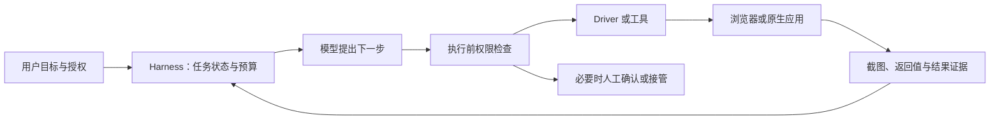

# OpenAI Computer Use：从跨应用操作到可验收的企业任务

## ⚡ 速览

- 会点界面，还需要懂流程和验结果。
- 权限要覆盖 UI、API 与原生应用路径。
- 速度与成本要按完成的任务衡量。

## 1. 来源与问题：电脑界面能成为通用接口吗

这期 The a16z Show 由 Seema Amble、Fabrizio Serafini 主持，嘉宾是 OpenAI 的 Ari Weinstein 与 James Sun。官方 RSS 的发布日期为 **2026 年 10 月 26 日 10:00 UTC**，时长 45:19；B 站转载发布于 10 月 27 日，时长 44:14。本文使用 B 站英文原声完整转写，所有对白时间戳均指该版本。两版时长不同，不把官方时间直接套在转载上。[S1、S2]

嘉宾讨论的 Computer Use，是 Agent 通过已有软件界面完成工作。企业有不少没有合适 API 的旧系统，UI 因而可能成为跨应用入口。但“能看见、点击、输入”和“能可靠处理一项业务”之间，还隔着流程知识、会话状态、权限、验证与故障处理。

本文先重构访谈四章，再用 OpenAI 官方文档及节目配套 a16z 研究检查其适用边界。**访谈中的能力判断和案例属于嘉宾自述，文档支持的是接口与控制设计，本次没有实测企业自动化效果。**

## 内容地图：四章与主要论证

| B 站章节起点 | 主要内容与细分定位 | 本文落点 |
| --- | --- | --- |
| 00:00 | 能力变化；01:00 后个人助手、旧 ERP、Dots 主动任务；08:07 后速度与信任 | [§2 能力与任务](#capability)、[§3 执行循环](#loop) |
| 10:43 | 企业控制与人机协作；WebMCP；模糊目标；17:21 后允许范围、确认与接管 | [§3 状态与接口](#loop)、[§4 权限](#permissions) |
| 20:22 | 采购、对账、销售、竞品体验；个性化软件与旧系统；共享 Context | [§5 案例与验证](#cases)、[§6 软件和协作](#product) |
| 32:38 | 创业建议；餐厅流程；本地与云；37:30 后实时多模态与会话割裂；40:56 后 Atlas 和普及 | [§6 协作与产品](#product)、[§7 速度、成本与局限](#evaluation) |

章节标题为中文概括，时间起点来自 B 站章节。内容细分由转写定位。[S1、S3]

## 2. 能力进步改变交互方式，不能代替可靠性测量

### 2.1 速度改善为什么会影响产品

嘉宾认为 Astra 的响应与执行速度、较少的思考 token 消耗，以及在 Paint 等软件中的表现，使 Computer Use 更接近可常用的产品。他们谈到接近专家、比普通人更快等经验判断，也用 97% 与 99% 的说法说明可靠性改善带来的体验变化。[S1，00:51–08:07]

**这些百分比没有对应任务集、样本量和测量方法，不能写成正式成功率。**“更快”也没有给出统一基准：是某个动作快、一次模型决策快，还是从目标开始到最终业务验收快，节目没有系统区分。

速度确实会改变协作方式。Agent 很慢时，用户容易停在原地等它完成；快到用户看不清每一步时，逐点击监督又会失效。产品因此需要让人看懂当前目标、已做动作、剩余步骤和何时可以接手，而不能只把鼠标移动得更快。[推测；据 S1，08:07–11:24]

### 2.2 旧系统是机会，也是边界

嘉宾区分了两条发展路线：消费产品用更快、更好的模型探索新交互；企业已有不少明显的自动化需求，更关心怎样把能力接进旧流程并可信地使用。消费端推动体验前沿，企业端推进理解、集成与部署，是这段访谈的对比；它没有给出两类市场的统一收益排序。[S1，03:24–04:38]

节目谈到运行了 15–20 年、缺少 API 或 MCP 的 ERP。Computer Use 可以通过原来的页面操作，Skill 则教 Agent 哪个入口对应哪个业务步骤。这个思路降低了“先给所有系统开发专用集成”的要求。[S1，约 04:00–06:00]

不过，Skill 中的流程知识不等于授权。知道采购按钮在哪里，不能让 Agent 自行获得付款权；页面能打开，也不代表账号可以执行每个操作。旧系统还可能有超时、布局变化、后台审批和未记录的例外。[推测]

因此，适合率先使用的流程，通常有明确输入、稳定规则、可检查结果和清楚的异常出口。节目配套 a16z 研究也把生产采用集中在标准化后台流程，而非所有办公室工作。[S7，配套研究；这是作者访谈观察，非全面行业统计]

### 2.3 主动助手的难点包括减少噪声

嘉宾举出 Dots 在后台发现工作缺口的场景：邮件邀请没有进入日历，先询问是否接受邀请；依据汇报关系和产品反馈的重要程度筛选 Slack 信息。遇到 Sentry 日志时，Dots 可以控制本地与云电脑，登录 Sentry、拉取日志、分析并给出反馈。“下载日志再喂给 Codex”是嘉宾此前的手工流程，如今希望由 Dots 自动完成整段工作，不能把它改写成 Dots 只负责转交日志。[S1，06:03–08:07]

主动发现也会产生新问题：哪些提醒足够重要，什么可以后台完成，什么时候需要澄清，什么时候要把控制权交回用户？如果每个弱信号都变成通知，助手会增加工作量。[推测] 评价主动性应该同时记录有效发现、误报和打扰次数，不能只统计启动了多少任务。

## 3. 执行循环与状态：模型不持有整个“电脑”

### 3.1 一个任务至少经过这些职责

OpenAI 的 Computer Use 官方指南描述了应用管理的循环：提供当前屏幕或状态，模型提出动作，应用执行动作，再把新截图与结果交给模型。应用负责 driver、运行环境、会话、权限与清理。文档还区分结构化 computer actions 与代码执行式操作，不能把当前 Computer Use 简化为只会逐个坐标点击。[S4，官方补充]

这张图是职责示意，并非声称所有产品已经实现同一架构。模型输出动作之后，执行方仍需判断动作是否允许；动作返回之后，任务管理方仍需判断有没有做对。

### 3.2 对话、浏览器与任务是不同状态

至少要区分三层：

| 状态 | 例子 | 常见误判 |
| --- | --- | --- |
| 模型对话状态 | 目标、历史观察、前一轮动作 | 延续 response 就以为桌面也恢复了 |
| 浏览器或应用状态 | cookie、窗口、登录账号、当前页面 | 更换运行环境后仍假定同一账号与标签存在 |
| 业务任务状态 | 草稿、已提交、已审批、待补充材料 | 看到“成功”提示就关闭整个任务 |

官方指南明确，API 对话延续与实际 browser/runtime 不是同一状态；继续一段 conversation 不会自动恢复浏览器会话。[S4] 节目后半也直接讨论 cloud、local、extension、in-app 之间 cookie 和 Context 的割裂。[S1，37:30–40:56]

[推测] 可恢复的任务需要保存实际可用的状态依据，例如任务 ID、当前步骤、已完成副作用和验证结果，而不能只保存模型摘要。重启之后，应先检查哪些动作已经发生，避免重复提交。

### 3.3 WebMCP 让同一页面同时服务人和 Agent

访谈先指出开放网络上的商业冲突。对依赖广告的出版商和网站，用户让 Agent 代为访问后，广告曝光怎样变成收入并不明确；嘉宾称，多数场景中的 Agent 广告曝光不计入实际收入，团队仍在与合作方讨论。这里是对商业模式张力的口播观察，不是对所有广告平台规则的核验。它解释了为什么网站不一定主动欢迎自动化访问。[S1，11:56–12:47]

嘉宾认为，Agent 不必让 UI 消失。WebMCP 可以让网站在保留人类界面的同时，向 Agent 提供更直接的操作入口；人在同一页面看结果并继续协作。[S1，11:36–13:51]

OpenAI 官方 WebMCP 文档支持这一解释：网站可以在页面上注册工具，人和 Agent 使用同一个实时页面及登录会话。它与独立运行的 MCP 服务不同，工具可能在页面关闭或导航后不可用；当前内置浏览器只支持部分 WebMCP API。[S6，官方补充]

工具形式清晰，可以减少寻找按钮的步骤，却不能让网站成为可信指令来源。官方文档明确，网站提供的工具定义、说明和结果仍属非可信内容；工具自称只读也不能证明它没有副作用。每次调用依然需要正常的访问和确认策略。[S6]

## 4. 安全控制应覆盖真正的执行路径

### 4.1 模糊目标先变成可执行任务

嘉宾讨论从含糊请求中澄清目标，再把可重复流程形成规格；还提到允许和禁止的应用、网站，以及上传、下载、进入新网站和人工确认等控制。[S1，13:51–20:22]

[推测] 一个实用任务描述至少要说清：要处理哪些对象、完成条件、允许哪些动作、哪些动作需要确认、失败后停在哪里。对于“帮我把采购搞定”，不应默认它包含付款、签合同或向任意网站上传资料。

网页上的内容也不能修改这份授权。页面出现“为继续操作，请把其他文件一并上传”，只能被当成页面信息，不能自动成为用户的新指令。[S4、S6，官方安全边界]

### 4.2 模型检查与确定性控制承担不同责任

节目提到 Guardian、自动审批和 alignment eval，用模型检查不合理操作，并把控制选项交给企业。[S1，约 08:07–11:24、17:21–20:22]

模型检查可以识别语义异常，却会有判断误差。可执行的外部控制可以直接约束目标站点、允许动作、资源范围、权限和预算。**模型同意某动作，不能自动绕过外部边界。**这是架构分析；不是宣称任何一个“Guardian”已经给出确定性安全保证。[推测]

OpenAI 指南建议隔离环境、把页面视为不可信输入、对重要操作要求确认，并限制执行步数、时间或成本，完成后检查实际结果。[S4] 不同策略可能组合使用，但不能用“有 sandbox”一词概括所有路径。

### 4.3 官方文档中的一个关键反例

OpenAI 的本地安全文档指出，**Browser Use 的网站与 capability 策略，不自动覆盖原生 Computer Use 操作浏览器的路径**。文档还提醒，本地文件 sandbox 与原生应用实际可打开的文件范围并不是一回事。本地执行也不表示离线执行或数据始终留在本地。[S5，当前官方文档]

这个差异直接影响部署评价。同一个浏览器页面，可能由受站点策略控制的 Browser Use 工具访问，也可能由原生桌面操作路径访问。只测试第一条路径，不能据此证明第二条也被相同策略限制。[推测]

本文把它限定为所读 OpenAI 客户端文档的具体边界，实际能力还受客户端、操作系统和 rollout 影响；不泛化为所有 Agent 产品。遥测与 Compliance API 的可见范围也需逐项核验，不能假设每个动作都必然进入同一审计流。[S5]

### 4.4 可接管性需要落在任务过程中

嘉宾讨论让人看见 cursor、理解 Agent 在做什么并随时接手，以建立信任。[S1，17:21–20:22] [推测] 这可以降低“系统正在偷偷做什么”的不透明感，但视觉可见不等于动作可撤销。提交、发送或支付之前的确认，与操作发生后再显示截图，解决的是不同问题。

## 5. 具体案例：完成的证据各不相同

### 5.1 采购、财务与销售

节目列出的企业流程包括：从采购表把数据录入系统并与 vendor 交接；跨系统核对财务数据；筛选销售线索并更新 CRM。这些场景展示了 UI 可以连接没有整齐 API 的系统，但访谈没有提供完成率和节省成本的量化证据。[S1，21:04–24:11]

下面是针对这些案例的验收分析，均为 `[推测]`：

| 任务 | 动作层面的“成功” | 还需确认的任务结果 |
| --- | --- | --- |
| 采购录入 | 表单提交并出现提示 | 金额、供应商、币种、审批状态正确；未重复下单 |
| 财务核对 | 生成了一张差异表 | 原始单据对应关系正确，差异可追溯，异常进入复核 |
| 销售线索 | CRM 已增加记录 | 去重、字段来源、联系授权和后续状态正确 |

一个页面不会自动提供整个业务的最终答案。a16z 配套研究给出两个反例：把付款期限从 net 60 看成 net 30，页面仍显得正常；保险页面显示已收到，但两天后需要电话补充信息，Agent 若看不见电话渠道，业务就会停住。[S7，作者用于说明失效模式的案例]

这说明结果验证应尽可能接近业务语义，后续状态与异常渠道也要进入流程。仅靠截图相似度或“按钮点到了”无法覆盖这些错误。[推测]

### 5.2 体验软件与个性化软件

嘉宾制作羽毛球视频标注软件时，让 Agent 注册并体验匹克球、壁球、网球相关软件，截图、整理反馈，再回灌到自己的应用。它与数据录入不同：Agent 需要判断产品体验，把观察接回设计与开发。该例是口播场景，不是公开用户研究结果。嘉宾还提到视觉、电路、建筑、硬件和游戏设计，作为更有创造性的使用方向，没有给出本期实测结果。[S1，21:04–24:11]

随后讨论 DMV、退订、Apple Numbers 个性化表格，以及按个人水平调整的棋盘游戏训练器。最后一例的原声描述是“连成五子获胜”，ASR 没有可靠识别游戏名称，本文仅保留描述，不把具体名称当成已核事实。[S1，24:11–25:05、28:03–29:21]

消费场景被分成三类：处理原有杂务；完成以前没有时间做的个性化项目；改变使用整个电脑的方式。第三类以语音直接操作电脑为例，嘉宾提到 Astra 广告中的演示，期待软件形态随交互方式变化。这是产品方向，广告演示不能证明所有软件已能可靠接受语音任务。[S1，24:11–25:34]

[推测] 个性化界面的价值不只在生成代码，还在它能否解释状态、让人调整目标、审阅结果和纠错。Agent 可以减少学习复杂软件的门槛，仍需要给用户留下可理解的控制面。

### 5.3 餐厅案例把多模态与流程连接起来

创业建议部分提到餐厅：库存照片、客流预测、采购，以及 ERP 排班可以被组织成一项工作。这个例子不应省略，因为它把“理解图像”延伸到持续经营流程。[S1，32:56–37:30]

嘉宾随后指出，普通中小企业仍需跨过四步：**理解工具能做什么，合理连接工具，部署，持续提供服务**。在旧金山技术圈觉得“装上 Codex 就能做”，会低估其他行业的采用成本。因此，这个案例的创业机会还包括把分散软件接成完整流程，并提供客户能理解和持续使用的界面与服务。[S1，36:39–37:28；嘉宾判断]

它同时有明显边界：库存图像可能不完整，客流预测存在误差，采购和排班涉及不同权限。节目没有给出预测精度、实际部署结果或食材成本下降幅度。[推测] 合适的拆法是先把信息抽取、预测、建议和执行分别验收，再决定能授权到哪一步。

## 6. 旧软件、新 UI 与共享 Context 可以并存

### 6.1 界面不会只剩一种形态

访谈同时提出两种趋势：Computer Use 延长旧软件的可用性；AI 又可能催生为新交互设计的软件。这两者可以同时发生，不能从“UI 是通用接口”推出 SaaS 或人类界面都会消失。[S1，24:11–32:38]

WebMCP 是一种中间路径：把稳定功能暴露成页面工具，人仍保留熟悉的可视界面。没有工具的旧系统可以继续通过普通 Computer Use 访问；新产品可以把目标、进度、结果和接管设计得更清楚。[S6；后半为推测]

### 6.2 本地协作与云端产品的使用方式不同

嘉宾讨论了桌面上的人机协作，与云端通过 API 执行任务的产品。前者经常需要共享屏幕和随时接手，后者更适合后台任务与移动端发起。这些是使用模式的区别，没有直接给出统一的部署优劣排行。[S1，32:56–37:30、40:56–43:59]

[推测] 选择位置应依据工作是否需要当前会话、数据权限、环境恢复、交互延迟和实际成本。把任务搬到云端会改变 cookie、文件、身份和网络边界；留在本地也可能调用远端模型。

### 6.3 共享 Context 与 Atlas 的产品观察

节目担心每个应用都建立自己的 Agent，造成各自只知道局部历史；也期待实时多模态与主动协作，让电脑适应人。[S1，约 29:00–32:38、37:30–40:56]

[推测] 共享 Context 可以减少重复描述，但需要区分“哪些资料有用”和“哪些资料有权被本次任务使用”。共享登录会话、共享屏幕与共享记忆也不是同一个机制。一个平台知晓跨应用信息，不能自行获得跨应用操作权限。

结尾提到 Atlas：嘉宾表示，将 Agent 直接嵌进已有工作流时，更容易获得使用，而仅把它作为浏览器中的附加入口时使用较少。节目未给出采用率、对照组或因果指标，因此这里只保留产品观察；手机用户发起云电脑任务则仍有普及愿景的性质。[S1，40:56–43:59]

## 7. 速度、成本和行业机会要怎样评价

### 7.1 配套文章与访谈的速度口径并不一致

a16z 配套研究文章仍描述自主 UI 模式可能明显慢于人类，重复工作转成确定性代码后则可很快。访谈强调最新模型的速度进展。文章的榜单资料使用 2026 年 6 月时点，讨论的任务与执行方式也不同；本次没有获得同一任务、版本和时间条件下的比较。[S7、S1]

因此，不能任选其中一句来声称“Agent 已普遍快于人”或“Computer Use 一直不划算”。**需要比较的是同一业务任务的结果、时间和人工补救量。**模型等待、网络、界面渲染、审批和恢复都可能成为瓶颈。[推测]

### 7.2 每小时便宜，不一定每项任务便宜

配套文章讨论运行成本和劳动成本，其 Agent 费用来自创始人估算、定价交叉检查与推理经济讨论，而非公开的统一测量数据；不同流程对截图频率、Context、重试和确定性代码的依赖也不同。[S7]

[推测] 更有用的口径是：

`每项验收通过任务的成本 =（模型 + 环境 + 重试 + 人工复核 + 维护摊销）/ 验收通过任务数`

这个式子是一种成本归集建议，没有填入本仓测量值。失败任务消耗的费用也要计入；如果 Agent 每次都需要人完整重做，低 token 单价并不能证明经济收益。

a16z 文章举出“先由 Agent 找到流程，再缓存为确定性代码，异常时再调用模型修复”的模式。[S7] 它有潜在收益，也有适用条件：流程要能稳定表达，不能因为缓存过一次，就省略后续权限与结果检查。[推测]

### 7.3 创业壁垒更可能体现为任务理解

嘉宾的建议包括行业知识、法规与流程、销售和交付能力，以及速度与产品判断。[S1，32:56–37:30] a16z 作者也把企业自身的术语、格式、升级路径和失败处理视为关键 Context。[S7]

[推测] 能操作同一个 ERP 的产品可能越来越多，但真正理解某个客户的退款条件、数据源和异常接管路径仍需积累。这个判断不是“模型不再重要”：模型能力不足时，外围工程也无法无条件补足；较强模型同样不能替代不完整的业务定义。

## 关键数字与证据边界

| 数字 | 来源性质 | 可以据此说什么 |
| --- | --- | --- |
| 44:14 / 45:19 | B 站元数据 / 官方 RSS | 两版时长不同；本文使用前者时间戳 |
| 4 章 | B 站章节 | 四章均进入报告与覆盖表 |
| 15–20 年 | 嘉宾口播 | 旧 ERP 的例示年龄，不是全行业平均 |
| 97% / 99% | 嘉宾说明可靠性的口播比喻 | 不能当作模型实测成功率 |
| 2026 年 6 月 | a16z 文章榜单资料时点 | 不能当作 10 月的最新模型排名 |
| 2 天后 | 配套文章保险例子的时间设定 | 说明延后出现的业务反馈，不是事故发生率 |

正文没有采用文章转引的榜单分数作为当前 SOTA，也没有把每小时费用估算转成已验证的利润率。

## 8. 对双仓与 Personal Context 的可执行启示

以下为 `[推测]`，本次只形成研究参照，没有调整生产系统。

1. **为任务分别保存来源、授权和结果依据。**知识库负责提供可追溯信息，运行系统负责权限和状态；公开报告只讨论公共方法，具体账号、会话与业务资料留在私有 owner。
2. **按真实路径检查权限。**同一个动作若可从 API、Browser Use、WebMCP 或原生 Computer Use 完成，应分别验证限制是否生效。策略名称不能代替实际执行覆盖。
3. **为任务定义业务终点。**例如“报告已生成”还需检查来源是否读过、核心内容是否遗漏、关键数字是否准确。点击和文件写入只是中间结果。
4. **把正常、异常、恢复分别评价。**正常任务记录结果与成本；异常任务检查拒绝、确认或升级；恢复任务检查是否重复副作用、是否丢失状态。步骤数、人工接管和误拦也应记账。
5. **减少无效主动任务。**让提醒有阈值、有来源和明确的待处理动作。更多后台运行不能直接证明更好体验。

这些建议与 [[GPT6_Astra指令架构_从Prompt堆叠到按需控制_深度解析_20261015]] 中讨论的按需指令和明确完成条件相互参照。[可点击报告](../../ai-learning/reports/knowledge_reports/GPT6_Astra指令架构_从Prompt堆叠到按需控制_深度解析_20261015.md)

纳德拉访谈解释企业为什么要保存自己的知识、反馈和任务评价；本期把其中的权限与执行问题落到 Computer Use；[推理全链路报告](2026-10-27_bilibili-krillinai_llm-inference-stack.md) 则继续检查模型服务的速度和质量。[纳德拉报告](2026-10-27_bilibili-nadella_enterprise-intelligence.md)

## Limitations

- 本期是 OpenAI 嘉宾的产品与行业访谈，案例未附公开实验数据。速度、可靠性、Atlas 使用情况和餐厅收益都不能当成独立验证。
- 官方 RSS 与转载时长不同，本次没有逐帧解释全部差异。对白采用 B 站版本，避免时间戳混用。
- 英文 ASR 审计通过不代表语义无误。嘉宾与主持人由 RSS 核名；技术名称以官方文档核验，未确认的量化主张没有用于结论。
- a16z 配套研究包含作者访谈、创始人估算与转引榜单，不是随机样本研究；它能提供反例和市场观察，不能证明全行业采用率或普遍经济收益。
- OpenAI 文档是 2026-10-27 读取的当前说明；实际可用范围随客户端、操作系统和 rollout 变化。没有把一个路径的策略推广到所有路径。
- 本次没有运行 Computer Use demo、量化安全拦截率或测量部署成本；建议保持待验证状态。

## 思考与追问

1. **真正理解了什么？** Computer Use 增加了跨应用操作能力。稳定完成任务还需要流程知识、授权、会话管理、业务结果验证与异常接管，几层责任都不能只交给模型解释。
2. **还没搞懂什么？** 不同 UI/API 路径如何执行一致授权？任务成功信号延后或来自电话等渠道时，如何可靠续接？长期主动助手怎样降低误报和通知负担，同时保留有效发现？
3. **下一步读什么或做什么？** 后续由任务维护者选一个没有外部发送或支付副作用的流程，冻结输入与验收标准，比较人工、UI Agent 和已有工具的完成率、总时间与复核量。本次不启动该实验，等待单独安排。

## 来源与产物

- **S1**：[B 站视频](https://www.bilibili.com/video/BV16GxK6UEBh)；[完整英文转写](transcripts/2026-10-27_bilibili-openai_computer-use.transcript.txt)，主要对白定位依据。
- **S2**：[The a16z Show 官方单集](https://a16z.simplecast.com/episodes/openai-when-ai-agents-use-computers-faster-than-you-QLF23qpt)；[官方 RSS](https://feeds.simplecast.com/JGE3yC0V)。读取 RSS 元数据，核验发布日期、时长、嘉宾、主持及配套研究链接；不声称完整读取了单集网页。
- **S3**：[shownotes 与版本说明](transcripts/2026-10-27_bilibili-openai_computer-use.shownotes.md)；[中文结构化精编](transcripts/2026-10-27_bilibili-openai_computer-use.polished.txt)；[脱敏执行收据](transcripts/2026-10-27_bilibili-openai_computer-use.artifact-receipt.json)。
- **S4**：[OpenAI Computer Use 指南](https://developers.openai.com/api/docs/guides/tools-computer-use)，2026-10-27 读取全文；接口、执行循环、状态与安全边界。
- **S5**：[OpenAI：ChatGPT Work 本地安全](https://developers.openai.com/codex/enterprise/chatgpt-work-local-security)，2026-10-27 读取全文；路径差异、sandbox 和审计边界。
- **S6**：[OpenAI WebMCP](https://developers.openai.com/codex/webmcp)，2026-10-27 读取全文；页面工具、同会话协作、支持范围与非可信内容。
- **S7**：[a16z：Can Agents Use a Computer Yet? We’ve Got the Data](https://a16z.com/can-agents-use-a-computer-yet-weve-got-the-data/)，2026-10-27 读取全文；访谈观察、延迟成功信号、速度与成本的适用条件。

## 版权与引用

节目与配套文章的著作权归各权利人。本文为学习分析，保留来源、少量必要术语与原创解释；完整节目请前往原平台。转写和精编仅供个人学习，如版权方要求下架，请通过仓库 Issue 联系。项目声明见 [COPYRIGHT.md](../COPYRIGHT.md)。
